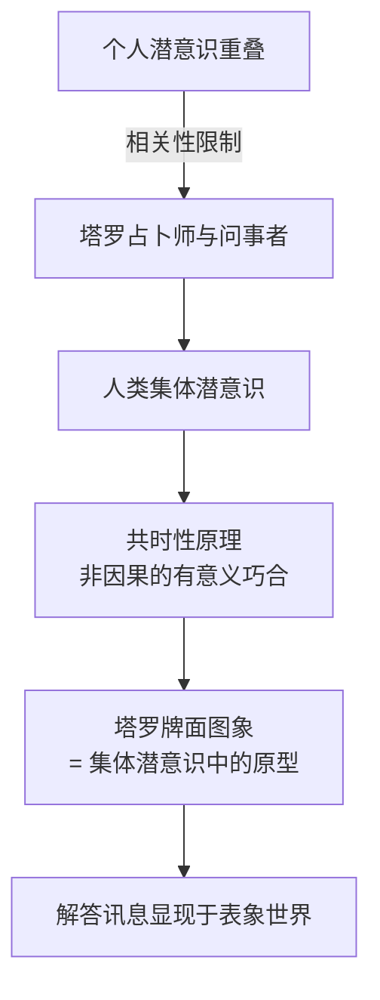

## 概述

《图解第一次塔罗占卜就上手》书中明确指出：**荣格（C.G. Jung）的心理学理论，是普受欧美塔罗专家认同的塔罗牌运作原理**。该理论不仅能合理解释塔罗占卜的精准度，更能免除学习者许多无谓的心理困扰。本页面系统梳理该书第1篇第4节「塔罗牌 VS. 荣格心理学」及其配套心理层面对应解析，建立塔罗占卜的心理学理论基石。

## 核心理论框架

### 塔罗占卜的荣格式运作模型

> **书中原话**：「塔罗占卜师与问事者的心灵都在人类的『集体潜意识』之中，而占卜过程中的抽牌因为『共时性原理』而与占问之事产生关联，至於塔罗牌面上的图象，就是集体潜意识当中的『原型』。所以，占卜师所需要的解答讯息，也就会从集体潜意识中透过塔罗牌图象等『原型』，显现在我们的表象世界中。」

---

## 三大核心支柱

### 集体潜意识 —— 讯息源头

| 概念 | 说明 |
|------|------|
| **定义** | 荣格承袭佛洛依德潜意识理论并扩大分析为「个人潜意识」与「集体潜意识」。集体潜意识指「人类有共通的心理机能，能透过遗传方式承接太古时期的潜意识」。 |
| **本质** | 属于全人类共享的心理层，非个人独有；是一种「整体」，联结所有人类心灵。 |
| **在塔罗中的角色** | **我们透过塔罗牌获取解答的源头**。占卜师与问事者的心灵皆浸润其中，抽牌动作即从此整体场域中调取信息。 |
| **初学者关键认知** | 「人类的心灵都是共通的，是一个整体，这个联结所涵括的所有人类心灵的东西，都可以称为『集体潜意识』。」 |

> **交叉引用**：[[78度的智慧塔罗体系]] 中亦以「愚者之旅」对应意识/潜意识/超意识三层面，呼应集体潜意识作为大阿尔卡那原型载体的定位。

### 原型 —— 牌面图象的心理本质

| 维度 | 说明 |
|------|------|
| **定义** | 「理解的典型方式」，普遍、集体而原始的思考形式，全人类共有。 |
| **结构地位** | 集体潜意识的**结构性元素**；与集体潜意识不可分割。 |
| **显现形式** | 当原型显现于世界上，即为「象徵」。例如：河流象徵感情、月亮象徵多变不安、棍杖象徵能量精力。 |
| **塔罗牌面** | 每张牌（尤大阿尔卡那）承载特定原型图象，如愚者=永恒流浪者/酒神狄奥尼索斯、女祭司=隐秘智慧/月亮直觉、死神=蜕变重生等。 |
| **解读启示** | 忠实解读牌义即是在接续原型语言，无需胡思乱想「牌灵」或超自然实体。 |

> **关联页面**：[[咨商塔罗]] 采用「中性解读」与「金三角对话模型」，实质即是将原型图象作为投射界面，引导提问者自行接续集体潜意识讯息。

### 共时性原理 —— 非因果的关联机制

| 项目 | 说明 |
|------|------|
| **来源** | 荣格受《易经》启发后推论提出，又译「同时性原理」。 |
| **核心机制** | 以**非因果关系**把巧合事件连系起来；宇宙中充满有意义的巧合，看似偶然实则暗藏微妙关联。 |
| **经典例证** | 小明指考放榜日经过婚宴听到恭喜声 → 随后接获录取通知。「听到恭喜声」与「接到好消息」无因果链，却具同步意义。 |
| **塔罗应用** | 抽牌瞬间（随机事件）与占问之事（心理关切）之间，由共时性原理建立「有意义的巧合」，使牌面精准回应提问。 |
| **哲学意涵** | 打破「因果决定论」的封闭系统，为占卜提供科学性解释框架。 |

> **跨域映照**：[[zhanxing-zhe-xue-ji-chu-bohm-hun-dun-jung]] 中将荣格共时性原理与大卫·波姆「隐显秩序」、量子力学「观察者效应」并列为占星学三大哲学支柱之一。

---

## 关键限制机制：个人潜意识重叠

### 为什么不能随意代占他人？

| 机制 | 说明 |
|------|------|
| **相关性限制** | 一般人心性修为未达可从集体潜意识任意擷取讯息境界，占卜必须「锁定与个人相关的事物」。 |
| **重叠条件** | 占卜师与问事者的**个人潜意识需重叠**，才能互相擷取讯息。无论面对面或远程沟通，此重叠为前提。 |
| **代占规则** | 除非代占者与当事人**关系亲近且互动频繁**（如母女、挚友），否则原则上不可代占。同事代占同事即屬不当。 |

> **实务启示**：此机制解释为何塔罗不适合预测国家大事、球赛胜负或窥探陌生人隐私——缺乏个人潜意识重叠基础。[[塔罗占卜与自由意志]] 亦从「偶然性占卜」视角论证提问者必须真实投入关切。

---

## 荣格简介与跨文化视野

| 项 | 内容 |
|----|------|
| **生平** | 1875年生于瑞士，分析心理学创始人。 |
| **核心贡献** | 集体潜意识、原型、共时性原理、个体化历程、阴影/阿尼玛/阿尼姆斯等。 |
| **跨文化融合** | 晚年受《易经》启发提出共时性原理，可说是融合东西方文化的智者。 |
| **对塔罗的影响** | 使塔罗从「神秘神授」转向「心理投射/原型激活」的可验证框架，奠定现代心理塔罗/咨商塔罗基础。 |

---

## 理论整合与实务启示

### 解牌心法：忠实呈现原型语言
- 无需臆造「牌灵」、「灵体附身」等民间传说。
- 牌面图象 = 集体潜意识原型的视觉化编码。
- 解读 = 协助提问者将原型语言翻译为当下生命情境的对应意义。

### 占卜伦理：尊重个人潜意识边界
- 拒绝无关联性代占、窥探隐私、预测大众事件。
- 确认提问者真实投入度（共时性需要真实关切作为「锚点」）。

### 学习路径：双轨并行
| 轨道 | 方法 | 对应荣格概念 |
|------|------|--------------|
| **观牌学习法** | 直觉凝视牌面，记录个人联想与感受 | 激活个人原型共鸣，建立个人潜意识与集体原型的连结 |
| **客观学习法** | 研读神话、象征、神秘学、主流牌义 | 学习集体潜意识的「公共词典」，避免主观偏离 |

> **书中建议**：「本書將引導大家採用『觀牌學習法』與『客觀學習法』雙軌進行。觀牌學習的部分，請大家在閱讀本書牌義（主流詮釋）之前勤加練習，以達到最佳的效果。」

### 进阶整合：塔罗作为个体化工具
- 大阿尔卡那22张 = 个体化历程的原型地图（愚者→世界）。
- 小阿尔卡那四元素 = 意识四功能（感觉/思考/情感/直觉）的日常运作场域。
- 长期记录塔罗日记（如书中「塔罗日记」流程）= 追踪个人潜意识与集体原型的互动轨迹，促进个体化。

---

## 相关知识页面交叉引用

| 页面 | 关联点 |
|------|--------|
| [[78度的智慧塔罗体系]] | 大阿尔卡那三组七结构对应意识/潜意识/超意识；荣格原型视角解读愚者之旅 |
| [[咨商塔罗]] | 中性解读、金三角对话、直觉训练——将荣格理论转化为咨商实务框架 |
| [[塔罗占卜与自由意志]] | 偶然性占卜观、共时性与自由意志的张力、提问而非预测 |
| [[zhanxing-zhe-xue-ji-chu-bohm-hun-dun-jung]] | 荣格共时性原理作为占星/塔罗哲学基石之一，与波姆全息宇宙、量子观察者效应并列 |
| [[nei-xing-xing]] | 荣格心理学作为心理占星核心基石，内行星（水金火）对应心理功能，与塔罗原型互补 |
| [[sasportas-gods-of-change]] | 外行星行运作为个体化危机/转化触发器，呼应塔罗塔牌/死神/審判等大阿尔卡那原型 |
| [[tarot-major-arcana-consulting-0-6]] | 大阿尔卡那0-6号牌的生命课题与咨商引导，实操荣格原型心理疗愈 |

---

## 关键术语对照表

| 中文 | 英文 | 备注 |
|------|------|------|
| 集体潜意识 | Collective Unconscious | 荣格核心概念，区别于个人潜意识 |
| 原型 | Archetype | 集体潜意识的结构性元素，显现为象征 |
| 共时性原理 | Synchronicity Principle | 非因果的有意义巧合，受《易经》启发 |
| 个人潜意识 | Personal Unconscious | 个体经验被压抑/遗忘内容的储存库 |
| 个体化 | Individuation | 整合意识与无意识、实现自我完整的终身历程 |
| 阴影 | Shadow | 被压抑的人格暗面，塔罗恶魔/塔/月亮常投射此原型 |
| 阿尼玛/阿尼姆斯 | Anima/Animus | 内在异性人格原型，塔罗女祭司/恋人/皇后/皇帝等呈现 |

---

## 结语

荣格心理学为塔罗占卜提供了**可被心理学与哲学双重验证的理论地基**：
1. **本体论**：塔罗牌图象 = 集体潜意识原型的视觉编码；
2. **认识论**：共时性原理 = 抽牌与提问之间非因果的有意义关联机制；
3. **方法论**：个人潜意识重叠 = 占卜有效性的边界条件（相关性限制）；
4. **实践论**：忠实解读原型语言 + 尊重伦理边界 = 塔罗咨商的专业标准。

这一框架使塔罗从「迷信占卜」升格为**「原型激活与心理整合的投射工具」**，成为现代心理塔罗、咨商塔罗、灵性成长塔罗的共同理论基石。

## 来源

- [图解第一次塔罗占卜就上手](../sources/图解第一次塔罗占卜就上手.md)
