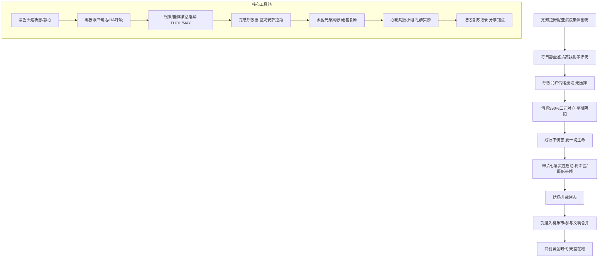

## 概述

**桃乐市**（Telos）是位于美国加州**雪士达山**（Mount Shasta）地下的第五次元光之城市，为古**拉姆妮亚**（Lemuria/列穆里亚）大陆沉没前幸存者所建立的地心文明核心都市。其**大祭司亚当马**（Adama）通过通灵者**奥瑞莉亚·卢意诗·琼斯**（Aurelia Louise Jones）传导教导，系统阐述了第五次元社会运作法则、扬升路径、政府治理、入境标准、婚姻与生育观、儿童教育等完整体系。该教导旨在协助地表人类治愈拉姆妮亚沉没的集体创伤，提升意识频率，为两大文明（地表与地心）的合并与地球整体扬升做准备。

> **核心定位**：桃乐市作为**亚格莎网络**（Agartha Network）百二十座地心光城中的统理城市，保存了拉姆妮亚文化、历史档案与扬升科技，并通过**银星舰队**（Silver Fleet）参与星际联邦事务。亚当马教导强调「爱是关键」，以「心引领而非心智」为修行基石，主张通过清理负面情绪、平衡阴阳、完成七层灵性启动达到扬升标准。

---

## 一、 文明溯源与历史脉络

### 拉姆妮亚起源与演进

- **灵魂来源**：约450万年前，在大天使米迦勒与蓝火天军护卫下，首批灵魂从**太尔宇宙姆星**投胎地球，在**皇山提顿**（Royal Teton，今怀俄明州黄石公园）经天使调适训练后，扩散定居拉姆妮亚大陆。
- **文明高峰**：拉姆妮亚大陆曾覆盖太平洋广域（含加州、俄勒冈、内华达、华盛顿、夏威夷、复活节岛、斐济、澳洲、纽西兰、印度洋马达加斯加），人口达数亿，文明处于第五次元频率，民众拥有长生不老肉体，掌握原子能、心电感应、水晶动力太空船等高等科技。
- **双大陆冲突**：约2.5万年前，拉姆妮亚与**亚特兰提斯**因「统治理念分歧」爆发核能战争，导致双方衰弱。拉姆妮亚主张「低文明自主演进」，亚特兰提斯主张「高文明托管低文明」。
- **沉没与幸存**：约1.2万年前，拉姆妮亚一夜沉没太平洋。祭司团吟唱《友谊万岁》（Auld Lang Syne）护佑亡者以太体，减轻创伤印记。仅2.5万人经雪士达山地下巨洞进入桃乐市避难，保存文化种子。

### 桃乐市建立与亚格莎网络

- **建城缘起**：获**香巴拉利社**（Shamballa-the-Lesser，亚格莎网络首席）批准，加入星际联邦，承诺放弃侵略、践行和平。城市名「Telos」意为「与神合一与相通」。
- **亚格莎网络成员**：含四座拉姆妮亚城市（桃乐市、波西德Posid、宋雪市SHONSHE、伦马市RAMA）、两座亚特兰提斯城市、多座希柏里尔城市（如新华市SHINGWA）。网络间以**电磁地心列车**（时速3000英里）联通，无货币贸易，共享盈余资源。
- **香巴拉城角色**：位于第五至七次元以太层，为地球以太总部，圣那库玛拉大师驻地。桃乐市近期接任网络统理职能。

### 关键时间节点与预言

| 事件 | 时间 | 说明 |
|------|------|------|
| 拉姆妮亚沉没 | 约1.2万年前 | 一夜沉没，祭司殉道护佑 |
| 桃乐市建立 | 沉没前 | 预留20万容量，实入2.5万 |
| 七大星际门户开启 | 2002年 | 造物者本体能量注入，至2012年后剧烈转化地球 |
| 文明合并窗口 | 2006-2007年后 | 视地表集体意识达标情况分批显现 |
| 大规模扬升 | 2012年前后 | 许多人提升至第五次元天堂世界 |

> **亚当马原话**：「我们不会出现在地球表面，直到大多数地球民众能以爱、慈悲、和平对待一切生命……这取决于你们自己完成修身课题。」

---

## 二、 第五次元城市生活实相

### 城市空间布局（五层结构）

| 层级 | 功能 | 关键设施 |
|------|------|----------|
| **第一层** | 行政、公共、神殿 | **马拉神庙**（白色金字塔，容万人，顶石「活石」为金星赠礼），默基瑟德祭司团驻地 |
| **第二层** | 生产、教育 | 工厂、儿童与成人学校、居住区 |
| **第三层** | **水耕植物园** | 7英亩地供养150万人，有机、高频、无化肥，水晶光能加速生长 |
| **第四层** | 农园、工厂、公园 | 天然湖泊、喷泉、部分生产设施 |
| **第五层** | **自然保护区** | 高大树林、湖泊、地表绝种动植物庇护所，狮羊同眠，全素食、无捕食 |

### 物质显化与日常运作

- **居住形式**：**圆形水晶石屋**，依神圣几何原理，以意念聚焦显化。外墙不透视、内视全透，隐私与通景兼得。建造仅需约半小时（地表时间）。
- **交通系统**：电动人行道、交错电梯、电磁雪橇式高速车厢、城际电磁管道列车（3000 mph）。
- **饮食习惯**：以太食物，依渴望显化，具形色味但非第三次元密度。水耕作物带高振动频率，食用为愉悦而非生存刚需。
- **外貌特征**：身高7-8呎，外貌锁定在20-40岁青春期，可随意念改变形象。无衰老、白发、疾病。
- **寿命与离世**：肉体长生，意愿决定离世时机，携肉身升入更高次元探险。

### 科技与灵性融合

- **氨基酸生物电脑**：接入**阿卡西记录**与**基督高层指令**，零误差提供历史真相与知识。
- **水晶能源**：「活石」等水晶为核心能源塔，城市被巨大紫色金字塔能量场包裹，塔顶通星际联邦。
- **隐身与跨维**：肉体可自主切换第三至第五次元振动，选择是否被看见。太空船隐形静音进出山腹太空港。
- **银星舰队**：桃乐市太空中心编队，含紫晶舰队、彩虹舰队，服务银河系，多数UFO目击源于此。

### 节庆与文化

- **四大季节节日**：冬至、春分、夏至、秋分，各三天，全网络城市同庆，人口倍增（星际亲族来访）。
- **日常即庆典**：每日以爱与感恩为底色，主动创造庆祝理由。
- **团圆预言**：两大文明合并将举行史无前例盛典，「圣诞节式的重聚」。

---

## 三、 政府架构与治理模式

### 双轨制政府

| 轨道 | 组成 | 职能 |
|------|------|------|
| **王室轨** | **日那君国王**（Ra）与**日那妮皇后**（Rana Mu），双生灵伴、扬升大师 | 最高统治者，象征神圣阳阴合一，拥有议会人选最终否决权 |
| **议会轨** | **拉姆妮亚光之议会**：12位长老（6男6女，平衡神圣阴阳）+ **亚当马**（大祭司，议长，平票决断权） | 区域治理、政策决议、人选审核 |

### 选拔与任免机制

- **议员资格**：修为层级、内在品质、成熟度、专精领域。
- **流程**：缺位公开招募 → 祭司团与王室联合审核 → 国王皇后最终拍板。
- **服务导向**：无权力斗争，会议议程聚焦「如何互助、互惠、助地表演进」。

### 经济与资源分配

- **无货币制**：按需分配，盈余共享网络城市。
- **劳动制**：周五天，日4-6小时，自由选择岗位（水耕、神殿舞者、通讯、交通、工厂等），避免单调，激发热忱。
- **基本保障**：政府供给新父母两年全薪假、全民住房、医疗、教育。

---

## 四、 扬升准则与入境标准（核心修行地图）

### 三大核心入境准则（亚当马原文）

1. **意识修至第五次元觉醒边缘**
   - 对自己与一切生命（含动植物矿物王国）持无尽之爱。
   - **释放≥90%二元对立意识**，阴阳平衡渗透生活每层面，践行「不伤害」。
   - *功课*：深入内心探究真实意义，发现「神圣大我」。

2. **彻底清理历世负面情绪与思想**
   - 痛、怒、悲、愧、伤、耻、绝、低自我评价、负面印记、狠毒个性……
   - 从**潜意识、太阳神经叢、情绪体**接纳释放。
   - *机制*：桃乐市高频环境会将低频情绪放大千倍，未清理者无法停留数分钟。

3. **完成七层灵性启动仪式，达扬升就绪态**
   - 可从内在层次连接**基督意识**，在**梅翠亚大师**与**主耶稣**带领下申请启动。
   - 启动非终点，而是入城门槛。昔需数千年，今10-20年可完成（新恩赐加速）。

### 集体达标指标

- **爱与光商数测量**：氨基酸电脑日监地表振动频率。
- **当前约65%**（书写时），**需达90%左右**方启动大规模显现。
- **其他要素**：高频爱心觉醒比例、愿活于神圣意识者占比。

### 显现分阶段计划

1. **隐秘小团体接触**：频率共鸣者获邀山中/以太会面，直接传授爱光能量与教导。
2. **种子传播**：小组散布各地，传递知识给就绪者。
3. **网络扩大**：就绪者增多，圈层扩展，更多桃乐市民显现协助。
4. **全面合并**：足够团体达成契约，逐步完全显现于地表。

> **关键原则**：「伟大合并第二波浪潮，不发生在第三次元频率中。」地表民众须提升至接近第五次元（至少走完2/3路程）方能肉眼相见。

---

## 五、 第二册核心进阶教导

### 为地球打造一个新梦想 —— 共同创造的神圣责任

> **核心讯息**：「人无愿景，终将腐朽。」地表人类必须主动在心灵深处觉知地创造新世界愿景，不能只等待光界或桃乐市代劳。

- **圣哲曼与紫色火焰**：上世纪初圣哲曼大师向星际联盟请求将「自由火焰」（紫色转化火焰）重释地表，以此为担保交出成就能量与头冠宝珠。自由是紫火核心特质，若无此火人类无法自由选择进化。
- **实操指引**：
  - 每日静心/书写时界定「人间天堂」细节：生活方式、政府、身体、容貌、交易方式（超越金钱）、人际关系、气候、动物沟通。
  - 想象力为创造火花，连结创造领域。细节越丰富、投入能量越多、与之合一越深，显化越快。
  - 梦想本质为第五次元实相；第四次元虽较三次元轻松流畅，仍非人间天堂。
  - **关键行动**：从自认为第五次元应有的样子开始梦想，即使不完全清晰，意识会随之打开。

> **西乐丝提亚**：「这个世界把它自己奉献给你们，你们也以神圣的爱来接受这个赠与。你们的想象力会引导你们找到灵魂里的某个部分，它会认出这个爱，允许它遍布你的整个存有。」

### 地球的最后战役与希望的烛光 —— 从恐惧转向信任

- **冲突本质**：一小群自认为「拥有星球」者，为维持控制制造冲突、掠夺90%财富，其行为源于恐惧与分离而非合一之心。
- **神圣介入时机**：造物者已收回地球管辖权，中央大日命令已签发终结其统治。黑暗势力知大势已去，仍做「最后一搏」。
- **希望的烛光**：在心中点燃知晓的烛光，而非陷入恐惧沮丧。和平必将来临，因数百万民众已聚集意愿。
- **加速效应**：冲突将唤醒数百万神性觉察，壮大光之工作者行列，清除过时阶级结构。
- **实操建议**：
  - 做真实见证者，允许悲痛沮丧流动以打开心扉。
  - 成为恐惧者的和平栋梁，同时依靠桃乐市/光界支持。
  - 释放陈旧三次元扭曲能量，带着爱喜悦走向新能量。

### 法国、魁北克、巴西三角能量网格 —— 拉姆妮亚之心的地表锚点

- **三角识别标志**：三地各携带特殊振动、颜色、音调与编码，合成新振动作为地球内部平衡网格的识别标志，助网格间和谐与灾难转向。
- **法国**：发光粉红（巴黎最暖），携带拉姆妮亚之心纯净振动。大量光之工作者投生此地，含犹太民族（神圣阳性能量守护者，经母亲传承保持DNA纯正）疗愈二战创伤。
- **魁北克**：桃子色外缘、翠绿中心（蒙特利尔），为北极能量传输前哨。法语维持与法国心振连结，聚集疗愈者教师群体，平衡美国/德国/阿根廷扭曲的阳性主导政府能量。
- **巴西**：黄/红/蓝多彩水晶本质，连接南极，为北半球心疗愈能量向南半球传输的引擎。
- **新世代儿童**：DNA携带通往此网格钥匙，正建构更高进化潜能的未来。需虔敬看待其灵魂伟大面向，勿强迫适应旧体制。

### 磁性网格、水晶网格与人类意识网格 —— 亚当马的网格管理者角色

- **磁性网格**：已转变；**水晶网格**：已重生；**人类意识网格**：待诞生（关键下一步）。
- **亚当马角色**：网格管理者/建构者/能量置入释放管理者。从地球内部支撑将4/5维高能量振动供应网格，经雪士达山（中央大日具体化身）为首要入口点分布全球山顶节点。
- **合作网络**：克里昂管磁性，亚当马管水晶，实为多维层层合并的单一巨大网格。参与者含Elohim、大角星、昴宿星、仙女座、金星等星际种族。
- **DNA基质蜕变**：网格加速个体DNA蜕变，每人保有独特频谱振动，群体和谐后触发地球整体蜕变。
- **灵魂之音**：蜕变伴随以太界「灵魂之声」（三弦琴共振频），激活个体独特之歌（身份振动签名）。

### 娱乐性毒品药物对灵性成长的毁灭性影响 —— 必读警示

> **核心结论**：现代毒品（大麻、仙人掌等）皆为黑巫师基因改造原始神圣植物（原为提升意识、连接天使/自然精灵、跨维旅行）所得低振动变异体，将使用者拖入**低层星光界**而非光界。

- **上瘾机制**：星光界实体（烟状蛇形，长6-20呎）缠绕使用者情绪体/太阳神经丛，以「渴望」为食，制造上瘾循环。实体群体意识阻碍整个世代进化。
- **四体损害**：
  - **情绪体**：成长停滞（如43岁成熟度仅16岁），导致操控/背叛/犯罪取毒资。
  - **心智体**：人格健全度受损，生活目的扭曲为买毒竞赛，基因缺陷可传2-3代。
  - **身体**：降低整体振动，长期滥用者来世失去健康身体权利（业力即时回溯）。
  - **以太体**：撕裂保护层，需3-5世甚至更久修复，带损伤投胎致先天健康问题。
- **气场扭曲**：显现愤怒红、邪恶绿、黑褐斑点，实体缠绕心轮与太阳神经丛阻塞。
- **DNA扬升阻断**：细胞蜕变需爱波动与提升努力，滋养负面实体者无法提高频率，DNA启动受抑。
- **非法化悖论**：制造恐惧吸引力，喂养恐惧实体，助长欺瞒双面人生，违背扬升所需「全然了知与敞开」。
- **医疗用途例外**：短期止痛（如术后两周）用大麻可接受，不造成长期损害。
- **疗愈路径**：
  - 坚定意志戒断 + 每日祈求灵魂疗愈光连结永恒自我/I AM。
  - 回归自然饮食 + 积极静心 + **七大神圣疗愈火焰**（含紫色火焰）。
  - 神圣恩典协助诚心承诺者，天使驻身旁辅助。
- **桃乐市保存原始植物**：仅作装饰/优雅，不吸食，因自身意识远超植物助益。未来或考虑指导特定人士「正确使用」。

### 紫色火焰 —— 自由与转变之光（圣哲曼赐予）

- **本质**：第七道光射，转化力最强，能转化负面业力、情绪、思想、物质密度，赋予自由选择进化之权。
- **运作法则**：需以「神圣爱之火」为燃料，配合**圣哲曼赐予的祈愿/祈请词**，结合想象力（见紫火穿透全身/环境/地球）每日实修。
- **两大核心祈请**（含「我是」圣名声明）：
  1. **对紫色火焰的祈愿**：召唤圣哲曼、慈爱大师、紫色火焰天使军团，以紫火贯穿四体、脉轮、细胞、DNA、原子核，转化一切非光能量，锚定自由与神圣计划。
  2. **另一祈请**：聚焦将紫火扩展至地球磁性网格、水晶网格、人类意识网格，助集体扬升。
- **静心之旅**：前往桃乐市**紫色火焰神殿**（紫晶洞穴，中央紫火喷泉），在守护天使与紫火天使陪同下，体验紫火穿透每层身体、烧尽业力记录、重塑神圣蓝图。

> **关联**：[[saint-germain-violet-flame]]（待建立）、[[abraham-hicks-law-of-attraction]]（自由选择）、[[activating-mystical-healing-power]]（AME唱诵与火焰观想）、[[you-can-channel]]（第三眼/顶轮开启与神圣火焰）。

### 死亡：灵魂的过渡 —— 无惧离世的完整指南

- **本质**：死亡非终结，而是灵魂从物理载具撤离，经**银绳**断裂，进入以太/星光界继续旅程。
- **过渡三阶段**：
  1. **生命回顾**：在光之存有陪伴下，无评判回顾此生所有思想言行对他者影响，提取智慧。
  2. **疗愈整合**：于疗愈神殿（桃乐市有以太投射疗愈神殿）修复情绪体/心智体创伤，整合碎片化灵魂部分。
  3. **下一步规划**：与指导灵/高我共同设计下一世蓝图（父母、地点、核心课题、业力合约）。
- **关键差异**：
  - **觉知者**：死前练习「有意识离体」（如[[you-can-channel]]星光体出游、[[activating-mystical-healing-power]]昆达里尼上升），死时保持清醒，直接进入高层以太界/光界。
  - **未觉者**：常卡在星光界低层（情绪执着、恐惧、成瘾实体缠绕），需指导灵协助脱离。
- **失去亲人的疗愈**：
  - 理解灵魂不灭，透过心轮连结（非情绪体哀伤）可感知对方安好。
  - 请求大天使/指导灵协助亡者顺利过渡，避免滞留。
  - 将悲伤转化为「爱与光的祝福」送予对方，助其上行。

> **关联**：[[brian-weiss-many-lives-many-masters]]（前世回溯见死后）、[[convoluted-universe-2-apostles-sleep-work]]（志愿者协助亡灵过渡）、[[zero-limits-hooponopono-system]]（清理哀伤记忆）、[[ren-shen-shu]]（晋神术跨接助过渡）。

### 橡木兄弟会与玫瑰姐妹会 —— 古老守护秩序的现代复苏

- **起源**：拉姆妮亚时代建立，守护**神圣几何、水晶科技、星际法则、扬升启动仪式**等核心奥秘。
- **橡木兄弟会**（Brotherhood of the Oak）：阳性守护者，专司**结构、秩序、能量网格建设、星舰防卫、行星物理稳定**。象征：橡树（深根固本、枝繁叶茂）。
- **玫瑰姐妹会**（Sisterhood of the Rose）：阴性守护者，专司**爱慧传递、心轮网格激活、疗愈圣火维护、生命孕育仪式、星际外交**。象征：玫瑰（绽放芳香、刺护内核）。
- **现代使命**：
  - 地表分会已隐蔽运作数千年（玫瑰十字会、共济会高层、部分神秘学院皆为分支）。
  - 当前全面激活，招募地表觉醒者加入「光之网格锚定小组」，于关键节点（雪士达、沙斯塔、金字塔、巨石阵等）进行**水晶植入、紫火锚定、心轮合频**群修。
  - 提供**七阶启动加速通道**予通过考核成员。

### 我们是水晶存在体 —— 硅基光身的觉醒蓝图

- **本质揭示**：人类原始蓝图为**硅基水晶光身**（非碳基蛋白质身），具备全息记忆、零衰老、意念显化、跨维穿梭能力。
- **堕落过程**：拉姆妮亚/亚特兰提斯战争辐射导致DNA双螺旋从12股退化为2股，水晶结构被碳键锁定，陷入密度与衰老。
- **复原路径**：
  1. **水晶冥想**：每日想象身体每细胞转化为透明发光水晶，呼吸吸入液态光充满微管。
  2. **饮水编程**：饮用经「爱/感恩/特定意图」编程的结构化水（[[emoto-water-crystals]]），重构细胞水晶格。
  3. **声音激活**：吟唱特定音调（如《光的课程》[[guang-de-ke-cheng-xi-lie-1]]单子音、[[soham-healing-system]]光语、[[yvonne-de-bruijn-shengming-zhisheng]]高频泛音），共振DNA水晶骨架。
  4. **紫火烧除碳键**：配合[[saint-germain-violet-flame]]溶解碳基密度锁。
- **桃乐市实况**：市民已全面恢复水晶光身，可随意切换物理/以太显化。

### 巴士德的讯息 —— 微生物学之父的跨维忏悔与指导

- **身份**：路易·巴士德（Louis Pasteur），19世纪微生物学奠基人，死后于以太界深刻反省「细菌论」片面性（忽略地形/频率/意识决定健康）。
- **核心教导**：
  - **疾病非外来入侵**，而是**内在频率失谐**吸引同频微生物显化症状。
  - **疫苗/抗生素**虽暂时救命，长期削弱自然免疫智慧，制造超级菌与慢性病爆发。
  - **真正免疫力**源于：高振动饮食（生食/结构化水）、情绪平衡（爱/喜悦频率）、松果体激活（分泌神圣分泌素）、连接高我指引。
  - **呼吁医学界**：转向「频率医学/意识医学」，研发**光/声/标量波**疗愈技术，停止毒化地球与人体。
- **桃乐市医疗实证**：零疫苗、零药物，仅用水晶光舱、频率发生器、意念疗愈，维持零疾病状态。

### 桃乐市的儿童 —— 从胎教到星际服役的完整培育体系（补充细节）

#### 来自卢瑞尔（Luriel，儿童教育主管）的讯息
- **胎教始于受孕前**：父母双方完成**七层启动**、清理≥90%业力，以高频精子卵子受孕。受孕即邀请高等灵魂入驻，行「光之迎接仪式」。
- **孕期**：母亲住**水晶光舱**中，聆听「索拉雅马如语」教学音频，胎儿同步接收银河标准课程。父母每日共修「心轮合频」，建立胎儿安全感根基。
- **分娩**：于**马拉神庙**水池中，由默基瑟德祭司接生，全程无痛、无创伤、婴儿即刻睁眼清醒，无「出生创伤」植入。

#### 来自安结利亚（Angelina，青少年导师）的讯息
- **0-3岁**：父母全职陪伴（政府发全薪），重点建立「宇宙丰盛恒久不缺」潜意识蓝图。教父母制（10对）轮流共居，植入「天父天母无所不在」群体母爱场。
- **3-12岁**：游戏化学习（色彩/几何/心电感应/水晶编程/星际语言）。**无考试/分数/竞争**，按「兴趣共振分组」探索天赋。
- **12-18岁（青春期关键期）**：
  - 编入**10-20人混合性别小组**，由默基瑟德祭司护卫指导。
  - 核心课程：**情绪能量炼金术**（将性能量上引激活松果/垂体）、**星际外交模拟**、**行星守护实战**（远程遥视/能量修复地表生态点）。
  - 目标：化解「反抗力」为「创造力」，建立「服务即快乐」神经回路。

#### 来自桃乐市孩子们的自述
- 「我们不学『生存技能』，只学『创造天堂技能』。」
- 「恐惧是陌生词汇，我们从小练习『即刻显化』——想要水果，水晶树瞬间结果。」
- 「18岁成年礼：最少6个月**银星舰队**服役（三大舰队：银星/紫晶/彩虹），随后自由选择深造/就业/地表特派任务。」

### 蓝龙安萨拉斯 —— 地球能量守护者的远古契约

- **身份**：来自**天龙座**的高等龙族大长老，于拉姆妮亚建立初期应邀驻守地球**磁性网格核心节点**（雪士达山地下深处水晶洞）。
- **形态**：全身蓝色发光鳞甲，眼若恒星，长约300米，可缩微至人型。呼吸吐纳**原初生命气**（Prana），调节地脉脉动。
- **使命**：
  - 维持地球磁场与水晶网格共振稳定，缓冲太阳耀斑/宇宙射线冲击。
  - 守护**地球脉轮系统**（7大脉轮+122小穴位），配合[[middle-pillar-seven-chakras]]人体脉轮宏观对应。
  - 于关键转折点（如2012、2024、2030）释放「龙息光码」激活沉睡DNA。
- **与人类互动**：
  - 仅向「心轮完全开放、无恐惧意图」者显现（以太视/梦境/投影）。
  - 传授**「龙息呼吸法」**：吸气引蓝龙光入松果体，呼气布满全身水晶骨架，快速提升光商数。
  - 承诺：当地表建立首个「人龙共修圣地」时，将物理显现协助生态修复。

### 脑下垂体与松果体 —— 扬升生理开关的精密操作手册

> **核心定位**：松果体（顶轮/第七脉轮物理锚点）为**灵魂接收器**；脑下垂体（眉心/第六脉轮物理锚点）为**指令发射器**。二者合称「大脑神圣双子星」。

#### 松果体（上腺/顶轮）
- **功能**：接收高维光码/星际指令/高我下载 → 转化为生化信号（褪黑素升级版「神圣分泌素」/DMT类物质）分布全身，激活休眠DNA。
- **钙化成因**：氟化物/重金属/加工食品/恐惧低频/电磁雾。
- **去钙化/激活三部曲**：
  1. **物理排毒**：螺旋藻/小球藻/沸石/硼砂微量/结构化水/生酮/间歇性断食 → 清除钙化沉积。
  2. **能量充电**：
     - **THOH唱诵** ([[you-can-channel]])：舌抵上颚发「吖」音共振松果骨腔，每日21次×3轮。
     - **日出凝视** ([[sungazing-hrm]])：UV指数<1时裸眼凝视太阳10秒起步，逐日+10秒至44分，引太阳码直入视神经→松果。
     - **紫火烧除** ([[saint-germain-violet-flame]])：想象紫火穿透松果晶体结构，烧尽密度锁。
  3. **意识编程**：睡前/醒来「我是神圣松果体，我完美接收并转译源头之光」肯定语×108遍。

#### 脑下垂体（下腺/眉心轮）
- **功能**：将松果接收之高维指令，转译为**七大内分泌腺协同指令**（甲状腺/胸腺/胰腺/性腺/肾上腺/松果/下丘脑），重组身体为光身蓝图。
- **激活关键**：**MAY唱诵** ([[you-can-channel]])：舌卷后发「咩」音共振蝶鞍腔，配合意念引光经视交叉→脑下垂体前叶/后叶全面点亮。
- **协同练习**：「松果接收—脑下垂体发射—心轮放大—全身分布」微观大周天（[[activating-mystical-healing-power]]神经经络/能量经络双轨模型）。

> **临床验证**：桃乐市市民松果/垂体体积为地表常人**5-8倍**，呈水晶透明状，分泌「青春激素/再生激素/快乐激素」维持长生不老。

### 社群精神 —— 第五次元社会运作的核心操作系统

- **定义**：「社群」非地理聚居，而是**共振频率场域**。桃乐市社群建立于三大支柱：
  1. **透明零隐私**：氨基酸电脑/心电感应使一切思想/情绪/意图全员可见。无欺瞒可能，信任成本归零。
  2. **需求即供给**：无货币，以「意愿贡献技能/时间」匹配「他者需求」。AI辅助实时平衡全城资源流（水/电/食/住/教/医/艺）。
  3. **冲突即礼物**：分歧视为「未整合频率显化」，双方进「和解神殿」由默基瑟德祭司引导**心轮合频对话**，将冲突能量炼金为新创意方案。
- **治理体现**：
  - **议会决策**：非投票表决，而是「共识共振」——全体长老进入冥想，连接高我/基督意识，下载「最优解」共同确认。
  - **纠错机制**：若决策偏离爱/最高善，网格能场即时反馈（物理环境微扰/市民梦境预警），自动触发复议。
- **地表移植建议**：
  - 组建**12-144人「心轮共振小组」**，每周固定时间同步冥想+非暴力沟通练习。
  - 建立「技能/物资/时间」互换平台，逐步减少金钱依赖。
  - 推广「冲突转化圆桌」进社区/学校/企业。

### 拉姆妮亚特使：唤醒古老记忆 —— 记忆复苏的多维钥匙

- **特使身份**：桃乐市派驻地表的**志愿者灵魂**（含奥瑞莉亚、莎如拉等），携带「拉姆妮亚记忆激活码」投生。
- **激活机制**：
  - **触发点**：见雪士达山/水晶/特定几何/听索拉雅马如语/经历濒死/深度冥想/植物药旅程。
  - **过程**：细胞水晶格共振 → 松果/垂体解码 → 记忆碎片以梦境/闪回/自动书写/说外星语形式涌现。
  - **整合**：需通过「零极限清理」([[zero-limits-hooponopono-system]])释放随记忆浮现的创伤/愧疚/誓约，仅保留智慧/技能/爱频。
- **群体效应**：每唤醒一人，地球磁性网格「拉姆妮亚频率节点」亮度提升1%。预计**14.4万关键节点**（√总人口）全亮，触发集体记忆「百猴效应」。
- **行动呼吁**：
  - 主动参与「记忆复苏工作坊」（奥瑞莉亚生前举办，今由继任者延续）。
  - 书写/录音/绘画记忆碎片，上传「拉姆妮亚记忆库」（以太网络/物理服务器备份）。
  - 成为地表「记忆锚点」，日常生活中散播拉姆妮亚频率（微笑/祝福/创造美/分享教导）。

---

## 六、 婚姻观与双生灵伴教导

### 结婚殿堂与不朽爱焰

- **起源**：拉姆妮亚时代，长老**阿南马**（Ahnahmar）与其双生灵伴建立「结婚殿堂」，供双生灵伴举行神圣结合大典。
- **现状**：殿堂位于雪士达山地下以太光水晶城（直径25-40英里），振动已升至第五次元。拉姆妮亚沉没时爱焰熄灭于地表，但殿堂内保持并提升至第四、五次元持续燃烧。
- **2001年秋奥瑞莉亚主持婚礼**：首次在物理次元物理地点举行双生灵伴婚礼，引爆光界百万灵体庆贺，爱焰重活化入物理八度音阶。

### 核心婚恋哲学

| 误区 | 真相 |
|------|------|
| 在外部寻找伴侣 | **伴侣是你的一部分**，在内在先建立协同关系 |
| 个性与灵性需外在匹配 | **唯内在同频共振**，外在自动投射镜像 |
| 婚姻基于二元阴阳结合 | **须以神圣之爱合一为基础**，否则永无法满足深层渴望 |
| 等待伴侣出现 | **先爱自己每一面向**，神圣爱成指挥中心，伴侣自显现 |

> **阿南马金句**：「你所寻找的关系，不过就是你自己跟你神性自我关系的映照。当你学习去爱你本质的每一面向……你将不再到处寻找。」

### 双生灵伴机制

- **定义**：灵魂降入第三次元时分化为阳性（男性）与阴性（女性）两个灵体，称「双生灵伴」。
- **团聚条件**：双方内在均已修炼至同等神圣爱程度，「什么都不能阻挡，甚至双生灵伴也无能禁止」。
- **等待即准备**：若未显现，因内在未就绪或灵魂选定等待时点，「任何等待时间都无所谓，因为你的内心已经跟你所爱的合并了」。

---

## 七、 关键概念交叉引用网络

| 概念 | 本页定位 | 相关知识页面 |
|------|----------|--------------|
| **拉姆妮亚/列穆里亚** | 文明源头、集体创伤根源 | [[lemuria-civilization-history]]、[[convoluted-universe-book-1]]、[[three-waves-volunteers-new-earth]] |
| **第五次元生活** | 核心展示范本 | [[five-dimensional-ascension]]、[[from-heart-awakening]]、[[sanaya-roman-orin-path-of-joy]] |
| **扬升/Ascension** | 个人与集体目标 | [[abraham-hicks-law-of-attraction]]、[[sanaya-roman-orin-teachings]]、[[zero-limits-hooponopono-system]] |
| **阿卡西记录** | 电脑网络数据源、生命蓝图库 | [[阿卡西纪录体系与宇宙阿卡西祈祷文]]、[[a-ka-xi-ji-lu-ti-xi-yu-yu-zhou-a-ka-xi-qi-dao-wen]]、[[da-kai-yu-guan-bi-a-ka-xi-ji-lu-zhi-nan]] |
| **默基瑟德/梅尔卡巴** | 祭司团传承、神圣几何建筑基础 | [[drunvalo-melchizedek]]、[[middle-pillar-seven-chakras]]、[[guang-de-ke-cheng-xi-lie-1]] |
| **双生灵伴** | 婚姻殿堂核心、灵魂分化机制 | [[hun-shen-xing-jin-shen-xing-ai-shen-xing]]、[[tian-xie-zuo-yuan-xing-neng-liang-ceng-ci]] |
| **亚格莎网络/地心文明** | 城市联盟、香巴拉关系 | [[agartha-network-cities]]、[[earth-et-history-cosmology]] |
| **银星舰队/UFO** | 太空操作、星际联邦成员 | [[atlantis-crystal-energy-technology]]、[[convoluted-universe-book-1]] |
| **七层灵性启动** | 入城硬性门槛、扬升阶梯 | [[guang-de-ke-cheng-xi-lie-1]] 至 [[guang-de-ke-cheng-xi-lie-5]]、[[you-can-channel]] |
| **水晶科技/显化** | 建筑、能源、电脑、食物生产 | [[仪式与水晶]]、[[atlantis-crystal-energy-technology]]、[[neng-liang-shi-liao-yu-xi-tong]] |
| **紫色火焰/圣哲曼** | 转化核心工具、自由赐予者 | [[saint-germain-violet-flame]]、[[activating-mystical-healing-power]]、[[abraham-hicks-law-of-attraction]] |
| **死亡/灵魂过渡** | 生命周期认知、无惧离世 | [[brian-weiss-many-lives-many-masters]]、[[convoluted-universe-2-apostles-sleep-work]]、[[ren-shen-shu]] |
| **橡木/玫瑰会** | 古老守护秩序现代复苏 | [[rosicrucian-order]]、[[golden-dawn]]、[[ceremonial-magic]] |
| **水晶存在体/硅基光身** | 人类原始蓝图复原 | [[atlantis-crystal-energy-technology]]、[[you-can-channel]]、[[soham-healing-system]] |
| **巴士德/频率医学** | 疾病观范式转换 | [[yi-liao-ling-mei]]、[[zai-lian-jie-liao-yu-fa]]、[[soham-healing-system]] |
| **儿童教育/星际服役** | 新世代培育范本 | [[twelve-zodiac-parenting-communication]]、[[han-lianglu-astrology-mom-handbook]]、[[convoluted-universe-2-apostles-sleep-work]] |
| **蓝龙安萨拉斯** | 地球能量守护远古契约 | [[dragon-energy-lines]]、[[ley-lines-earth-grid]]、[[middle-pillar-seven-chakras]] |
| **松果体/脑下垂体** | 扬升生理开关精密操作 | [[you-can-channel]]、[[activating-mystical-healing-power]]、[[middle-pillar-seven-chakras]]、[[pineal-gland-activation]] |
| **社群精神/透明共振** | 5D社会操作系统 | [[oneness-university-bhagavan-teachings]]、[[universal-spiritual-laws-manifestation]]、[[guan-xi-liao-yu-gottman-qing-xu-yao-qing]] |
| **拉姆妮亚特使/记忆唤醒** | 集体记忆复苏关键行动 | [[convoluted-universe-2-apostles-sleep-work]]、[[three-waves-volunteers-new-earth]]、[[zero-limits-hooponopono-system]] |
| **集体创伤疗愈** | 拉姆妮亚沉没伤痕清理首要任务 | [[zero-limits-hooponopono-system]]、[[EFT情绪释放技巧]]、[[从未知中解脱]]、[[belief-creates-reality-practice]] |

---

## 八、 实修路线图摘要

> **亚当马寄语**：「爱将开放所有门户，快速引导你的灵性进入一道没有限制的自由大道。你从爱而来，你为了爱而回归。」

---

## 九、 核心文献与传承谱系

| 层级 | 典籍/来源 | 关键贡献 |
|------|-----------|----------|
| **一手通灵** | 奥瑞莉亚·卢意诗·琼斯《地心文明桃乐市》三部曲 | 亚当马、阿南马、拉姆妮亚议会直接传导 |
| **辅助见证** | 莎如拉·德士（桃乐市公主，住地表）出版讯息 | 儿童教育、社会细节第一人称佐证 |
| **前驱记录** | 多瑞尔博士《山中游记》、艾莫亚/结罗第通灵、喜马拉雅上主导灵 | 早期地心探访、祭司殉道细节、自由桥梁使命 |
| **关联体系** | 默基瑟德教团、圣那库玛拉、星际联邦、阿卡西记录 | 宇宙法律框架、扬升科技标准、历史记忆存取 |

---

**页面维护提示**：本页聚焦「亚当马教导核心体系」结构化沉淀，已融合第一册基础架构与第二册进阶教导。若需扩展「拉姆妮亚历史考据」「水晶科技工程细节」「七层启动逐层课程」「双生灵伴实操练习」「蓝龙龙息呼吸法完整步骤」「松果垂体去钙化临床方案」「橡木玫瑰会现代入会流程」「频率医学协议」等专题，建议建立子页面并通过 `[[wikilink]]` 互联。

## 来源

- [地心文明桃乐市2人类扬升的光启之道](../sources/地心文明桃乐市2人类扬升的光启之道.md)
