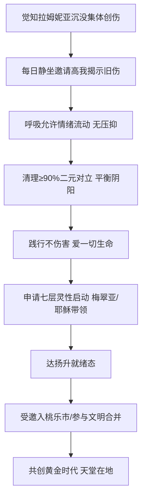

## 概述

**桃乐市**（Telos）是位于美国加州**雪士达山**（Mount Shasta）地下的第五次元光之城市，为古**拉姆妮亚**（Lemuria/列穆里亚）大陆沉没前幸存者所建立的地心文明核心都市。其**大祭司亚当马**（Adama）通过通灵者**奥瑞莉亚·卢意诗·琼斯**（Aurelia Louise Jones）传导教导，系统阐述了第五次元社会运作法则、扬升路径、政府治理、入境标准、婚姻与生育观、儿童教育等完整体系。该教导旨在协助地表人类治愈拉姆妮亚沉没的集体创伤，提升意识频率，为两大文明（地表与地心）的合并与地球整体扬升做准备。

> **核心定位**：桃乐市作为**亚格莎网络**（Agartha Network）百二十座地心光城中的统理城市，保存了拉姆妮亚文化、历史档案与扬升科技，并通过**银星舰队**（Silver Fleet）参与星际联邦事务。亚当马教导强调「爱是关键」，以「心引领而非心智」为修行基石，主张通过清理负面情绪、平衡阴阳、完成七层灵性启动达到扬升标准。

## 一、 文明溯源与历史脉络

### 拉姆妮亚起源与演进

- **灵魂来源**：约450万年前，在大天使米迦勒与蓝火天军护卫下，首批灵魂从**太尔宇宙姆星**投胎地球，在**皇山提顿**（Royal Teton，今怀俄明州黄石公园）经天使调适训练后，扩散定居拉姆妮亚大陆。
- **文明高峰**：拉姆妮亚大陆曾覆盖太平洋广域（含加州、俄勒冈、内华达、华盛顿、夏威夷、复活岛、斐济、澳洲、纽西兰、印度洋马达加斯加），人口达数亿，文明处于第五次元频率，民众拥有长生不老肉体，掌握原子能、心电感应、水晶动力太空船等高等科技。
- **双大陆冲突**：约2.5万年前，拉姆妮亚与**亚特兰提斯**因「统治理念分歧」爆发核能战争，导致双方衰弱。拉姆妮亚主张「低文明自主演进」，亚特兰提斯主张「高文明托管低文明」。
- **沉没与幸存**：约1.2万年前，拉姆妮亚一夜沉没太平洋。祭司团吟唱《友谊万岁》（Auld Lang Syne）护佑亡者以太体，减轻创伤印记。仅2.5万人经雪士达山地下巨洞进入桃乐市避难，保存文化种子。

### 桃乐市建立与亚格莎网络

- **建城缘起**：获**香巴拉利社**（Shamballa-the-Lesser，亚格莎网络首席）批准，加入星际联邦，承诺放弃侵略、践行和平。城市名「Telos」意为「与神合一与相通」。
- **亚格莎网络成员**：含四座拉姆妮亚城市（桃乐市、波西德Posid、宋雪市SHONSHE、伦马市RAMA）、两座亚特兰提斯城市、多座希柏里尔城市（如新华市SHINGWA）。网络间以**电磁地心列车**（时速3000英里）联通，无货币贸易，共享盈余资源。
- **香巴拉城角色**：位于第五至七次元以太层，为地球以太总部，圣那库玛拉大师驻地。桃乐市近期接任网络统理职能。

### 关键时间节点与预言

| 事件 | 时间 | 说明 |
|------|------|------|
| 拉姆妮亚沉没 | 约1.2万年前 | 一夜沉没，祭司殉道护佑 |
| 桃乐市建立 | 沉没前 | 预留20万容量，实入2.5万 |
| 七大星际门户开启 | 2002年 | 造物者本体能量注入，至2012年后剧烈转化地球 |
| 文明合并窗口 | 2006-2007年后 | 视地表集体意识达标情况分批显现 |
| 大规模扬升 | 2012年前后 | 许多人提升至第五次元天堂世界 |

> **亚当马原话**：「我们不会出现在地球表面，直到大多数地球民众能以爱、慈悲、和平对待一切生命……这取决于你们自己完成修身课题。」

## 二、 第五次元城市生活实相

### 城市空间布局（五层结构）

| 层级 | 功能 | 关键设施 |
|------|------|----------|
| **第一层** | 行政、公共、神殿 | **马拉神庙**（白色金字塔，容万人，顶石「活石」为金星赠礼），默基瑟德祭司团驻地 |
| **第二层** | 生产、教育 | 工厂、儿童与成人学校、居住区 |
| **第三层** | **水耕植物园** | 7英亩地供养150万人，有机、高频、无化肥，水晶光能加速生长 |
| **第四层** | 农园、工厂、公园 | 天然湖泊、喷泉、部分生产设施 |
| **第五层** | **自然保护区** | 高大树林、湖泊、地表绝种动植物庇护所，狮羊同眠，全素食、无捕食 |

### 物质显化与日常运作

- **居住形式**：**圆形水晶石屋**，依神圣几何原理，以意念聚焦显化。外墙不透视、内视全透，隐私与通景兼得。建造仅需约半小时（地表时间）。
- **交通系统**：电动人行道、交错电梯、电磁雪橇式高速车厢、城际电磁管道列车（3000 mph）。
- **饮食习惯**：以太食物，依渴望显化，具形色味但非第三次元密度。水耕作物带高振动频率，食用为愉悦而非生存刚需。
- **外貌特征**：身高7-8呎，外貌锁定在20-40岁青春期，可随意念改变形象。无衰老、白发、疾病。
- **寿命与离世**：肉体长生，意愿决定离世时机，携肉身升入更高次元探险。

### 科技与灵性融合

- **氨基酸生物电脑**：接入**阿卡西记录**与**基督高层指令**，零误差提供历史真相与知识。
- **水晶能源**：「活石」等水晶为核心能源塔，城市被巨大紫色金字塔能量场包裹，塔顶通星际联邦。
- **隐身与跨维**：肉体可自主切换第三至第五次元振动，选择是否被看见。太空船隐形静音进出山腹太空港。
- **银星舰队**：桃乐市太空中心编队，含紫晶舰队、彩虹舰队，服务银河系，多数UFO目击源于此。

### 节庆与文化

- **四大季节节日**：冬至、春分、夏至、秋分，各三天，全网络城市同庆，人口倍增（星际亲族来访）。
- **日常即庆典**：每日以爱与感恩为底色，主动创造庆祝理由。
- **团圆预言**：两大文明合并将举行史无前例盛典，「圣诞节式的重聚」。

## 三、 政府架构与治理模式

### 双轨制政府

| 轨道 | 组成 | 职能 |
|------|------|------|
| **王室轨** | **日那君国王**（Ra）与**日那妮皇后**（Rana Mu），双生灵伴、扬升大师 | 最高统治者，象征神圣阳阴合一，拥有议会人选最终否决权 |
| **议会轨** | **拉姆妮亚光之议会**：12位长老（6男6女，平衡神圣阴阳）+ **亚当马**（大祭司，议长，平票决断权） | 区域治理、政策决议、人选审核 |

### 选拔与任免机制

- **议员资格**：修为层级、内在品质、成熟度、专精领域。
- **流程**：缺位公开招募 → 祭司团与王室联合审核 → 国王皇后最终拍板。
- **服务导向**：无权力斗争，会议议程聚焦「如何互助、互惠、助地表演进」。

### 经济与资源分配

- **无货币制**：按需分配，盈余共享网络城市。
- **劳动制**：周五天，日4-6小时，自由选择岗位（水耕、神殿舞者、通讯、交通、工厂等），避免单调，激发热忱。
- **基本保障**：政府供给新父母两年全薪假、全民住房、医疗、教育。

## 四、 扬升准则与入境标准

### 三大核心入境准则（亚当马原文）

1. **意识修至第五次元觉醒边缘**
   - 对自己与一切生命（含动植物矿物王国）持无尽之爱。
   - **释放≥90%二元对立意识**，阴阳平衡渗透生活每层面，践行「不伤害」。
   - *功课*：深入内心探究真实意义，发现「神圣大我」。

2. **彻底清理历世负面情绪与思想**
   - 痛、怒、悲、愧、伤、耻、绝、低自我评价、负面印记、狠毒个性……
   - 从**潜意识、太阳神经叢、情绪体**接纳释放。
   - *机制*：桃乐市高频环境会将低频情绪放大千倍，未清理者无法停留数分钟。

3. **完成七层灵性启动仪式，达扬升就绪态**
   - 可从内在层次连接**基督意识**，在**梅翠亚大师**与**主耶稣**带领下申请启动。
   - 启动非终点，而是入城门槛。昔需数千年，今10-20年可完成（新恩赐加速）。

### 集体达标指标

- **爱与光商数测量**：氨基酸电脑日监地表振动频率。
- **当前约65%**（书写时），**需达90%左右**方启动大规模显现。
- **其他要素**：高频爱心觉醒比例、愿活于神圣意识者占比。

### 显现分阶段计划

1. **隐秘小团体接触**：频率共鸦者获邀山中/以太会面，直接传授爱光能量与教导。
2. **种子传播**：小组散布各地，传递知识给就绪者。
3. **网络扩大**：就绪者增多，圈层扩展，更多桃乐市民显现协助。
4. **全面合并**：足够团体达成契约，逐步完全显现于地表。

> **关键原则**：「伟大合并第二波浪潮，不发生在第三次元频率中。」地表民众须提升至接近第五次元（至少走完2/3路程）方能肉眼相见。

## 五、 婚姻观与双生灵伴教导

### 结婚殿堂与不朽爱焰

- **起源**：拉姆妮亚时代，长老**阿南马**（Ahnahmar）与其双生灵伴建立「结婚殿堂」，供双生灵伴举行神圣结合大典。
- **现状**：殿堂位于雪士达山地下以太光水晶城（直径25-40英里），振动已升至第五次元。拉姆妮亚沉没时爱焰熄灭于地表，但殿堂内保持并提升至第四、五次元持续燃烧。
- **2001年秋奥瑞莉亚主持婚礼**：首次在物理次元物理地点举行双生灵伴婚礼，引爆光界百万灵体庆贺，爱焰重活化入物理八度音阶。

### 核心婚恋哲学

| 误区 | 真相 |
|------|------|
| 在外部寻找伴侣 | **伴侣是你的一部分**，在内在先建立协同关系 |
| 个性与灵性需外在匹配 | **唯内在同频共振**，外在自动投射镜像 |
| 婚姻基于二元阴阳结合 | **须以神圣之爱合一为基础**，否则永无法满足深层渴望 |
| 等待伴侣出现 | **先爱自己每一面向**，神圣爱成指挥中心，伴侣自显现 |

> **阿南马金句**：「你所寻找的关系，不过就是你自己跟你神性自我关系的映照。当你学习去爱你本质的每一面向……你将不再到处寻找。」

### 双生灵伴机制

- **定义**：灵魂降入第三次元时分化为阳性（男性）与阴性（女性）两个灵体，称「双生灵伴」。
- **团聚条件**：双方内在均已修炼至同等神圣爱程度，「什么都不能阻挡，甚至双生灵伴也无能禁止」。
- **等待即准备**：若未显现，因内在未就绪或灵魂选定等待时点，「任何等待时间都无所谓，因为你的内心已经跟你所爱的合并了」。

## 六、 儿童教育与代际培育体系

### 生育许可与孕前准备

- **唯神圣婚姻中允许生育**。
- **父母强制培训**：类比驾照制度，未经训练不得生育（地表16岁童可生育无准备，桃乐市视为重大失责）。
- **新生儿前两年**：父母**放下公职全天候育儿**（政府全薪保障），奠定心理平衡基石。

### 教父母制与社群嵌入

- **出生即配10对教父母**（20位），通常近期也将生育，形成代理兄弟姐妹群。
- **轮流共居**：儿童成长期定期住在教父母家，**潜意识植入「天父天母无所不在、爱与供应永不断绝」**。
- **消除孤独感**：即使独生子，也拥有庞大支持网络。

### 正规教育阶段（3-18岁）

| 阶段 | 内容 | 特色 |
|------|------|------|
| **3-5岁** | 半天戏剧表演、社交艺术、色彩数字游戏化 | 直接体验式学习 |
| **5-18岁** | 全天课程，**索拉雅马如语**（Solara Maru，银河源语）为主修，英语为选修 | 桌面氨基酸电脑接阿卡西记录，**默基瑟德圣团训练教师** |

### 青春期社团制（12岁起）

- **10-20人同龄混合性别小组**，男女比例相等。
- **默基瑟德祭司护卫指导**，共同经历发育全程。
- **功能**：分享经验、实验讨论、化解「反抗力」→ 引导寻找创造性嗜好出口。
- **终身纽带**：成员多成终生挚友，共享境遇成就。

### 成年分流（18岁）

1. **深造专精**：调阅水晶图书馆海量资料（高等文明遗存）。
2. **银星舰队服役**：全民最少6个月，三大舰队（银星、紫晶、彩虹）服务银河。
3. **技能就业**：即入社会分工，自由选择岗位，开启人生舞蹈。

### 与地表儿童的未来合流

- **目前仅通过受监管电视节目间接接触**。
- **地心城市间儿童常往来**参与庆典、社交。
- **合并后**：两文明儿童将精心计量融合，「充满乐趣与伟大探险」，新世代将引领地球凤凰涅槃式重生。

## 七、 关键概念交叉引用网络

| 概念 | 本页定位 | 相关知识页面 |
|------|----------|--------------|
| **拉姆妮亚/列穆里亚** | 文明源头、集体创伤根源 | [[三波志愿者与新地球]]、[[回旋宇宙]]、[[convoluted-universe-book-1]] |
| **第五次元生活** | 核心展示范本 | [[五次元的灵性觉醒]]、[[五次元的灵魂扬升]]、[[从心觉醒]] |
| **扬升/Ascension** | 个人与集体目标 | [[abraham-hicks-law-of-attraction]]、[[sanaya-roman-orin-path-of-joy]]、[[零极限与荷欧波诺波诺体系]] |
| **阿卡西记录** | 电脑网络数据源、生命蓝图库 | [[阿卡西纪录体系与宇宙阿卡西祈祷文]]、[[a-ka-xi-ji-lu-ti-xi-yu-yu-zhou-a-ka-xi-qi-dao-wen]]、[[da-kai-yu-guan-bi-a-ka-xi-ji-lu-zhi-nan]] |
| **默基瑟德/梅尔卡巴** | 祭司团传承、神圣几何建筑基础 | [[德隆瓦洛·默基瑟德]]、[[中脉七轮]]、[[光的课程]] |
| **双生灵伴** | 婚姻殿堂核心、灵魂分化机制 | [[hun-shen-xing-jin-shen-xing-ai-shen-xing]]、[[tian-xie-zuo-yuan-xing-neng-liang-ceng-ci]]、[[灵魂伴侣相关页面]] |
| **亚格莎网络/地心文明** | 城市联盟、香巴拉关系 | [[古典医学占星-奥斯卡霍夫曼]]（地心对应）、[[地心文明相关]] |
| **银星舰队/UFO** | 太空操作、星际联邦成员 | [[atlantis-crystal-energy-technology]]、[[earth-et-history-cosmology]] |
| **七层灵性启动** | 入城硬性门槛、扬升阶梯 | [[guang-de-ke-cheng-xi-lie-1]] 至 [[guang-de-ke-cheng-xi-lie-5]]、[[you-can-channel]] |
| **水晶科技/显化** | 建筑、能源、电脑、食物生产 | [[仪式与水晶]]、[[亚特兰提斯水晶能量技术]]、[[neng-liang-shi-liao-yu-xi-tong]] |
| **集体创伤疗愈** | 拉姆妮亚沉没伤痕清理首要任务 | [[零极限与荷欧波诺波诺体系]]、[[EFT情绪释放技巧]]、[[从未知中解脱]] |

## 八、 实修路线图摘要

> **亚当马寄语**：「爱将开放所有门户，快速引导你的灵性进入一道没有限制的自由大道。你从爱而来，你为了爱而回归。」

## 九、 核心文献与传承谱系

| 层级 | 典籍/来源 | 关键贡献 |
|------|-----------|----------|
| **一手通灵** | 奥瑞莉亚·卢意诗·琼斯《地心文明桃乐市》三部曲 | 亚当马、阿南马、拉姆妮亚议会直接传导 |
| **辅助见证** | 莎如拉·德士（桃乐市公主，住地表）出版讯息 | 儿童教育、社会细节第一人称佐证 |
| **前驱记录** | 多瑞尔博士《山中游记》、艾莫亚/结罗第通灵、喜马拉雅上主导灵 | 早期地心探访、祭司殉道细节、自由桥梁使命 |
| **关联体系** | 默基瑟德教团、圣那库玛拉、星际联邦、阿卡西记录 | 宇宙法律框架、扬升科技标准、历史记忆存取 |

---

**页面维护提示**：本页聚焦「亚当马教导核心体系」结构化沉淀。若需扩展「拉姆妮亚历史考据」「水晶科技工程细节」「七层启动逐层课程」「双生灵伴实操练习」等专题，建议建立子页面并通过 `[[wikilink]]` 互联。

## 来源

- [地心文明桃乐市1第五次元拉姆妮亚的扬升之道](../sources/地心文明桃乐市1第五次元拉姆妮亚的扬升之道.md)
