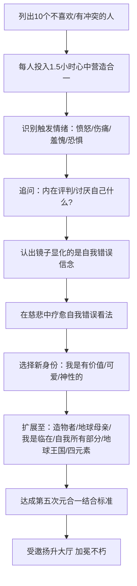

## 概述

**桃乐市**（Telos）是位于美国加州**雪士达山**（Mount Shasta）地下的第五次元光之城市，为古**拉姆妮亚**（Lemuria/列穆里亚）大陆沉没前幸存者所建立的地心文明核心都市。其**大祭司亚当马**（Adama）通过通灵者**奥瑞莉亚·卢意诗·琼斯**（Aurelia Louise Jones）传导教导，系统阐述了第五次元社会运作法则、扬升路径、政府治理、入境标准、婚姻与生育观、儿童教育等完整体系。该教导旨在协助地表人类治愈拉姆妮亚沉没的集体创伤，提升意识频率，为两大文明（地表与地心）的合并与地球整体扬升做准备。

> **核心定位**：桃乐市作为**亚格莎网络**（Agartha Network）百二十座地心光城中的统理城市，保存了拉姆妮亚文化、历史档案与扬升科技，并通过**银星舰队**（Silver Fleet）参与星际联邦事务。亚当马教导强调「爱是关键」，以「心引领而非心智」为修行基石，主张通过清理负面情绪、平衡阴阳、完成七层灵性启动达到扬升标准。

---

## 一、 文明溯源与历史脉络

### 拉姆妮亚起源与演进

- **灵魂来源**：约450万年前，在大天使米迦勒与蓝火天军护卫下，首批灵魂从**太尔宇宙姆星**投胎地球，在**皇山提顿**（Royal Teton，今怀俄明州黄石公园）经天使调适训练后，扩散定居拉姆妮亚大陆。
- **文明高峰**：拉姆妮亚大陆曾覆盖太平洋广域（含加州、俄勒冈、内华达、华盛顿、夏威夷、复活节岛、斐济、澳洲、纽西兰、印度洋马达加斯加），人口达数亿，文明处于第五次元频率，民众拥有长生不老肉体，掌握原子能、心电感应、水晶动力太空船等高等科技。
- **双大陆冲突**：约2.5万年前，拉姆妮亚与**亚特兰提斯**因「统治理念分歧」爆发核能战争，导致双方衰弱。拉姆妮亚主张「低文明自主演进」，亚特兰提斯主张「高文明托管低文明」。
- **沉没与幸存**：约1.2万年前，拉姆妮亚一夜沉没太平洋。祭司团吟唱《友谊万岁》（Auld Lang Syne）护佑亡者以太体，减轻创伤印记。仅2.5万人经雪士达山地下巨洞进入桃乐市避难，保存文化种子。

### 桃乐市建立与亚格莎网络

- **建城缘起**：获**香巴拉利社**（Shamballa-the-Lesser，亚格莎网络首席）批准，加入星际联邦，承诺放弃侵略、践行和平。城市名「Telos」意为「与神合一与相通」。
- **亚格莎网络成员**：含四座拉姆妮亚城市（桃乐市、波西德Posid、宋雪市SHONSHE、伦马市RAMA）、两座亚特兰提斯城市、多座希柏里尔城市（如新华市SHINGWA）。网络间以**电磁地心列车**（时速3000英里）联通，无货币贸易，共享盈余资源。
- **香巴拉城角色**：位于第五至七次元以太层，为地球以太总部，圣那库玛拉大师驻地。桃乐市近期接任网络统理职能。

### 关键时间节点与预言

| 事件 | 时间 | 说明 |
|------|------|------|
| 拉姆妮亚沉没 | 约1.2万年前 | 一夜沉没，祭司殉道护佑 |
| 桃乐市建立 | 沉没前 | 预留20万容量，实入2.5万 |
| 七大星际门户开启 | 2002年 | 造物者本体能量注入，至2012年后剧烈转化地球 |
| 文明合并窗口 | 2006-2007年后 | 视地表集体意识达标情况分批显现 |
| 大规模扬升 | 2012年前后 | 许多人提升至第五次元天堂世界 |

> **亚当马原话**：「我们不会出现在地球表面，直到大多数地球民众能以爱、慈悲、和平对待一切生命……这取决于你们自己完成修身课题。」

---

## 二、 第五次元城市生活实相

### 城市空间布局（五层结构）

| 层级 | 功能 | 关键设施 |
|------|------|----------|
| **第一层** | 行政、公共、神殿 | **马拉神庙**（白色金字塔，容万人，顶石「活石」为金星赠礼），默基瑟德祭司团驻地 |
| **第二层** | 生产、教育 | 工厂、儿童与成人学校、居住区 |
| **第三层** | **水耕植物园** | 7英亩地供养150万人，有机、高频、无化肥，水晶光能加速生长 |
| **第四层** | 农园、工厂、公园 | 天然湖泊、喷泉、部分生产设施 |
| **第五层** | **自然保护区** | 高大树林、湖泊、地表绝种动植物庇护所，狮羊同眠，全素食、无捕食 |

### 物质显化与日常运作

- **居住形式**：**圆形水晶石屋**，依神圣几何原理，以意念聚焦显化。外墙不透视、内视全透，隐私与通景兼得。建造仅需约半小时（地表时间）。
- **交通系统**：电动人行道、交错电梯、电磁雪橇式高速车厢、城际电磁管道列车（3000 mph）。
- **饮食习惯**：以太食物，依渴望显化，具形色味但非第三次元密度。水耕作物带高振动频率，食用为愉悦而非生存刚需。
- **外貌特征**：身高7-8呎，外貌锁定在20-40岁青春期，可随意念改变形象。无衰老、白发、疾病。
- **寿命与离世**：肉体长生，意愿决定离世时机，携肉身升入更高次元探险。

### 科技与灵性融合

- **氨基酸生物电脑**：接入**阿卡西记录**与**基督高层指令**，零误差提供历史真相与知识。
- **水晶能源**：「活石」等水晶为核心能源塔，城市被巨大紫色金字塔能量场包裹，塔顶通星际联邦。
- **隐身与跨维**：肉体可自主切换第三至第五次元振动，选择是否被看见。太空船隐形静音进出山腹太空港。
- **银星舰队**：桃乐市太空中心编队，含紫晶舰队、彩虹舰队，服务银河系，多数UFO目击源于此。

### 节庆与文化

- **四大季节节日**：冬至、春分、夏至、秋分，各三天，全网络城市同庆，人口倍增（星际亲族来访）。
- **日常即庆典**：每日以爱与感恩为底色，主动创造庆祝理由。
- **团圆预言**：两大文明合并将举行史无前例盛典，「圣诞节式的重聚」。

---

## 三、 政府架构与治理模式

### 双轨制政府

| 轨道 | 组成 | 职能 |
|------|------|------|
| **王室轨** | **日那君国王**（Ra）与**日那妮皇后**（Rana Mu），双生灵伴、扬升大师 | 最高统治者，象征神圣阳阴合一，拥有议会人选最终否决权 |
| **议会轨** | **拉姆妮亚光之议会**：12位长老（6男6女，平衡神圣阴阳）+ **亚当马**（大祭司，议长，平票决断权） | 区域治理、政策决议、人选审核 |

### 选拔与任免机制

- **议员资格**：修为层级、内在品质、成熟度、专精领域。
- **流程**：缺位公开招募 → 祭司团与王室联合审核 → 国王皇后最终拍板。
- **服务导向**：无权力斗争，会议议程聚焦「如何互助、互惠、助地表演进」。

### 经济与资源分配

- **无货币制**：按需分配，盈余共享网络城市。
- **劳动制**：周五天，日4-6小时，自由选择岗位（水耕、神殿舞者、通讯、交通、工厂等），避免单调，激发热忱。
- **基本保障**：政府供给新父母两年全薪假、全民住房、医疗、教育。

---

## 四、 第三册核心进阶教导：第五次元协定与觉醒练习

### 核心框架：第五次元意识的觉醒

亚当马在第三册开篇指出：**第五次元并非一个去处，而是一种存在状态**，由爱、信任、慈悲、坚定的信念、恩典和感恩的能量结合而成。桃乐市的社会结构正是个体整合这些能量后的自然显化。

> **关键原则**：第五次元联合意识在全球整合前，每个人必须对自己的能量负责，走完独特旅程，无人可代劳。

### 四大觉醒步骤（进化中的自我练习）

#### 第一步：从神性大我提问「你是谁」
- 放下一切对自我的「认识」，从内心深处发问。
- 用已觉醒的部分倾听答案，而非不安的自我或较低心智。
- **核心**：同时面对「本质」与「具显」，接受二者对立的神圣意义，唤醒大师品质第一层——心与神性本质在同一呼吸中共现。

#### 第二步：拆除「认为知道」的信念系统
- 认知并拆除迄今自以为是的一切信念，在「坚定的信念」上跃进。
- 培养「想要」对自己慈悲的意愿——这是大师品质工具，源于灵魂暗夜后的深层了知。
- 允许万物所有可能性出现，建立「我是大师，能与宇宙共创一切」的坚定信念。

#### 第三步：经验与灵魂的神圣融洽——通往神性自我的门槛
- **列表一**：列出限制性信念系统（他人评价、自我不适感知、世界观、灵性旅程观），不带批判、带慈悲深挖细微层面。从中取回能量，否则该部分留在分离中。
- **列表二**：列出内心深处认识的真正自己。探讨「头脑自以为知」与「神性合一真知」的差异，以最纯净动机倾听心中振动，直到感受到真实声调、存在扩展。
- **列表三**：列出对自己持有的评判。在慈悲中疗愈评判，显现转化与自由，加速觉醒。评判能量限制体验，无评判才能找到照亮宇宙的光。

#### 第四步：日常三段式整合练习
1. **晨间**：独处沉思存在状态，请求指导团/高我释放旧信念，请求宇宙赐予新观点，心智处「未知」，心处「知晓」。
2. **日间**：频繁运用爱、信任、坚定信念、慈悲、恩典、感恩六大能量，召唤其纯净振动入身入细胞入DNA，建立真实身份能量标记，修正旧频率。
3. **晚间**：深深敬意中拥抱当天给予自己的一切，意图睡眠中继续整合新智慧，请求心脏细胞与DNA随新振动扩展，进化发生于所有时空次元。

> **亚当马强调**：练习不分先后序，但必须一次全做完。先逐日单练，再全天全做。向已完成工作致谢，珍惜觉醒真相。

---

## 五、 拉姆妮亚之心三层面向（西乐丝提亚/阿南马/亚当马）

第三册第二章完整呈现「拉姆妮亚之心」的三重面向，对应阴性接纳、创造热忱、基督宽恕三大核心频率。

### 第一层：西乐丝提亚——心的阴性接纳与信任频率

- **核心教导**：心智原为服务心的工具，现被变异小我控制，塞满恐惧/批判/错误概念，导致累世痛苦。进化关键在于**心智屈服于心的振动**。
- **心的频率本质**：
  - 开放接受所有可能性，不质疑、不分析连结。
  - **信任是核心能量**——与生俱来，无需学习、清理空间或强行打开，「它只是如实存在」。
  - 揭开帷幕的条件：允许心主导顺服的心智振动。
- **实修「信任场域游戏」**：
  1. 心中创造充满喜悦人事物的场域（不限制）。
  2. 身置舒适位置，用心（非心智）倾听周围振动，识别心的触动。
  3. 安住于轻柔能量垫（心共同能量与地球之心结合），熟悉如床如肤。
  4. 听取周围每人独特心歌，追溯至源头——心。
  5. 允许心智在场域漫游、臣服于信任，如照料冒险的孩子，提醒其接纳一切可能。

> **西乐丝提亚金句**：「你们就是帷幕。你们会一直都是，一直到你们的心智屈服，你们的心被允许去主导你们的实相为止。」

### 第二层：阿南马——心的热忱与创造循环

- **核心教导**：**心永远是创造者**，心智是必要工具但非领导者。创造循环：心的能量（热忱）表达意图 → 形成标量能量填充电磁网格空白 → 心智焦点指挥凸显单一事件 → 物质成形、意识成实相。
- **双重心智架构**：
  - **较高心智**：灵感中心，接触心与神性心智，接收印象传送给心。需练习耐性、放松焦点、减轻「做」的责任，让心以「存在」负责。
  - **较低心智**：存在研究中心，编制物质层面接收目录。**非选择决策权威**，心才是唯一权威。
- **日常核心练习**：将觉知导向心跳声，将注意力从较低心智嘈杂声移至心跳节奏，感受全身合一。此举移除心智控制，激活细胞原始频率提醒「你是谁」、他人心能量提醒「目的」。
- **物质生命本质**：非无光，因失去对它的爱而变暗。热忱（心能量）连结神性，断定别处更好而移除热忱，导致分离。桃乐市人完全认出并无条件爱此能量，分享一切经验印记于心。
- **桃乐市沉思法**：非打坐冥想、非观想意象（聚焦「你不是什么」），而是**允许心智自语、接受能力扩展至周遭、感官聚焦环境流动、让心的情绪智能记录一切、融入自然能量波流、调整内在频率与天生本具一致（自我/时空合一）、向外送出心的课题（真正创造行为）**。

> **阿南马金句**：「用你的心作出选择，用你的心、而不是用心智过生活，是一个群体的、连結的行动，它会找回『活著』的爱的记忆。」

### 第三层：亚当马——心的基督宽恕与合一本质

- **核心教导**：**宽恕是造物者与神性本质**。最深层真理：没有需要原谅的事，只能发现而非创造此真实。
- **创伤十字路口**：一边是愤怒/悲痛/羞愧，另一边是欢乐/智慧/爱/创造力/真实。羞愧是幻相（认为错事不可救赎）。
- **灵魂投生逻辑**：为体验神性完整光谱，灵魂选择「缺乏所求面向」的经验（如求欢乐则投生无欢乐生命）。所有经验成细胞记忆、基因模式、地球心灵结构一部分。
- **帷幕真相**：唯一帷幕是恐惧/错误信念/悲伤。**痛苦非因创伤，因不愿感受痛苦**。宽恕自我带回拉姆妮亚之心纯净频率。
- **疗愈机制**：心智带入情绪仓库，唯心频率能以宇宙之爱引导通过雷区。允许感受，重联细胞记忆，从身体结构与所有时空DNA基因传承移除恐惧悲伤。身体感受柔和舒适/连结加深/病痛减少。
- **灵魂定位修正**：灵魂非位于松果体中心，而是**身体在灵魂里面**，气场是最低振动，灵魂向外延伸，界定健康程度。心频率连结灵魂与神性灵魂。
- **宽恕本质三阶段**：
  1. 倾听他人真实并接受。
  2. 接受其本有样子并爱那个样子。
  3. 不管真实是什么，接受并爱他们。**真实来说，没有什么可宽恕的。**
- **最终邀请**：在你整个存在本质中以此频率振动，你即是这个心。无需其他启蒙仪式即可通过帷幕。

> **亚当马金句**：「在你們身體內跳動的心，和拉姆妮亞之心是一樣的。傾聽它，珍惜它。你們並非不完整，而以你們的整個存在，以及在整個存在本質裡以這個頻率振動時，你們也不是無法變成這個心。」

---

## 六、 亚当马给奥瑞莉亚的宽恕功课与合一状态实操步骤

### 萨南达（耶稣）与奥瑞莉亚对话背景
奥瑞莉亚抗拒亚当马布置的功课：**找出生命中不喜欢的10人，每人花1.5小时放入心中，营造合一心境，看见彼此一体性**。萨南达坚持：必须立即彻底完成，此为进入合一世界、下一层启蒙、扬升加冕的门槛。

### 核心教导：镜子法则与自我疗愈

1. **触发机制**：他人无力让你产生负面感受，**只有你自己有此力量**。被触怒因内在已存该情绪。
2. **镜子角色**：名单上人扮演触发器与镜子，在达更高振动前，显现内在待疗愈之处。与他人无关，只关乎你如何看待自己。
3. **深挖追溯**：回顾一生，同类触发事件发生百余次。探究：内心评判/讨厌什么创造了此镜子？本质是**对自我误解、批判、愤怒、错误信念**。
4. **疗愈主体**：疗愈裂缝疗愈的是**你自己**。他人可能受益非你责任。神派你讨厌的人非为娱乐，因你神圣意图求开悟，磁性吸引他们引发局限带入觉知表层。
5. **面对镜子步骤**：
   - 看清感受，进入深层。
   - 认出引发者只是做他们自己，非真想激怒你。
   - 决定不再感受错误信念，改变自我错误认知。
   - 在更深情绪/爱/接纳中为自己选择新身份。
   - 疗愈错误看法，生命现奇迹。

### 合一状态的完整定义（第五次元标准）

> **萨南达**：「结合，在第五次元对它的了解是：它包含了与一切生命的合一，而不仅仅和其中的一部分。它包括了和至高造物者的结合；和神圣地球母亲……的结合；和『我是/神性临在』……的结合；和你自己所有部分的结合，以及地球所有王国的结合，已知和未知的，动物王国；也包括了所有的风、火、水、地元素。」

- **达标果相**：意识完全达此层次结合 → 受邀通过第五次元门户 → 扬升大厅荣耀加冕 → 扬升之火笼罩完全转变 → 永远成为不朽之身 → 面对面与大师共工、无限制。

### 实操路线图：从抗拒到合一

---

## 七、 关键概念交叉引用网络

| 概念 | 本页定位 | 相关知识页面 |
|------|----------|--------------|
| **拉姆妮亚/列穆里亚** | 文明源头、集体创伤根源 | [[lemuria-civilization-history]]、[[convoluted-universe-book-1]]、[[three-waves-volunteers-new-earth]] |
| **第五次元生活** | 核心展示范本 | [[five-dimensional-ascension]]、[[from-heart-awakening]]、[[sanaya-roman-orin-path-of-joy]] |
| **扬升/Ascension** | 个人与集体目标 | [[abraham-hicks-law-of-attraction]]、[[sanaya-roman-orin-teachings]]、[[zero-limits-hooponopono-system]] |
| **阿卡西记录** | 电脑网络数据源、生命蓝图库 | [[阿卡西纪录体系与宇宙阿卡西祈祷文]]、[[a-ka-xi-ji-lu-ti-xi-yu-yu-zhou-a-ka-xi-qi-dao-wen]]、[[da-kai-yu-guan-bi-a-ka-xi-ji-lu-zhi-nan]] |
| **默基瑟德/梅尔卡巴** | 祭司团传承、神圣几何建筑基础 | [[drunvalo-melchizedek]]、[[middle-pillar-seven-chakras]]、[[guang-de-ke-cheng-xi-lie-1]] |
| **双生灵伴** | 婚姻殿堂核心、灵魂分化机制 | [[hun-shen-xing-jin-shen-xing-ai-shen-xing]]、[[tian-xie-zuo-yuan-xing-neng-liang-ceng-ci]] |
| **亚格莎网络/地心文明** | 城市联盟、香巴拉关系 | [[agartha-network-cities]]、[[earth-et-history-cosmology]] |
| **银星舰队/UFO** | 太空操作、星际联邦成员 | [[atlantis-crystal-energy-technology]]、[[convoluted-universe-book-1]] |
| **七层灵性启动** | 入城硬性门槛、扬升阶梯 | [[guang-de-ke-cheng-xi-lie-1]] 至 [[guang-de-ke-cheng-xi-lie-5]]、[[you-can-channel]] |
| **水晶科技/显化** | 建筑、能源、电脑、食物生产 | [[仪式与水晶]]、[[atlantis-crystal-energy-technology]]、[[neng-liang-shi-liao-yu-xi-tong]] |
| **紫色火焰/圣哲曼** | 转化核心工具、自由赐予者 | [[saint-germain-violet-flame]]、[[activating-mystical-healing-power]]、[[abraham-hicks-law-of-attraction]] |
| **死亡/灵魂过渡** | 生命周期认知、无惧离世 | [[brian-weiss-many-lives-many-masters]]、[[convoluted-universe-2-apostles-sleep-work]]、[[ren-shen-shu]] |
| **橡木/玫瑰会** | 古老守护秩序现代复苏 | [[rosicrucian-order]]、[[golden-dawn]]、[[ceremonial-magic]] |
| **水晶存在体/硅基光身** | 人类原始蓝图复原 | [[atlantis-crystal-energy-technology]]、[[you-can-channel]]、[[soham-healing-system]] |
| **巴士德/频率医学** | 疾病观范式转换 | [[yi-liao-ling-mei]]、[[zai-lian-jie-liao-yu-fa]]、[[soham-healing-system]] |
| **儿童教育/星际服役** | 新世代培育范本 | [[twelve-zodiac-parenting-communication]]、[[han-lianglu-astrology-mom-handbook]]、[[convoluted-universe-2-apostles-sleep-work]] |
| **蓝龙安萨拉斯** | 地球能量守护远古契约 | [[dragon-energy-lines]]、[[ley-lines-earth-grid]]、[[middle-pillar-seven-chakras]] |
| **松果体/脑下垂体** | 扬升生理开关精密操作 | [[you-can-channel]]、[[activating-mystical-healing-power]]、[[middle-pillar-seven-chakras]]、[[pineal-gland-activation]] |
| **社群精神/透明共振** | 5D社会操作系统 | [[oneness-university-bhagavan-teachings]]、[[universal-spiritual-laws-manifestation]]、[[guan-xi-liao-yu-gottman-qing-xu-yao-qing]] |
| **拉姆妮亚特使/记忆唤醒** | 集体记忆复苏关键行动 | [[convoluted-universe-2-apostles-sleep-work]]、[[three-waves-volunteers-new-earth]]、[[zero-limits-hooponopono-system]] |
| **集体创伤疗愈** | 拉姆妮亚沉没伤痕清理首要任务 | [[zero-limits-hooponopono-system]]、[[EFT情绪释放技巧]]、[[从未知中解脱]]、[[belief-creates-reality-practice]] |

---

## 八、 实修路线图总结

### 阶段一：奠基——第五次元协定四步骤
1. **神性提问**：每日从大我发问「我是谁」，倾听真实答案。
2. **信念拆除**：列三张表（限制信念/真实自我/自我评判），慈悲取回能量、疗愈评判。
3. **日常三段式**：晨间请求新观点、日间锚定六大能量、晚间拥抱整合扩展DNA。
4. **心引领心智**：练习「信任场域游戏」，让心智臣服于心的信任频率。

### 阶段二：深化——拉姆妮亚之心三层整合
1. **西乐丝提亚层**：安住心的开放接纳与信任，识别心歌，熟悉心能量垫。
2. **阿南马层**：觉知心跳，移交领导权给心，实践「存在」而非「做」，沉思神性无限面向。
3. **亚当马层**：宽恕自我与他人，发现「无需宽恕」真相，感受痛苦穿透帷幕，重联细胞记忆。

### 阶段三：突破——镜子功课与合一结合
1. **列出冲突对象**，投入时段营造合一心境。
2. **识别触发情绪→追溯自我错误信念→慈悲疗愈→选择新身份**。
3. **扩展结合对象**：造物者、地球母亲、我是临在、自我所有部分、地球王国、四大元素。
4. **达成第五次元合一标准**，受邀扬升大厅加冕。

> **亚当马寄语**：「爱将开放所有门户，快速引导你的灵性进入一道没有限制的自由大道。你从爱而来，你为了爱而回归。」

---

## 九、 核心文献与传承谱系

| 层级 | 典籍/来源 | 关键贡献 |
|------|-----------|----------|
| **一手通灵** | 奥瑞莉亚·卢意诗·琼斯《地心文明桃乐市》三部曲 | 亚当马、阿南马、拉姆妮亚议会直接传导 |
| **辅助见证** | 莎如拉·德士（桃乐市公主，住地表）出版讯息 | 儿童教育、社会细节第一人称佐证 |
| **前驱记录** | 多瑞尔博士《山中游记》、艾莫亚/结罗第通灵、喜马拉雅上主导灵 | 早期地心探访、祭司殉道细节、自由桥梁使命 |
| **关联体系** | 默基瑟德教团、圣那库玛拉、星际联邦、阿卡西记录 | 宇宙法律框架、扬升科技标准、历史记忆存取 |

---

**页面维护提示**：本页聚焦「亚当马教导核心体系」结构化沉淀，已融合第一册基础架构、第二册进阶教导与**第三册第五次元协定/拉姆妮亚之心三层面向/宽恕功课/合一实操**完整脉络。若需扩展「拉姆妮亚历史考据」「水晶科技工程细节」「七层启动逐层课程」「双生灵伴实操练习」「蓝龙龙息呼吸法完整步骤」「松果垂体去钙化临床方案」「橡木玫瑰会现代入会流程」「频率医学协议」等专题，建议建立子页面并通过 `[[wikilink]]` 互联。

## 来源

- [地心文明桃乐市3第五次元协定：与神合一之道](../sources/地心文明桃乐市3第五次元协定：与神合一之道.md)
