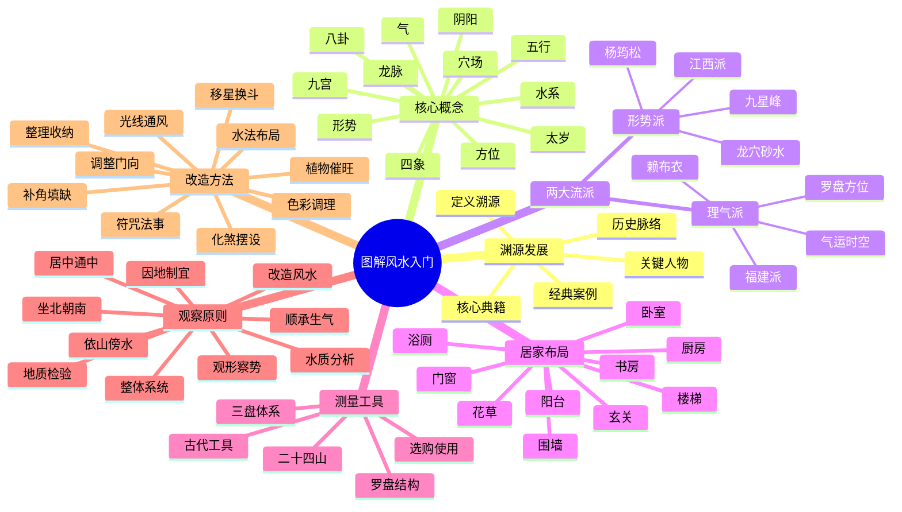

# 图解风水入门

## 书籍概况

《图解风水入门》以通俗易懂的图解方式，系统梳理风水学的渊源发展、核心理论体系、两大流派分野、居家商业布局实操禁忌、罗盘仪器结构与使用方法，以及观察风水的十大原则。全书配有200余幅图片和图解示例，旨在让风水这一传统文化走出神秘面纱，成为可理解、可操作的环境学问。

> **核心定位**：风水=家居风水+商业风水+事业风水+学业风水  
> **根本宗旨**：寻找生气，追求阴阳、天地、身心和谐的至善境界  
> **现代视角**：风水学是地球物理学、地质学、环境景观学、自然生态建筑学、天体运行方位学等的综合类科学

---

## 第一章 探索风水的渊源

### 风水的定义与核心概念

- **名称溯源**：晋代郭璞《葬经》——“气乘风则散，界水则止。古人聚之使不散，行之使有止，故谓之风水。”
- **历史别称**：堪舆、阴阳、卜宅、相宅、图宅、形法、青囊、青鸟、青乌、地理
- **核心要素**：风（气流）、水（水流）、气（生气/死气/阴气/阳气/土气/地气等）
- **根本宗旨**：理气——寻找生气，顺应自然，创造适合人类身心健康的最佳建筑环境
- **研究对象**：阳宅（活人住所）、阴宅（死者墓葬）
- **理论基石**：河图、洛书、八卦、五行等易学文化

### 风水与现代学科的对应关系

| 风水概念 | 对应现代学科 |
|----------|--------------|
| 龙脉/山脉走向 | 地质学、地球物理学 |
| 水口/水系分析 | 水文学、水文地质学 |
| 坐北朝南/藏风聚气 | 气象学、微气候学、建筑环境学 |
| 五色土/土壤分析 | 土壤学、地质勘探 |
| 明堂/环境格局 | 环境景观学、城市规划学 |
| 罗盘/方位测量 | 天文学、地磁学、测绘学 |

> **交叉引用**：[[fengshui-shiyi-genyu]] 详述郭璞《葬经》生气论与现代科学诠释；[[zhongguo-fengshui-xue-chu-tan]] 梳理曾涌哲《中国风水学初探》的科学性论证框架。

### 历史发展脉络

| 时期 | 阶段特征 | 关键事件/人物 |
|------|----------|---------------|
| 原始社会 | 萌芽期——近水向阳择穴居 | 半坡遗址“上吉风水”格局 |
| 夏商周 | 萌芽期——卜筮选址 | 甲骨文卜宅记录、《逸周书》土宜说 |
| 先秦 | 孕育期——阴阳五行成型 | 《周易》确立仰观俯察、《尚书》召公相宅 |
| 秦汉 | 理论初步归纳 | 《堪舆金匮》《宫宅地形》等著作、《葬经》定义风水 |
| 魏晋 | 理论全面构架 | **郭璞**《葬书》成风水鼻祖 |
| 唐宋 | 盛行期——两大流派分野 | 杨筠松传江西派（形势派）、赖布衣传福建派（理气派） |
| 明清 | 泛滥期——理论完备普及 | 《四库全书》收录风水典籍、民间风水师遍布城乡 |
| 民国至今 | 重新评估研究期 | 现代科学视角重释传统风水 |

> **关键人物**：[[fengshui-shiyi-genyu]] 郭璞为风水鼻祖；《葬经》生气循环图见书中插图。

### 核心理论基础

#### 地理学基础（五大方面）
- **地形地图**：龙脉思想、天星地形关系、风水地图绘制（如《中国三大干龙总览图》）
- **水文**：地表水/地下水/水质分析——“寻龙点穴须仔细，先须观水势”
- **气候气象**：藏风避风、阳宅坐北朝南营造微气候
- **土壤**：五色土吉凶（红黄吉、紫白次、黑凶）、有机质含量与尸骨保存
- **探矿**：指示植物探矿（野葱银、野韭金）、水源探矿（红泉银、腥泉铁、温泉硫矾）

#### 心理学基础
- **环境知觉**：行为=人×环境（卢因公式），对应风水“人对气场的感知”
- **三重环境**：
  - 物理环境：自然/构筑环境→“山厚人肥，山瘦人饥”地形心理影响
  - 社会环境：经政因素
  - 象征环境：美学象征→“寻龙”即图腾取象、“物华天宝人杰地灵”心理期待
- **心物同源**：内象外化、外象内移，为风水要义

> **交叉引用**：[[fengshui-nengliang-quyu-ditu]] 日下由纪惠《召唤宇宙能量的幸运整理术》以心理创伤疗愈切入风水布局；[[xinli-shanghen-yu-zhengli-guanxi]] 同源。

### 两大流派分野

| 维度 | 形势派（形法/江西派） | 理气派（理法/福建派） |
|------|----------------------|----------------------|
| **核心关注** | 山川地势形态（龙穴砂水） | 罗盘方位、气运时空（阴阳五行八卦九宫） |
| **四大纲目** | 龙、穴、砂、水 | 卦、星、门、向 |
| **代表人物** | 唐·杨筠松（传江西） | 宋·赖文俊/赖布衣（传福建） |
| **核心典籍** | 《撼龙经》《疑龙经》《葬法》 | 《九天玄女青囊海角经》《宅经》 |
| **理论源头** | 郭璞《葬书》形势理论之宗 | 中国古代“气论”哲学（方以智“一切物皆气所为”） |
| **实用性** | 观测直观、流传广 | 计算精密、需罗盘专业操作 |
| **九星峰** | 贪狼/巨门/武曲吉，左辅/右弼小吉，破军/廉贞/禄存/文曲凶 | 二十四山向、飞星九运、玄空大卦 |

> **交叉引用**：[[qimen-dunjia-fundamentals]] 奇门遁甲亦分阴阳二遁、形势理气；[[fenglin-qimen-fengshui]] 王凤麟阴盘奇门风水主张“没吉没凶、月相定局”；[[ye-hongsheng-qi-men-dun-jia-ti-xi]] 叶鸿生四层框架整合预测运筹。

### 经典风水格局案例

- **洛阳古都**：河洛交汇、北高南低、四山环抱、十二门二十四街百四十闾里、中轴对称——九朝都城风水典范
- **江西临川“才子都”**：赣江崇江抚河扇形汇聚“聚水格”、武夷山直入来气、西北环山挡风、北方层峦叠嶂——宋明以来134名人、80余少年才子
- **香港聚财**：岭南山系“九龙入海”、珠江水气大屿山拦截输入、西北/西方水口对应六七运旺期

---

## 第二章 风水学中的基本概念

### 核心概念体系

#### 气——风水术的核心
- **哲学渊源**：《庄子》「人之生也，气之聚也，聚则为生，散而为死」
- **郭璞定义**：《葬经》「葬者，乘生气也……气行乎地中，其行也因地之势；其聚也因势之止」
- **分类**：生气/死气/阴气/阳气/土气/地气/乘气/聚气/纳气/迄脉/气母
- **军事应用**：帝王气/猛将气/军盛气/军败气/伏兵气/暴兵气/城胜气/屠城气/战阵气/图谋气（十种气色占验）

#### 阴阳——万物的根本
- **本义**：向日为阳，背日为阴
- **本体论**：《素问》「阴阳者，天地之道也，万物之纲纪，变化之父母，生杀之本始，神明之本府也」
- **风水应用**：
  - 先天八卦：两仪四象分阴阳（太阳/少阴为阳，太阴/少阳为阴）
  - 后天八卦：生数成数分阴阳（九八七六为阳，四三二一为阴）
  - 罗盘定位：西北至正东为阳，东南至正西为阴
  - 居住验证：大门朝南（阳）吉、朝北（阴）凶——光照杀菌、干湿差异

| 阳 | 天 | 光 | 热 | 干 | 刚 | 南 | 上 | 左 | 男 | 太阳 |
|----|----|----|----|----|----|----|----|----|----|------|
| 阴 | 地 | 影 | 冷 | 湿 | 柔 | 北 | 下 | 右 | 女 | 月亮 |

- **四合院格局**：坐北朝南、大门东南（巽位），演化自四神砂，合抱聚气、适应北方气候

#### 四象——对地形的比喻
- **来源**：《周易·系辞》「太极生两仪，两仪生四象」
- **天文对应**：二十八宿四七分布——东青龙、南朱雀、西白虎、北玄武
- **风水格局**：前朱雀（低平/水池）、后玄武（高山/丘陵）、左青龙（蜿蜒流水/道路）、右白虎（驯伏低矮/长道）
- **口诀**：「玄武垂头，朱雀翔舞，青龙蜿蜒，白虎驯俯」
- **文化印证**：中山公园社稷坛五色土——东青/南赤/西白/北黑/中黄，象征四方朝贡天下祥和
- **诸葛八卦村**：外八卦（八山环抱）、内八卦（钟池太极、八巷辐射）、双重八卦迷宫布局

#### 五行——阴阳之纲领
- **经典定义**：《尚书·洪范》「一水二火三木四金五土……水曰润下，火曰炎上，木曰曲直，金曰从革，土曰稼穑」
- **生克循环**：
  - 相生：水→木→火→土→金→水
  - 相克：水→火→金→木→土→水
- **三种分类法**：
  - **正五行**：东木/南火/西金/北水/中土——定方位
  - **八卦五行**：震庚亥未巽辛木、乾甲兑丁巳丑金、坎癸申辰水、离壬寅戌火、坤乙艮丙土——卦配干支
  - **洪范五行**：甲寅辰巽大江水、震艮巳三原属木、离壬丙乙火为宗、兑丁乾亥金生处、丑癸坤庚未土中——二十四山向精微变化
- **政治应用**：邹衍五德始终说——黄帝土/夏木/商金/周火/秦水，相克改朝换代

> **交叉引用**：[[bazi-mingli-xue-jichu-jiaocheng]] 陆致极以现代科学框架重释五行干支；[[fei-wei-zong-qi-li-lun]] 王唯工以肺为宗重构五行气论。

#### 八卦——方位的标志
- **生成**：《易·系辞》「易有太极，是生两仪，两仪生四象，四象生八卦」
- **符号构成**：“—”阳、“--”阴，三重叠成八卦
- **朱熹《八卦取向歌》**：「乾三连，坤六断；震仰盂，艮覆碗；离中虚，坎中满；兑上缺，巽下断」
- **双系统**：
  - **先天八卦**（伏羲/河图）：乾南/坤北/离东/坎西/震东北/巽西南/坎西北/艮东南
  - **后天八卦**（文王/洛书）：离南/坎北/震东/兑西/巽东南/乾西北/艮东北/坤西南——与九宫合为“九宫八卦”

| 卦名 | 自然 | 特性 | 家人 | 肢体 | 动物 | 后天方位 | 季节 | 阴阳 | 五行 |
|------|------|------|------|------|------|----------|------|------|------|
| 乾 | 天 | 健 | 父 | 首 | 马 | 西北 | 秋冬 | 阳 | 金 |
| 兑 | 泽 | 说 | 少女 | 口 | 羊 | 西 | 秋 | 阴 | 金 |
| 离 | 火 | 丽 | 中女 | 目 | 雉 | 南 | 夏 | 阴 | 火 |
| 震 | 雷 | 动 | 长男 | 足 | 龙 | 东 | 春 | 阳 | 木 |
| 巽 | 风 | 入 | 长女 | 股 | 鸡 | 东南 | 春夏 | 阴 | 木 |
| 坎 | 水 | 陷 | 中男 | 耳 | 猪 | 北 | 冬 | 阳 | 水 |
| 艮 | 山 | 止 | 少男 | 手 | 狗 | 东北 | 冬春 | 阳 | 土 |
| 坤 | 地 | 顺 | 母 | 腹 | 牛 | 西南 | 夏秋 | 阴 | 土 |

- **高要八卦村**：村庄按阴阳八卦设计→风调雨顺人才辈出

#### 九宫——空间数理模型
- **排布**：乾六/坎一/艮八/震三/中五/巽四/离九/坤二/兑七
- **阴阳属性**：乾坎艮震四阳、巽离坤兑四阴、中五中性
- **飞布规律**：中→西北→西→东北→南→北→西南→东→东南→中（洛书九宫数序）
- **应用**：宅命吉凶判断、飞星九运、奇门遁甲盘面、风水布局定位

> **交叉引用**：[[qimen-dunjia-yang-dun-540-ju-xiang-jie]] 奇门阳遁540局以九宫为盘面；[[ziwei-doushu-xiang-xing-lilun]] 紫微斗数亦用九宫/十二宫位体系。

#### 龙脉、形势、水系、穴场体系
| 概念 | 定义 | 关键判断标准 |
|------|------|--------------|
| **龙脉** | 山川气脉绵延如龙 | 昆仑为祖，三大干龙（北/中/南）分布中国；来龙要大强专逆 |
| **形势** | 形=单坐山头，势=起伏群峰 | 劲欲行远腾、形欲圆聚藏气、形由势成势止形定 |
| **水龙** | 水势走向如龙 | 寻龙先观水势；水会龙尽、水交龙止、水融注内气聚 |
| **水口** | 水流进出口 | 天门开（来水见源）、地户闭（去水不见）、包容面积∝富贵 |
| **明堂** | 穴前生气聚合地 | 内明堂（近案龙虎环抱）、外明堂（远朝水曲折）；吉格：交锁/周密/朝进/宽畅/大会/广聚 |
| **砂** | 穴四周护山 | 肥圆富/秀尖贵/斜臃肿贱；层层叠叠前后有序内倾有情 |
| **朝案** | 远朝近案 | 朝=高大远山如宾臣；案=近小如几案；三台玉几最吉 |
| **点穴** | 乘生气之精准位置 | 三年寻龙十年点穴；审阴阳定五行决向背究死生……定正偏审隐露 |
| **倒杖** | 立穴放棺准则 | 顺杖/逆杖/缩杖/缀杖/穿杖/离杖/没杖/对杖/开杖/截杖/顿杖/犯杖——顺适来脉情理 |
| **择时** | 天时地利配合 | 禄命法/丛辰法/天星法/运气法；「不得真龙得年月，也应富贵旺人家」 |

#### 方位与太岁
- **四大表示法**：五行（木东火南金西水北土中）、八卦（离南坎北震东兑西）、干支（甲乙东丙丁南庚辛西壬癸北子北午南）、四神（左青龙右白虎前朱雀后玄武）
- **历史尊卑**：西/东向为尊（项王东向、亚父南向、沛公北向、张良西向侍）
- **太岁/岁星**：木星公转≈12年，对应十二生肖轮转；犯太岁=冲（年冲/对冲/偏冲/刑太岁）
- **六十甲子**：十干×十二支=60年一甲子，值年太岁掌祸福

---

## 第三章 居家布局禁忌与实操指南

### 玄关装饰——引气入室必经之路
| 玄关方位 | 忌放饰物 | 宜放水池/鱼缸方位 |
|----------|----------|-------------------|
| 北方 | 马形 | 东北、西北、西、南 |
| 东北 | 羊/猴形 | |
| 东方 | 鸡/凤形 | |
| 东南 | 猪/狗/狼形 | |
| 南方 | 鼠/鱼形 | |
| 西南 | 牛/虎/狮/豹形 | |
| 西方 | 兔形 | |
| 西北 | 龙/蛇/蜥蜴形 | |

> **原理**：玄关方位五行与饰物生肖五行冲克为忌；水主财，水池宜布旺方。

### 门窗布局——同气相求、防止串门煞
1. **门窗不正对**——气场直出直入，宅气散失
2. **忌大门/房门/窗直通**——“串门煞”，主退财
3. **窗户大小适中**——过大散气、过小污浊
4. **落地窗慎用**——光污染、隐私度低、西晒升温
5. **忌转角直角窗**——方向不纯，气场杂乱
6. **窗外忌防盗网/攀爬植物**——阻隔气场
7. **窗台忌堆杂物**——阻碍纳气

### 阳台布局——住宅纳气之处
| 禁忌 | 理由 |
|------|------|
| 改作厨房/厕所/浴室 | 污秽之气污染纳气口 |
| 阳台连通客厅放沙发 | 阳台位不宜压坐卧重物 |
| 阳台连通卧室放床 | 同左 |
| 阳台门冲房门/床头 | 冲煞 |
| 堆放杂物/残缺物件 | 阻挡宅气、秽气聚集 |
| 放大型笨重物件 | 阻隔气流 |
| 种植过多花卉/枯枝败叶 | 阴气过重 |
| 花盆叠放 | 象征外债收不回 |

### 卧室布局——人生三分之一时光所在
| 禁忌项目 | 风水原理 |
|----------|----------|
| 房间过狭长 | 通风差、废气潮气难排 |
| 装饰过多/不整洁 | 杂气扰心神 |
| 门正对厨房/厕所/杂物间 | 湿热/秽气/霉气对流入室 |
| 门冲床/套间门冲床 | 门煞直冲，易惊悸失眠 |
| 床上横梁/吊灯压顶 | 压煞，产生压迫感、头疼 |
| 床头靠窗/靠壁柜杂物 | 无靠山、气场不稳 |
| 无床头柜/柜角横冲 | 床头柜纳财、避角煞 |
| 窗帘遮光差/透光 | 免疫功能需全黑环境修复 |
| 梳妆镜照床/多玻璃装饰 | 镜煞/光煞扰神 |
| 青少年睡双人床 | 易早熟（实践验证） |
| 床头正对梁柱 | 压迫感、运势受阻 |

### 书房布置——开启智慧、凝神静气
| 禁忌 | 影响 |
|------|------|
| 书柜过高压床/压书桌 | 主人虚弱/心神不定劳心头昏 |
| 灯光过强 | 易疲劳 |
| 电器过多 | 头痛、心神不专 |
| 墙贴偶像海报 | 精神错乱、噩梦、多疑 |
| 书桌置房间正中 | 四面无靠、孤独难发展 |
| 书桌被门冲 | 干扰集中、效率降低、易犯错 |
| 门正对厕所/厨房 | 文昌受水火冲击、引入秽气 |
| 书桌堆垃圾/不整理 | 环境浊乱不利读书学习 |
| 座后有窗（尤大窗） | “背后无靠”大忌 |

### 厨房布局——财帛食禄健康之源
| 核心原则 | 禁忌细则 |
|----------|----------|
| 地面平坦、忌高于室内 | 防水气倒流、财气外泄 |
| 炉灶忌背宅反向 | 灶口与坐向相反=背主不利 |
| 忌走廊直冲灶口/厨灶过露 | 露灶露财、外气直冲破财 |
| 忌厨房门正对炉灶 | 灶要藏不露、露则散财 |
| 忌与厕所门相对/炉口对坐厕 | 水火不容、秽气冲灶 |
| 忌与房门相对 | 对房中人不利、灾病 |
| 厨房不贴近睡房/复式楼上不设睡房 | 火热炎上传递、楼上受害 |
| 灶背忌空虚/玻璃背靠 | 灶宜背靠实墙、有靠山 |
| 忌安水道/排污渠上 | 破财得病 |
| 忌斜阳直射 | 食物变质损健康 |
| 厨房忌洗衣/洗衣机对灶 | 水火冲克、影响运气 |
| 忌灶上晾晒衣物/尤忌内衣 | 无端惹祸、火烧衣服之象 |

### 浴厕布局——不洁隐私之地
| 禁忌 | 原理 |
|------|------|
| 排污渠迂回曲折 | 秽气萦绕宅内、损健康 |
| **厕所开在房屋中心** | **大忌**——中宫为太极心脏、污秽核心 |
| 厕所对神坛/邻神坛 | 冲犯神位、不敬 |
| 厕所设当风方位 | 秽气随风散布 |
| 厕所门正对大门成线 | 疾病丛生（朱雀开口纳秽） |
| 浴厕改睡房/饭厅 | 秽气场所不宜改吉用 |
| 套间过多/厕所多 | 一宅厕所越少越好、吉中藏凶 |
| 套间门冲床/厕所门冲头部 | 直冲煞气 |
| 套间厕所用玻璃隔断 | 导致婚姻危机（隐私/气场穿透） |

### 楼梯设置——接气送气通道
| 原则 | 禁忌 |
|------|------|
| 楼梯与大门间留明堂空间 | 锁住宅气 |
| 大门设门槛 | 防宅气随人下楼流失 |
| 入门不见梯口冲大门 | 犯冲设屏风化解 |
| 忌旋转梯 | “磨盘煞”、易意外灾伤 |
| 楼梯底整洁、忌杂物/水池/厨房/卧室/神位 | 杂气/水火冲克神位 |
| 不宜设住宅中央/正后方 | 中央口角夫妻不和、后方泄气 |
| 宜设边隅不显眼处 | 藏风聚气、不扰中宫 |

### 围墙设计——聚气屏障
| 禁忌 | 后果 |
|------|------|
| 太高太贴住宅 | 影响通风采光 |
| 正面开大窗（“朱雀开口”） | 招是非 |
| 左右开窗（“龙虎眼”） | 不利人丁、多疾病 |
| 门口两边/左右对称开窗 | 尤凶 |
| 有缝隙裂痕/风吹入院 | 破财、气场破损 |
| 先筑围墙再盖房 | “困/囚”字、影响家运 |
| 前阔后窄（“火星拖尾”） | 家人多疾患 |
| 围墙冲宅（“泥尖煞”） | 冲左伤男、冲右伤女 |
| 爬满蔓藤/长杂草 | 阴气重、气场混乱 |

### 花草树木布局——聚气避风遮形通气
| 原则 | 禁忌 |
|------|------|
| 大树不挡门/花槽不冲门 | 遮挡纳气口 |
| 门前窗外树木秀美端庄 | 驼背/臃肿/空心/枯萎主凶 |
| 门窗边树不宜太近/树荫不挡光通风 | 南方巨树浓荫遮日最忌 |
| 宅体无植物攀爬 | 根系破坏墙体、阴气上爬 |
| 花草树木不贴宅墙 | 根系扰动地基、湿气侵入 |
| 树枝伸出宅外及时修剪 | 主子孙离乡 |
| 果树不宜多 | 吸收地气、损宅运 |
| 树上忌蚂蚁窝 | 招惹是非 |

---

## 第四章 测量风水的方法与工具

### 观察风水十大原则

| 序号 | 原则 | 核心口诀/要点 | 实例/应用 |
|------|------|---------------|-----------|
| 1 | **整体系统原则** | “阳宅须择好地形，背山面水称人心，山有来龙昂秀发，水须围抱作环形，明堂宽大为有福，水口收藏积万金，关煞二方无障碍，光明正大旺门庭” | 宽大明堂利聚财、家宅商铺同理 |
| 2 | **因地制宜原则** | 适应地域气候土质，回归自然天人合一 | 西北窑洞朝南、防火防寒冬暖夏凉；蒙古包逐草而居 |
| 3 | **依山傍水原则** | 山为骨架、水为生机源泉 | 南京虎踞龙蟠、秦淮入江四山环抱 |
| 4 | **观形察势原则** | “人之居处宜以大地山河为主，其来脉气势最大，关系人祸福最为切要” | 大环境定小环境吉凶、形势完美宅地方完美 |
| 5 | **地质检验原则** | 地质定体质、亲临研磨嚼尝挖井听水 | 《山海经》载地质身体关系 |
| 6 | **水质分析原则** | 考察来龙去脉、辨析水质、掌握流量、优化水环境 | 微量元素致病/治病、水质定吉凶 |
| 7 | **坐北朝南原则** | 采光避北风、向东南受温暖阳风、向西北受凉寒阴风 | 平阳原阴阳风别、近案遮拦阴风 |
| 8 | **居中通中原则** | 适中不偏、山水朝向与穴地协调、房屋大小协调 | 洛阳居天下之中为九朝都、帝陵园林中轴线 |
| 9 | **顺承生气原则** | 气为万物本源、季节方位变化生死气向、取旺相消纳控制 | 阳宅顺乘生气方称贵格 |
| 10 | **改造风水原则** | 风水可改、人工环境即改造风水 | 故宫护城河景山、北海蓄湖堆岛、圆明园百景 |

> **交叉引用**：[[fengshui-nengliang-quyu-ditu]] 以玄关为底边、太极点为中心划分六大能量区域；[[zhaohuan-yuzhou-nengliang-xingyun-zhengli-shu]] 同源整理术与风水能量区域。

### 勘察风水十种方法
1. **看山**——观龙脉来去、九星峰吉凶、祖山少祖父母关系
2. **看水**——辨水口开合、明堂聚散、水势朝抱反背
3. **看砂**——分卫砂迎砂朝砂案砂、辨肥圆秀尖斜臃肿贵贱
4. **看穴**——审阴阳定五行、决向背究死生、推来历论星峰
5. **看向**——立向分金、罗盘二十四山、坐山向向配合
6. **看煞**——识冲煞/煞煞/形煞/声煞/光煞/气煞、化解趋避
7. **看气**——察生气死气、旺相休囚、阴阳消长
8. **看时**——择年月日时、禄命/丛辰/天星/运气四法
9. **看人**——命理八字、生肖五行、宅命配合、主次分明
10. **看法**——符咒/摆设/改造/调理、移星换斗、化煞补救

### 古代测量工具
- **圭表/土圭**——测日影定方正位、辨时令（夏至致日图）
- **罗经/指南针**——宋代沈括《梦溪笔谈》记载磁针偏东、人工磁化
- **水平仪/绳墨**——测高低平整、定垂直方正
- **尺度量具**——鲁班尺、文公尺、风水尺（吉凶刻度）

### 现代核心工具——罗盘

#### 罗盘结构三大层
| 层级 | 名称 | 核心内容 | 功能 |
|------|------|----------|------|
| **天池** | 磁针/红线/十字线 | 磁针指南、红线定向、十字线分阴阳 | 核心测向、定阴阳、分金线 |
| **内盘** | 多层同心圆环 | **三盘**：地盘（正针/子午线）、人盘（中针/偏东/后天八卦）、天盘（缝针/偏西/先天八卦） **二十四山**：十二支+八干+四隅（乾坤艮巽） **六十四卦**/九星/八卦/五行/二十八宿/六十甲子/三元/三合/黄泉/催官等专环 | 综合信息库、天地人三才配合、精确分金立向 |
| **外盘/座盘** | 底座/定盘针/水平仪/十字定向线 | 固定内盘、辅助水平、对准测向 | 稳定操作基座 |

#### 三盘差异与应用
| 盘别 | 别名 | 方位基准 | 偏角 | 对应体系 | 主用 |
|------|------|----------|------|----------|------|
| **地盘** | 正针/子午线 | 真北/地理子午 | 0° | 形势派/地理山川 | 看山水形势、定坐向 |
| **人盘** | 中针/后天八卦 | 磁北 | +7.5°东偏 | 理气派/人事吉凶 | 看宅命人命、飞星九运 |
| **天盘** | 缝针/先天八卦 | 星北/岁差修正 | -7.5°西偏 | 天文星象/天时择日 | 看星象天时、先天气数 |

> **核心口诀**：“地盘看山水，人盘看宅命，天盘看天时；三盘合用，天地人三才合一。”

#### 二十四山与五行/八卦/九星对应
| 八卦 | 方位 | 三山 | 五行 | 九星 | 吉凶倾向 |
|------|------|------|------|------|----------|
| 坎 | 北 | 壬子癸 | 水 | 贪狼/巨门/禄存 | 贪狼巨门吉 |
| 艮 | 东北 | 丑艮寅 | 土 | 文曲/廉贞/武曲 | 武曲吉 |
| 震 | 东 | 甲卯乙 | 木 | 破军/左辅/右弼 | 左右辅弼小吉 |
| 巽 | 东南 | 辰巽巳 | 木 | 廉贞/武曲/破军 | 武曲吉 |
| 离 | 南 | 丙午丁 | 火 | 禄存/文曲/廉贞 | 禄存凶 |
| 坤 | 西南 | 未坤申 | 土 | 巨门/破军/左辅 | 巨门吉 |
| 兑 | 西 | 庚酉辛 | 金 | 武曲/禄存/文曲 | 武曲吉 |
| 乾 | 西北 | 戌乾亥 | 金 | 文曲/廉贞/破军 | 破军凶 |

#### 罗盘选购要诀
1. **磁针灵敏**——停摆快、指向稳、红线正
2. **刻度精准**——字迹清、同心圆同轴、三盘对准
3. **材质优良**——黄梨木/紫檀/桃木不变形、防潮防裂
4. **层数适用**——初学三层（地人天）、进阶十层以上（六十四卦/九星/黄泉/催官等）
5. **品牌传承**——老字号/师传校验、避免工艺品假货

#### 罗盘使用流程
1. **选定立向点**——宅门/灶位/床位/穴位中心
2. **水平放置**——水平仪气泡居中、避免金属干扰
3. **对准十字线**——红线对准门向/坐山/水口/朝山
4. **读取三盘度数**——地盘/人盘/天盘同读、记录二十四山
5. **综合判断**——结合形势/理气/命理/择时、定吉凶趋避

> **交叉引用**：[[qimen-dunjia-fundamentals]] 奇门遁甲亦重罗盘定向；[[li-juming-fengshui-gaiyun-xue]] 李居明融合三元玄空飞星与罗盘实战；[[fenglin-yinpan-qimen-lilun]] 王凤麟阴盘奇门主张月相定局、不讲奇门只言遁甲。

### 改造风水的方法
| 方法 | 操作要点 | 适用场景 |
|------|----------|----------|
| **移星换斗** | 调整布局改变气场流向、转凶为吉 | 缺角/冲煞/格局不佳 |
| **化煞摆设** | 五帝钱/葫芦/八卦镜/泰山石/麒麟/貔貅/水晶球/风铃/绿植 | 尖角煞/反弓煞/穿心煞/天斩煞/白虎煞/孤峰煞/镰刀煞/割脚煞/反光煞 |
| **补角填缺** | 镜面反射/石填土补/灯光亮化/植物生旺 | 宅屋缺角（乾/坤/艮/巽等八方） |
| **调整门向** | 改门/加门槛/设屏风/挂帘/贴符 | 门冲/串门煞/大门朝凶向 |
| **水法布局** | 鱼缸/水池/喷泉/流水摆件/位置方位/进出口 | 催财/旺丁/化煞/调节湿度 |
| **色彩调理** | 五行色对应方位/命理喜用神/墙面/装饰/软装 | 补五行/旺运势/调心理 |
| **光线通风** | 开窗/增灯/镜面反光/排风扇/空气净化 | 采光不足/气流不畅/阴气重 |
| **符咒法事** | 请神/安香/诵经/画符/贴符/做法/化太岁/安太岁 | 重煞/犯太岁/凶年/宅宅不宁 |
| **植物催旺** | 富贵竹/发财树/万年青/龟背竹/金钱树/桂花/玉兰/松柏/竹/梅/兰/菊 | 旺方位/化煞气/美化环境/调节气场 |
| **整理收纳** | 断舍离/七三法则/风水能量区域/玄关太极点/物品能量清理 | 心理创伤/囤积行为/气场淤积/运势低迷 |

> **交叉引用**：[[hua-jie-da-fa-quan-shu-shang]] 李居明九大形煞分级化解法器配置；[[zhaohuan-yuzhou-nengliang-xingyun-zhengli-shu]] 日下由纪惠整理术与风水能量区域；[[xinli-shanghen-yu-zhengli-guanxi]] 心理创伤与囤积行为对应整理障碍。

---

## 知识框架总览

---

## 交叉引用索引

### 风水核心理论体系
- [[fengshui-shiyi-genyu]] 郭璞《葬经》生气论与现代科学诠释
- [[zhongguo-fengshui-xue-chu-tan]] 曾涌哲《中国风水学初探》科学性论证框架
- [[fengshui-biecheng-yu-liupai]] 风水别称与流派演变脉络
- [[fengshui-lishi-chuan-shuo]] 风水历史传说脉络
- [[fengshui-bao-di-jiu-chong]] 九种风水宝地类型
- [[fengshui-bao-di-mo-shi]] 传统风水宝地十三要素模式
- [[zhongguo-fengshui-gaoyouqian]] 高友谦《中国风水》十大领域文化母题破解

### 居家布局与化煞实操
- [[fengshui-nengliang-quyu-ditu]] 日下由纪惠六大能量区域图与整理术
- [[zhaohuan-yuzhou-nengliang-xingyun-zhengli-shu]] 宇宙能量整理术核心体系
- [[xinli-shanghen-yu-zhengli-guanxi]] 心理创伤五型模型与囤积行为对应
- [[hua-jie-da-fa-quan-shu-shang]] 李居明九大形煞分级化解法器配置
- [[hua-jie-da-fa-quan-shu-xia]] 符咒祝由十三科茅山术六甲天书隐身遁法
- [[li-juming-fengshui-gaiyun-xue]] 李居明三元玄空飞星九运阳宅化煞实战
- [[tujie-zhongguo-jujia-shenghuo-baike-1001-wen]] 住宅格局招财布局商铺选址八运财运

### 罗盘与方位测量体系
- [[qimen-dunjia-fundamentals]] 奇门遁甲三式定位四盘符号阴阳二遁排盘占断
- [[qimen-dunjia-yang-dun-540-ju-xiang-jie]] 阳遁540局九宫盘面数据结构
- [[qimen-dunjia-yin-dun-540-ju-xiang-jie]] 阴遁540局逐时排盘图解
- [[fenglin-yinpan-qimen-lilun]] 王凤麟阴盘奇门月相定局没吉没凶移星换斗
- [[ye-hongsheng-qi-men-dun-jia-ti-xi]] 叶鸿生四层框架55符号预测运筹
- [[ziwei-doushu-xiang-xing-lilun]] 紫微斗数相性理论共性特性命运分离

### 相关命理预测体系
- [[bazi-mingli-xue-jichu-jiaocheng]] 陆致极八字基础教程现代科学框架重释
- [[bazi-mingli-xue-jin-jie-jiaocheng]] 陆致极八字进阶四视角实务推演
- [[bazi-fenxi-sigeyanshi-moxing]] 陆君动态分析强弱调候格局形象
- [[ziwei-doushu]] 紫微斗数天干地支十四主星星系坐宫断验
- [[chu-xue-ziwei-doushu]] 郑景峰勸學齋主零基础入门教材对比
- [[liuyao-foundation-basics]] 王虎应六爻初学爻变法安世应寻宫诀

---

## 版本记录
- 2025-01-15：创建页面，基于《图解风水入门》归档文章构建结构化知识框架
- 整合风水渊源、核心概念、两大流派、居家布局禁忌、罗盘工具、观察十原则、改造方法七大板块
- 建立与现有风水、奇门、八字、紫微、六爻等页面的交叉引用网络

## 来源

- [图解风水入门](../sources/图解风水入门.md)
