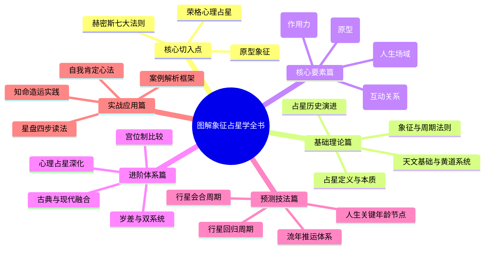

# 图解象征占星学全书

## 核心定位与编写缘起

《图解象征占星学全书》是作者在出版《占星其实很简单》系列入门篇与进阶篇后，历经八年探索重构的集大成之作。书稿将原有两册融合重组，并补充八年来对占星核心原理的深度心得，**以「原型象征」为唯一切入点**，系统串联历史、天文、赫密斯七大法则、荣格心理占星、行星周期与人生循环，构建从零基础到实战解盘的完整知识体系。

> **作者自述**：在完成八成本命盘全书编辑时才发现自己真正有了真正了解占星的根基。决定完全放空自己，重新回到最基本的部分，去思考12星座是什么？12宫位是什么？每一颗行星又代表什么？去探索占星中各种元素的核心原理，寻找每一个元素最简单最简单的关联象征。在经过八年的搜寻探索，终于找到了那个最根本的基本源头 —— 宇宙的基本原理。

## 知识架构总览

---

## 第一部 认识占星学

### 1-1 占星学是什么？

#### ◇ 星星的密码
占星学包含神话、天文学、数学、哲学、预言与宗教。古人发现数颗特殊星星（太阳、月亮、水星、金星、火星、木星、土星）沿黄道运行，其位置关系与人事变化对应，经数千年观察归纳发展而成。**占星学是解读星星密码的学问**。

#### ○ 上天如此，地下如是
核心公理：「在天成象，在地成形」，天有此象，地就有此形。行星与地球生命相互关联，农业社会中人们潜意识感受到日月星辰的近远、亮度与颜色与个人命运有奇妙互动。

#### ◇ 星星才是主角
- **行星是唯一影响主因**，星座只是行星力量的12种变化型态
- 每个出生时刻的行星位置独一无二，对应独特人生意义
- 荣格「同步性理论」：同一时间点上看似不相关的事物，具有相同意义，非行星影响人，而是彼此具有相同特殊性关联

> **跨页引用**：[[zhanxing-zhe-xue-ji-chu-bohm-hun-dun-jung#荣格同步性与占星]]、[[humanistic-astrology#原型与同步性]]、[[arroyo-astrology-psychology-four-elements#整合途径同步性]]

#### ◇ 宇宙法则：赫密斯七大法则
赫密斯主义（Hermes Trismegistus）传承的七大宇宙基本法则，占星术是运用这些法则的最有效工具：

| 法则 | 核心内容 | 占星应用 |
|------|----------|----------|
| **唯心法则** | 宇宙万物皆为心所造 | 星盘反映内在心智投射 |
| **上下一致法则** | 大宇宙与小宇宙对应，内在如何外在就如何 | 星盘宏观天象与微观人生同构 |
| **振动法则** | 万物皆在振动，改变频率改变现象 | 行星周期频率与人生阶段共振 |
| **二元对立法则** | 对立两面本质相同，相对性存在 | 星座极性、相位吉凶、行星庙旺落陷 |
| **周期循环法则** | 万物皆有周期，经历生长毁灭循环 | 行星回归、推运、大年小月周期 |
| **因果法则** | 业力法则，有因必有果，无巧合 | 本命盘业力模式、流年触发果报 |
| **阴阳法则** | 一切事物有阴阳两面，视角转换即转化 | 阳宫阴宫、阳星阴星、主动被动能量 |

> **跨页引用**：[[zhanxing-mofa-benjamin-dykes#占星与魔法宇宙观]]、[[alchemy-comprehensive-guide#赫密斯传承与七大法则]]、[[law-of-attraction-comprehensive-guide#三大万能法则]]

#### 人类的潜能与人生地图
- 科学家研究人类大脑使用率不足十分之一，占星术可解开潜能
- 个人人生蓝图如人生地图，解开星盘组合密码即掌握人生方向

#### 占星术的三重定义
1. **宇宙共通的符号象征语言**：反映宇宙基本原则，透过地球与星体关系对应人間万物
2. **分析工具**：分析自己他人运势、个性、动机，天象气候、人文流行、经济趋势、世界局势
3. **思考模式**：最基本的宇宙逻辑，连结理性与感性，掌握无意识与现实世界的连结

#### 宿命论与自由意志
- **印度占星偏宿命论**，现代西洋占星强调自由意志
- 命运如河流流向确定，但可在分支支点用自由意志决定未来
- 占星是教导「如何顺天」的学问，了解行星与人間关联如何相互顺应

> **跨页引用**：[[arroyo-astrology-karma-transformation#三种业力与转化]]、[[seth-philosophy-jane-roberts#信念创造实相]]、[[sanaya-roman-orin-teachings#显化法则与自由意志]]

### 1-2 占星学的历史

#### 占星术起源与早期发展
- **美索不达米亚平原**（公元前3000+年）：游牧民族观察日月五星特殊性，结合天体崇拜形成占卜基础
- **迦勒底人/新巴比伦帝国**（公元前600+年）：系统归纳整理，建立历法、蜜月旅行仪式
- **黄道十二宫确立**（公元前5世纪）：最早占星图见于公元前409年
- **希腊融合**：亚历山大东征带入希腊文明，行星对应希腊神祇，拉丁名沿用至今
- **托勒密《四书》**（100-170年）：奠定占星架构与原理，假定象义效应具有周期性与独特性

#### 马雅与东西方体系差异
- **马雅**：13×20=260天循环，52年大周期，重视金星周期
- **中国**：十天干×十二地支=60甲子循环，二十八宿配十二地支演变为十二生肖
- **印度**：恒星黄道系统，重视月亮交点（罗睺/计都），偏宿命论论断事件

#### 阿拉伯占星桥梁作用
- 保存希腊哲学科学，吸收埃及、印度、中国、炼金术等文化
- **阿拉伯点**（幸運點、婚姻點、死亡點）成现代占星重要敏感点
- 经阿拉伯回流欧洲，催生文艺复兴后占星复兴

#### 现代占星分野
- **古典占星**：事件预测、宿命论、七主星体系
- **现代占星**：心理分析、自由意志、三王星(天海冥)+小行星纳入、电脑排盘普及
- **汉堡学派**：中点理论、90度盘、八超海王星
- **泛音盘**：约翰·爱迪从印度分盘启发，基于音律共振分析命盤深层信息
- **高慕火星效应**：统计学验证出生时火星位置与运动员成就相关，证实占星基本前提

> **跨页引用**：[[xing-zhan-xue-yu-tian-wen-xue-shi#中国占星史]]、[[indian-astrology-jyotish-overview#核心差异]]、[[chinese-star-divination#果老星宗体系]]、[[arabic-parts-and-fixed-stars#阿拉伯点体系]]、[[zhanxing-shuji-mulu-yu-zhuti-daohang#历史源流分类]]

### 1-3 占星与天文学

#### 天文学基础框架
- 占星与天文同源五百年，哥白尼、伽利略、牛顿皆为占星高手
- **地心说观测视角**：以出生地为中心，行星位置投影黄道平面
- **星体为影响力来源**：行星间特殊角度产生交互作用，对个人/世界产生缓急影响

#### 星图四大核心要素
| 要素 | 定义 | 决定因素 |
|------|------|----------|
| **星座** | 黄道带春分点起12等分30°空间，12种基本原型 | 出生季节决定太阳星座 |
| **宫位** | 以东升点起黄道12等分区间，12种人生场景 | 出生时刻决定太阳宫位 |
| **行星** | 太阳系相关星球(含日月)、小行星、特殊点 | 出生瞬间行星黄道经度 |
| **相位** | 星体间特定夹角(0/60/90/120/180°)，吉凶互动 | 行星间黄道经度差 |

#### 坐标系与黄道系统
- **天球**：地球为心无限延伸假想球，88星座定位依据
- **黄道**：太阳在天球运行轨迹，倾斜赤道23.5°
- **春分点/秋分点**：黄赤道交点，日夜等长
- **岁差**：春分点每年西移50.25″，约25920年一周
- **回归黄道vs恒星黄道**：西洋占星用回归黄道(春分点起)，印度占星用恒星黄道(固定星起)，当前相差约24-30°

#### 宫位制比较
| 分类 | 代表制 | 核心逻辑 | 适用场景 |
|------|--------|----------|----------|
| **等分宫位** | 整宫制(Whole Sign) | 上升星座0°起宫，星座=宫位 | 古典/印度占星、整体快速判读 |
| | 等分宫制(Equal House) | 上升点起每宫30° | 中纬度地区、心理占星 |
| | 太阳宫制 | 太阳点起每宫30° | 无出生时间、太阳星座专栏 |
| **四分宫位** | 普拉西德斯(Placidus) | 上升到中天时间三等分投影 | **现代主流**、高纬度修正 |
| | 科赫(Koch) | 地平线与赤道交替起算至正午 | 普拉西德斯简化版 |
| | 波费里/坎帕那/雷吉蒙塔努斯/莫里纳斯 | 不同几何投影模型 | 专业研究、历史比较 |

> **跨页引用**：[[zhanxing-tianwen-jichu-yu-huangdao-tixi#坐标系统详解]]、[[zheng-gong-zhi-yu-shier-gong-wei#整宫制实务]]、[[vargas-divisional-charts#分宫图体系]]、[[zhanxing-yu-ce-ji-fa-ti-xi#宫位制选择对预测的影响]]

### 1-4 象征与周期

#### 占星理论基础：从物理到玄秘
- **毕达哥拉斯音乐宇宙论**：行星发射独特频率，出生时原始振动和谐则健康
- **科学解释尝试**：行星辐射能量场、磁场影响地球生命
- **人体微缩宇宙**：354穴位为敏感点，出生瞬间宇宙电磁场通过穴位建立个体宇宙磁场
- **量子全息观**：宇宙不可分割整体，局部变化影响整体，占星建立天地人感应链接

> **跨页引用**：[[zhanxing-zhe-xue-ji-chu-bohm-hun-dun-jung#波姆全息宇宙与占星]]、[[liang-zi-zhan-xing-xue#量子隐喻框架]]、[[kryon-dna-12-secrets-book#多次元DNA与振动频率]]

#### 天、地、人三因子关联
| 因子 | 占星对应 | 象征意义 |
|------|----------|----------|
| **天(宇宙)** | 12星座 | 12种基本原型特质，天人关系 |
| **地(地球)** | 12宫位 | 12种基本环境场景，地人关系 |
| **人** | 行星位置 | 个人基本能力特质，天地人关联点 |
| **互动** | 行星相位 | 能量流通顺逆，吉凶变化 |

#### 象征法则与碎形结构
- **象征连接**：金星→爱→玫瑰/巧克力/金牛天秤/金字塔，同一象征下奇妙关联
- **碎形自相似**：宇宙结构如碎形，放大缩小皆同模式
- **层层类似结构**：夸克→分子→细胞→器官→个体→家庭→国家→地球→太阳系→银河→宇宙，同构对应
- **原型归类**：万法归一，12星座/宫位/行星象义为12基本原型

#### 荣格与心理占星学奠基
- **荣格核心贡献**：
  - 占星学是古代心理学知识总和，星盘包含所有对立面
  - 心理目标是对立面整合，12星座=12集体无意识原型表现
  - **同步性原理**：无因果关联的有意义巧合，解释占星运作机制
  - 四心理功能对应四元素：感觉(土)、思考(风)、情感(水)、直觉(火)

> **跨页引用**：[[humanistic-astrology#荣格心理学整合]]、[[arroyo-astrology-psychology-four-elements#原型与宇宙法则]]、[[nei-xing-xing#荣格心理占星框架]]、[[zhanxing-zhongjian-xingzuo-xinli#荣格原型与星座心理]]

#### 时代更迭：双鱼时代至水瓶时代
- **柏拉图大月**：春分点每经一星座约2160年，构成时代象征
- **双鱼时代**(约公元前-2000年)：**无意识驱使的救赎时代**，耶稣基督象征第一条鱼，反基督象征第二条鱼
- **水瓶时代**(约2000-2050年)：**改革创新自由时代**，个体超越自我觉醒，秩序破坏与疏离冷漠为挑战
- **春分点恒星合相触发重大事件**：耶稣诞生、法国大革命、科学启蒙等

> **跨页引用**：[[zhanxing-quanshu-rudolf#时代周期与大年]]、[[earth-et-history-cosmology#地球历史与外星干预]]、[[convoluted-universe-book-1#三波志愿者与新地球]]

#### 周期法则：万物皆有循环
- **自然周期**：日月食、太阳黑子11年周期(战争高峰)、冰河期、干旱洪水
- **人文周期**：朝代更替、文明演进、经济波段、马克思出生日蚀金牛座创造共产主义
- **行星回归周期**：

| 行星 | 周期 | 人生阶段标记 |
|------|------|--------------|
| 太阳 | 1年 | 生日、年度主题 |
| 月亮 | 1月 | 情绪潮汐、月相循环 |
| 水星 | 88天 | 思维沟通节奏、逆行反思期 |
| 金星 | 225天 | 爱情价值观循环、逆行重评关系 |
| 火星 | 2年 | 行动能量周期、逆行能量内敛 |
| 木星 | 12年 | **成长扩张大周期**，12/24/36/48/60/72/84岁关键节点 |
| 土星 | 29.5年 | **成熟责任大周期**，29/59/89岁人生结构重组 |
| 天王星 | 84年 | **觉醒变革大周期**，21/42/63/84岁断裂重生 |
| 海王星 | 165年 | **灵性溶解大周期**，42/84岁集体幻象转化 |
| 冥王星 | 248年 | **生死蜕变大周期**，个人无法完成全周期 |

#### 行星会合周期与历史拐点
- **会合周期**：两行星从合相到下一合相，期间主要相位为关键触发点
- **木土20年会合**：权力与压力冲突，美国总统诅咒(林肯/肯尼迪上任木土合相)，近似60甲子三分之二
- **三王星会合**：公元前571年木天海会合，孔子/老子/释迦牟尼/毕达哥拉斯同期降世

> **跨页引用**：[[jupiter-saturn-cycles#木土20年社会周期]]、[[uranus-neptune-pluto-transits#三王星集体周期]]、[[zhanxing-liu-nian-rudolf#行星回归与会合预测]]、[[zhan-xing-kan-tian-xia#世运预测实例]]

#### 人生周期关键年龄表
| 人生阶段 | 关键年龄 | 核心相位/回归 | 主题挑战 |
|----------|----------|---------------|----------|
| **儿童反抗期** | 6-10岁 | 木星对分/土星刑冲 | 自我界限建立 |
| **启蒙期** | 12-14岁 | **木星首回归**/土星对分 | 青春期身份确立 |
| **成年期** | 18-28岁 | 木星对分/二回归、土星刑冲、天王刑冲 | 社会化、职业启动 |
| **成熟期** | 29-37岁 | **土星首回归**(29)、木星三回归(36) | **三十而立**、人生结构定型 |
| **中年危机期** | 40-47岁 | 土星刑冲、天王对分(42)、海王刑冲(44) | **中年觉醒**、价值重估 |
| **更年期** | 49-56岁 | 土星二回归前、海王/天王三分 | 身心转型、灵性深化 |
| **前老年期** | 59-63岁 | **木星五回归/土星二回归**(59)、天王刑冲 | 退休转型、智慧传承 |
| **老年期** | 65-84岁 | 木土持续刑冲回归、天王首回归(84) | 生命总结、超越准备 |

> **跨页引用**：[[saturn-return#土星回归三阶段]]、[[jupiter-return#木星回归成长节点]]、[[zhanxing-liu-nian-rudolf#人生关键年龄推运]]、[[bian-huan-de-tiankong#老师把戏师模型与人生阶段]]

---

## 核心要素体系：星盘四大支柱

### 十二星座：12种基本原型
**定义**：黄道带春分点起12等分，非指天文星群，**借用星座名作原型代码**。每星座30°，代表宇宙12种基本原型特质。

| 分类法 | 维度 | 星座分组 | 核心动力 |
|--------|------|----------|----------|
| **二分法** | 阳/阴 | 阳:牡羊/双子/狮子/天秤/人马/水瓶 阴:金牛/巨蟹/处女/天蝎/摩羯/双鱼 | 外向主动/内向接受 |
| **三分法** | 基本/固定/变动 | 基本:牡羊/巨蟹/天秤/摩羯 固定:金牛/狮子/天蝎/水瓶 变动:双子/处女/人马/双鱼 | 启动/维持/转化 |
| **四分法** | 火/土/风/水 | 火:牡羊/狮子/人马 土:金牛/处女/摩羯 风:双子/天秤/水瓶 水:巨蟹/天蝎/双鱼 | 意志/实感/理智/情感 |

> **跨页引用**：[[zodiac-sign-correspondences#十二星座完整对应表]]、[[star-transit-chiefs#三方四正人性分类]]、[[han-lianglu-12-zodiac-planetary-interactions#十二星座演化意识]]、[[twelve-zodiac-archetypes#原型爱情与宿命功课]]

#### 星座原型神话映射
- **牡羊座**：英雄启程、黄金羊毛、自我诞生
- **金牛座**：欧罗巴公牛、丰饶女神、感官享受
- **双子座**：卡斯托尔波鲁克斯、信使神、双重性
- **巨蟹座**：赫拉派巨蟹、母性保护、情感根基
- **狮子座**：尼米亚狮、太阳神阿波罗、创造自我
- **处女座**：德墨忒尔/珀耳塞福涅、收获女神、精炼服务
- **天秤座**：阿斯特赖亚天平、正义和谐、关系镜像
- **天蝎座**：奥里翁猎手、凤凰涅槃、生死转化
- **人马座**：凯龙半人马、哲学家、真理追寻
- **摩羯座**：海山羊潘、时间之主、成就结构
- **水瓶座**：加尼米德水瓶、革新者、群体意识
- **双鱼座**：阿芙洛狄忒厄洛斯、合一溶解、灵性回归

> **跨页引用**：[[zhong-shen-de-xing-kong#黄道十二宫神谱]]、[[zhanxing-xingxing-tianwen-yu-yiyi#行星神话原型心理映射]]、[[asteroid-goddesses-mandala#四女神星曼陀罗原型]]

### 十二宫位：12种人生场域
**定义**：以东升点(ASC)为第一宫起点，逆时针分布，代表个人与世界互动的12个生活领域。

| 宫位 | 名称 | 核心主题 | 对应星座原型 | 角度特殊点 |
|------|------|----------|--------------|------------|
| **1宫** | 命宫/上升 | 自我形象、身体、人生面具 | 牡羊座 | **ASC东升点** |
| **2宫** | 财宫 | 金钱价值观、资源、自尊 | 金牛座 | |
| **3宫** | 兄弟宫 | 沟通学习、短途、兄弟姐妹 | 双子座 | |
| **4宫** | 田宅/天底 | 家庭根基、内在情感、晚年 | 巨蟹座 | **IC天底点** |
| **5宫** | 子女宫 | 创造表达、恋爱、投机、子女 | 狮子座 | |
| **6宫** | 奴仆/疾厄 | 工作服务、健康、日常琐事 | 处女座 | |
| **7宫** | 夫妻/下降 | 伴侣关系、合作、公开敌人 | 天秤座 | **DES西降点** |
| **8宫** | 疾厄/命运 | 共享资源、性、死亡重生、奥秘 | 天蝎座 | |
| **9宫** | 迁移/福德 | 高等教育、远行、信仰、法律 | 人马座 | |
| **10宫** | 官禄/中天 | 事业声誉、社会地位、权威父母 | 摩羯座 | **MC中天点** |
| **11宫** | 交友/祸福 | 社群理想、友谊、集体愿景 | 水瓶座 | |
| **12宫** | 玄秘/隐匿 | 潜意识、业力、隐秘、灵性超越 | 双鱼座 | |

#### 四轴心心理动力模型
- **ASC/DES轴**：自我↔他者，投射与镜像，关系课题
- **MC/IC轴**：社会角色↔内在根基，外在成就与内在安全感平衡

> **跨页引用**：[[sasportas-twelve-houses#十二宫位生命过程]]、[[zhenggongzhi-yu-shier-gongwei#宫位组合应用]]、[[zhanxing-zhongjian-xingzuo-xinli#宫位心理动力学]]、[[darby-costello-moon-in-astrology#月亮在十二宫位]]、[[zhanxing-yu-zhen-wo#四柱生命骨架]]

### 十大行星：作用力与心理功能
**定义**：太阳系相关星球(含日月)、三王星、凯龙星、小行星、敏感点。每星代表特定心理功能与能量模式。

| 行星 | 核心功能 | 心理对应 | 神话原型 | 掌管星座 | 喜乐/落陷 |
|------|----------|----------|----------|----------|-----------|
| **太阳** | 生命核心、意志、自我实现 | 自我、个体化中心 | 阿波罗/拉/奥西里斯 | 狮子座 | 喜乐狮子/落陷水瓶 |
| **月亮** | 情绪本能、记忆、养育需求 | 内在小孩、潜意识 | 阿耳忒弥斯/伊西斯/嫦娥 | 巨蟹座 | 喜乐巨蟹/落陷摩羯 |
| **水星** | 思维沟通、学习、感知 | 理性心智、信使 | 赫耳墨斯/托特/奥丁 | 双子/处女 | 喜乐双子处女/落陷人马双鱼 |
| **金星** | 爱情价值、审美、吸引 | 阿尼玛/关系模式 | 阿佛洛狄忒/伊南娜/西王母 | 金牛/天秤 | 喜乐金牛天秤/落陷天蝎白羊 |
| **火星** | 行动欲望、攻击、防御 | 阿尼姆斯/生存本能 | 阿瑞斯/马尔斯/关羽 | 白羊/天蝎 | 喜乐白羊天蝎/落陷天秤金牛 |
| **木星** | 扩张成长、信念、幸运 | 超我、意义追寻 | 宙斯/朱庇特/雷神 | 人马/双鱼 | 喜乐人马双鱼/落陷双子处女 |
| **土星** | 结构限制、责任、业力 | 现实原则、权威内化 | 克洛诺斯/沙尼/阎罗王 | 摩羯/水瓶 | 喜乐摩羯水瓶/落陷巨蟹狮子 |
| **天王星** | 觉醒变革、自由、直觉 | 更高心智、突破 | 天王星/普罗米修斯/哪吒 | 水瓶座 | 喜乐水瓶/落陷狮子 |
| **海王星** | 溶解边界、幻象、灵性 | 集体无意识、超越 | 波塞冬/尼普顿/观音 | 双鱼座 | 喜乐双鱼/落陷处女 |
| **冥王星** | 生死蜕变、权力、深层转化 | 阴影、灵魂进化 | 黑帝斯/普路托/阎摩 | 天蝎座 | 喜乐天蝎/落陷金牛 |

#### 行星分类与进化层级
| 层级 | 行星 | 特质 | 发展任务 |
|------|------|------|----------|
| **个人行星** | 太阳/月亮/水星/金星/火星 | 个性核心、日常功能 | 我是谁、怎么生存 |
| **社会行星** | 木星/土星 | 社会化、结构化 | 如何融入、建立秩序 |
| **超个人/外行星** | 天王星/海王星/冥王星 | 集体进化、超越个体 | 如何觉醒、转化、合一 |
| **桥梁小行星** | 凯龙星/四女神星 | 个人→集体转化节点 | 疗愈整合、女性原型完整 |

> **跨页引用**：[[nei-xing-xing#内行星心理功能详解]]、[[outer-planet-transits-psychological-framework#外行星行运心理框架]]、[[zhanxing-xingxing-tianwen-yu-yiyi#十大行星神话心理天文三位一体]]、[[asteroid-goddesses-book#四女神星原型框架]]、[[chiron-asteroid-wounded-healer#凯龙星受伤疗愈者]]

### 相位：行星间的能量对话
**定义**：行星间特定角度关系，代表心理功能间的互动模式、能量流通质量。

| 相位 | 角度 | 性质 | 心理机制 | 关键词 |
|------|------|------|----------|--------|
| **合相** | 0° | 融合/强化 | 能量合一、盲点/天赋 | 强度、专注、整合 |
| **六分相** | 60° | 机会/和谐 | 才能显现、需主动开发 | 机会、技巧、流通 |
| **四分相** | 90° | 张力/挑战 | 冲突推动成长、内在斗争 | 危机、行动、突破 |
| **三分相** | 120° | 流畅/天赋 | 自然和谐、易忽视潜能 | 容易、保护、表达 |
| **对分相** | 180° | 对立/投射 | 外镜内、关系拉扯、整合 | 意识化、平衡、他者 |
| **半四分相** | 45° | 内在刺激 | 微张力、持续调整 | 烦躁、驱动、精进 |
| **五分相** | 72° | 创造/特殊 | 独特才华、非线性连接 | 灵感、宿命、天赋 |

#### 容许度标准
- 主要相位：8°(合/对/四/三/六)
- 次要相位：4°(半四/五分/八分三/十二分五)
- 角点(ASC/MC)与日月：可放宽至10-12°

#### 苏·汤普金斯心理相位理论
- **相位=情结(Complex)**：行星能量交织形成的心理情结
- **合相**：融合情结，未分化潜能
- **四分相**：冲突情结，驱动个体化
- **三分相**：和谐情结，资源易得
- **对分相**：投射情结，关系中整合
- **星盘整合读法**：相位网络→核心情结群→人生主题

> **跨页引用**：[[sue-tompkins-aspect-theory#相位情结理论]]、[[aspect-interpretation-framework#五大相位深度诠释]]、[[minor-aspects-psychological-astrology#次要相位心理动力学]]、[[zhanxing-tuxing-xiangwei-quanshu#图形相位与行星组合]]、[[zhanxing-biji-zhaohui-zhenshi-ziji#相位关键字速查]]

---

## 预测技法体系：时间维度的展开

### 推运三大核心技法
| 技法 | 原理 | 时间映射 | 适用层面 |
|------|------|----------|----------|
| **行运(Transits)** | 实时行星触发本命星 | 实时1:1 | 外在事件触发、集体氛围 |
| **次限推进(Secondary Progressions)** | 出生后1天=1年 | 象征性时间 | 内在心理成长、人生阶段 |
| **太阳弧推进(Solar Arc Directions)** | 太阳每日推进约1° | 等距推进 | 事件时机精确定位 |

### 行星回归与会合预测实务
- **木星回归(12/24/36/48/60/72/84岁)**：扩张机会窗口、信念升级
- **土星回归(29/59/89岁)**：结构重组、责任成熟、业力清算
- **天王星半回归(42岁)**：中年觉醒、突破僵化
- **海王星刑冲(42/84岁)**：幻象破灭、灵性开悟
- **冥王星刑冲(36-45岁)**：深层蜕变、权力交接
- **木土会合(20年)**：社会周期转折、事业重大抉择

### 流年推运实操步骤
1. **确定年度主题**：太阳回归图+木星土星行运重点宫位
2. **识别关键触发**：外行星(天海冥)触发本命个人行星/角点
3. **次限推进月亮/太阳换宫/相位**：内在心理阶段转换
4. **日蚀月蚀轴落宫**：半年/年周期重大事件区域
5. **太阳弧触发角点/个人行星**：精确事件时机验证

> **跨页引用**：[[zhanxing-liu-nian-rudolf#五大流年技法体系]]、[[zhanxing-yu-ce-ji-fa-ti-xi#预测技法术语规范]]、[[bian-huan-de-tiankong#三层面预测理论]]、[[outer-planet-transits-psychological-framework#危机五阶段与转化模型]]、[[zhan-xing-kan-tian-xia#世运预测与名人命盘]]

---

## 实战解盘：从星盘到人生地图

### 星盘四步读法
| 步骤 | 核心任务 | 关键检查点 | 输出成果 |
|------|----------|------------|----------|
| **1. 格局扫描** | 元素/模式统计、半球分布、行星丛聚 | 缺失元素、强势半球、Stellium宫位 | 基本能量画像、人生侧重 |
| **2. 四轴定锚** | ASC/DESC、MC/IC星座与行星 | 宫主星落宫、相位、守护星状态 | 人生框架、核心动力轴 |
| **3. 行星逐一拆解** | 十大行星：星座/宫位/相位/状态 | 庙旺落陷、相位网络、宫主星链 | 具体心理功能运作模式 |
| **4. 相位网络整合** | 相位模式(大三角/T-Cross/大十字/风筝/神秘矩形) | 核心情结群、能量流向、出口行星 | 核心人生主题、转化路径 |

### 自我肯定心法与双轨实作法
> **跨页引用**：[[zhanxing-biji-zhaohui-zhenshi-ziji#自我肯定心法与双轨实作法]]

- **核心心法**：星盘非判决书，**自我肯定**是读盘前提
- **双轨制**：星盘分析 + 「关于我笔记」主观体验记录
- **关键字速查表**：行星/星座/宫位/相位核心词快速检索
- **绘图指南**：astro.com等工具操作、手绘曼陀罗强化连接

### 知命造运实践框架
1. **知命**：识别本命盘业力模式、天赋短板、核心课题
2. **顺天**：流年推运把握进退时机、借势而为
3. **造运**：自由意志在分支点做高振动选择、重塑神经回路
4. **验证**：实战案例复盘、调整认知模型、累积智慧

> **跨页引用**：[[zhan-xing-kan-tian-xia#知命造运实践框架]]、[[arroyo-astrology-karma-transformation#转化导向占星]]、[[sasportas-gods-of-change#危机转化与种子隐喻]]、[[sanaya-roman-orin-teachings#显化法则与情绪引导系统]]

---

## 书稿特色与知识体系创新点

### 原型象征为唯一切入点
- 拒绝「关键词堆砌」，建立**神话→天文→心理三位一体**原型理解链
- 每一要素(星座/宫位/行星/相位)皆追溯至**最简核心象征**
- 例：金星非「爱情星」，而是「吸引与价值评估原型」，统摄爱情/金钱/审美/资源

### 赫密斯七大法则贯穿全书
- 非附录式引入，而是**每章理论基石、每技法操作依据**
- 例：相位解读用「二元对立+振动+因果」，推运用「周期+上下一致+阴阳」

### 荣格心理占星深度整合
- **同步性原理**解释占星为何有效(非因果、共时性关联)
- **原型/阴影/阿尼玛阿尼姆斯/个体化**映射星盘核心结构
- **情结理论**重释相位：相位=激活的心理情结

### 行星周期与人生循环精密对应
- **微观**：日月周期→情绪/事件节奏
- **中观**：木火土周期→成长/行动/结构阶段
- **宏观**：天海冥周期→集体进化/时代精神/灵魂进化
- **人生关键年龄表**提供可操作的生命地图

### 古典技法与现代心理融合
- **整宫制/行星状态/本命主星/阿拉伯点/恒星**古典核心技法完整保留
- **心理占星/演化占星/超个人占星**现代视角深度融合
- **汉堡中点/泛音盘/和谐盘**专业进阶工具纳入

### 图解化教学设计
- **每个概念配专属图示**：天球模型、黄道分割、相位几何、周期波形、人生阶段表
- **星盘实例分层标注**：新手看基础层、进阶看深度层
- **符号视觉化记忆法**：行星符号拆解、星座符号溯源、相位符号几何本质

### 跨学科知识网络
- **天文/数学/神话/心理学/量子物理/神话学/炼金术/塔罗/易学**交叉引用
- **中西占星对照**：回归/恒星黄道、十二宫/二十八宿、西洋/印度/中国三体系
- **身心灵整合**：脉轮/能量医学/显化法则/前世今生/灵性疗愈

---

## 章节详细大纲(完整书稿结构)

### 第一部 认识占星学（已详述）
- 1-1 占星学是什么？——定义、本质、法则、历史使命
- 1-2 占星学的历史——美索不达米亚到现代分野演进
- 1-3 占星与天文学——坐标系、黄道、宫位制、岁差
- 1-4 象征与周期——理论基础、天地人、碎形、荣格、时代周期、行星周期、人生周期
- 1-5 出生星盘——四大要素、星盘结构、读图入门
- 1-6 占星的符号——行星/星座/相位/特殊点符号溯源与视觉化记忆

### 第二部 十二星座：原型的十二面相
- 2-1 星座分类学：二分/三分/四分法深度解析
- 2-2 火象三星座：牡羊/狮子/人马——意志与灵感的展开
- 2-3 土象三星座：金牛/处女/摩羯——实感与结构的建构
- 2-4 风象三星座：双子/天秤/水瓶——理智与连接的编织
- 2-5 水象三星座：巨蟹/天蝎/双鱼——情感与融合的深潜
- 2-6 星座原型神话全景：每星座核心神话、心理任务、进化路径
- 2-7 星座在宫位中的表达：同一星座落不同宫位的场域化呈现

### 第三部 十二宫位：人生的十二场域
- 3-1 宫位天文几何：四轴、象限、半球、拦截、宫位大小
- 3-2 宫位制比较实务：整宫/普拉西德斯/科霍/等分制优劣与选择
- 3-3 十二宫位深度解析：每宫核心主题、心理功能、人生事件、守护星追踪
- 3-4 四轴心理动力学：ASC/DESC自我他者、MC/IC事业根基
- 3-5 宫位连锁与衍生宫：宫主星落宫链条、衍生宫位解读法
- 3-6 空宫不是空：空宫守护星状态、相位、推运激活机制

### 第四部 十大行星：心理功能的能量谱系
- 4-1 太阳：个体化中心、生命意志、英雄之旅
- 4-2 月亮：内在小孩、情绪记忆、养育模式、灵魂根基
- 4-3 水星：感知过滤、思维模式、沟通风格、学习路径
- 4-4 金星：价值锚点、关系蓝图、审美取向、吸引法则
- 4-5 火星：行动引擎、欲望防卫、冲突模式、勇者之路
- 4-6 木星：信念地图、扩张路径、意义追寻、导师原型
- 4-7 土星：现实骨架、权威内化、业力契约、时间之主
- 4-8 天王星：觉醒闪电、自由突破、直觉下载、革新者
- 4-9 海王星：边界溶解、集体共鸣、幻象陷阱、神秘合一
- 4-10 冥王星：灵魂蜕变、权力真相、阴影整合、凤凰涅槃
- 4-11 凯龙星与桥梁小行星：受伤疗愈者、女性原型完整化

### 第五部 相位：能量的几何对话
- 5-1 相位几何本质：圆周分割、谐波共振、容许度标准
- 5-2 五大相位深度心理诠释：合/六/四/三/对——情结与转化
- 5-3 次要相位与特殊相位：半四分/五分/八分三/十二分五/隐相位
- 5-4 相位模式识别：大三角/T-Cross/大十字/风筝/神秘矩形/大锤/拱连
- 5-5 相位网络整合读法：核心情结群、能量流向、出口行星、补偿机制
- 5-6 行星状态与相位修正：庙旺落陷、相位相、速度、逆行、燃烧

### 第六部 预测技法：时间的展开与折叠
- 6-1 行运：外在触发器、外行星慢速周期、内行星快速触发、行运图读法
- 6-2 次限推进：内在成长时钟、推进月亮/太阳/水金火、推进角点换宫
- 6-3 太阳弧推进：事件时机精准定位、太阳弧触发本命/推进/行运三重验证
- 6-4 行星回归与会合：木星/土星/天王星/海王星/冥王星/木土/木天等周期实务
- 6-5 日蚀月蚀与蚀周期：蚀点落宫、蚀族系列、19年梅顿周期、蚦前后敏感期
- 6-6 综合推运实战流程：年度/月度/周度/日度四层级、关键词提取、事件窗口锁定

### 第七部 实战解盘：从理论到智慧
- 7-1 星盘四步读法标准化流程：格局→四轴→行星→相位网络
- 7-2 核心人生主题提取法：主导元素/模式、核心相位模式、行星丛聚、四轴行星
- 7-3 咨询伦理与框架：来访者中心、知情同意、预测边界、赋能导向
- 7-4 经典案例全程复盘：名人/普通人/关系/事业/健康/灵性六大类案例
- 7-5 自我肯定心法与双轨实作：星盘+笔记、关键字速查、绘图曼陀罗、验证循环
- 7-6 知命造运：业力识别、自由意志锻炼、显化实操、生命花园经营

### 第八部 进阶专题与跨学科映照
- 8-1 古典占星核心技法：整宫制、行星状态、本命主星、阿拉伯点、恒星、反照
- 8-2 印度占星精华映照：恒星黄道、二十七星宿、分盘图、维姆绍大运、行星战争
- 8-3 中国星命学对照：二十八宿、七政四余、紫微斗数、四柱八字、太岁流年
- 8-4 医学占星与身心对应：黄道十二宫身体映射、行星器官统摄、体液/元素/脉轮整合
- 8-5 关系占星深度：合盘/中点盘/比较盘/达沃逊盘、亲密关系业力契约
- 8-6 世运占星与集体命运：外行星大周期、木土/天冥/海冥会合、国家/城市星盘
- 8-7 占星与显化法则：吸引力漩涡、情绪引导系统、振动频率、有意创造
- 8-8 占星与灵性进化：灵魂计划、北交点/龙头图/前世指标、个体化→神性化

---

## 参考书目与知识溯源网络

### 核心经典奠基之作
| 书目 | 作者 | 核心贡献 | 本书整合点 |
|------|------|----------|------------|
| **《占星、心理学与四元素》** | Stephen Arroyo | 人本占星、四元素心理功能、同步性整合 | 第二章星座原型、第四部行星心理功能 |
| **《占星、业力与转化》** | Stephen Arroyo | 业力类型、土星业力王、水象宫业债、日月法则 | 第八部业力识别、第六部土星周期 |
| **《占星十二宫位研究》** | Howard Sasportas | 宫位即生命过程、自然黄道对应、空宫守护星 | 第三部宫位深度、第七部案例框架 |
| **《变异三王星》** | Howard Sasportas | 外行星行运心理动力学、意义疗法、耗散结构 | 第四部外行星、第六部推运危机模型 |
| **《占星相位研究》** | Sue Tompkins | 相位即情结、五大相位心理诠释、星盘整合读法 | 第五部相位理论、第七部整合读法 |
| **《占星全书》** | 鲁道夫 | 占星历史、天文基础、行星意涵、木星周期教学法 | 全书历史/天文/教学架构溯源 |
| **《占星扬升指南》** | 鲁道夫 | 关键字系统、神话心理天文三位一体、生命循环宫位 | 第二部星座、第三部宫位、第八部灵性进化 |
| **《内行星》** | Sasportas & Greene | 水金火心理深度、神话原型、门槛功能 | 第四部个人行星详解 |
| **《当代占星研究》** | Sue Tompkins | 相位计算、容许度、无关连相位、实战框架 | 第五部技术规范、第七部实操流程 |

### 跨学科映照节点
| 领域 | 核心映照点 | 关联章节 |
|------|------------|----------|
| **量子物理/全息宇宙** | 波姆隐显秩序、观察者效应、非定域性 | 1-4象征理论、8-7显化法则 |
| **荣格深度心理学** | 集体无意识、原型、阴影、同步性、个体化 | 1-4荣格章节、全书心理框架 |
| **赫密斯/炼金术/卡巴拉** | 七大法则、大小宇宙、生命之树、四元素 | 1-1宇宙法则、2-1分类学、8-8灵性进化 |
| **神话学/比较宗教** | 星座/行星神话原型、英雄之旅、生死重生 | 第二部星座神话、第四部行星神话 |
| **中国易学/命理** | 阴阳五行、二十八宿、紫微斗数、流年大运 | 1-2历史、8-3中西对照、6-4周期对应 |
| **印度吠陀占星** | 恒星黄道、星宿、分盘、大运、行星状态 | 8-2印度精华、1-3黄道系统 |
| **显化/新思想/灵性** | 吸引力法则、振动频率、信念重塑、阿卡西记录 | 8-7显化法则、1-1宿命自由意志 |

---

## 使用指南与学习路径建议

### 零基础入门路径（3-6个月）
1. **第一部通读** → 建立占星整体认知框架
2. **第二部+第三部精读** → 熟记12星座/12宫位核心原型与关键词
3. **第四部逐星研习** → 十大行星每周深入一颗，完成「行星日记」
4. **第五部相位入门** → 掌握五大相位几何与心理关键词
5. **第七部四步读法实操** → 自身/亲友/名人星盘各练3张，记录「关于我笔记」

### 进阶深化路径（6-12个月）
1. **第六部推运技法** → 学会年度/月度推运，追踪自身流年验证
2. **第八部专题拓展** → 选择1-2专题(医学/关系/世运/古典/印度)深钻
3. **案例库建立** → 收集50+验证案例，建立个人「相位-事件」数据库
4. **咨询实习** → 在导师督导下进行10+小时实战咨询，复盘记录

### 专业精通路径（持续终身）
1. **古典技法精通** → 整宫制/本命主星/阿拉伯点/恒星/反照/择时
2. **跨体系整合** → 西洋/印度/中国三系统对照验证、多重确证
3. **前沿研究** → 天体物理新发现/心理治疗新流派/量子生物学/显化科学
4. **教学传承** → 输出教案/著作/课程，建立个人占星教学体系

---

## 版本迭代与维护说明

> 本页面为《图解象征占星学全书》知识库核心索引页，将随书稿定稿进度持续更新。所有交叉引用页面均为知识库现有条目，点击即可跳转深度阅读。欢迎读者通过编辑建议补充案例、修正谬误、拓展专题。

**最后更新**：2025-01-20  
**维护者**：数字知识库策展人  
**关联总索引**：[[zhanxing-shuji-mulu-yu-zhuti-daohang]]  

---

*「星星不是命运的锁链，而是灵魂的罗盘。懂得阅读星语，便拥有了在迷雾中辨识真北的勇气与智慧。」*  
—— 《图解象征占星学全书》序言

## 来源

- [图解象征占星学全书](../sources/图解象征占星学全书.md)
