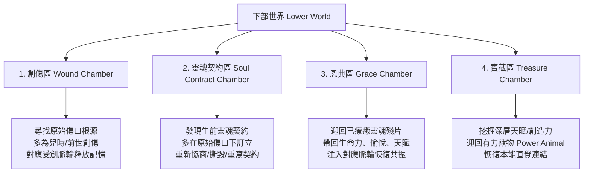

## 維洛多九脈輪體系概述

阿貝托·維洛多醫師（Dr. Alberto Villoldo）在《印加靈魂復元療法》（Mending the Past and Healing the Future with Soul Retrieval）中，繼承印加薩滿傳統的七脈輪架構，並擴展為**九脈輪體系**。此體系將脈輪視為能量吸收、釋放與交換的旋轉光輪，沿脊柱分佈，連結肉體、靈魂與精神三個層面，並對應「下部世界（過去/潛意識）」、「中間世界（當下/顯意識）」、「上部世界（未來/超意識）」三大意識畛域。

> **核心觀點**：當人經歷創傷導致靈魂部分失落（Soul Loss），相應脈輪會儲存痛苦記憶、能量受阻，進而影響身心健康與命運軌跡。透過「靈魂復元」與「時空遊歷」療癒各脈輪，可修復過去、擷取命運、重塑未來。

---

## 傳統七脈輪：功能、靈魂失落徵兆與療癒主題

維洛多醫師依脊柱自下而上排列，前四脈輪屬「土地脈輪」（下部世界/過去/潛意識），後三脈輪屬「天空脈輪」（上部世界/未來/超意識），心脈輪為軸心。

| 脈輪 | 位置 | 核心功能 | 靈魂失落徵兆 | 療癒後呈現 |
|------|------|----------|--------------|------------|
| **1. 海底輪** Root Chakra | 脊柱基部 | 通往大地之母、女性能量通道；安全感、生存根基 | 孤立無依、像孤兒、難以信任他人、過度尋求物質安全感 | 消除不足感與欠缺感，建立深層安全感 |
| **2. 臍輪** Sacral Chakra | 肚臍下四指 | 熱情、性能量、早期自我意識；腎上腺啟動、「面對或逃避」應激模式 | 長期處於恐懼/焦慮、腎上腺素過度分泌、覺得世界充滿威脅、難以行動 | 不再活於恐懼，世界感知為安全處所，行動力恢復 |
| **3. 太陽神經叢** Solar Plexus | 胃部上方 | 自我表達、人格展現、個人意志 | 悲傷、羞愧感、或過度自我膨脹、不清晰自我身份 | 家庭/人際關係穩固，自我認同清晰 |
| **4. 心輪** Heart Chakra | 胸腔中央 | **全系統軸心**；給予/接納愛、寬恕、連結 | 分不清真愛與迷戀、自我迷戀、情感封閉、關係受創 | 體驗無私的愛與寬恕，能量自然流向最需療癒之處 |
| **5. 喉輪** Throat Chakra | 喉嚨凹陷處 | 靈性溝通中心、非語言力量表達、說真話 | 睡眠失調、害怕表達/被聽見、體重失調、無法分辨真偽、難以忠於自我 | 進入自我力量範圍，找回內在聲音，清晰真實溝通 |
| **6. 第三隻眼** Third Eye | 前額中央 | 直覺洞見、認知「與造物主合一」、表達內在神性、在他人見神性 | 過度理智化、與內在感覺脫節、不知自己感受、靈性分離感 | 體驗靈性真實，不再覺得與神性分離 |
| **7. 頂輪** Crown Chakra | 頭頂 | 通往上蒼/源頭之門、超越時空維度、天地合一 | 巨大孤寂感、靈性斷連、無法進入超越時空狀態 | 活力充沛遊走時空維度，與天地合一（療癒全七脈輪後始能助人） |

> **關鍵提示**：心輪為「能量聚合點」。維洛多醫師指出，當不確定失落靈魂應歸屬哪脈輪時，將其帶回心輪，療癒能量會自動流向最需要之處。

---

## 第八脈輪：靈魂脈輪——轉世記憶與命運藍圖

- **位置**：盤旋於頭頂上方，如光芒四射的太陽（對應基督聖容金色光暈、佛陀光環）。
- **本質**：靈魂延伸出的發光母體，如發光柵網遍佈宇宙，傳遞能量訊息連接兩極。
- **核心功能**：
  1. **儲存所有轉世記憶**——每一次成肉身的經驗、創傷、契約、天賦。
  2. **攜帶命運藍圖**——選擇生身父母、家庭環境、人生課題與最高福祉路徑。
  3. **死亡時不消逝**——肉體死後第八脈輪保留完整記憶與能量，不覺得損失（如木匠燒毀一把椅子，知曉可再造一把）。
- **與靈魂失落的關係**：若靈魂創傷未療癒，第八脈輪會在每次轉世中「在每把新造的椅子上（即新肉體）顯現出來」，使人重複遭遇相似家庭、關係、境遇，直到療癒該傷口。
- **進階運作**：療癒過程中，第八脈輪會擴大為發光球體，包裹其餘脈輪，經懺罪與淨化後，沿「時光線索」追蹤療癒過去、影響未來。這些線索連結河流、森林、出生地、當下居住地。

> **前置條件**：除非已療癒第一至第七脈輪的靈魂失落，否則無法接近第八脈輪。療癒完成後，不再以個人歷史定義自我，而以精神體界定自我。

---

## 第九脈輪：精神體脈輪——肉體建築師與超越時空連結

- **位置**：棲住於發光能量場之外，宇宙萬物中心，與無限連接。
- **別稱**：「肉體的偉大建築師」（Great Architect of the Body）。
- **核心功能**：
  1. **建構肉體結構**——依據第八脈輪藍圖，在每一世製造新軀體。
  2. **超越時空**——位於「時間之外」，治療者透過聚焦第九脈輪，可進行「時空遊歷」：回溯過去修補創傷、前往未來擷取命運。
  3. **非局域性操作平台**——量子物理學的「非局域性」在此具象化：不受時空距離限制，以意圖與強烈願望即時影響事件。
- **意識狀態**：進入「超越時間的永恆當下」（Timeless Now），萬事萬物同時發生，過去不再決定現在，未來可反向引導當下。

> **愛因斯坦語錄**：「對於我們這些物理學家而言，過去、現在、未來的區別只是一個幻影，雖然這幻影非常頑固。」

---

## 三大世界與四大腦區：意識導航地圖

維洛多醫師結合神經科學與薩滿傳統，繪製意識導航地圖：

| 世界/畛域 | 對應心理層面 | 對應腦區 | 核心特質 | 時空遊歷角色 |
|-----------|--------------|----------|----------|--------------|
| **下部世界** Lower World | 潛意識、個人/集體歷史、靈魂記憶 | **1. 原始/爬蟲腦** 延髓、小腦 | 生存本能、自主神經、生物性時間感（進食/交配） | 存取創傷區、靈魂契約區、恩典區、寶藏區；療癒過去 |
| **中間世界** Middle World | 顯意識、當下現實、日常生活 | **2. 邊緣系統/猴子腦** 杏仁核、海馬體 | 情緒、部落/家庭系統、四大本能（恐懼、進食、打鬥、交配）、迷信 | 當下體驗場域；受邊緣系統主導時陷入宿命循環 |
| **上部世界** Upper World | 超意識、命運、大靈、未來藍圖 | **3. 新皮層/科學家腦** **4. 前額葉皮質/上帝腦** | 抽象思維、時間單位發明、個人主義、工業文明基礎 | 新皮層：線性時間規劃；前額葉：非線性時間、與萬物合一、療癒未來、擷取命運 |

> **兩次覺醒**：
> 1. **猴子腦覺醒**（30-40歲）：意識到「我必死」，活於死亡恐懼。
> 2. **上帝腦覺醒**：意識到「超越俗世的永生自我」，不受恐懼擺布，進入時空遊歷、詩人/音樂家/巫士的高峰體驗領域。

---

## 靈魂復元四區室與脈輪對應療癒流程

下部世界分四區室，每區室對應特定療癒任務，並與脈輪系統交互運作：

- **守門人**：遊歷下部世界前需開啟神聖空間、呼喚守門人（印加稱「華斯卡」Huascar，象徵繩索連接上下世界），獲許可與護衛。
- **獸物**：療癒完成後從寶藏區迎回，作為直覺本能向導，協助重連大地與內在智慧。

---

## 時空遊歷、非局域性與命運擷取

### 核心原理
- **非局域性**：量子層面證實，兩粒光子經偏光鏡測量，瞬間影響彼此，不受時空距離限制。治療者古老技術早已應用此原理。
- **祈禱實證**：23項嚴謹研究證實遠距祈禱有效；溯及既往祈禱（British Journal of Medicine）證實十年前出院病人因十年後祈禱而住院/發燒天數縮短——因在「時間之外的現在」一切同時發生。
- **命運追蹤**：澳洲原住民「唱出世界」、奧色治族追蹤命運線選定遷徙地（後發現石油成為最富部落）。

### 實作架構
1. **修復過去**：進入下部世界四區室，療癒創傷、釋放契約、迎回恩典與寶藏。
2. **擷取未來**：進入上部世界，遊歷未來可能命運線，選擇最高福祉藍圖，將其「安裝」進當下生活。
3. **跳脫因果輪迴**：不再以過去歷史草擬現在，而是讓未來完成態反向拉動當下行動（如維洛多寫作前先遊歷未來已完成的書）。

> **帕西法爾聖杯傳說**作為原型隱喻：宿命（母親「心痛」織的粗布衣、父親/兄長的武士宿命）vs 命運（聖杯城堡、問出「聖杯主人是誰」、療癒漁翁國王傷口）。老太婆（Crone/時間女神）揭露內在缺失，迫使英雄轉向命運之路。

---

## 整合應用：從脈輪療癒到命運實現

| 階段 | 核心任務 | 關鍵技術 | 對應脈輪/世界 |
|------|----------|----------|---------------|
| **1. 安全準備** | 開啟神聖空間、呼喚守門人、建立保護 | 儀式祈禱、想像發光軀體下沉 | 所有脈輪基礎穩定 |
| **2. 下部世界療癒** | 探索四區室、療癒原始傷口、重寫契約、迎回靈魂殘片與獸物 | 時空遊歷、引導式冥想、呼吸法、主動想像 | 第1-7脈輪、下部世界 |
| **3. 第八脈輪整合** | 存取轉世記憶、檢視命運藍圖、沿時光線索療癒跨世創傷 | 懺罪淨化、發光球體包裹、時光線索追蹤 | 第8靈魂脈輪、下部世界深層 |
| **4. 第九脈輪命運擷取** | 進入「時間之外」、遊歷未來最高福祉命運、安裝新藍圖 | 聚焦第九脈輪、非局域性意圖、主動想像實現 | 第9精神體脈輪、上部世界 |
| **5. 實相化** | 將療癒與新命運體現在身心關係事業、DNA重編碼、新軀體生成 | 日常實踐、關係重構、健康轉化、創造力表達 | 全脈輪系統、中間世界 |

---

## 關鍵概念交叉引用

- **脈輪系統基礎**：[[chakra-clearing-doreen-virtue]]（九大脈輪含耳輪、視覺化觀想、天使療癒）
- **薩滿時空遊歷與非局域性**：[[shamanic-journeying-time]]（量子物理非局域性、四大腦區、下部世界四區室、帕西法爾聖杯神話）
- **印加靈魂復元完整體系**：[[inca-soul-retrieval]]（三界架構、九脈輪對應療癒流程、宿命轉化命運範式）
- **能量場與脈輪診斷**：[[人体气场彩光学]]（生物反饋氣場攝影、七輪彩光體系、靜脈雷射ILIB）
- **身心靈整合療法**：[[光療氧療花精整合療法]]（三脈七輪整合框架、巴赫花精脈輪應用）
- **前世回溯與出生前計劃**：[[brian-weiss-many-lives-many-masters]]（凱瑟琳個案、靈性大師教導、超意識狀態）、[[出生前计划与因果疗愈]]（靈魂小組、反面學習、因果平衡）
- **量子隱喻與占星平行**：[[zhanxing-zhe-xue-ji-chu-bohm-hun-dun-jung]]（波姆全息宇宙、混沌理論碎形結構、榮格同步性、量子占星學隱喻）

---

## 實修提示與倫理提醒

1. **循序漸進**：必須先療癒第1-7脈輪，才能安全接近第8、9脈輪。
2. **專業訓練**：維洛多強調「除非接受足夠訓練，絕不可輕意幫他人進行靈魂復元」，過程可能勾起深層被壓抑記憶。
3. **錄音引導**：建議將各章引導冥想錄製成音檔，閉眼聆聽練習，避免睜眼查閱步驟中斷狀態。
4. **道德基石**：巫士訓練一半時間用於培養「對萬物生命最深的敬畏」，技術須建立在高尚道德情操之上。
5. **自我承諾**：迎回靈魂殘片會強制重新安排生活優先序，確認當下有充裕時間與承諾能力再啟動。

---

## 參考書目與延伸閱讀

- **主要來源**：Alberto Villoldo, Ph.D.《Mending the Past and Healing the Future with Soul Retrieval》（中譯本《印加靈魂復元療法》，許桂綿譯，天使神秘學院）
- **作者前作**：《印加能量療法》（Shaman, Healer, Sage）、《四風之舞》（Dance of the Four Winds）、《日之島》（Island of the Sun）
- **同領域重要著作**：Sandra Ingerman《靈魂復歸》（Soul Retrieval）、Hank Wesselman、John Perkins相關作品
- **科學理論支撐**：David Bohm《全息宇宙》、Karl Pribram《全息腦》、非局域性量子實驗（Aspect et al.）、溯及既往祈禱研究（British Journal of Medicine）

---

> 「我們在此，不僅是要種出玉米，還要孕育心中的上帝。」——維洛多醫師的印加導師

> 「我心中有兩匹狼在打鬥，一隻是憤怒仇恨，一隻是慷慨仁慈。誰會贏？我所餵養的那隻。」——切羅基傳說

## 来源

- [印加灵魂复原疗法](../sources/印加灵魂复原疗法.md)
