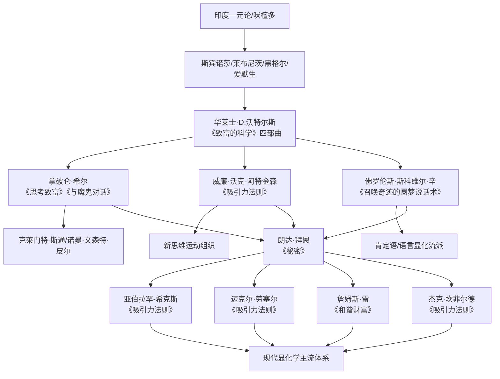

# 华莱士·D.沃特尔斯《致富的科学》四部曲核心体系

## 核心定位与历史地位

华莱士·D.沃特尔斯（Wallace Delois Wattles，1860-1911）是美国**新思维运动**的重要奠基人之一，其四部曲著作构成了现代**吸引力法则**与**显化学**的基石性文本体系。四本书分别为：

- **《成就梦想》**（原名 *How to Get What You Want*）—— 方法论总纲
- **《致富的科学》/《成就财富》**（原名 *The Science of Getting Rich*）—— 物质显化核心
- **《成就伟人》**（原名 *The Science of Being Great*）—— 精神进化纲领
- **《成就健康》**（原名 *The Science of Being Well*）—— 身体养生实务

> **历史影响链条**：沃特尔斯 → 拿破仑·希尔《思考致富》 → 朗达·拜恩《秘密》 → 现代显化学主流体系（亚伯拉罕-希克斯、迈克尔·劳塞尔、詹姆斯·雷等）。《致富的科学》被誉为《秘密》背后的"终极秘密"，与《思考致富》《世界上最伟大的推销员》并称"世界三大财富奇书"。

## 哲学基石：一元论本体论

沃特尔斯明确宣称其理论建立在**宇宙一元论**之上——"一生万物，万物归一"，本源（Formless Substance/Thinking Stuff）以看似多元的物质世界为表现。此观源自印度哲学，经笛卡儿、斯宾诺莎、莱布尼茨、叔本华、黑格尔、爱默生等西方哲学家发展，成为新思维运动的形而上学基础。

> **核心公理**：
> 1. 思想能创造其所思之形象
> 2. 人可在思想中构造物质形象，并以思想影响行动，创造出想象中的具象物质
> 3. 必须从**竞争性思维**转为**创造性思维**，形成清晰愿景，以信念与目标支持，辅以高效行动
> 4. 必须在当下环境中以"特别的方式"行动

## 四部曲架构总览

| 卷册 | 核心主题 | 关键法则 | 对应生命维度 |
|------|----------|----------|----------------|
| **《成就梦想》** | 成功的通用方法论 | 能力意识、建设性运用、清晰愿景 | 方法论/总纲 |
| **《致富的科学》** | 财富显化的精密科学 | 创造性思维、高效行动、感恩、印象增强 | 物质/财富 |
| **《成就伟人》** | 内在伟大的觉醒与表达 | 能力法则、主动型人格、天赋无限发展 | 精神/人格 |
| **《成就健康》** | 完美健康的思维与生活法则 | 健康意识、本源连接、生活方式重构 | 身体/健康 |

---

## 第一部：《成就梦想》—— 成功的通用操作手册

### 核心命题：成功的原因在个人内部

- **成功定义**：如愿以偿。因同类相生，成功的原因必须同质同量存在于成功者身上，而非环境。
- **能力意识**："知道自己能做某事，且知道如何做"。需渗透潜意识，通过睡前冥想暗示："我能成功！凡对他人可能者，对我亦可能！"
- **建设性运用现有资源**：松鼠进化为飞鼠的隐喻——仅当现有功能臻于完美，剩余生命力才推向更高层面。
- **完美完成当下每件事**：不等待环境改变，而以创造性方式运用现有环境。每笔交易、每段关系皆为垫脚石，须投入"绰绰有余的生命力"。
- **全方位关系整合**：业务、家庭、社交关系皆须注入活力与兴趣，避免"精神卖淫"（不道德手段），尊重自我与他人。

> **跨书呼应**：此卷建立的"能力意识"与"建设性运用"原则，直接支撑《致富的科学》中的"特别的方式思考与行动"。

---

## 第二部：《致富的科学》—— 财富显化的精密科学

### 章节脉络与核心法则

#### 第1章 致富的权利
- 生命目的在于发展；物质获取是发展前提 → 致富是不可剥夺的权利。
- 身心灵三重动机平衡：身体需食衣住行，心智需书旅友美，精神需爱与给予。
- **致富乃最高尚之学问**，不致富即对上帝与人类推卸责任。

#### 第2章 致富有道：特别的方式
- 致富遵循**因果自然法则**；与环境、天赋、节俭、行业、资本均无决定性关联。
- 同环境同行业者，一富一贫，证明关键在于"特别的方式"行事。
- 无资本者亦可致富，资本是致富过程的结果而非前提。

#### 第3章 人人有创造财富的权利：丰盛本源
- 贫穷非因机遇垄断，本源供给取之不尽（可见与不可见双重供给）。
- 宇宙为巨大生命体，本能趋向更繁茂表达 → 自然慷慨供给一切有利生命之物。
- 顺应社会发展潮流（如从铁路转航空、从工业转农业关联业）即顺应机遇流。

#### 第4章 创造财富的首要法则：按本质思考
- **思想世界**：有形物质皆为思想结晶。人为思想中心，可创造思想。
- **核心难点**：按"本质"而非"表象"思考。表象（贫穷、疾病）易入心成象，须以意志坚守本质（财富、健康）。
- 此为致富第一步：思维方式决定行动方式。

#### 第5章 丰富生活：生命力的必然延伸
- 生命本能=生生不息=寻求更全面发展。欲望即潜能展现。
- 致富目的非感官享乐、非极端利他、非单一维度，**乃身心灵全面充实**。
- **摒弃竞争思维，确立创造思维**：不争夺存量，而激发本源增量。供给无限，创造无限。

#### 第6章 如何获得财富：愿景与交易原则
- **清晰愿景构建**：如水手记目的港、舵手盯罗盘。在想象中已拥有并使用所求之物。
- **使用价值 > 货币价值**：给予他人超越其付款的使用价值，每笔交易提升对方生活水平。
- **雇员发展**：经营即传授"发展原则"，给敢担责者致富阶梯。

#### 第7章 以特别的方式思考：愿景、信念、目标
- 模糊欲望无法启动创造力；须观察欲望、构造清晰愿景、牢记不舍。
- **白日梦与科学家的区别**：信念与目标。坚信想象正在实现，目标即实现想象。
- 意志仅用于自身：迫使自己按正确方式思考行动，绝不施于他人或物体。

#### 第8章 如何驾驭意志：守护信念
- 意志不对外施力（那是掠夺/奴役），仅对内聚焦。
- **注意力守卫**：不研究贫穷、疾病、罪恶；拒绝悲惨画面入心。
- **最佳扶贫**：自己先富，以事实激励穷人怀致富信念。竞争致富踢毁梯子，创造致富铺平大道。

#### 第9章 进一步发挥意志：关注富裕趋势
- 忽略贫穷，聚焦世界富裕趋势。以祝贺非怜悯口吻谈论穷人。
- 致富非唯利是图，乃崇高目标：健康、精神愉悦、爱之传递皆赖创造性富裕。
- 每日研读本书，屏蔽疑虑理论，只读乐观新闻。

#### 第10章 以特别的方式做事：思想与行动结合
- 思想推动创造力按惯常轨道将所求送达；行动在当下环境中接收、安放所求。
- **行动只能在当下、当地、当前职业中进行**。不等环境变，以行动促环境变。
- 不匆忙（匆忙即堕入竞争），全力以赴完成今日之事。

#### 第11章 有效的行动：每日成功累积
- **每日非成功即失败**。无效率行动即失败；有效率行动即成功。
- **关键**：坚持愿景，使一切力量参与每项行动。闲暇深思愿景细节，工作时参照激励。
- 成功累积加速显化：万物内在充实欲望被激活，吸引力倍增。

#### 第12章 进入适宜创业领域：天赋与欲望
- 天赋是工具，须以正确方式使用。最适合天赋之业最易成功，**最想做之业满足感最大**。
- **欲望即能力证明**。强烈欲望=强大能力待发。无义务做不喜欢之事（除非作跳板）。
- 不仓促换业，逐步改善。机遇充足，心怀疑虑则待，坚持愿景增强信念。

#### 第13章 财富积累的印象：传递进步感
- 与人交往须给"不断进步"印象。进步是全人类追求、自然内在要求、宇宙基本动力。
- 以不可动摇信念渗透每事：卖棒棒糖亦纳入进步思想。真信念无需夸耀，面貌自显。
- **动机警示**：勿追求统治/主宰/炫耀，竞争思想与创造思想背道而驰。

#### 第14章 升华的人格：专业与打工者同效
- 医生、教师、律师、打工者皆适用。坚持"伟大成功者"愿景，传递进步力。
- 打工者不讨好上司，而以自我发展取悦：让工头、同事感受进步力，机遇自至。
- 生命进步定律如万有引力般精密，**致富法则是精密科学**。

> **核心模型总结**：
> ```mermaid
> graph LR
> A[清晰愿景] --> B[信念与目标]
> B --> C[创造性思维]
> C --> D[高效行动]
> D --> E[传递进步印象]
> E --> F[吸引资源与机遇]
> F --> G[财富显化]
> A --> H[感恩]
> H --> B
> ```

---

## 第三部：《成就伟人》—— 内在伟大的觉醒与表达

### 核心框架：能力法则与主动型人格

#### 第1章 任何人都可以成为伟人
- **能力法则**：人人内在有一条法则，明智运用可无限发展智力，朝任何方向成长。
- **天赋定义**：非才能，乃人与上帝在灵魂行为中的结合，具无限能力储备。
- **人生目的即成长**：植物顺势而生，人可随心所欲成长。无进步即低能或神经错乱。
- **球茎隐喻**：外表相同，成长后千差万别（玫瑰、百合、藤蔓、橡树），皆完美有价值。
- **危机显化伟人**：平凡人在危急时加速运用能力法则，显化英雄/领袖潜能。

#### 第2章 遗传与机遇
- 遗传非障碍：心理资本可增。不良倾向（抑郁、怯懦、坏脾气）可用相反习惯替换。
- **颅相非定数**：脑区大小不决定天赋上限；细腻活跃细胞小块组织胜过粗糙大块。
- **能力法则入脑**：运用最高发展天赋，可使相应脑区细胞无限增加、速度加快。
- **确立理想即重塑大脑**：朝理想方向前进，所有能力皆转化为实现理想所需天赋。

> **与《致富的科学》呼应**："按本质思考"即"运用能力法则朝理想方向发展大脑"；"特别的方式行事"即"主动型人格的表达"。

---

## 第四部：《成就健康》—— 完美健康的思维与生活法则

> **注**：归档文章提及此卷但未展开章节内容。依沃特尔斯体系推演，核心原则当为：
- 健康即本源的完美表达，疾病为表象干扰
- 建立**健康意识**（对应能力意识/财富意识）
- 按本质（健康）而非表象（症状）思考
- 思想、呼吸、饮食、睡眠、运动的"特别的方式"实操
- 将健康愿景渗透潜意识，以高效行动配合生活方式重构
- 身心灵三位一体：身体健康为精神表达与财富创造的载体

---

## 核心概念交叉引用表

| 概念 | 沃特尔斯表述 | 现代显化学对应 | 相关知识页 |
|------|--------------|----------------|------------|
| **本源** | Formless Substance / Thinking Stuff | 量子场/零点场/源头能量 | [[abraham-hicks-law-of-attraction]]、[[james-ray-harmonic-wealth]] |
| **特别的方式思考** | 按本质而非表象思考 | 振动频率对齐/情绪指导系统 | [[law-of-attraction-comprehensive-guide]]、[[michael-losier-law-of-attraction]] |
| **创造性思维 vs 竞争性思维** | 不争夺存量，激发本源增量 | 丰盛心态/显化而非吸引 | [[universal-spiritual-laws-manifestation]]、[[world-greatest-law-of-attraction]] |
| **清晰愿景** | 水手记目的港、舵手盯罗盘 | 视觉化/剧本法/愿景板 | [[shakti-gawain-chuang-zao-xing-xiang-ti-xi]]、[[xiang-yu-zhou-xia-ding-dan]] |
| **信念与目标** | 白日梦与科学家的分水岭 | 确信/允许/接纳的艺术 | [[abraham-hicks-law-of-attraction]]、[[law-of-attraction-canfield]] |
| **意志仅用于自身** | 迫使自己正确思考行动 | 内在一致性/三位一体 | [[breakthrough-triangle-success-psychology]]、[[james-ray-harmonic-wealth]] |
| **高效行动** | 当下、当地、每事臻完美 | 灵感行动/下一步行动 | [[michael-losier-law-of-attraction]]、[[chuang-zao-jin-qian-tong-wang-feng-yu-zhi-lu]] |
| **感恩** | 坚持愿景因正实现而诚挚感恩 | 情绪指导系统最高频率 | [[abraham-hicks-law-of-attraction]]、[[world-greatest-law-of-attraction]] |
| **进步印象** | 传递"不断进步"感召他人 | 镜像法则/能量感召 | [[universal-spiritual-laws-manifestation]]、[[louise-hay-you-can-heal-your-life]] |
| **能力法则** | 内在无限成长机制 | 潜能开发/神性显化 | [[xianhua-shijian-yu-zhuanzhu-lianci]]、[[activating-mystical-healing-power]] |

---

## 思想传承谱系图



---

## 实操精要清单（四部曲通用）

### 每日晨间
1. **冥想渗透**：安静冥想，想象本源渗透全身如水入海绵
2. **肯定宣示**："我能成功！凡对他人可能者，对我亦可能！我充满成功能力！"
3. **愿景复盘**：在想象中已拥有并使用所求之物，感受真实感与喜悦
4. **感恩预支**：为愿景正在实现诚挚感恩

### 全天候
1. **注意力卫士**：拒绝贫穷/疾病/冲突画面入心；不谈论过往匮乏
2. **本质思考**：遇表象（缺钱、症状、障碍）即刻转念至本质（丰盛、健康、机遇）
3. **当下臻完美**：当前环境、当前工作、当前关系，投入"绰绰有余生命力"
4. **使用价值优先**：给予他人超越其付出的使用价值（金钱、服务、情绪、信息）
5. **传递进步印象**：言谈举止、面部表情、行动效率皆显"不断进步"

### 晚间
1. **回顾修正**：检视是否有竞争性思维、匆忙、无效行动、怀疑恐惧
2. **睡前植入**：重复晨间肯定，带着"已成"感觉入睡

---

## 经典语录精选

> "宇宙是一个巨大的生命体，它总是本能地向生命体更繁茂、更能发挥自己各项功能的地方前进。自然也是为生命体的进化而存在的，其存在的动力是增强生命力。因此，它可以慷慨地提供有利于生命体的一切。" ——《致富的科学》第3章

> "你无权对别人使用你的意志力，即使你的目的是'为了他们好'，因为你并不真正了解对别人来说什么才是'好'。致富的法则不需要你把任何形式的力量或武力用在任何人身上。" ——《致富的科学》第8章

> "每个人身上都有一条能力法则。通过明智的方式来运用和管理这条法则，人可以发展自己的智力。人具有一种内在的能力，可以朝着自己所希望的任何方向成长，而这种成长的可能性似乎没有任何限制，万事皆有可能。" ——《成就伟人》第1章

> "成功者的身上有某种东西，使其能够有效地去运用自己的才能。在通往成功的路上，所有的人都必须对这种东西加以培养。" ——《成就梦想》第1章

---

## 现代应用启示

1. **显化教练/课程设计**：以"愿景-信念-高效行动-感恩"四步为标准模块
2. **商业领导力**：将"传递进步印象"转化为组织文化建设与客户体验设计
3. **个人成长体系**：融合"能力法则"与"神经可塑性"，设计大脑重塑训练营
4. **财富教育**：区分"竞争性获利"与"创造性致富"，建立商业伦理新范式
5. **身心医学**：以"健康意识"为核心，配合冥想、呼吸、运动、营养的整合干预

---

## 延伸阅读与资源

### 原著版本
- 英文原版：`The Science of Getting Rich` (1910) / `The Science of Being Great` (1911) / `The Science of Being Well` (1910) / `How to Get What You Want` (1908)
- 中文译本：多版本流通，推荐完整收录四部曲之合集版

### 直接衍生著作
- [[napoleon-hill]] 《思考致富》《与魔鬼对话》
- [[world-greatest-law-of-attraction]] 威廉·沃克·阿特金森《吸引力法则》
- [[yu-mo-gui-dui-hua]] 拿破仑·希尔《与魔鬼对话》
- [[abraham-hicks-law-of-attraction]] 亚伯拉罕-希克斯《吸引力法则》
- [[michael-losier-law-of-attraction]] 迈克尔·劳塞尔《吸引力法则》
- [[james-ray-harmonic-wealth]] 詹姆斯·雷《和谐财富》
- [[law-of-attraction-canfield]] 杰克·坎菲尔德《吸引力法则》

### 理论深化
- [[xianhua-shijian-yu-zhuanzhu-lianci]] 亚伯拉罕-希克斯显化实操溯源
- [[universal-spiritual-laws-manifestation]] 巴观/合一大学宇宙显化法则
- [[bible-law-of-attraction]] 圣经与吸引力法则神学重构
- [[activating-mystical-healing-power]] 道格拉斯·德龙神秘疗愈能量启动

### 实操工具书
- [[shakti-gawain-chuang-zao-xing-xiang-ti-xi]] 莎克蒂·高文《创造性想象》
- [[xiang-yu-zhou-xia-ding-dan]] 贝波儿《向宇宙下订单》
- [[chuang-zao-jin-qian-tong-wang-feng-yu-zhi-lu]] 奥林/达本《创造金钱》
- [[louise-hay-you-can-heal-your-life]] 露易丝·海《重塑生命》

---

## 结语

沃特尔斯四部曲以**极简语言封装了极深奥的形而上学原理与极实用的操作法则**，确立了"思想创造现实"在现代显化学中的科学地位。其核心贡献在于：

1. **去神秘化**：将显化还原为"类似代数算术的精密科学"
2. **去道德化**：宣告致富是权利、义务、最高尚学问，非贪婪非自私
3. **去外授化**：确立意志仅用于自身、不研究匮乏、不等待环境的自主范式
4. **整体化**：身心灵财四维一体，缺一不可

> **研读建议**：按《成就梦想》→《致富的科学》→《成就伟人》→《成就健康》序列精读，每卷研习21天以上，配合每日晨间/晚间实操，方能内化为"特别的方式"思考与行动的本能模式。

## 来源

- [吸引力法则：让你成就财富、成功与健康的秘密法则](../sources/吸引力法则：让你成就财富、成功与健康的秘密法则.md)
