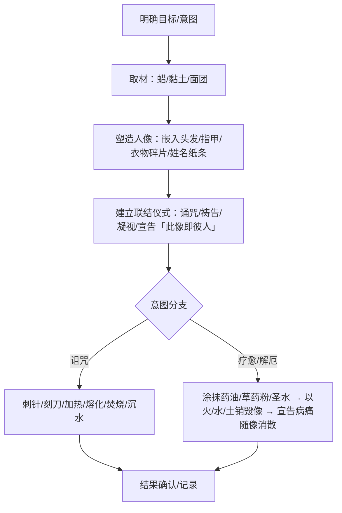

## 欧洲民间传说与猎巫记录中的核心法器体系

本页面依据《图解魔女魔法使事典》等归档文献，系统整理欧洲猎巫时期档案、民间传说与魔导书典籍中记载的四大核心法器：**扫帚与飞行软膏**、**手杖/魔杖**、**大釜**、**蜡像**。重点对比「教会塑造的刻板印象」与「实操记录中的材料、咒语、仪式流程」，并标注药理成分、神话溯源、制作规范与交感咒术操作细节，构建可交叉引用的结构化知识库。

---

## 一、扫帚飞行与飞行软膏：药理成分、咒语记录与飞行方式

### 扫帚飞行的档案定义与教会建构

- **核心论点**：魔女骑扫帚飞往「魔女夜宴」（Sabbat）的形象，是**猎巫时期教会凭空妄想的产物**，并非民间巫术原始面貌（《图解魔女魔法使事典》第2章）。
- **飞行工具不限扫帚**：审判记录显示亦可用**三齿叉、纺针、锄头、金雀儿树枝、羽叶菊、麻茎、豆茎等中空植物茎**，甚至**臼、大釜、桌椅、狼、山羊、狗**等动物；亦有「不搭工具、直接变鸟飞行」或「徒步、马车前往」记录。
- **骑乘姿势**：扫把头朝后为主流（可扫除飞行痕迹）；朝前则装蜡烛照明。
- **唯一克制**：**教会钟声**具驱邪力，响起时魔女会从空中坠落；部分地区夜宴期间持续敲钟以防魔女侵扰。

### 飞行软膏：材料清单、药理分析与实证实验

> **关键结论**：飞行能力源于**涂抹于大腿内侧、阴部周围及工具上的「飞行软膏」**，而非扫帚本身。软膏含强效致幻生物碱，导致使用者产生飞行幻觉。

#### A. 材料三大类型（出自《图解魔女魔法使事典》P.46-49）

| 类别 | 典型材料 | 备注 |
|------|----------|------|
| **含麻药/毒素药草** | 颠茄、乌头、洋金花、黑天仙子、罂粟果、风茄、黑茄、宾莨菪等 | 含阿托品、东莨菪碱、吗啡等生物碱，属抗胆碱能/阿片类致幻剂 |
| **违背基督教道德材料** | 受洗前婴儿体脂、被绞刑罪犯体脂、动物血 | 缺乏科学根据，属教会政治抹黑、强化「魔女=恶魔契约」叙事的补充设定 |
| **令人厌恶动物** | 蛇、蟾蜍等 | 同情巫术材料，象征性而非药理主导 |

#### B. 药理机制与现代实证

- **1960年民俗学者普乌克特自涂实验**：成功获得与魔女相似的飞行/幻觉体验，证实软膏为**经皮吸收型迷幻剂**；因涂抹部位靠近黏膜（阴部周围），吸收迅速、幻觉强烈。
- **LSD 类比**：麦角菌中毒史料显示欧洲历史上常发集体幻觉、癫痫样症状，软膏成分与麦角生物碱机制相近。

#### C. 审判档案中的飞行咒语（不同时期、地区）

| 年份 | 地点/人物 | 咒语内容 |
|------|-----------|----------|
| 1563 | 英国耿西岛玛丹·雀尔夫 | 「以恶魔和魔王之名，飞越岩壁和荆棘吧！」 |
| 1586 | 法国亚尔萨斯安娜·维肯兹普菲 | 骑行咒：「飞吧！以一千个恶魔之名。」 涂膏咒：「阿门、黑登、阿门、黑登。」 越河咒：「抬起手肘，奇耶！」 |
| 1662 | 苏格兰伊索贝尔·高迪 | 夹枯草/豆茎于双腿间，诵「霍思安发多克！霍思安构！霍思安佩拉提斯！喝一！喝一！」三遍即飞。 |
| 1664 | 英国索美塞特魔女群 | 涂油咒：「撒巫朵、塔巫朵安塔巫朵、速奥特安阿伯特。」 散会咒：「真是美好啊！快乐相聚！开心别离！」 返家咒：「莲图姆多尔眠图姆。」 |

> **演变趋势**：早期咒语简短（呼唤恶魔），后期愈发冗长华丽，疑为审判官妄想投射。

### 交叉引用与延伸阅读

- [[zhihuan-zhiwu-leixing]]：致幻植物药理与仪式用途对照（颠茄、天仙子、罂粟等）。
- [[ciqing-zhiwu-chuanqi]]：催情/致幻植物在民间魔法中的历史渊源。
- [[alchemy-comprehensive-guide]]：炼金术与药草学对生物碱提取的早期技术积累。

---

## 二、手杖与魔杖：神话起源、分类体系、制作仪式与代表性神杖

### 起源溯源：从贤者权杖到魔导具

| 起源说 | 核心论据 | 代表文献/传承 |
|--------|----------|---------------|
| **贤者/老人支撑杖 → 智慧象征** | 摩西、史基尼尔等神话人物手杖即权威标识 | 《旧约圣经》、《北欧神话》 |
| **德鲁伊橡木杖/槲寄生崇拜** | 「德鲁伊」=「橡木贤者」；橡木杖为魔力来源，槲寄生为万应药原料 | 凯尔特祭司传统，被视为**西洋魔杖历史原型** |
| **飞行棍棒演变说** | 魔女以棍棒飞行，后演变为手杖/魔杖 | 民间传说与猎巫档案交叉印证 |

> **关键转折**：《所罗门之钥》等魔导书盛行后，手杖被规范为**仪式魔法必备道具**，并分为「魔法棒 Staff」与「魔法杖 Wand」两大类。

### 《所罗门之钥》分类与制作规范

| 类别 | 用材 | 象征意义 | 制作关键步骤 |
|------|------|----------|--------------|
| **魔法棒 Staff** | 接骨木、桐木、蔷薇木 | 引导者象征 | — |
| **魔法杖 Wand** | 榛树树枝（一年生、未结果） | 地上与冥界权威象征 | 1. 周三日出一刀砍下<br>2. 水星日/水星时刻刻记号<br>3. 诵咒：「神圣的主啊，请祝福这根棍棒……使它成为圣别，借助您力量获得所需德性」<br>4. 木头烟熏、洁净处保存 |

> **核心原则**：魔杖本身无力，**唯持有者（魔法师）能注入魔力**。

### 五大代表性神话魔杖对照表

| 魔杖名称 | 神话来源 | 持有者/典故 | 核心机能 | 后世影响 |
|----------|----------|-------------|----------|----------|
| **双蛇双翼杖 (Kerykeion/商神杖)** | 希腊神话 | 荷米斯（原属阿波罗） | 炼金术师手杖原型；双蛇缠绕象征对立统一 | 现代医学标志（误用阿斯克勒庇俄斯杖）、炼金术象征 |
| **阿斯克勒庇俄斯杖** | 希腊神话 | 医神阿斯克勒庇俄斯 | 单蛇缠木杖，治愈/医术象征 | 医学/急救标志（正确对应） |
| **亚伦杖** | 《旧约圣经》 | 摩西/亚伦 | 分红海、变蛇、水变血（十灾） | 魔杖「行神迹」原型，名声最高 |
| **加姆班泰因** | 北欧神话 | 赫尔莫德（奥丁子） | 废除他人魔法；原为巨人赫勃巴德所有 | 魔杖「破魔/抗魔」功能原型 |
| **史基尼尔杖** | 北欧神话 | 弗雷随从史基尼尔 | 刻卢恩字母诅咒杖，迫女巨人葛德屈服 | 卢恩魔法/诅咒杖制作范式 |

### 德鲁伊橡木杖与槲寄生仪式细节

- **采集仪式**：阴历第六天，用**黄金镰刀**割取橡树上槲寄生，**白布承接不落地**，祭两白母羊。
- **药用价值**：制成「万应药」，中和毒素、治愈不孕。
- **形象传承**：德鲁伊「白胡、斗篷、手杖」直接塑造现代魔法师视觉原型。

### 交叉引用与延伸阅读

- [[ceremonial-magic]]：所罗门系魔导书中手杖/魔杖的仪式规范与神圣守护天使召唤流程。
- [[abramelin-book]]：《亚伯拉梅林魔法书》中的魔法道具制作与仪式工具体系。
- [[qimen-dunjia-fundamentals]]：奇门遁甲中「仗剑/执简」等仪式工具的对应逻辑（跨文化对照）。
- [[luwen-fuwen-hexin-tixi]]：卢恩字母刻杖仪式与北欧符文魔法杖制作的平行对照。

---

## 三、大釜药剂调制：仪式用途、神话原型与审判档案实录

### 核心定位：调制软膏/媚药/毒药的「炼金器」，兼具祭祀与烹饪功能

- **神话原型**：
  - **美狄亚返老还童锅**（希腊神话，P.10）
  - **芭芭雅嘎土锅烹人**（斯拉夫传说，P.16）
  - **《马克白》第四幕大釜**（莎士比亚戏剧，深植大众意象）
- **审判档案实录**（十六世纪末法国亚尔萨斯）：
  - 夜宴中魔女**吟唱咒语/祈祷文，煮沸大锅**，液体**泼洒地面或分发信徒泼洒喜爱处** → 性质为**丰收祭祀/宗教仪式**而非单纯投毒。
  - 锅中液体疑为「庆祝作物丰收的神圣液体」；夜宴餐点亦用大釜烹调，**非人肉**。
- **教会定性**：因信仰异教神祇，被强行归入「魔女邪恶仪式」。

### 《马克白》大釜咒语全文（岩波文库版木下顺二译）

> **三女巫绕釜吟唱**：
> - 「痛苦吧！挣扎吧！沸腾吧！一遍又一遍，直到釜里化作一滩烂泥。」
> - **投入材料**：虎斑猫叫声、刺猬叫声、怪鸟催促、蟾蜍毒液（睡31天）、沼泽蛇肉、蝾螈眼、青蛙蹼、蝙蝠毛、狗舌头、蝮蛇信、蜥蜴针、壁虎脚、猫头鹰翅膀、龙鳞、狼牙、魔女木乃伊、食人鲨胃肠、月蚀夜红豆杉枝、犹太人肝/山羊胆、异教徒鼻/邪教徒唇、妓女溺死婴儿手指、老虎肠、狒狒血（冷却用）。

> **文学功能**：将民间药材、解剖部位、异教/犹太/性别污名化意象拼贴成「极致邪恶」符号库，深度塑造后世大釜刻板印象。

### 实操层面的「大釜逻辑」：从民间医药到祭祀共食

| 层面 | 说明 |
|------|------|
| **民间医药/产婆实操** | 草药熬制、软膏调制需大容器，产婆常用大锅 → 易被联想为「魔女大釜」 |
| **异教丰收祭祀** | 集体共食、神圣液体泼洒田地/信徒 → 仪式性「大釜共同体」 |
| **教会重构** | 将共食解读为「食婴/食人」，将药草解读为「毒药」，将祭祀解读为「恶魔崇拜」 |

### 交叉引用与延伸阅读

- [[alchemy-comprehensive-guide]]：炼金术实验室器具（炉、坩埚、蒸馏器）与大釜的技术谱系对照。
- [[chinese-star-divination]]：中国星命学中「天厨/天厨星」对应烹饪/药物调制的象征平行。
- [[ancient-egyptian-mythological-legends]]：埃及「生命之釜/重生之釜」神话意象对照（奥西里斯肢解重组隐喻）。

---

## 四、蜡像交感咒术：操作流程、双重用途（诅咒/疗愈）、审判案例

### 定义与理论基础：同情巫术核心——「像产生像」

- **操作对象**：蜡或黏土制作**目标人物人像**（蜡像/Wax Image / Poppet）。
- **核心动作**：
  1. **塑像** → 建立「象似联结」
  2. **戳刺/加针** → 转移伤害/病痛
  3. **熔化/焚毁/水浸** → 完成诅咒或「烧毁病痛」
- **理论来源**：自古即有的**交感巫术/同情咒术**，非猎巫时期独创；近代医学发达前广泛用于**疾病转移疗愈**。

### 审判档案确证案例

| 年份 | 地点 | 案情摘要 |
|------|------|----------|
| 1664 | 英国索美塞特 | 魔女坦承曾用蜡像进行仪式 |
| 1678 | 苏格兰佩斯利 | 魔女供认制作人像施咒 |

> **教会定性**：认定为「诅咒他人的邪恶道具」。
> **另一可能**：疗愈用——将病痛转移至蜡像后销毁，使患者痊愈（同情巫术正向用法）。

### 操作流程标准化重构（基于民间传说与档案综合）



### 关键变量与禁忌

| 变量 | 诅咒侧重 | 疗愈侧重 |
|------|----------|----------|
| **材料** | 蜡（易熔）、带刺植物刺 | 黏土/面团（可烘烤）、药草油、圣水 |
| **咒语** | 呼唤恶魔/灵体、宣告伤害 | 祈求神灵/祖先/自然力、宣告转移病痛 |
| **时机** | 目标睡眠/虚弱时、月相亏缺期 | 满月/节气转折/目标发病急性期 |
| **销毁方式** | 火烧/水化/埋地/喂动物 | 火化后撒风/水流/埋净土，伴随感恩祷告 |

### 交叉引用与延伸阅读

- [[zheng-yi-dao-fu-zhou-xiu-xing-shi-wu]]：正一道符咒中「纸人/草人」替身术与蜡像操作的中西对照。
- [[liu-jia-fa-shu-qi-men-fa-shu-pian]]：六甲法术中「寻龙术/净宅术」使用偶人/符人之法。
- [[hooponopono-cleaning-tools]]：零极限清理工具中「意象疗愈/马桶冲水意象」与蜡像熔化/水化的心理机制平行。
- [[shamanic-journeying-time]]：萨满灵魂复元中「取回灵魂碎片/象征性物件」与蜡像「象似联结」的结构同构。

---

## 五、四大法器体系交叉对照与实践整合图谱

| 维度 | 扫帚/飞行软膏 | 手杖/魔杖 | 大釜 | 蜡像 |
|------|---------------|-----------|------|------|
| **核心功能** | 意识飞行/他者世界接入 | 权威显现/能量导向/仪式开合 | 物质转化/集体共食/祭祀媒介 | 象似联结/伤病转移/意图具象化 |
| **材料属性** | 草药生物碱（软膏）+ 木/植物茎（载具） | 神木/圣树枝条 + 卢恩/希伯来字母刻印 | 金属/陶器容器 + 水/火/药材 | 蜡/黏土/面团 + 目标连结物（发/甲/名） |
| **仪式阶段** | 起飞前涂抹/诵咒 → 飞行/幻觉 → 降落/醒来 | 開坛立杖/刻印/注力 → 主仪式引导/指向 → 收杖封存 | 药材投入/熬制/吟唱 → 分发/泼洒/共食 → 釜灰/渣处理 | 塑像/立联 → 刺/涂/烧/化 → 灰渣弃置/回送 |
| **教会定性** | 恶魔赐予/淫乱飞行/异端集会 | 异教祭司权杖/巫师标志/召唤恶魔工具 | 食婴/毒药/恶魔盛宴器具 | 诅咒杀人/钉针害命/黑巫术核心证据 |
| **现代实践复原** | 迷幻剂微量给药/导向式想象/飞行冥想 | 仪式魔法/威卡/混沌魔法核心工具 | 草药熬制/仪式共食/炼金象征操作 | 心理投射疗愈/符号魔法/家庭民间疗法 |
| **关联页面** | [[zhihuan-zhiwu-leixing]] [[ciqing-zhiwu-chuanqi]] | [[ceremonial-magic]] [[abramelin-book]] [[luwen-fuwen-hexin-tixi]] | [[alchemy-comprehensive-guide]] [[ancient-egyptian-mythological-legends]] | [[zheng-yi-dao-fu-zhou-xiu-xing-shi-wu]] [[hooponopono-cleaning-tools]] |

---

## 六、史料批判与方法论说明

1. **来源层级区分**  
   - **一手审判档案**（如 1586 年亚尔萨斯、1662 年苏格兰伊索贝尔·高迪、1664/1678 年蜡像供词）→ 尚存当事人口述痕迹，但经酷刑/诱导污染大。  
   - **恶魔学著作**（约翰·得·尼诺尔德《被狼附身的人与魔女》、斯皮纳/克雷默《女巫之锤》）→ 神学建构为主，夹杂民间材料。  
   - **文学/戏剧作品**（莎士比亚《马克白》、格林童话）→ 以「极致邪恶」符号库塑造大众刻板印象，非实录。  
   - **神话/传说**（希腊、北欧、凯尔特、斯拉夫）→ 提供原型意象与仪式逻辑的深层结构。

2. **「教会妄想」与「民间实操」的分离原则**  
   - 凡涉「婴儿体脂、食人、恶魔显形、飞行实体化」等**违背物理/生理常识**者，优先判定为**教会神学投射**；  
   - 凡涉**草药成分、刻杖仪式、熬药流程、塑像步骤**等**可操作、可复核**者，保留为**民间巫术/草药学/仪式技术**实证材料。

3. **药理还原路径**  
   - 飞行软膏 → **抗胆碱能综合征**（颠茄/天仙子/洋金花）+ **阿片样镇痛/欣快**（罂粟/乌头） → 经黏膜给药 → 强烈幻觉/离体感/飞行叙事生成。  
   - 现代致幻剂研究（普乌克特 1960、麦角/LSD 史料）提供跨时空佐证。

4. **仪式技术标准化重构**  
   - 将零散咒语、材料、动作、时机整理为**可执行流程表**（如 2.2 制作规范、4.3 操作流程图），供现代仪式魔法/民俗复原/心理剧疗愈参考，**不背书超自然因果**，仅作技术档案保存。

---

## 七、关键术语双语对照表（便于检索与交叉引用）

| 中文 | 英文/拉丁文/德文 | 备注 |
|------|------------------|------|
| 魔女夜宴 | Sabbat / Hexensabbat | 猎巫档案核心概念 |
| 飞行软膏 | Flying ointment / Hexensalbe / Unguentum volans | 含颠茄/天仙子/罂粟等 |
| 魔法棒 | Staff / Baton | 引导者象征，材质多样 |
| 魔法杖 | Wand / Virga | 权威象征，榛木首选 |
| 大釜 | Cauldron / Kessel | 炼金/祭祀/烹饪三位一体 |
| 蜡像 | Wax image / Poppet / Wachspuppe | 同情巫术核心道具 |
| 同情巫术 | Sympathetic magic / Simulacra magic | 「像产生像」原则 |
| 德鲁伊 | Druid / Drwidae | 凯尔特祭司，橡木/槲寄生崇拜 |
| 所罗门之钥 | Clavicula Salomonis / Key of Solomon | 中世纪魔导书典范 |
| 亚伯拉梅林 | Abramelin / Book of Abramelin | 圣护天使召唤体系 |

---

## 八、延伸学习路径与知识图谱导航

```mermaid
mindmap
  root((欧洲巫术核心法器体系))
    扫帚与飞行软膏
      药理成分分析[[zhihuan-zhiwu-leixing]]
      审判咒语语料库
      迷幻剂人类学[[dolores-cannon-atlantis-revelations]]
    手杖与魔杖
      神话原型溯源[[fire-mythology-beings]]
      所罗门之钥制作规范[[ceremonial-magic]]
      德鲁伊橡木杖传承[[qimen-dunjia-fundamentals]]
      卢恩刻杖平行[[luwen-fuwen-hexin-tixi]]
    大釜仪式
      神话原型对照[[ancient-egyptian-mythological-legends]]
      炼金器具谱系[[alchemy-comprehensive-guide]]
      萨满共食仪式[[shamanic-journeying-time]]
    蜡像交感咒术
      正一道替身术[[zheng-yi-dao-fu-zhou-xiu-xing-shi-wu]]
      零极限意象疗愈[[hooponopono-cleaning-tools]]
      萨满灵魂取回[[shamanic-journeying-time]]
    史料批判方法论
      教会妄想vs民间实操
      药理还原路径
      仪式技术标准化
```

> **使用建议**：  
> - **学术研究**：以「审判档案原文+药理成分表+神话原型对照」三角互证为基础。  
> - **仪式复原/心理剧**：采用「标准化流程表+安全设定（剂量/时机/禁忌）+心理整合框架」。  
> - **跨文化对照**：同步阅读 [[zheng-yi-dao-fu-zhou-xiu-xing-shi-wu]]、[[luwen-fuwen-hexin-tixi]]、[[shamanic-journeying-time]]，建立「象似联结/替身/意象疗愈」的普适技术图谱。

---

**页面版本**：v1.0 初稿（2025-08-15）  
**维护者**：数字知识库策展人  
**数据源**：《图解魔女魔法使事典》全文归档、《所罗门之钥》、猎巫审判档案选编、相关神话/民俗学文献。

## 来源

- [图解魔女魔法使事典](../sources/图解魔女魔法使事典.md)
