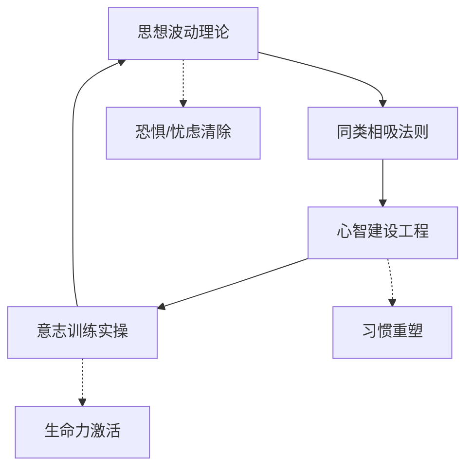

# 世界最伟大的吸引力法则：威廉·沃克·阿特金森原著核心思想与实操体系详解

> **核心定位**：威廉·沃克·阿特金森（William Walker Atkinson，1862–1932）的《吸引力法则：神奇的个人磁场效应》（The Law of Attraction in the Thought World，1906）是**新思想运动**早期最系统、最权威的奠基之作。本书首次明确提出“吸引力法则”术语，确立了**思想即能量、同类相吸、心智建设、意志训练**的完整理论与实操框架，直接影响后世拿破仑·希尔、亚伯拉罕-希克斯、迈克尔·劳塞尔、杰克·坎菲尔德等显化体系。

---

## 书目与作者档案

| 项目 | 内容 |
|------|------|
| **原著书名** | *The Law of Attraction in the Thought World* / 《吸引力法则：神奇的个人磁场效应》 |
| **作者** | 威廉·沃克·阿特金森（William Walker Atkinson） |
| **出版年份** | 1906 年（美国芝加哥） |
| **作者身份** | 《新思想》杂志主编、律师、印度教信徒、瑜伽大师门下学生、百余部灵性/心理/神秘学著作作者（常用笔名：Yogi Ramacharaka、Theron Q. Dumont） |
| **核心贡献** | 首次系统阐述“思想波动—同类相吸—心智建设—意志训练”四位一体的吸引力法则操作体系 |
| **历史地位** | 新思想运动经典三部曲之一（另两部：华莱士·瓦特尔斯《致富科学》、查尔斯·哈尼尔《大师锁系统》） |

---

## 核心理论架构：四大支柱



### 思想波动理论：思想即实在的能量波
- **核心论断**：思考时大脑辐射“思想波”，其真实性不亚于光、热、电、磁波，仅频率更高、五感不易察觉。
- **科学隐喻**：引用物理学家 Elisha Gray 与 M.M. Williams 论述，指出声波与光波之间存在巨大频谱间隙，足以容纳思想波频段。
- **关键比喻**：磁铁吸引钢铁虽不可见磁力线，思想波同样不可见却能吸引同频人事物。
- **跨页引用**：[[abraham-hicks-law-of-attraction#振动频率与吸引机制]]、[[law-of-attraction-comprehensive-guide#三大万能法则]]、[[xianhua-shijian-yu-zhuanzhu-lianci#量子显化与振动频率]]

### 同类相吸法则：宇宙运作的底层代码
- **法则表述**：“在思想世界里，同类相吸——你怎样播种，将怎样收获。”
- **双向运作**：
  - 积极思想（爱、勇气、自信）→ 吸引同频人、环境、机遇
  - 消极思想（恐惧、嫉妒、愤怒）→ 吸引同频困境、冲突、失败
- **频率调谐模型**：大脑如“马可尼无线电台”，仅接收与自身频率共振的信号。
- **实证现象**：清晨“易怒”者全天吸引家庭争吵；“唠叨”者全天遭遇琐事验证其心态。
- **跨页引用**：[[universal-spiritual-laws-manifestation#观点法则与情绪法则]]、[[belief-creates-reality-practice#信念创造实相四步法]]、[[michael-losier-law-of-attraction#三步骤公式与差异明晰进程表]]

### 心智建设工程：从“奴隶”到“君主”的身份重构
- **核心隐喻**：“我”是心智君主，“意志”是工具，低层本能（情绪、欲望、恐惧）本应为仆役，实则常篡位为王。
- **建设三步骤**：
  1. **宣告主权**：“我在此宣示我对自己的完全控制！”（每小时重复，内化为潜意识指令）
  2. **切断低层联结**：拒绝与消极念头对抗，转而聚焦“勇气、爱、自控”等高频意象
  3. **建立新习惯**：用意志引导注意力，将积极心态固化为“第二天性”
- **关键洞见**：不与消极念头搏斗（那会加强其能量），而是**移动注意力焦点**至对立的积极特质。
- **跨页引用**：[[breakthrough-triangle-success-psychology#突破三角形三要素]]、[[chen-zao-jin-qian-tong-wang-feng-yu-zhi-lu#信念转化与内在指引]]、[[xiang-yu-zhou-xia-ding-dan#显化法则与正向思考]]

### 意志训练实操：接通宇宙无限能源的导线
- **意志本质**：人人拥有无限意志储备（接通“宇宙意志发电厂”）；差异在于大脑“导电轮”是否升起接通。
- **训练核心**：**锻炼大脑而非强化意志**——大脑是获取意志能量的工具，工具越精良，显化功率越大。
- **每日操作清单**：
  - **自我暗示**：“我正在运用我的意志力量”（每小时 ≥1 次，含义内化而非鹦鹉学舌）
  - **厌恶任务突破**：每月至少完成一项极度厌恶的任务，纯为磨练意志肌肉
  - **专注力训练**：单点聚焦，排除杂念，让精神引擎全功率输出
  - **启停自如**：工作时全情投入，休息时彻底切换（避免“炉火常燃”耗尽燃料）
- **跨页引用**：[[james-ray-harmonic-wealth#三位一致与五大支柱]]、[[law-of-attraction-canfield#振动频率与潜意识重构]]、[[soham-healing-system#疗愈层面与以太体]]

---

## 十章深度逐章解析

### 第一章：思想世界的吸引力法则
- **万有引力与心理吸引力的同构性**：物理微粒靠引力结合，人生事件靠思想吸引聚合。
- **思想波的物理实在性**：不可视≠不存在；通灵敏感者可感知，精密仪器终将捕捉。
- **频谱间隙论证**：声波顶点（40,000 Hz）至光波起点（7.5×10¹⁴ Hz）之间的巨大频域，正是思想波驻留之处。

### 第二章：同类相吸、异类相斥
- **思想波的球面扩散**：异于水波平面涟漪，思想波向四面八方立体传播。
- **自我繁殖与共振**：强思想唤醒深层沉睡同频念头（如小提琴共振玻璃杯）。
- **精神频率决定接收**：自信者屏蔽绝望波；绝望者放大绝望波——**“你怀着什么心看世界，世界就是什么样”**。
- **无意识精神交锋**：初次见面者的静默博弈，确立心理地位与关系模版。

### 第三章：关于头脑的讨论
- **双轨心智模型**：
  | 主动努力 | 被动成就 |
  |----------|----------|
  | 新铸硬币，开辟新路 | 沿旧路前行，缺乏创造力 |
  | 由主观意志发起 | 由遗传、他人建议、旧习惯驱动 |
- **习惯形成机制**：主观冲动 → 重复 → 固化为被动反射 → 成为本能/第二天性。
- **意志的统治权**：“我”是主人，主动/被动心智皆为其工具；征服低层自我即接通宇宙意志。

### 第四章：头脑的构建
- **有意识做心智设计师**：每秒都在建设头脑，觉醒者主动设计，睡眠者被动被建设。
- **宣告“主宰”誓词**：「我在此宣示我对自己的完全控制！」——每小时重复，可视化“真我”加冕画面。
- **实战应用**：
  - 怒火升起 → 默念“你应当坚持自我！” → 瞬间冷静
  - 恐惧袭来 → 回想“真正的自我从不惧怕” → 汲取勇气
  - 嫉妒涌动 → 思考高贵天性 → 一笑置之
- **一年蜕变承诺**：严肃执行，岁末将「脱胎换骨」。

### 第五章：意志的秘密
- **意志非需强化，需训练大脑接收**：唐纳德·G·米切尔名言——“唯有决心让人出类拔萃”。
- **精神懒汉陷阱**：嘴上说“我想成功”，实则更想偷懒；渴望若不如囚犯渴自由、将死者渴生，皆为戏耍。
- **核心自我暗示**：「我正在运用我的意志力量」——高频重复，内化为潜意识指令。
- **厌恶任务练兵场**：主动挑战最抗拒之事，纯为磨练意志肌肉，非自我折磨。

### 第六章：裁掉你的恐惧和忧虑
- **恐惧是磁铁**：强烈恐惧等同强烈渴望恐惧之事发生——法则对“渴望”与“恐惧”同等生效。
- **替代法则**：勿说“我不怕”，而说“我充满勇气！”——承认恐惧存在再否定，优于直接否定恐惧对象。
- **勇气烙印法**：将“勇气”词深植脑海，可视化勇气图像，直至成态度一部分。
- **无畏即正义，恐惧即邪恶**——正义终胜；切断“营养来源”（惯性思维），恐惧自饿死。
- **渐进式脱敏**：从不恐惧之事入手，累积胜利体验，再向核心恐惧进军。

### 第七章：清扫成功的路障
- **忧虑=恐惧产物**，根除恐惧，忧虑因失营养而亡。
- **忧虑≠动力**；渴望才是行动燃料——忧虑只绞手哀号，渴望转化为行动。
- **九成忧虑多余，一成过分**——精力应存储待真难题降临时使用。
- **注意力单通道原理**：专注当下建设性思考，忧虑自动销声匿迹（大脑单任务处理特性）。
- **上帝抛馅饼给有准备者，也抛有准备者给馅饼**——宇宙自调节，信任流程。

### 第八章：精神控制的法则
- **思想非生来奴仆或暴君，由你赋予身份**——意志坚定则为仆，意志松懈则为主。
- **专心致志=破解关键**：全身心投入单一任务，阻力消失，能量 100% 利用。
- **懂得停车比懂得开车更重要**：工作完成即切换休息模式，避免慢性应激耗竭。
- **对抗思维=加固思维**；**转移注意力=溶解思维**——投入截然不同的新焦点，旧念自隐。

### 第九章：发掘生命的力量
- **行尸走肉 vs. 精明活着的人**——完全觉醒是入场券。
- **口号疗法**：「我充满了活力！」——晨昏餐间每小时重复，配合呼吸可视化（吸入力量，呼出衰老/消极）。
- **知行合一**：勿只口头喊口号，以行动证明活力——对每件小事投入真兴趣。

### 第十章：训练你的惯性思维
- **威廉·詹姆斯金句**：「让紧张情绪成为盟友，在无意识习惯层面完成，越早越好。」
- **潜意识=建议大仓库**；输入原料决定习惯成品——**加倍小心筛选进入潜意识的素材**。
- **新习惯扎根前，意志护卫不得放松**；一旦扎根，即成“第二天性”，自动运行。
- **循序渐进，抓住每个可能机会**——微小胜利累积成宏大转变。

---

## 实操工具箱：从书中提炼的 12 项核心练习

| # | 练习名称 | 核心动作 | 频率/时机 | 对应章节 |
|---|----------|----------|-----------|----------|
| 1 | **主权宣告** | 高声/默念「我在此宣示我对自己的完全控制！」 | 每小时 ≥1 次；受诱惑/困惑/疲惫时加倍 | 第四章 |
| 2 | **勇气烙印** | 可视化“我充满勇气”画面；将“勇气”字刻入脑海 | 晨昏各 5 分钟；恐惧袭来即时启动 | 第六章 |
| 3 | **意志暗示** | 「我正在运用我的意志力量」——含义内化而非机械重复 | 每小时 ≥1 次；面对难任务前加倍 | 第五章 |
| 4 | **厌恶任务突破** | 主动完成一项最抗拒之事，纯为磨练意志 | 每月 ≥1 次 | 第五章 |
| 5 | **活力呼吸** | 吸气想「吸入力量/活力」，呼气想「呼出衰老/消极」 | 晨昏各 10 分钟；沮丧时即时 3-5 循环 | 第九章 |
| 6 | **注意力转移** | 遇消极念头，不抗争，即刻投入截然不同的建设性焦点 | 随时触发 | 第八章 |
| 7 | **精神引擎启停** | 工作全神贯注；下班/睡前彻底切换放松模式 | 每日工作/休息转换点 | 第八章 |
| 8 | **忧虑熔炉** | 列出忧虑清单 → 标记「90% 多余/10% 过分」 → 封存待真发生时再处理 | 每周一次回顾 | 第七章 |
| 9 | **频率微调** | 觉察当下情绪基调 → 有意识升高至“自信/期待/感恩”频段 | 每日 3 次定点检查 | 第二章 |
| 10 | **习惯种子播种** | 选定 1 个微习惯（如早起 15 分钟/读 1 页书） → 意志护卫 21 天不间断 | 每日固定时段 | 第十章 |
| 11 | **真我可视化** | 闭目构建“真正的自我”加冕、统治低层本能的电影感画面 | 晨昏各 3 分钟 | 第四章 |
| 12 | **感恩锚定** | 事件未现先感恩：「谢谢！我已得到」——三字最强祈祷 | 晨昏及得失转折点 | 全书贯穿 |

---

## 与后世显化体系的谱系对照

| 维度 | 阿特金森 (1906) | 拿破仑·希尔 (1937) | 亚伯拉罕-希克斯 (1980s-) | 迈克尔·劳塞尔 (2000s) | 詹姆斯·雷 (2008) |
|------|-----------------|-------------------|-------------------------|----------------------|-----------------|
| **核心术语** | 吸引力法则 | 吸引力法则/渴望 | 吸引力法则/振动频率 | 吸引力法则/差异明晰 | 和谐财富/三位一致 |
| **理论基石** | 思想波/同类相吸 | 思想成事/潜意识 | 源头能量/情绪导航系统 | 思想/感受/行动三步骤 | 量子场/零点场/垂直时间 |
| **心智模型** | 君主/奴隶/意志工具 | 另我/主导欲望/信念 | 内在存有/扩展/允许 | 发射器/接收器/心灵感应罩 | 意识/潜意识/超意识三位一体 |
| **关键实操** | 宣告主权/注意力转移/厌恶任务 | 明确目标/自信/坚持/大师联盟 | 情绪向上梯/创造性工作坊/接纳艺术 | 差异明晰表/愿望陈述/实现陈述 | 五大支柱/量子冥想/回音波技术 |
| **恐惧处理** | 替代法/勇气烙印/切断营养 | 六大基本恐惧/信仰替代 | 情绪向上梯/允许而非对抗 | 重新框架/差异明晰 | 量子坍缩/平行现实选择 |
| **跨页引用** | **本页** | [[napoleon-hill]] | [[abraham-hicks-law-of-attraction]] | [[michael-losier-law-of-attraction]] | [[james-ray-harmonic-wealth]] |

---

## 核心金句语录库（可作每日素读卡片）

> 1. **“宇宙由一个法则统治——表现形式多样，根本只有一个法则。”** ——第一章
> 2. **“思想波就像光、热、电、磁的波一样真实；唯一区别在于振动频率。”** ——第一章
> 3. **“在思想世界里，同类相吸——你怎样播种，将怎样收获。”** ——第二章
> 4. **“你的大脑就是一台马可尼电报机，只接收与自身频率共振的信号。”** ——第二章
> 5. **“‘我’是心智的君主，‘意志’是‘我’的工具。”** ——第三章
> 6. **“你希望头脑成为什么样，最终就能建设成什么样——前提是你有意识地做设计师。”** ——第四章
> 7. **“意志力量的电流正沿着精神线路奔腾；我们要做的只是把导电轮升起接通。”** ——第五章
> 8. **“恐惧是焦虑、嫉妒、愤怒、失败和一切不幸的源头。拔除恐惧，烦恼自亡。”** ——第六章
> 9. **“忧虑从来帮不了任何忙；它总在成功路上设路障。渴望才是行动的燃料。”** ——第七章
> 10. **“思想非生来奴仆也非暴君，除非你允许。专心致志是破解关键。”** ——第八章
> 11. **“完全觉醒是入场券。把生命投入每件事，别再心不在焉地活着。”** ——第九章
> 12. **“让紧张情绪在无意识习惯层面成为盟友，越早越好，抓住每个机会。”** ——第十章（引威廉·詹姆斯）

---

## 学习路径建议

```mermaid
journey
    title 阿特金森吸引力法则 21 天入门冲刺
    section Week 1: 奠基认知
      研读第一章+第二章: 5: 理解思想波与同类相吸物理隐喻
      书写金句卡片: 4: 每日抄写 2 句核心语录
    section Week 2: 身份重构
      晨昏主权宣告: 5: 配合真我可视化
      勇气烙印练习: 4: 面对微小恐惧即时启动
    section Week 3: 意志肌肉
      每日意志暗示: 5: 含义内化而非机械重复
      完成 1 项厌恶任务: 4: 纯为磨练意志
    section Week 4: 生活化
      活力呼吸+注意力转移: 5: 融入日常碎片时间
      忧虑熔炉周复盘: 4: 建立长期情绪管理系统
```

---

## 常见误区澄清

| 误区 | 原著纠正 |
|------|----------|
| **“吸引力法则=愿望清单+等待”** | 阿特金森强调**意志训练、注意力管理、习惯重塑**的主动工程，而非被动许愿。 |
| **“消极念头一冒出来就完了”** | 关键不在念头出现，而在**是否投入注意力喂养它**；转移焦点即可切断能量供给。 |
| **“必须 24 小时高能亢奋”** | 作者明确反对：需**启停自如**，休息时彻底切换，避免慢性应激耗竭。 |
| **“恐惧要用力压制/对抗”** | **对抗=加强**；唯一有效路径是**替代法**（勇气替代恐惧）+ **切断营养**（停止惯性思维）。 |
| **“意志力天生强弱定数”** | 人人接通宇宙无限意志源；差异只在**大脑接收装置是否经过训练**。 |

---

## 扩展阅读与资源链接

### 同作者/同系经典
- 《大师锁系统》—— 查尔斯·哈尼尔（1912，新思想三部曲之二）
- 《致富科学》—— 华莱士·瓦特尔斯（1910，新思想三部曲之三）
- 《瑜伽呼吸法》《瑜伽心智力》—— Yogi Ramacharaka（阿特金森笔名作品）

### 现代显化体系深度对标
- [[abraham-hicks-law-of-attraction]]：情绪导航系统与创造性工作坊
- [[michael-losier-law-of-attraction]]：三步骤公式与差异明晰进程表
- [[law-of-attraction-canfield]]：坎菲尔德/詹姆斯·雷量子显化框架
- [[universal-spiritual-laws-manifestation]]：巴观五大宇宙灵性法则
- [[breakthrough-triangle-success-psychology]]：合一大学突破三角形实操

### 心理学/脑科学佐证视角
- [[buddhas-brain-rick-hanson]]：神经可塑性与冥想重塑大脑
- [[heart-brain-coherence]]：心脑相干与显化生理机制
- [[self-discovery-toolkit]]：肯·罗宾逊天命发现工具箱（心智图/可视化板/自由书写）

---

## 结语：把“秘密”还原为“技能”

阿特金森在百年前便看透：**吸引力法则非玄学咒语，乃心智技术**。其精髓只在八字——

> **念动波生，同频共振；我主意志，习惯成性。**

> 只要把“主权宣告”挂在嘴边，把“注意力转移”练成肌肉记忆，把“厌恶任务”当作意志健身房，**人人皆可成为自己命运的磁场主宰**。

> 今晚睡前，不妨试一次：**「我在此宣示我对自己的完全控制！」**——感受那股久违的、属于君主的微光唤醒。

---

> **页面维护提示**：本页聚焦阿特金森原著十章核心体系；后世显化流派详解请跳转对应专题页（见“谱系对照表”与“扩展阅读”）。若需补充书中未涉及的“金钱显化/疗愈/关系专用技法”，建议在 [[michael-losier-law-of-attraction]]、[[chuang-zao-jin-qian-tong-wang-feng-yu-zhi-lu]]、[[belief-creates-reality-practice]] 等页面扩充。

## 来源

- [吸引力法则：神奇的个人磁场效应](../sources/吸引力法则：神奇的个人磁场效应.md)
