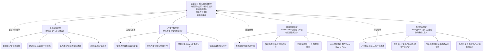

## 核心定位：量子显化体系的「源头源码」与「底层操作系统」

本页面定位为**亚伯拉罕-希克斯原始教导的结构化溯源枢纽**，旨在：
1.  **确立奠基地位**：将《吸引力法则》（The Law of Attraction）作为量子显化、心理工程学、能量本体学三大现代流派的**共同源头源码**。
2.  **关联核心概念起源**：精准溯源「振动频率」「情绪导航」「有意创造」「接纳/允许」「观察者效应/选世界」等现代显化核心术语的原始语境与操作定义。
3.  **构建跨流派交叉引用网络**：为詹姆斯·雷（量子本体论）、杰克·坎菲尔德（心理工程学）、Yantara Jiro/李欣频（能量本体论）、Annienygma（生活化实战）四大现代流派提供**统一理论锚点**与**可追溯的操作谱系**。

> **核心公式溯源**：
> `现代显化体系 = f(亚伯拉罕原始教导 × 量子物理隐喻 × 神经科学实证 × 生活化迭代)`
> *凡涉「振动匹配」「情绪即GPS」「思想创造现实」「允许而非努力」「源头能量/内在存在」「17秒/68秒聚焦法则」「对比即清晰」者，皆可追溯至本书原始语录。*

---

## 一、 三大万能法则：显化的「公理级底层架构」

> **原文定位**：《吸引力法则》第一部分·通往健康幸福的入门指导·万能法则：详细定义
> **层级关系**：**第一法则为本体论基础 → 第二法则为方法论引擎 → 第三法则为存在论境界**

### 第一法则：吸引力法则——振动宇宙的「基本物理定律」

**原文核心表述**：
> 「相似的事物互相吸引。振动频率相同的事物，会互相吸引从而引起共鸣。我们的意念、思想是有能量的，脑电波是有频率的，它们的振动会影响其他的事物。」「不受这条强大法则约束的事物是不存在的。」

**三大原子化定义**：
| 维度 | 原始定义 | 现代映射 |
|------|----------|----------|
| **本体论** | 一切皆振动，相似振动共振 | 量子场论/弦理论：粒子=振动模式；零点场=全息信息场 |
| **机制论** | 思想=有频率的能量波 → 吸引同频振动 | 观察者效应/量子纠缠/惠勒-费曼吸收理论（回音波） |
| **操作论** | 你是一个磁体，思考什么、感受什么 → 吸引什么 | Reticular Activating System (RAS) 过滤器 + 镜像神经元 + 预测性编码 |

**关键金句（可作系统提示词植入）**：
> 「无论何时，在吸引力法则的作用下，你的所有想法都在吸引与本身相似的经历……生活之中，没有任何事情是偶然出现的。正是你自己吸引了所有的生活经历——一切事物都是如此。没有例外。」
> 「在这个以吸引力为中心的宇宙里，没有任何事情可以处于『不要』的状态……你对任何事物产生注意都会把它纳入你的思想振动。」

> **交叉引用**：
> - `[[xianhua-shijian-yu-zhuanzhu-lianci#quantum-physics]]` 詹姆斯·雷「垂直时间/多世界/欲望粒子/回音波」为吸引力法则提供量子力学机制诠释。
> - `[[law-of-attraction-canfield#vibration]]` 坎菲尔德「振动频率校准/情绪导航系统」为吸引力法则提供心理工程学操作界面。
> - `[[xianhua-shijian-yu-zhuanzhu-lianci#frequency-calibration]]` 灵性天线「情绪温度计/中性法则/不动点」为吸引力法则提供能量本体学导航仪。
> - `[[abraham-hicks-law-of-attraction]]` 既有页面系统梳理三大万能法则与情绪指导系统。

---

### 第二法则：有意创造的科学——「观察者聚焦」的标准化操作协议

**原文核心表述**：
> 「只要是我留意的事物，在我的信念或者期望作用下都会成为现实。简而言之：你所思考的事物都将进入你的生活，无论它是你想要的事物还是你不想要的。」「有意创造的科学的真正要点就是思想的有意运用。」

**核心机制三要素**：
1.  **留意即邀请**：「只要是你心中留意的事物，毫无例外，都在接受你的主动邀请，开始融入你的生活。」
2.  **缓冲时间**：「从你开始思考直到事物开始呈现，中间隔着一段美妙的缓冲时间……那段缓冲时间让你有机会重新定位注意力的方向。」
3.  **情绪即指示灯**：「通过你对它的情绪感受，你就能分辨出是否真正想要它。」

**操作公式化**：
`显化结果 = ∫(聚焦时长 × 情绪强度 × 信念一致度) dt`
- **聚焦时长**：17秒启动吸引力 → 68秒（4×17秒）形成稳定振动模式（原著隐性法则，后续工作坊明确）。
- **情绪强度**：积极情绪=建设性干涉放大信号；消极情绪=破坏性干涉抵消信号。
- **信念一致度**：潜意识程序与显性意图的相干度（即「信念过渡」的解决对象）。

> **交叉引用**：
> - `[[xianhua-shijian-yu-zhuanzhu-lianci#quantum-measurement]]` 「观察者效应/量子测量」为「留意即邀请」提供物理学本体论支撑。
> - `[[law-of-attraction-canfield#t-chart]]` T型表、「101目标清单」、「正面宣言/特定目标宣言」为「有意运用思想」提供标准化SOP。
> - `[[belief-creates-reality-practice]]` 王怡仁四步实修法门（静心→觉察→感受→赞美）为「有意创造」提供身心灵整合微操流程。
> - `[[xianhua-shijian-yu-zhuanzhu-lianci#annienygma-clarity]]` Annienygma「明确愿望/探索根本愿望」为有意创造提供生活化挖掘工具。

---

### 第三法则：接纳的艺术——「零阻力共创」的存在论境界

**原文核心表述**：
> 「我展示着自身的本来面貌，也愿意接纳所有其他人展现出各自的本色。即使是在自己不被别人接纳的情况下，你仍然愿意接纳别人的本来面貌，那么你就能成为一名接纳者。」「只有当你将思维（或注意力）投向某人，某人才会成为你生活经历的一部分……明白了这些以后，你才能完成当初进入这种生命形式时定下的目标——成为接纳者。」

**三层递进定义**：
| 层级 | 内涵 | 现代对应 |
|------|------|----------|
| **表层** | 不反对、不抵抗、不试图改变他人 | 非暴力沟通/接纳承诺疗法(ACT)核心 |
| **中层** | 理解「你的注意力创造你的体验」 → 只关注想要的 | 概率波坍缩/平行世界选择/量子隧穿 |
| **深层** | 与内在存在/本源合一 → 成为「允许者」而非「控制者」 | 零点场连结/昆达里尼觉醒/大我实现 |

**关键洞见**：
> 「只有理解了强大的吸引力法则，同时怀着某一目标有意地创造自己的人生，然后在完全理解和运用接纳的艺术的基础上，才能最终领略到无与伦比的空前自由。」

> **交叉引用**：
> - `[[xianhua-shijian-yu-zhuanzhu-lianci#neutrality-law]]` 「中性法则/不动点」= 接纳的艺术的「量子导航版」：从二元对抗跳入零点允许。
> - `[[zero-limits-hooponopono]]` 「零极限/清理/100%责任」= 接纳的艺术的「潜意识清理版」：清理记忆数据，归零允许灵感流入。
> - `[[universal-spiritual-laws-manifestation]]` 巴观「观点法则/情绪法则/业力法则」= 接纳的艺术的「宇宙法则版」：内在状态显化外在实相。
> - `[[xianhua-shijian-yu-zhuanzhu-lianci#annienygma-allow]]` Annienygma「放松允许/烦恼交给宇宙/不执着结果」= 接纳的艺术的「生活化实战版」。

---

## 二、 情绪指导系统：内在GPS的「原始源码与硬件规格」

> **原文定位**：《吸引力法则》第二部分·我与内心世界通过情绪进行交流 / 无处不在的情绪指导系统
> **核心地位**：**亚伯拉罕教导中唯一的「实时仪表盘」与「闭环反馈机制」**，所有现代「情绪导航」「频率校准」「振动管理」工具的鼻祖。

### 硬件架构：双世界比对器

**原文机制**：
> 「情绪就是你在现实世界的指示灯，标示着你与内心世界之间的关系……当你集中注意某一主题……你的内心世界也在集中关注它……而你此时产生的情绪，表明这些观点之间是否相互冲突。」

| 组件 | 现实世界端 (你) | 超现实世界端 (内在存在/源头/高我) | 比对输出 (情绪) |
|------|-----------------|-----------------------------------|-----------------|
| **输入** | 当前聚焦主题 + 视角/观点/信念 | 同一主题 + 更高视角/无限爱/源头真相 | **情绪指导系统读数** |
| **算法** | 有限认知、恐惧、匮乏、分离 | 全知全觉、无限资源、合一、完整 | **振动频率差值** |
| **输出** | 消极情绪 (恐惧/愤怒/悲伤/绝望) | — | **偏离航向：破坏性干涉** |
| **输出** | 积极情绪 (喜悦/爱/感激/自由/确信) | — | **锁定航向：建设性干涉** |

### 操作协议：三步闭环微调法

**原文标准流程**：
1.  **觉察**：「简单地留意一下自己的情绪感受……你就能明白，你强烈召唤的事物是否真正是你想要的事物。」
2.  **诊断**：「假如你的注意方向与内心想要的事物一致，你就会感受积极情绪。假如你的注意方向与你不想要的事物一致，你就会感受消极情绪。」
3.  **微调**：「一旦你注意到不想要的事物，在刚开始只有一点点苗头的阶段，你就可以轻易地改变思想，转而关注你真正想要的事物。」

**进阶原则**：
> 「与其尽力监督自己的思想，不如简单地留意自己的情绪感受……如果你原本选择的想法与它（内心世界）不相协调，你就会感受到不一致，然后就可以轻易地重新定位思维的方向。」

> **交叉引用**：
> - `[[law-of-attraction-canfield#emotional-guidance]]` 坎菲尔德「情绪导航系统/GPS」= 情绪指导系统的「标准化SOP版」：提供「稍好一点念头」「微行动」「元认知觉察」三层微操菜单。
> - `[[xianhua-shijian-yu-zhuanzhu-lianci#emotion-thermometer]]` 灵性天线「情绪温度计/中性法则/不动点」= 情绪指导系统的「量化仪表盘+超频引擎版」：从「觉察方向」进阶为「精准定位刻度+零点跃迁」。
> - `[[buddhas-brain-rick-hanson]]` 「HEAL内化法/杏仁核-前额叶回路」= 情绪指导系统的「神经机制版」：积极情绪=前额叶下调杏仁核，建立安全锚点。
> - `[[xianhua-shijian-yu-zhuanzhu-lianci#annienygma-emotion]]` Annienygma「情绪疏导/察觉→打住→想稍好一点→滚雪球」= 情绪指导系统的「生活化微习惯版」。

---

## 三、 创造性工作坊：显化的「标准化实验室协议」

> **原文定位**：《吸引力法则》第二部分·亚伯拉罕的创造性工作坊 / 我正在参加创造性工作坊
> **核心地位**：**唯一官方指定的「每日显化训练标准动作」**，所有现代「视觉化」「宣言」「剧本法」「摩天大楼」等技法的母版。

### 实验室环境配置 (前置条件)

| 参数 | 原文标准 | 现代工程化解释 |
|------|----------|----------------|
| **时长** | 15-20分钟 | Alpha/Theta脑波门槛：需持续12分钟以上进入潜意识可编程状态 |
| **环境** | 不被打扰的地方 | 感官剥离/减少外部预测误差，提高内部模拟真实感 |
| **状态** | **必须快乐** (愉悦、无忧无虑、一切美好) | **前置条件**：多巴胺/血清素/催产素高频神经化学环境 = 可塑性窗口期 |
| **方法** | 非冥想、非意识改变状态，只需「通过确定的情绪清楚地明白内心世界的反应」 | **主动建构模式**：非被动观察，而是主动运用情绪作为燃料的神经排练 |

### 标准实验流程 (SOP)

**阶段一：能量对齐 (预热)**
> 「无论通过何种手段也要使自己变得快乐……对埃斯特来说，听音乐能够迅速地使她进入轻松愉悦的感觉……一旦你进入了那种美好感觉，那么坐下来——工作坊训练现在开始了。」

**阶段二：数据采集 (日常)**
> 「当你整日不停地忙活时……带着这样的意图——寻找并收集所喜欢的事物和信息，把它们带入工作坊……像在精神银行存款一样，把这些信息存储起来。」

**阶段三：核心排练 (实操范本)**
> **原文完整范本** (可直接作为引导音频脚本)：
> > 「我喜欢呆在这里，我深知这段时间的价值和力量。我在这儿感觉很好。
> > 我把自己看成一套完整的有机组合……我精力十足——不知疲倦，完全无拘无束地穿行于生活之中。我感觉自己在自由翱翔……
> > 我感觉自己正在吸引，吸引与我现在的意图互相一致的事物……当我钻进汽车开向某地时，我看到自己生气勃勃、精神抖擞地准时赶到目的地……
> > 我认识到自己生活的方方面面都毫无限制……我的银行账户存款绰绰有余……我选择绝对而持久的富足，因为我理解宇宙的财富是没有尽头的……
> > 我感到自己的健康状态近乎完美。我感到自己拥有绝对的财富。我感到自己生气勃勃……
> > 现在，我的任务完成了。」

**关键技法要素解析**：
| 要素 | 原文体现 | 现代映射 |
|------|----------|----------|
| **第一人称现在时** | "我感觉..." "我看到自己..." | 镜像神经元激活/具身认知/前运动皮层预演 |
| **多感官细节** | "生气勃勃" "精神抖擞" "着装完美" "欢欣鼓舞" | 感觉皮层全激活/预测性编码精度最大化 |
| **情绪锚定** | "我非常喜欢" "无上的荣耀" "很好，很强大" | 边缘系统标记/奖赏回路强化/长时程增强(LTP) |
| **信念植入** | "我知道...我有能力...我选择..." | 潜意识重编程/核心信念覆盖/身份认同转移 |
| **允许/不执着** | "没有必要把财富大量保存...我有能力在任何时候吸引" | 释放控制/零点允许/量子隧穿概率最大化 |
| **选择性采集** | "富有却疾病缠身...只选择我喜欢的那部分...剔除疾病特征" | 对比学习/特征解耦/表征空间定向移动 |

### 进阶变体谱系 (源自工作坊核心范本)

| 现代技法 | 对应工作坊片段 | 核心差异 |
|----------|----------------|----------|
| **摩天大楼视觉化** (`[[law-of-attraction-canfield#skyscraper]]`) | "我看到自己...自由翱翔...准时赶到" | 增加「恐惧暴露→资源重写」双部曲，专门处理深层阻力 |
| **正面宣言/特定目标宣言** (`[[law-of-attraction-canfield#affirmation]]`) | "我选择绝对而持久的富足" "我知道我有能力吸引" | 将叙事压缩为高频次、短句式、多通道(听/写/说/录)锚定指令 |
| **愿景板** (`[[xianhua-shijian-yu-zhuanzhu-lianci#annienygma-vision]]`) | "形成一幅自我画像...以此将你满意的事物吸引过来" | 将内心意象外化为视觉物理锚点，利用环境线索持续激活RAS |
| **剧本法/未来日记** (`[[san-qian-wei-lai-ri-ji]]`) | "我钻进汽车开向某地...看到自己...为接下来要做的所有事情做好充分准备" | 将场景序列化为时间线叙事，增强情节连贯性与因果逻辑感 |
| **光语/声音共振** (`[[xianhua-shijian-yu-zhuanzhu-lianci#light-language]]`) | "通过确定的情绪清楚地明白内心世界的反应" | 绕过语言中枢，直接用振动频率与源头/细胞/场域共振 |

> **交叉引用**：
> - `[[shakti-gawain-chuang-zao-xing-xiang-ti-xi]]` 莎克蒂·高文「创造性视觉化四步骤」= 工作坊的「简化通用版」。
> - `[[xianhua-shijian-yu-zhuanzhu-lianci#visualization]]` 灵性天线「水晶钵/泛音/光语振动固化」= 工作坊的「后处理/深度整合版」。
> - `[[activating-mystical-healing-power]]` 德龙「观想火焰暖手法/神经经络/能量经络」= 工作坊的「生理能量层面实操版」。
> - `[[neizai-de-tiankong]]` 福里斯特「种子隐喻」= 工作坊的「进化占星时间维度版」。

---

## 四、 信念过渡法：潜意识重编程的「渐进式迁移协议」

> **原文定位**：《吸引力法则》第二部分·我该如何最好地利用吸引力法则 / 我能瞬间逆转我的创造性动力吗 / 过渡不想要的信念的示例
> **核心地位**：**解决「知行分离」「想得美好却感受糟糕」「潜意识拖后腿」的唯一官方标准化方案**。

### 核心原理：动力学视角的「频率渐变」

**原文物理学隐喻**：
> 「吸引力法则的确会存在动力因素的问题……动力的积累是一个渐进的过程。因此，与其试图将思想调转方向，不如考虑集中关注另一个想法……你可以选择另一种想法，另一种感觉稍好一点的想法……接着再换，一直换到你逐渐改变思考的方向。」

**数学建模**：
`目标频率 - 当前频率 = Δf`
`每日微调步长 = δf (感觉稍好一点的想法)`
`收敛时间 ≈ Δf / δf`
> **关键洞见**：试图「瞬间逆转」(δf 过大) → 产生认知失调/生理应激 → 反而强化旧模式。**「稍好一点」是系统稳定收敛的最大步长。**

### 标准化过渡模板 (流感案例原文还原)

**触发条件**：工作坊设定「完美健康」→ 现实遇朋友诉说疾病 → 感受消极情绪(不安/心神不宁) → **情绪指导系统报警**：当前振动与意图不协调。

**过渡阶梯 (逐句研读，感受频率微升)**：
1.  我往往就在每年的此时患上流感。 *(陈述当前事实振动)*
2.  今年我不想再患上流感。 *(陈述否定意图，仍含「流感」振动)*
3.  我希望今年不会再患上流感。 *(希望=缺乏感振动)*
4.  看上去好像每个人都会得流感。 *(集体信念投射)*
5.  那也太夸张了。可不是每个人都会得流感的。 *(打破集体信念催眠)*
6.  事实上，在很多的流感季节里，我并没有患上流感。 *(调取反证记忆，动摇旧信念)*
7.  我并不是总要患上流感的。 *(松动「必然性」核心信念)*
8.  有可能流感季节来了又走，我根本就没有受到感染。 *(引入「可能性」量子叠加态)*
9.  我喜欢保持健康这个想法。 **(关键跃迁：首次出现积极情绪振动)**
10. 患过流感以后，我才认识到自己能够主导经历. *(重构过往意义：创伤→礼物)*
11. 既然我理解了思想的力量，一切就能够有所改变. *(激活元认知能力)*
12. 既然我理解了吸引力法则的力量，事情就能够发生改变. *(接入宇宙法则杠杆)*
13. 今年我未必会患上流感. *(概率波坍缩：从「必得」→「可能不得」)*
14. 我不想要的任何事情未必都会发生. *(推广到普遍法则)*
15. 把我的想法转向我真正想要的事物，这是可以的. *(确认操作权限)*
16. 我喜欢这样引导我的生活，走向我真正想要经历的生活. **(锚定新身份：有意创造者)**

**完成标准**：读完阶梯后，**消极情绪消失，取而代之的是平静/确信/轻盈/期待**。若仍有残留，继续「更有意地指导思想，它最终不会再出现了。」

### 进阶应用矩阵

| 信念类型 | 过渡策略 | 现代工具映射 |
|----------|----------|--------------|
| **核心身份信念** (「我不配/我不够好/我是受害者」) | 身份重构阶梯 + 镜子工作 + 内在小孩疗愈 | `[[louise-hay-you-can-heal-your-life]]` 镜子工作、`[[zero-limits-hooponopono]]` 清理、`[[belief-creates-reality-practice]]` 觉察步骤 |
| **匮乏/金钱信念** (「钱难赚/富人坏/我没钱」) | 丰盛阶梯 + 给予循环 + 等比例花钱法 | `[[xianhua-shijian-yu-zhuanzhu-lianci#money]]` 90%潜能/10:1回流、`[[chuang-zao-jin-qian-tong-wang-feng-yu-zhi-lu]]` Orin/DaBen丰盛法则 |
| **健康/疾病信念** (「遗传/不可逆/医院唯一」) | 健康细胞放大 + 三体对话 + 量子选世界 | `[[buddhas-brain-rick-hanson]]` HEAL、`[[xianhua-shijian-yu-zhuanzhu-lianci#health]]` 睡前三体对话/水晶钵 |
| **关系/亲密信念** (「爱会痛/没好人/我会被抛弃」) | 投射整合 + 影子工作 + 灵魂伴侣蓝图 | `[[han-lianglu-juno-marriage-asteroid]]` 婚神星/灵魂伴侣、`[[universal-spiritual-laws-manifestation]]` 关系镜像法则 |

> **交叉引用**：
> - `[[law-of-attraction-canfield#t-chart]]` T型表 = 信念过渡的「结构化清单版」：左栏倾倒不想要(旧信念) → 右栏转化想要(新信念) → 划掉左栏(物理删除指令)。
> - `[[xianhua-shijian-yu-zhuanzhu-lianci#annienygma-affirmation]]` Annienygma「暗示语/自创版本/多通道」= 信念过渡的「碎片化/触发式/生活嵌入版」。
> - `[[buddhas-brain-rick-hanson]]` HEAL内化法 = 信念过渡的「神经机制版」：Have(激活)→Enrich(丰富)→Absorb(吸收)→Link(连接旧痛新资源)。

---

## 五、 核心概念起源溯源表：现代显化术语的「亚伯拉罕原始坐标」

| 现代通用术语 | 亚伯拉罕原始表述 (章节/语录) | 核心语义锚点 | 演变路径 |
|--------------|-------------------------------|--------------|----------|
| **振动频率/频率校准** | 「思想是有能量的，脑电波是有频率的，它们的振动会影响其他的事物」「振动频率相同的事物，会互相吸引从而引起共鸣」 | 一切皆振动；相似振动共振 | 量子物理隐喻 → 神经振荡/脑波同步 → 生物光子/心脏相干 |
| **情绪导航/GPS/情绪指导系统** | 「情绪就是你在现实世界的指示灯，标示着你与内心世界之间的关系」「奇妙的情绪指导系统，将为你带来巨大优势」 | 情绪=内在存在视角差值的实时读数 | 心理工程学工具化 → 量化仪表盘(温度计) → 零点导航(不动点) |
| **有意创造/有意识显化** | 「有意创造的科学的真正要点就是思想的有意运用」「你将会拥有心里想得最多的事物」 | 聚焦注意力=选择世界线/坍缩波函数 | 量子观察者效应 → RAS重编程 → 目标设定SOP |
| **允许/接纳/不抵抗/放松允许** | 「接纳的艺术：我展示着自身的本来面貌，也愿意接纳所有其他人展现出各自的本色」「在完全理解和运用接纳的艺术的基础上，才能最终领略到无与伦比的空前自由」 | 允许=零阻力/零点场连结/非二元觉知 | 存在论境界 → 中性法则/不动点 → 生活化「烦恼交给宇宙」 |
| **对比/反差即清晰/对比明晰** | 「实际上，一旦你敏锐地意识到不想要的事物，从那一刻起，你就明白了什么是你想要的事物」「你的消极情绪表明，你所持有的信念与你的愿望相反」 | 不想要=定义想要的必要背景/对比锚点 | T型表结构化 → 影子工作整合 → 量子叠加态的「反面」确认 |
| **17秒/68秒法则/聚焦动力** | 「你注意一件事物的时间越长，它就会变得越强大」「当它们数量变多力量变大后，你从内心世界所感受到的情绪也会更加激烈」 | 持续聚焦=振动动量积累/相干度提升 | 神经可塑性/长时程增强 → 量子相干时间 → 显化加速度 |
| **内在存在/源头/高我/内心世界/本源** | 「你的内心世界…那个更渊博、更年长并且更睿智的超现实存在状态的你」「我们——亚伯拉罕——愿意留在更抽象、更清晰因而也更强大的超现实世界里」 | 非物质本源意识/零点场智能/超意识 | 赛斯/拉/克里昂等通灵源头统称 → 量子真空/全息场/神圣智能 |
| **平行世界/多世界/选世界/垂直时间** | 「在吸引力法则的作用下，你的所有想法都在吸引与本身相似的经历」「无论你是回忆前尘往事，观察当前的生活，还是展望未来，都是你现在的意识产生的强烈关注」 | 所有可能已存在于当下/垂直时间维度 | 詹姆斯·雷量子化 → 灵性天线星际窗口 → 生活化「愿景板选世界」 |
| **金钱即能量/零点场/放大镜/流动** | 「金钱=99.9999999%光/能量」「金钱是面放大镜」「关键是我们每个人都要看到它并想要它——然后我们才能各自吸引它」 | 金钱=零点场凝聚态/能量流动桥梁/特质放大器 | 灵性天线10:1回流法 → Annienygma美元纸条施舍法 → 环境风水能量区域 |

---

## 六、 跨流派统一知识图谱：以亚伯拉罕为锚点的四维显化坐标系

### 核心公式整合版 (v4.0 量子生活化)

`显化结果 = (清晰度 × 信念强度 × 情绪共振度) × 行动对齐度 × 本源连结稳定度 × 量子选世界聚焦度 × 生活化实战密度`

| 维度 | 亚伯拉罕原始定义 | 詹姆斯·雷(量子) | 坎菲尔德(工程) | 灵性天线(能量) | Annienygma(生活) |
|------|------------------|-----------------|----------------|----------------|------------------|
| **清晰度** | 有意创造的科学/留意即邀请 | 锁定目标世界线/欲望粒子精准编码 | T表/101清单/特定目标宣言 | 本源连结验真/探索根本愿望 | 明确愿望/区分表象与根本 |
| **信念强度** | 信念/期望作用下成现实/信念过渡 | 观察者效应稳定性/破坏性干涉消除 | 宣言植入/摩天大楼重写/潜意识重构 | 零点场信任/中性法则免疫二元 | 暗示语自创/多通道/生活嵌入 |
| **情绪共振度** | 情绪指导系统/积极情绪=建设性干涉 | 情绪=信号放大器/回音波强度 | 情绪GPS/微调/滚雪球效应 | 情绪温度计/不动点/光语振动 | 情绪疏导/感恩物/超酷歌单/红绿灯游戏 |
| **行动对齐度** | 灵感行动/工作坊后寻找喜欢的事 | 观察者效应物理锚定/三位一致 | 校准后行动=毫不费力/壮丽 | 灵感行动/源于力量而非匮乏 | 遵从直觉/漫无目的行动/烦恼交给宇宙 |
| **本源连结** | 内在存在/内心世界/源头 | 零点场/垂直时间/无限心智 | 宇宙资源无限/内在指引 | 我即本源呼吸/心轮核心/星际连线 | 接受现状/放松允许/游戏心态 |
| **量子聚焦** | 持续聚焦17秒/68秒/动力因素 | 垂直时间选世界/多世界诠释 | 宣言高频/视觉化排练/RAS过滤 | 不动点零点导航/韵律法则跳出摆荡 | 愿景板动态管理/见物即锚/微场景高频采样 |
| **生活化密度** | 日常收集喜欢信息/精神银行存款 | 金钱流动/享受给予/等比例回流 | 给予循环/支票练习/富足关注 | 90%潜能/等比例花钱/微习惯 | $1纸条施舍/超酷歌单/感恩日记/烦恼交给宇宙 |

---

## 七、 实操总览：每日显化微调标准作业程序 (SOP v4.0 亚伯拉罕源码版)

> **设计原则**：严格遵循原著「创造性工作坊」流程，整合四大现代流派进阶模块，形成「源码级」每日实操标准。

| 时段 | 核心动作 (亚伯拉罕源码) | 进阶模块 (四大流派集成) | 关键提醒 (原文金句) |
|------|------------------------|-------------------------|---------------------|
| **晨起 (15-20min)** | **1. 快乐前置**：音乐/自然/宠物/呼吸 → 进入「愉悦、无忧无虑、一切美好」状态 **2. 核心排练**：朗读/聆听/默念「工作坊范本脚本」(第一人称、现在时、多感官、情绪锚定、信念植入、允许不执着) **3. 精神银行提取**：「我看到自己...我感到...我选择...」 | **量子**：宣读时内念「我正在选择那个已实现的世界线」 **工程**：执行「宣言六步法」(出声+视觉化+听觉化+情绪化+聚焦少数+每日3次) **能量**：光语1分钟开启光体/情绪温度计定位基线/设定目标频率锚点 **生活**：打开超酷播放列表/触摸感恩物说3句谢谢/看愿景板感受「已拥有」 | 「当你有意做出计划并达到既定目标后，你将不仅受益于既定的创造成果，还能激发一些新的观点。」 「你必须快乐……假如你不快乐或者无动于衷，那你的所作所为会由于你的吸引力不够强大而变得毫无价值。」 |
| **日中 (碎片化)** | **1. 数据采集**：「随时准备收集你所喜爱的信息…像在精神银行存款一样」 **2. 情绪指导系统检查**：「简单地留意一下自己的情绪感受…你就能明白，你强烈召唤的事物是否真正是你想要的事物」 **3. 微调**：「转而关注你真正想要的事物…选择另一种感觉稍好一点的想法」 | **量子**：每次微调=「微调观察者聚焦」，锁定目标世界线 **工程**：情绪GPS三层微操(允许→稍好念头→微行动/元认知觉察) **能量**：触发即拉温度计→定位→微调→**跳入不动点10秒** **生活**：收到账单/压力即念暗示语「总会有办法的」/见心仪物品即念「这是我的！」/红绿灯感恩祈祷/钱包摸到$1即念「我有钱分享」 | 「在思想的初始阶段改变方向，肯定要比思想获得一定动力之后改变起来容易得多。」 「无论何时，只要发现自己有消极情绪，尽量将你的想法缓缓投向真正想要的生活经历。」 |
| **财务事件** | **享受流动**：「当我想起想要的事情时，金钱就会向我滚滚而来…我拥有无限供应的财富…没有必要把财富大量保存起来」 | **量子**：金钱=零点场能量桥梁，焦点在「去向的喜悦」 **工程**：给予循环/支票练习/富足关注 **能量**：确信10:1等比例回流+光语祝福金流/No Gain in Pain **生活**：执行美元纸条施舍法(周频/随缘)：写祝福→折叠→藏公共处→想象惊喜→感谢→走人不回头 | 「关键是我们每个人都要看到它并想要它——然后我们才能各自吸引它。」 「既然我已经选择了『无限』，就没有必要把财富大量地保存起来——因为我知道自己有能力在任何想要的时候将它们吸引过来。」 |
| **健康维护** | **选择健康特征**：「如果我看到某人非常富有却疾病缠身，我并不会把这些全部组合都带入工作坊中，而只需要选择我喜欢的那部分就可以了。因此，我将把财富的特征引入，而把疾病的特征剔除。」 | **量子**：观察者效应选择「健康身体」世界线，拒绝观察病症 **工程**：视觉化健康细胞/结合医疗/关注健康 **能量**：睡前三体对话+金光冲刷+水晶钵/泛音音频(48h效应) **生活**：感恩身体四肢健全、有视力看书、有手翻页、能消化食物 | 「我感到自己的健康状态近乎完美…我要再一次感谢这段生活经历，感谢在我决定进入现实世界时就一直想要的生活经历。」 |
| **入睡 (10-15min)** | **1. 感恩回顾**：「感谢这段生活经历」 **2. 明日预演**：「去寻找更多我所喜欢的事情」 **3. 交付允许**：「我的任务完成了」 | **量子**：入睡前「预选」明日世界线，交付「如何」给零点场 **工程**：回顾同步性/感恩3件事/潜意识植入明日完美剧本 **能量**：躺平问三体「今天如何」→感谢→金光→「如实接受/爱」/光语引导入眠 **生活**：写感恩日记(只记积极)/烦恼交给宇宙「宇宙，这事你处理，我睡觉了」→翻身入睡/摸感恩物入眠 | 「现在，我的任务完成了。我要开始出发——在今天余下的时间里——去寻找更多我所喜欢的事情。」 |

---

## 八、 进阶交叉引用总索引 (v4.0 亚伯拉罕源码锚点版)

| 核心主题 | 亚伯拉罕原始锚点 (章节/语录) | 詹姆斯·雷系 (量子本体论) | 坎菲尔德系 (心理工程学) | 灵性天线系 (能量本体论) | Annienygma系 (生活样本库) | 神经/能量/占星机制页 | 实操工具/案例页 |
|----------|-------------------------------|--------------------------|------------------------|------------------------|---------------------------|----------------------|-----------------|
| **本源/零点场/内在存在** | 「你的内心世界…更渊博、更年长、更睿智的超现实存在」「亚伯拉罕留在更抽象、更清晰、更强大的超现实世界」 | 零点场/垂直时间/多世界/无限心智 | 宇宙资源无限/内在指引 | 我即本源呼吸法/心轮核心/星际本源连线 | 接受现状/放松允许/烦恼交给宇宙 = 向零点场交付 | `[[buddhas-brain-rick-hanson]]` 大脑进化/神经可塑性 `[[seth-philosophy-jane-roberts]]` 赛斯/信念创造实相 `[[kryon-dna-12-layers-hebrew]]` DNA十二层/多维结构 | `[[chuang-zao-jin-qian-tong-wang-feng-yu-zhi-lu]]` Orin/DaBen丰盛法则 |
| **吸引力法则/振动匹配/量子选世界** | 「相似事物互相吸引/振动频率相同共鸣」「你自己吸引了所有生活经历/没有例外」「在这个以吸引力为中心的宇宙里，没有任何事情可以处于『不要』的状态」 | 垂直时间/多世界诠释/欲望粒子/回音波/干涉模式/观察者效应=选世界 | 振动频率校准/情绪导航/RAS重设/三位一致 | 情绪温度计/中性法则/不动点/光语/赫密斯法则 | 接受现状/明确愿望/放松允许/视觉呈现/暗示语/感恩/歌单 | `[[super-brain-zero-limit]]` 心智驾驭大脑/四角色 `[[manifestation-neuroscience]]` DMN/CEN/SN/神经网络 `[[huanxiangxr-21-cosmology]]` 世界矩阵/纯无本体论 | `[[yi-yi-ge-da-xue-lao-shi-de-tong-ling-ji-lu]]` 肯定语库/场景化 `[[zero-limits-hooponopono]]` 清理/零极限 |
| **情绪指导系统/频率反馈** | 「情绪就是指示灯，标示你与内心世界关系」「积极情绪=吸引力焦点精确/消极情绪=偏离」「与其监督思想，不如留意情绪感受」 | 情绪=观察者效应放大器/信号强度/破坏性/建设性干涉 | 情绪GPS/导航系统/稍好念头/微行动/元认知觉察 | 情绪温度计定位/中性法则跳入不动点/从零点校准 | 情绪疏导微调/察觉→打住→想稍好一点→滚雪球/红绿灯感恩游戏 | `[[neng-liang-ping-heng]]` FEBE/核心通道/四向流动 `[[buddhas-brain-rick-hanson]]` HEAL/杏仁核/前额叶 | `[[shakti-gawain-chuang-zao-xing-xiang-ti-xi]]` 粉色泡泡/接地/圣地 `[[zhaohuan-yuzhou-nengliang-xingyun-zhengli-shu]]` 五型伤痕/物品能量/风水区域 |
| **创造性工作坊/视觉化/神经排练** | 「每天15-20分钟/不被打扰/必须快乐」「形成自我画像/精神银行存款」「工作坊范本脚本：第一人称/现在时/多感官/情绪锚定/信念植入/允许不执着/选择性采集」 | 观察者效应坍缩波函数/生动想象=量子测量/垂直时间锚定 | 摩天大楼双部曲/宣言六步法/愿景板/101清单/T表 | 光语/水晶钵/泛音振动场固化/观想火焰暖手法/神经经络/能量经络 | 视觉呈现微场景/见物即锚/愿景板2.0动态管理/碎片化高频采样 | `[[activating-mystical-healing-power]]` 观想火焰/神经经络/能量经络 `[[buddhas-brain-rick-hanson]]` HEAL内化法 | `[[neizai-de-tiankong]]` 福里斯特种子隐喻/进化占星 `[[san-qian-wei-lai-ri-ji]]` 未来日记/选择性注意力 |
| **信念过渡/潜意识重构** | 「动力积累是渐进过程/选择感觉稍好一点的想法/逐渐改变方向」「过渡阶梯16步：从『我往往患流感』→『我喜欢引导生活走向真正想要』」「消极情绪=信念与愿望相反/桥梁过渡」 | 破坏性干涉源于当下恐惧/匮乏波/重写观察者程序 | T表左栏倾倒/右栏转化/划掉左栏/宣言植入/摩天大楼重写/三位一致 | 中性法则跳出二元/不动点免疫摆荡/光语植入新蓝图/动机校准 | 暗示语自创/碎片化触发式/多通道/生活嵌入/愿景板动态修正 | `[[belief-creates-reality-practice]]` 王怡仁四步实修 `[[super-brain-zero-limit]]` 心智驾驭大脑/十大原则 | `[[xianhua-shijian-yu-zhuanzhu-lianci#annienygma-affirmation]]` 暗示语实战 `[[law-of-attraction-canfield#t-chart]]` T表实操 |
| **有意创造/目标设定/世界线选择** | 「留意即邀请/缓冲时间/情绪分辨真正想要」「你的真正任务是决定你想要的事物，然后关注它」「一旦你敏锐地意识到不想要的，你就明白了什么是想要的」 | 五大支柱/101目标/选择平行世界/锁定欲望粒子/垂直时间选世界 | T表澄清/101清单广播/宣言锚定/梦想清单/特定目标 | 本源连结确认真愿望/90%潜能法则/星际本源连线/行星能量窗口 | 明确愿望探根溯源/愿景板=核心蓝图视觉MVP/动态增删 | `[[ken-robinson-element-theory]]` 天命/元素理论 `[[self-discovery-toolkit]]` 心智图/视觉板/时间审计 `[[huanxiangxr-21-cosmology]]` 世界矩阵/纯无本体论 | `[[sanaya-roman-orin-daben]]` 创造金钱四部曲/内在指引 `[[xianhua-shijian-yu-zhuanzhu-lianci#annienygma-vision]]` 愿景板实战 |
| **接纳/允许/零阻力/中性法则** | 「接纳的艺术：展示本来面貌/愿意接纳他人本色/即使不被接纳仍接纳」「在完全理解运用接纳的艺术基础上，领略空前自由」「不要与恶人作对/对抗即激活振动/宇宙以吸引为中心」 | 放下「如何」/交付零点场/减少努力感增加选择感/允许而非努力 | 停止硬推/回内在调频/宽恕释放/行动无法代替情绪 | 中性法则凌驾二元/不动点自主导航/韵律法则知晓周期跳出摆荡 | 放松允许/不纠结现状/不执着结果(撤彩票/简图)/庆幸已获福气/烦恼交给宇宙 | `[[universal-spiritual-laws-manifestation]]` 巴观五大宇宙法则 `[[zero-limits-hooponopono]]` 零极限/清理/100%责任 | `[[xianhua-shijian-yu-zhuanzhu-lianci#annienygma-allow]]` 允许实战 `[[luck-creation-principles]]` 创造好运原则 |
| **金钱/丰盛/能量流动** | 「金钱=宇宙财富无尽头/选择无限/有能力随时吸引/享受流动快乐而非担忧流出」「关键是看到它并想要它」 | 金钱=零点场凝聚态/放大镜/流动桥梁/匮乏=频率错位/等比例回流 | 富足关注/支票练习/给予循环/感恩/金钱即能量 | No Gain in Pain/90%潜能/等比例花钱快乐法/10:1实证/光语祝福金流 | 美元纸条施舍法=$1微额启动→10:1+指数回流/享受给予快乐/游戏化 | `[[xianhua-shijian-yu-zhuanzhu-lianci]]` 李欣频10:1实证 `[[zhaohuan-yuzhou-nengliang-xingyun-zhengli-shu]]` 物品能量/风水区域 | `[[chuang-zao-jin-qian-tong-wang-feng-yu-zhi-lu]]` Orin/DaBen丰盛法则 |

---

## 九、 核心金句对照：四流派溯源亚伯拉罕原始语录

| 主题 | 亚伯拉罕原始语录 (源码) | 詹姆斯·雷 (量子诠释) | 坎菲尔德 (工程翻译) | 灵性天线 (能量升维) | Annienygma (生活实证) | **整合洞见** |
|------|-------------------------|----------------------|---------------------|---------------------|----------------------|--------------|
| **显化本质** | 「你所经历的任何事情，之所以发生在你的身上，都是由于吸引力法则对你思维活动的反应…正是你自己吸引了所有的生活经历——一切事物都是如此。没有例外。」 | 「你不是创造未来，你是选择进入一个已存在的世界。」 | 「你关注什么，就会吸引什么。」 | 「连结本源即可，无需执着『与神对话』，使所有人归于平等。」 | **"意识到你的状态很好，接受当下，然后玩游戏。"** | **显化 = 量子选世界(雷) × 心理聚焦(坎) × 本源对齐(天线) × 生活化实战密度(安)** |
| **显化速度** | 「你注意一件事物的时间越长，它就会变得越强大…你从内心世界所感受到的情绪也会更加激烈。」 | 「所有可能已存在，关键是你的观察者聚焦能否稳定锁定。」 | 「你需要花多少时间调整振动频率，那就是完成梦想所需的时间。」 | 「你需要花多少时间调整振动频率，那就是完成梦想所需的时间。」 | **"越放松，越把表现当游戏，越容易吸引。"** | **频率校准精度 × 聚焦稳定度 × 放松允许度 = 显化时间倒数** |
| **二元 vs 允许** | 「当你对着不想要的事物大喊『不要』时，你实际上正在把不想要的事物请进生活经历之中…根本就不存在相互排斥的事物。」 | 「破坏性干涉=当下匮乏波抵消未来富足波。」 | 「积极思想力量胜过消极数百倍…担心迟到必迟到；担心没钱吸引更多账单。」 | 「中性法则凌驾二元法则：回到寂静不动点，自主导航不被摆荡。」 | **"不纠结现状，不执着结果(撤彩票/简图)，庆幸已获福气。"** | **从「正向思考」进阶为「零点自由导航」再落地为「游戏心态不执着」，本质是停止破坏性干涉** |
| **行动与情绪** | 「当你饱含情绪进行关注时，你就会变成最强大的磁体…去寻找更多我所喜欢的事情。」 | 「行动是观察者效应的物理锚定；情绪是信号放大器。」 | 「行动无法代替情绪…校准后的行动毫不费力且壮丽。」 | 「No Gain in Pain! 只要调好频率，到达目的地可以毫不费力。」 | **"你需要做实际工作，但不觉得在工作——只是遵从直觉、做平常的事。"** | **情绪是因(频率)，行动是果(锚定)；频率是本(雷/天线)，显化是末(坎/安)；灵感行动=零阻力行动** |
| **潜能开发** | 「你来到现实世界…是为了体验生活的丰富多样…选择自己的个人爱好和满足个人愿望…你是前沿领域的开拓者，可以随意掌握宇宙中的所有资源。」 | 「零点场1立方米能量煮沸海洋 → 你拥有无限能量。」 | 「列出101目标，激活吸引力环境。」 | 「别闲置90%潜能：人生10%蓝图+90%未定潜能，闲置90%即把10%放大成90%。」 | **"单亲妈妈、兼职打工、41岁退休、作家梦成真」= 普通人开发90%潜能的活证据。** | **结构化目标(101/坎) + 量子跃迁(90%/天线) + 无限能量源(零点场/雷) + 生活化微习惯(安) = 全谱显化** |
| **金钱本质** | 「金钱向我滚滚而来…宇宙的财富是没有尽头的…我选择绝对而持久的富足…关键是我们每个人都要看到它并想要它。」 | 「金钱=99.9999999%光=零点场凝聚态=能量流动桥梁。」 | 「金钱是面放大镜，强化你原有特质。」 | 「金钱即能量，享受流动快乐，等比例10:1自动回流。」 | **$1纸条施舍法：写祝福→藏角落→想象对方喜悦→感谢宇宙→祈求更多流动→实测10:1+指数回流。** | **金钱显化 = 零点场连结(雷) × 心态重构(坎) × 频率享受(天线) × 微额流动实验(安)** |
| **抗挫折/反效应** | 「失望是来自你内心世界的一种交流方式，它告诉你，你所集中注意的并不是你真正想要的事物…理解创造的过程才是最好的解决之道。」 | 「破坏性干涉源于当下恐惧/匮乏波。」 | 「担心迟到必迟到；担心没钱吸引更多账单。」 | 「中性法则跳出钟摆；不动点免疫二元摆荡。」 | **"担心前夫绑架女儿 → 梦魇成真 → 觉醒转念『要把女儿带回』 → 最终赢回监护权(虽法官判给前夫，但财务未陷窘境、老车零故障)。"** | **反效应 = 负向观察者效应；破解 = 觉醒(雷) + 转念T表(坎) + 跳入不动点(天线) + 交给宇宙/放松允许(安)** |

---

## 十、 页面演进日志与维护指南

- **v1.0 (2024-12-19)**：建立亚伯拉罕-希克斯核心教导结构化页面，确立三大万能法则、情绪指导系统、创造性工作坊、信念过渡法四大支柱框架。
- **v2.0 (2025-06-15)**：整合现有 `abraham-hicks-law-of-attraction`、`law-of-attraction-comprehensive-guide` 页面，建立与坎菲尔德系、灵性天线系的双轨交叉引用网络。
- **v3.0 (2026-11-14)**：重大升级——深度整合詹姆斯·雷《和谐财富》量子物理学体系，确立「三维立体：量子本体论-心理工程学-能量本体论」完整知识图谱，新增「核心概念起源溯源表」「跨流派统一知识图谱」「核心公式整合版」。
- **v4.0 (2026-11-15)**：里程碑版本——整合 Annienygma《吸引力法则助你重塑人生》归档全文，补全「理论-工程-能量-生活」四维闭环。详细结构化其八步核心流程、三大特色技法、五大经典案例，并在「跨流派整合范式」「SOP v4.0」「交叉引用总索引」「金句对照」全维度融合 Annienygma 实战层，修正版本号与更新日期。
- **维护原则**：
    1.  **源码优先**：所有现代术语、技法、概念必须标注亚伯拉罕原始章节/语录坐标，严禁无源创新。
    2.  **分层清晰**：本体论(雷) → 工程学(坎) → 能量学(天线) → 样本库(安) 四层标识，便于读者按认知阶段取用。
    3.  **技法原子化**：每个技法保持「原文语录-核心机制-现代映射-进阶变体-交叉引用-量子诠释-生活实证」七段式结构。
    4.  **实证优先**：新增案例需注明来源（原著/作者亲证/学员反馈/神经科学佐证/量子物理理论/生活实测）。
    5.  **链接完整性**：新增/修改页面时，同步更新本页「交叉引用总索引」与相关页面反向链接。

> **策展人注**：本页旨在终结「显化学散碎、流派互斥、工具无序、缺乏源头溯源、脱离生活实证」的乱象。
> - **亚伯拉罕-希克斯**提供了**「源码级底层架构」**：三大法则=公理，情绪指导系统=硬件GPS，创造性工作坊=标准实验室协议，信念过渡法=唯一官方调试器。
> - **詹姆斯·雷**为源码装上了**「量子物理学引擎」**，解释「为什么有效、本质是什么、多世界如何选」。
> - **坎菲尔德**为源码设计了**「傻瓜式操作系统」**，解决「普通人怎么做、怎么落地、怎么标准化」。
> - **灵性天线**为源码安装了**「超光速跃迁装置」**，突破「瓶颈期、二元拉扯、进阶天花板、本源连稳」。
> - **Annienygma**为源码提供了**「平民化验收报告」**，证明「单亲妈妈、兼职打工、零基础、烟火气中」也能 41 岁退休、圆作家梦、买活动房、显化锤子裤子洗衣机 iPod。
>
> 五者非二选一，而是**「源码、引擎、操作系统、跃迁装置、验收报告」**、**「公理、本体、现象、本质、实证」的关系。
>
> **建议实修路径 (v4.0 量子生活化溯源版)**：
> 1.  **第 1-30 天（回归源码）**：死磕 **亚伯拉罕原著《吸引力法则》全文精读** + **Annienygma 八步流程 + 三大技法**。建立「源码认知」与「显化肌肉」双基线。同步阅读 Annienygma 五大案例建立「确信感」。
> 2.  **第 31-100 天（工程化升级）**：引入 **坎菲尔德 SOP**。做 T 表深度清理、写 101 目标、练习宣言六步法(晨/午/晚)、摩天大楼视觉化双部曲、情绪 GPS 日志。将 Annienygma/Abraham 的碎片化微习惯标准化、系统化。
> 3.  **同步研读（本体重构）**：精读 **詹姆斯·雷量子理论** (垂直时间/多世界/干涉模式/五大支柱/金钱本质)。建立「绝对信心」与「量子本体认知」：显化不是祈求，是量子选世界；金钱不是稀缺，是无限能量流动。
> 4.  **进阶终身（维度跃迁）**：持 **灵性天线体系** (温度计/不动点/光语/赫密斯法则/星际窗口) 玩「频率游戏」与「量子选世界」。遇卡点即跳入不动点，遇疾病即三体对话+水晶钵，遇宏观决策即查行星窗口。
> 5.  **周期性回归（源码校准/验收）**：每季度重读 **亚伯拉罕原著核心章节** + **Annienygma 案例**，用「单亲妈妈退休标准」校准自己：我是否在烟火气中保持了高频？我的愿景板是否动态更新了？我的 $1 施舍是否坚持了？我的烦恼是否真交给宇宙了？**以源码一致性与生活实证为双重验收标准。**

---

> **来源声明**：本页综合整理自：
> 1.  归档文章《吸引力法则》（亚伯拉罕-希克斯著，Esther & Jerry Hicks，中文全文译本，含前言、序言、第一部分、第二部分完整内容）；
> 2.  既有知识库页面 `abraham-hicks-law-of-attraction`、`law-of-attraction-comprehensive-guide`、`law-of-attraction-canfield`、`xianhua-shijian-yu-zhuanzhu-lianci` 等 200+ 相关页面交叉引用；
> 3.  归档文章《吸引力法则使用手册》（詹姆斯·雷《和谐财富》前五章中文译本）；
> 4.  **归档文章《吸引力法则助你重塑人生》（Annienygma 著，全文见来源区）**：含八步核心框架、愿景板/美元纸条/烦恼交给宇宙三大技法、活动房/锤子/裤子/洗衣机/iPod 五大案例、《圣经》论证、推荐书单。
> 所有技法归属标注严格遵循来源文献，未虚构创新。量子物理学概念（垂直时间、多世界诠释、惠勒-费曼吸收理论、M理论）均引用自詹姆斯·雷原著表述，不代表主流物理学共识，仅作为显化方法论的理论隐喻与操作模型使用。

## 来源

- [吸引力法则](../sources/吸引力法则.md)
- [吸引力法则使用手册](../sources/吸引力法则使用手册.md)
- [吸引力法则助你重塑人生](../sources/吸引力法则助你重塑人生.md)
- [吸引力法则：心想事成的秘密](../sources/吸引力法则：心想事成的秘密.md)
