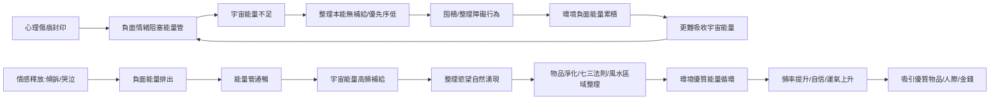

## 核心框架概覽

本頁建立在日下由紀惠《召喚宇宙能量的幸運整理術》之上，核心論點為：**無法整理的真正原因非技巧不足，而是心靈負面情緒阻塞宇宙能量輸送管**。書中提出「五大類型心理傷痕模型」，每種傷痕對應特定囤積行為與整理障礙模式；療癒路徑為「釋放封印情感（傾訴、哭泣）→ 通暢能量管 → 恢復整理慾望與能力 → 環境能量升級 → 運氣提升」。

> 關聯頁面：[[zhaohuan-yuzhou-nengliang-xingyun-zhengli-shu]]（本書總覽頁）、[[guang-liao-yang-liao-hua-jing-zheng-he-liao-fa]]（光療/氧療/花精整合療法中的能量管概念）、[[neng-liang-ping-heng]]（能量平衡體系中的核心通道與四向流動）

## 五大類型心理傷痕與囤積行為對應表

| 類型 | 核心傷痕 | 典型囤積/整理障礙行為 | 能量狀態 | 療癒關鍵 |
|------|----------|------------------------|----------|----------|
| **A型** | 金錢恐懼 / 逃避現實 | 大量購買、只買折扣品、冰箱食物腐敗、衣櫃塞滿、玄關堆滿廢棄物、囤積能量發威 | 金錢能量不穩定、富裕能量難循環 | 撫平金錢傷痛、建立穩定金錢能量 |
| **B型** | 未感受疼愛 / 情感飢渴 | 名牌依賴、同類物品重複購買、購後失興、懶於保養、囤積衣服/飾品/能量石/療癒商品 | 缺乏自信、用物品掩飾內心空洞 | 覺察童年缺愛、淨化負面情感、學會珍惜物品 |
| **C型** | 無法信任他人 / 過度焦慮 | 無法丟棄禮物、無法拒絕推銷、囤積紙類/發票/計算用紙、人際壓力轉化為物品堆積 | 溫柔阻礙丟棄、負面能量左右、無法發揮自身能量 | 練習重視真實感受、只買真正想要的、建立可信賴關係 |
| **D型** | 被比較創傷 / 完美主義 | 公開區域完美、隱蔽區域混亂（錢包發票亂塞、抽屜化妝品亂放）、非全然整理即完全不整理、長時間待在雜亂環境 | 缺乏彈性、完美主義導致行動癱瘓 | 放下「不完美不被尊敬」信念、整理包包/衣櫃、培養不囤積習慣 |
| **E型** | 人生疲倦 / 危機敏感 | 折扣季大掃貨、囤積健康器材/減肥食品/網購商品、壓力與物品量成正比、睡眠不足導致判斷力下降、年齡增長易成垃圾屋 | 慢性壓力、腦力耗盡、負面循環 | 傾吐心中不滿/自責/後悔、充足睡眠、恢復正常判斷力 |

> 註：傷痕不見得只有一種；若兩類符合項目相近，需同時閱讀兩者解說。

## 傷痕形成機制：從童年經驗到成年囤積模式

### A型：金錢創傷 → 逃避現實
- **成因**：遺失大筆錢、被借錢不還/詐騙/破產/被裁員等金錢負面經驗
- **心理防禦**：自我催眠「錢不可怕」→ 失控大手筆消費 或 極端只買便宜貨
- **能量後果**：無法靜心評估物品 → 囤積 → 富裕能量阻塞

### B型：童年缺愛 → 名牌填補自尊
- **成因**：父母壓力大/兄弟姊妹多 → 無法撒嬌 → 「我不夠好、得不到認同」核心信念
- **心理防禦**：用名牌/高價/奢華物品裝飾自我 → 偽裝自信
- **能量後果**：物品非真正想要 → 購後失興、不保養、重複購買 → 悲傷累積

### C型：人際創傷 → 過度責任感與無法拒絕
- **成因**：父母專制/言語攻擊/霸凌 → 無法信任、懼怕人際
- **心理防禦**：「不想被討厭」→ 無法拒絕邀約/推銷 → 被動囤積
- **能量後果**：禮物丟不掉、紙類堆山 → 溫柔變成負擔 → 陷入無力感

### D型：持續比較 → 完美主義癱瘓
- **成因**：童年被指責不擅長項目、被拿來比較 → 缺乏自信、強烈需他人肯定
- **心理防禦**：追求樣板間級完美 → 公開區完美、隱蔽區混亂 → 非全然執行即放棄
- **能量後果**：缺乏彈性整理能力 → 長期處於雜亂中 → 戰爭心/警戒心持續

### E型：家庭功能失調 → 慢性疲倦與危機感
- **成因**：父母關係惡劣/被親人拖累/權力壓迫 → 內歸因「生命嚴峻辛苦」
- **心理防禦**：高度危機敏感 → 為未來過度準備 → 囤積庫存、衝動購物
- **能量後果**：壓力與物品量成正比 → 睡眠不足 → 判斷力下降 → 惡性循環

## 情感釋放療癒機制：從封印到流動

### 核心原理
> 「人們總會把難過或不愉快的回憶封印起來。若放置不管，傷痕留在內心深處不會痊癒。但如果刻意回憶，反而能治療傷痛。」

### 兩步驟釋放法
1. **盡可能回想**難過、悲傷、掛念之事 → **說出當時忍耐未說的話**（「不要走」、「你好過分」等） → 話語即被封印情感
2. **用力哭、盡情哭** → 從封印的悲傷/痛苦中解放 → 身心變輕鬆  
   - 若痛苦過深難以喚醒記憶 → 給予時間、不焦急 → 過去會慢慢被喚醒

### 生理與能量層面解釋
- **負面情緒（悲傷/憎恨/後悔/寂寞/不安/擔心）頻率低** → 遮斷宇宙能量 → 僅能接收生存最低能量 → 整理本能（優先序低）無補給
- **正向情緒（喜悅/喜愛/幸福/好心情）頻率高** → 與宇宙能量共振 → 能量輸送管暢通 → 高頻能量持續補給 → 整理慾望自然湧現
- **哭泣/傾訴** = 排出廢氣（負面能量）→ 吸入新鮮氧氣（宇宙能量）之呼吸隱喻

> 關聯：[[neijing-huxi-yangsheng-fa]]（內經呼吸養生法：排濁納清）、[[neng-liang-ping-heng]]（能量平衡：核心通道與四向流動）、[[shakti-gawain-chuang-zao-xing-xiang-ti-xi]]（創造性想像中的情感釋放）

## 整理能力恢復的完整鏈路

## 關鍵整理技法作為能量流動的物理支撐

### 七三法則（空間七三法則）
- **原則**：保留三成空位 → 讓新宇宙能量進入
- **操作**：抽屜/衣櫃/收納空間物品佔用超過七成 → 必有不需要物品 → 找出「不需要/老舊/用不習慣」三大問題物品丟棄
- **心理效應**：三成餘裕 → 「還有空位/沒問題」 → 心情有餘裕 → 吸引好運
- **絕對法則**：「不購買、不囤積、不拿取」→ 即使有空位也不立刻塞滿

### 風水能量區域地圖（以玄關為底邊、中央為太極）
| 區域 | 對應運氣 | 整理重點 |
|------|----------|----------|
| **太極（中央）** | 出人頭地、身心健康、良緣、求子 | 不擺物品、設為聚集地、保持清爽 |
| **人際好轉區** | 人際、人氣、親子、婆媳、溝通 | 擦拭鏡子/螢幕/門把等反光面 → 自我閃耀、不在意他人評價 |
| **工作發展區** | 工作、人脈、讀書、合格、專注、靈感 | 整理書桌/書架/文具、保持專注環境 |
| **夢想實現區** | 戀愛、美麗、目標達成、自我肯定/確立 | 整理衣櫃/化妝品/飾品、打造美感空間 |
| **創造安定區** | 安全、安心、小孩成長、不動產 | 整理臥室/收納、建立安穩基地 |
| **金錢運提升區** | 財產、存款、收入、名聲 | 房屋四角落（邊長約50cm）、角落整潔 |
| **召喚福神區（屋外圍繞）** | 所有運氣提升 | 玄關/陽台/庭院清理、節慶裝飾及時收拾 |

> 關聯：[[fengshui-bao-di-jiu-chong]]（風水寶地九重）、[[fengshui-shiyi-genyu]]（風水十一根源：氣感而應、藏風聚氣）

### 物品能量辨別與處理原則
- **直覺偵測器**：看到物品感受「真高興」留下、「好討厭」丟棄
- **禮物**：關愛能量在收到瞬間已移轉 → 感謝後丟棄（髒污/不悅時機到必丟）
- **前任物品**：含不再需要能量 → 直接丟垃圾桶、呼喚名字道謝 → 淨化依戀
- **現任禮物**：放「高級住宅區」（墊餐巾/特別區域、膜拜心情保管）
- **衣物**：一年以上未穿但猶豫 → 先留、淨化穩定後自然決定；送人前洗曬消除八成原主人能量
- **皮包/飾品**：壞掉/未用過/重複款 → 真心道謝、分袋垃圾分類丟棄
- **護身符/籤詩**：一年以上吸滿邪氣 → 燒掉或白紙包謝謝丟棄
- **能量石**：光輝消失/不覺得開心 → 職責盡、白紙包謝謝丟棄
- **玩偶**：充滿回憶猶豫 → 留下；數量多覺得「得想辦法」 → 處理非最愛者、擦拭/紙包/分別丟棄、說「謝謝陪伴」
- **信件**：讀完瞬間職責盡 → 謝卡/賀卡回想笑容說謝謝丟棄；前任信阻礙新階段 → 俐落處理；恩師/貴人/小孩卡片 → 珍藏
- **餐具**：缺角/裂痕 → 關閉宇宙能量門 → 換完整漂亮餐具
- **廚房用品**：髒汙/未用密封盒/便當盒 → 豪爽處理；菜刀/砧板/鍋子足矣
- **餐具組**：不合品味/抗拒感 → 載「討厭意念」阻礙能量 → 賣二手/謝謝丟棄
- **小孩作品**：看到覺得「好開心」瞬間能量存入大腦動力區 → 留幾項代表作、其餘謝謝處理
- **筆記本/單字本**：努力波動/自尊 → 偶爾翻閱誇獎自己、不阻礙空間前提留幾本
- **獎狀**：平靜無波 → 豪爽丟棄、說「感謝給我得獎能量」；介意則拍照留存
- **空盒/紙袋**：「現在需不需要？」五秒無答案 → 全扔；空罐同理
- **書本**：五能量峰值過後（相遇/到手/興奮閱讀/邂逅新知/反覆閱讀）→ 不在身邊不在意 → 清除對象、垃圾處理（能量已進入書中不宜轉贈）
- **照片/相簿**：實體照片能量大 → 必沖洗做迷你相簿（主題精選五張）、厚重相簿佔空間無能量 → 精選移精巧相簿
- **遺物/父母遺物**：思念昇華覺得可處理時 → 往生者傳達「淨化時期到」 → 紙包分開說謝謝處理；父母遺物為過去能量阻礙高飛 → 下定決心放手

## 宇宙能量與整理的互動法則

| 法則 | 內容 | 實務應用 |
|------|------|----------|
| **能量優先序** | 生存本能（活下去/避開危險/睡覺/吃飯/伴侶）> 整理本能 | 無法整理 = 宇宙能量不足，非懶惰 |
| **整理開關** | 內建開關，需宇宙能量+整理心情雙備齊 | 放鬆「能做再做」 → 輕鬆規則啟動正向循環 |
| **打掃神明降臨** | 突然想整理/不累/靈活 = 運氣升級前兆、打掃神明降臨 | 覺察此時機、順勢整理 |
| **運氣流動高度** | 胸口同高位置（視線可及） | 輕盈頻率（實質/姿態/需求量最低）才能抓住運氣 |
| **排除負面能量優先** | 吸收優質能量前必先排出不需要物品（如呼氣再吸氣） | 移除非必需品 → 確保宇宙能量流暢 |
| **現存能量法則** | 衡量現有物品/條件獲取最大幸福，不想不可能之事 | 整齊環境增加積極選擇（辦派對/開課等）、空間寬廣可能性多 |
| **呼吸與空間** | 房子需呼吸（窗/玄關=口鼻）+ 留白（三成空間） | 早起開窗1-3分、清理窗邊玄關雜物、維持七三法則 |

## 從心理傷痕到環境能量的完整轉化路徑

1. **覺察**：五型傷痕測驗 → 識別核心傷痕與對應囤積模式
2. **釋放**：傾訴封印話語 + 盡情哭泣 → 排出負面能量、通暢能量管
3. **恢復**：宇宙能量高頻補給 → 整理慾望自然湧現、不再靠意志力
4. **行動**：七三法則 + 風水區域整理 + 物品能量辨別處理 → 環境優質能量循環
5. **提頻**：頻率上升 → 吸引優質物品/人際/金錢 → 正向循環鞏固
6. **維持**：早起開窗/呼吸/留白/不囤積/及時處理節慶裝飾/邀請客人啟動開關

## 關鍵洞見彙整

- **整理非技巧問題，是能量問題**：無法整理 = 負面情緒阻塞宇宙能量輸送管
- **傷痕是生命禮物**：弱點轉化為豐裕關鍵，透過釋放轉化
- **情感釋放即能量呼吸**：傾訴/哭泣 = 呼出廢氣、吸入宇宙能量
- **物品承載意念**：每件物品藏有製造者/贈送者/使用者意念，影響擁有者頻率
- **直覺為最佳辨別儀**：「真高興/好討厭」藏著靈魂指引聲音
- **七三法則創造能量緩衝區**：三成空位 = 心理餘裕 = 吸引好運入口
- **風水區域地圖將意圖具體化**：對應區域整理 = 向宇宙發送明確訊號
- **環境與頻率共振**：家直接反映住戶頻率，整理環境 = 整理內在頻率
- **打掃神明透過外在觸發降臨**：客人來訪/派對/獎勵機制 = 啟動整理開關
- **好運在胸口高度流動**：輕盈姿態（實質/心態/需求極小）才能乘風而上

## 交叉引用索引

- 核心書籍總覽：[[zhaohuan-yuzhou-nengliang-xingyun-zhengli-shu]]
- 能量管與脈輪系統：[[neng-liang-ping-heng]]、[[chakra-clearing-doreen-virtue]]、[[zhong-mai-qi-lun]]
- 情感釋放技術：[[EFT情緒釋放技巧]]、[[EFT情傷療癒實作]]、[[hua-jie-da-fa-quan-shu-shang]]（符咒化解中的情感釋放）
- 風水與空間能量：[[fengshui-bao-di-mo-shi]]、[[fengshui-shiyi-genyu]]、[[yin-pan-qimen-paipan-shi-yi-bu]]（陰盤奇門疾病預測與環境調理）
- 物品能量與淨化：[[neng-liang-shi-liao-yu-xi-tong]]（能量石療癒）、[[baoshi-yu-mai-lun-dui-ying]]（寶石脈輪對應）、[[ciqing-zhiwu-chuanqi]]（植物能量）
- 顯化與吸引力法則：[[xianhua-shijian-yu-zhuanzhu-lianci]]、[[zhuan-nian-li-nian-de-jing-ren-li-liang]]、[[chang-zao-jin-qian-tong-wang-feng-yu-zhi-lu]]
- 創傷療癒與內在小孩：[[nei-zhi-liao-yu-taro]]、[[you-ni-hui-hu-xi-jiu-neng-zuo-ming-xiang]]、[[yi-ni-hai-de-zhi-dao-ling-cheng-wei-hao-ma-ji]]

## 修訂記錄

- 2024-01-15：初版建立，結構化五大傷痕模型、釋放機制、整理技法與能量法則，建立交叉引用網絡

## 来源

- [召唤宇宙能量的幸运整理术](../sources/召唤宇宙能量的幸运整理术.md)
