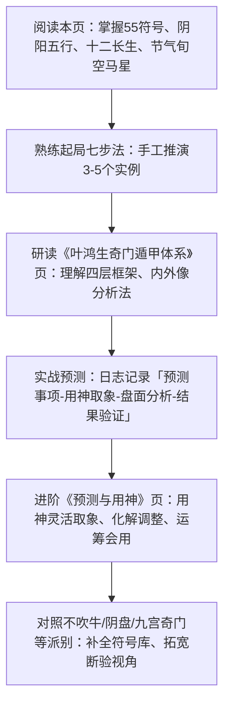

# 叶鸿生奇门遁甲基础知识与起局实务

> **页面定位**：本页依据叶鸿生《奇门遁甲》教材（初中级入门版）归档内容，系统沉淀其**四层框架**、**55符号体系**、**易学基础知识**、**起局七步法**、**九宫八卦/八门象意**等核心知识点，并建立与现有奇门遁甲页面的交叉引用网络。

---

## 一、体系定位与学习路径

### 叶鸿生奇门遁甲体系三阶段

| 阶段 | 核心任务 | 关键词 |
|------|----------|--------|
| **初级** | 认识构造、组成，掌握预测使用方法 | 破框架、画导图、宏观看、微观论 |
| **中级** | 讲解思路、看盘方式，建立预测准确率的太极 | 建立分析系统、95%准确率、一物一太极、结合实际 |
| **高级** | 预测、化解、调整、运筹 | 处理事情、达成结果的方式方法 |
| **遁甲智慧** | 知天地、知我、知太极，万事万物皆存乎一心 | 内圣外王、修行成王 |

> **交叉引用**：[[ye-hongsheng-qi-men-dun-jia-ti-xi]] 系统梳理了该体系的四层框架、55符号、预测与运筹方法论；[[ye-hongsheng-qi-men-yu-ce-yu-yong-shen]] 专注预测方法论与用神取象实战思维。

### 两大郑重提醒

1. **功能定位**：奇门遁甲是“帝王之学”，用于**观天时、察地理、见我、知我心、定位、能量**，而非单纯算卦问吉凶。[[bu-chui-niu-qimen-jiangyi-yi]] 同样强调奇门遁甲上编基础定位为“阴阳五行、十天干、十二地支、九宫、九星、八门”的理论框架。
2. **工具观**：任何高深技术不过是成长路上的**“工具”**，唯你所用，切不可钻进“仪器”里看人生。[[bu-chui-niu-qimen-jiangyi-wu]] 指出“九宫八卦区域象意、星门神仪能量旺弱、十二长生状态、十干八门克应”是实战断验的精细编码，工具属性显著。

---

## 二、四层框架与55符号体系

### 四层框架（由内向外）

| 层级 | 内容 | 核心作用 | 对应既有页面 |
|------|------|----------|--------------|
| **第1层（最底）** | **九宫八卦** | 整个奇门运作的**载体**；宫位五行、旺衰、方位、时间、人物、场所、人体部位 | [[fenglin-qimen-xiangyi-zheng-shu]] 系统梳理九宫八卦、十天干十二长生、门迫击刑入墓空亡等断验核心编码 |
| **第2层** | **地支（十二地支）** | 体现天干的**阶段**（长生→养）；兼具时间、方位、应期参考 | [[bu-chui-niu-qimen-jiangyi-yi]] 涵盖十二地支特性与六亲作用 |
| **第3层** | **九星、八门原宫位与五行** | 九星/八门**本位五行**与**落宫旺衰**（我生为旺、生我为废、克我为囚、我克为休、同我为相）；吉凶不执着 | [[bu-chui-niu-qimen-jiangyi-wu]] 详述十二长生状态与星门神仪能量旺弱判断 |
| **第4层（最上）** | **天盘：九星、八门、天干、八神** | 表面“面子”信息，**需结合下三层**综合判断；天干合/克/入墓/阶段变化 | [[ye-hongsheng-qi-men-yu-ce-yu-yong-shen]] 强调“用神仅为代表符号、四层框架内外像分析法” |

### 55个核心符号清单

| 类别 | 数量 | 符号 | 学习重点 | 关联页面 |
|------|------|------|----------|----------|
| **八卦** | 8 | 乾坤震巽坎离艮兑 | 含义、定义、五行、方位、时间、季节旺衰 | [[fenglin-qimen-xiangyi-zheng-shu]] |
| **九星** | 9 | 天蓬天芮天冲天辅天禽天心天柱天任天英 | 含义、吉凶不执、五行、特点形状、旺衰口诀 | [[bu-chui-niu-qimen-jiangyi-wu]]、[[yin-pan-qimen-paipan-shi-yi-bu]] |
| **十天干** | 10 | 甲乙丙丁戊己庚辛壬癸 | 相合、相刑、克应、入墓、能量阶段 | [[bu-chui-niu-qimen-jiangyi-yi]]、[[yin-pan-qimen-paipan-shi-yi-bu]] |
| **八神** | 8 | 值符腾蛇太阴六合白虎玄武九地九天 | 辅助参考，含义单一，可不参照五行 | [[yin-pan-qimen-paipan-shi-yi-bu]] 排盘十一步含八神安放 |
| **八门** | 8 | 开休生伤杜景死惊 | 辅助作用，自身五行与落宫论生克 | [[bu-chui-niu-qimen-jiangyi-wu]]、[[yin-pan-qimen-paipan-shi-yi-bu]] |
| **十二地支** | 12 | 子丑寅卯辰巳午未申酉戌亥 | 体现天干阶段、时间方位、定应期 | [[bu-chui-niu-qimen-jiangyi-yi]]、[[liu-jia-fa-shu-qi-men-ji-chu-pian]] |

> **学习原则**：符号如建筑原材料，**唯其所用**，不可执着“水泥吉、钢铁凶”；核心在**心中有设计图（框架、观念、标准）**。[[qi-men-dun-jia-ji-chu-yu-pai-pan]] 同样整合了十干、五行、十二支、九星、八门、八神、九宫、排盘、三元、阴阳遁等基础体系。

---

## 三、易学基础知识（预备知识包）

### 阴阳五行与生克

- **五行**：金、木、水、火、土
- **相生**：土→金→水→木→火→土
- **相克**：土→水→火→金→木→土
- **阴阳干支**：
  - 阳干：甲丙戊庚壬；阴干：乙丁己辛癸
  - 十二支阴阳：子午卯酉为四正（阴阳交媾），寅申巳亥为四维（阳），辰戌丑未为四隅（阴）

> **交叉引用**：[[bu-chui-niu-qimen-jiangyi-yi]]、[[yin-pan-qimen-paipan-shi-yi-bu]] 均以阴阳五行开篇。

### 天干地支与脏腑类象

| 天干 | 五行 | 脏腑部位 | 地支 | 五行 | 月令/节气 | 主要类象 |
|------|------|----------|------|------|-----------|----------|
| 甲 | 木 | 胆、头 | 子 | 水 | 十一月/大雪冬至 | 鼠、北方、水局 |
| 乙 | 木 | 肝、项 | 丑 | 土 | 十二月/小寒大寒 | 牛、中央、金局 |
| 丙 | 火 | 小肠、肩 | 寅 | 木 | 正月/立春雨水 | 虎、东方、火局 |
| 丁 | 火 | 心、血 | 卯 | 木 | 二月/惊蛰春分 | 兔、东方、木局 |
| 戊 | 土 | 胃、肋 | 辰 | 土 | 三月/清明谷雨 | 龙、中央、水局 |
| 己 | 土 | 脾、腹 | 巳 | 火 | 四月/立夏小满 | 蛇、南方、金局 |
| 庚 | 金 | 大肠、脐 | 午 | 火 | 五月/芒种夏至 | 马、南方、火局 |
| 辛 | 金 | 肺、大腿 | 未 | 土 | 六月/小暑大暑 | 羊、中央、木局 |
| 壬 | 水 | 膀胱、胫 | 申 | 金 | 七月/立秋处暑 | 猴、西方、水局 |
| 癸 | 水 | 肾、足 | 酉 | 金 | 八月/白露秋分 | 鸡、西方、金局 |
|      |      |          | 戌 | 土 | 九月/寒露霜降 | 狗、中央、火局 |
|      |      |          | 亥 | 水 | 十月/立冬小雪 | 猪、北方、木局 |

> **地支六冲/六合/三合/三会/六害/三刑**详见正文表格，奇门遁甲实战主要参考**六冲、击刑（三刑）、旬空、马星**；[[bu-chui-niu-qimen-jiangyi-wu]]、[[yin-pan-qimen-paipan-shi-yi-bu]] 均列举地支冲合刑害与旬空马星。

### 十二长生（生旺死绝表）

> **核心口诀**：**长生沐浴冠带临官帝旺衰病死墓绝胎养**（12阶段）

| 状态 | 甲木 | 丙火/戊土 | 庚金 | 壬水 | 乙木 | 丁火/己土 | 辛金 | 癸水 | 象征含义 |
|------|------|-----------|------|------|------|-----------|------|------|----------|
| 长生 | 亥 | 寅 | 巳 | 申 | 午 | 酉 | 子 | 卯 | 萌发、降生 |
| 沐浴 | 子 | 卯 | 午 | 酉 | 巳 | 申 | 亥 | 寅 | 洗浴、承受自然 |
| 冠带 | 丑 | 辰 | 未 | 戌 | 辰 | 未 | 戌 | 丑 | 穿衣戴帽、渐荣 |
| 临官 | 寅 | 巳 | 申 | 亥 | 卯 | 午 | 酉 | 子 | 长成、做官、领导 |
| **帝旺** | **卯** | **午** | **酉** | **子** | **寅** | **巳** | **申** | **亥** | **壮盛极点、成熟** |
| 衰 | 辰 | 未 | 戌 | 丑 | 丑 | 辰 | 未 | 戌 | 盛极而衰 |
| 病 | 巳 | 申 | 亥 | 寅 | 子 | 卯 | 午 | 酉 | 困顿、患病 |
| 死 | 午 | 酉 | 子 | 卯 | 亥 | 寅 | 巳 | 申 | 气尽、形死 |
| **墓/库** | **未** | **戌** | **丑** | **辰** | **戌** | **丑** | **辰** | **未** | **成功归库、收藏** |
| 绝 | 申 | 亥 | 寅 | 巳 | 酉 | 子 | 卯 | 午 | 前气绝、后气未来 |
| 胎 | 酉 | 子 | 卯 | 午 | 申 | 亥 | 寅 | 巳 | 受胎、后继气至 |
| 养 | 戌 | 丑 | 辰 | 未 | 未 | 戌 | 丑 | 辰 | 养胎、成形待发 |

> **实战要点**：天盘天干落宫，**必查地支对应长生阶段**；如丙落乾宫（戌亥）查表得“入墓”，表达结束、休息、收藏。[[bu-chui-niu-qimen-jiangyi-wu]]、[[yin-pan-qimen-paipan-shi-yi-bu]] 均将十二长生作为断验核心编码。

### 干支五行旺季与节气

| 方位 | 旺季 | 天干 | 地支 | 节气序列 |
|------|------|------|------|----------|
| 东方 | 春 | 甲乙 | 寅卯 | 立春雨水、惊蛰春分、清明谷雨 |
| 南方 | 夏 | 丙丁 | 巳午 | 立夏小满、芒种夏至、小暑大暑 |
| 中央 | 四季末 | 戊己 | 辰戌丑未 | 立秋处暑、白露秋分、寒露霜降 |
| 西方 | 秋 | 庚辛 | 申酉 | 立冬小雪、大雪冬至、小寒大寒 |
| 北方 | 冬 | 壬癸 | 亥子 | （循环） |

> **二十四节气歌**：“春雨惊春清谷天，夏满芒夏暑相连；秋处露秋寒霜降，冬雪雪冬大小寒。”[[bu-chui-niu-qimen-jiangyi-yi]]、[[yin-pan-qimen-paipan-shi-yi-bu]] 均以节气定阴阳遁局数。

### 六甲旬空（孤虚）

| 旬首 | 空亡地支 | 空亡宫位 | 对面宫位（虚） |
|------|----------|----------|----------------|
| 甲子 | 戌亥 | 乾(6) | 巽(4) |
| 甲戌 | 申酉 | 兑(7) | 震(3) |
| 甲申 | 午未 | 离(9)/坤(2) | 坎(1)/艮(8) |
| 甲午 | 辰巳 | 震(3)/巽(4) | 兑(7)/乾(6) |
| 甲辰 | 寅卯 | 艮(8)/震(3) | 坤(2)/离(9) |
| 甲寅 | 子丑 | 坎(1)/艮(8) | 离(9)/坤(2) |

**旬空理解**：
- **人（日干/人物用神）落旬空**：心中不确定、在思考，**必看对面宫位**为关注焦点。
- **事（值符/时干/非人用神）落旬空**：事情未发生或未显化，**不看对面**。
- **风水宫位旬空**：缺角、受外煞干扰、过于阴暗长期关闭。

> **交叉引用**：[[bu-chui-niu-qimen-jiangyi-wu]]、[[yin-pan-qimen-paipan-shi-yi-bu]]、[[qi-men-dun-jia-ji-chu-yu-pai-pan]] 均收录旬空歌诀与实战理解。

### 马星（驿马）

| 时支 | 马星地支 | 所在宫位（四维） |
|------|----------|------------------|
| 申子辰 | 寅 | 艮(8) |
| 巳酉丑 | 亥 | 乾(6) |
| 寅午戌 | 申 | 坤(2) |
| 亥卯未 | 巳 | 巽(4) |

**实战规则**：
- **日干/人物用神临马星** → 本人正在动、奔波。
- **值符/时干/事用神临马星** → 事情正在进行中。
- **软件标记**：马字图标或小方格。

---

## 四、阴阳遁18局三元起局七步法（实例演示）

> **案例时间**：公历2019年5月10日16:30 → 干支：**己亥年 己巳月 丁未日 戊申时**

### 步骤总览

| 步骤 | 操作 | 关键口诀/规则 | 本例结果 |
|------|------|---------------|----------|
| **第1步** | 查当下时间干支 | 万年历/排盘软件 | 己亥年 己巳月 丁未日 戊申时 |
| **第2步** | 查节气定阴阳遁局数范围 | 节气表+用局表 | 立夏节气 → 阳遁 **四、一、七** 三局 |
| **第3步** | 找日干支**旬首**（甲/己）定上中下元 | 子午卯酉上元、寅申巳亥中元、辰戌丑未下元 | 日支未→属甲辰旬→**下元** → **阳遁七局** |
| **第4步** | 九宫排**三奇六仪**（九天干） | 阳遁顺排(123456789)、阴遁逆排(987654321) | 兑7宫起戊→顺排戊己庚辛壬癸丁丙乙 |
| **第5步** | 依时干支找**旬首**定**值符值使** | 遁甲歌：甲子遁戊、甲戌遁己、甲申遁庚、甲午遁辛、甲辰遁壬、甲寅遁癸 | 时干戊申→旬首甲辰→甲辰遁壬→壬落坤宫 → **值符=天芮星、值使=死门** |
| **第6步** | 安值符星、值使门、八神、八门 | 值符星安时干宫→顺/逆飞九星；值使门安时干所在旬位宫→顺飞八门；值符安值符星头→顺/逆安八神 | 见下文完整盘面 |
| **第7步** | 安天盘天干（拖原位天干） | 各九星原位天干拖至飞宫位 | 完成天地盘叠合 |

> **三元上中下元口诀**：
> - **上元**：子午卯酉
> - **中元**：寅申巳亥
> - **下元**：辰戌丑未

> **阴阳遁用局速查**（节气→局数）：
> - **阳遁**：冬至惊蛰一七四、小寒二八五、大寒春分三九六、雨水九六三、清明立夏四一七、立春八五二、谷雨小满五二八、芒种六三九
> - **阴遁**：夏至白露九三六、小暑八二五、大暑秋分七一四、立秋二五八、寒露立冬六九三、处暑一四七、霜降小雪五八二、大雪四七一

### 完整盘面（阳遁七局·旬首甲辰壬·值符天芮值使死门）

| 宫位 | 九宫数 | 八卦 | 地支 | 九星 | 八门 | 八神 | 天干(天盘) | 天干(地盘) | 旬空/马星 |
|------|--------|------|------|------|------|------|------------|------------|-----------|
| 东南 | 4 | 巽 | 辰巳 | 天冲 | 生门 | 玄武 | 癸 | 丁 | 旬空(寅卯) |
| 南 | 9 | 离 | 午 | 天辅 | 伤门 | 九地 | 丁 | 庚 | |
| 西南 | 2 | 坤 | 未申 | 天芮 | **景门** | **值符** | 壬丙 | 戊 | **马星(寅)** |
| 东 | 3 | 震 | 卯 | 天任 | 休门 | 白虎 | 癸 | 己 | 旬空(寅卯) |
| 中 | 5 | 中 | — | — | — | — | 丙 | — | |
| 西 | 7 | 兑 | 酉 | 天英 | 杜门 | 腾蛇 | 庚 | 辛 | |
| 东北 | 8 | 艮 | 寅丑 | 天蓬 | 开门 | 六合 | 辛 | 己 | **马星(寅)** |
| 北 | 1 | 坎 | 子 | 天心 | 惊门 | 太阴 | 乙 | 辛 | |
| 西北 | 6 | 乾 | 戌亥 | 天柱 | 死门 | 九天 | 戊 | 乙 | |

> **排盘软件建议**：初学不必手工起局耗时，挑选美观舒服的免费软件/小程序即可；但**会起局有助于理解天地能量阶段变化规律**。[[yin-pan-qimen-paipan-shi-yi-bu]] 详述阴盘十一步排盘流程（排四柱→定阴阳遁→画九宫→布地盘三奇六仪→找旬首→定值符值使→排天盘→排八神→定八门→排隐干→查空亡马星），与本七步法逻辑高度一致。

---

## 五、九宫八卦象意全解（后天八卦为主用90%）

> **原则**：**先天八卦为体（10%），后天八卦为用（90%）**。初学者主参考后天八卦（以人为中心前后左右）。用神落宫，**必读该宫卦象意**。

### 九宫八卦分布（洛书九宫）

| 宫位 | 八卦 | 五行 | 方位 | 数字 | 地支 | 旺季节气 |
|------|------|------|------|------|------|----------|
| 1 | 坎 | 水 | 北 | 1、6 | 子 | 冬至大寒(11月) |
| 2 | 坤 | 土 | 西南 | 2、8、5、10 | 未申 | 立秋白露(7-8月) |
| 3 | 震 | 木 | 东 | 3、8、4、9 | 卯 | 春分谷雨(2月) |
| 4 | 巽 | 木 | 东南 | 4、5、3、8 | 辰巳 | 立夏芒种(4-5月) |
| 5 | 中 | 土 | 中央 | 5、10 | — | 四季末月 |
| 6 | 乾 | 金 | 西北 | 1、4、6、9 | 戌亥 | 立冬大雪(10月) |
| 7 | 兑 | 金 | 西 | 2、7、4、9 | 酉 | 秋分霜降(8月) |
| 8 | 艮 | 土 | 东北 | 7、8、5、10 | 丑寅 | 立春惊蛰(12-1月) |
| 9 | 离 | 火 | 南 | 3、9、2、7 | 午 | 夏至大暑(5月) |

### 八卦核心象意速查表

| 卦 | 核心意象 | 代表人物 | 代表场所 | 人体部位 | 颜色 | 五味 | 时间(农历) |
|----|----------|----------|----------|----------|------|------|------------|
| **乾** | 天、刚健、首领 | 国君、主席、父亲、老板、长辈 | 京都、大城市、高处 | 头、右腿、肺、骨、男性生殖器 | 白、大赤、玄 | 辛辣 | 九十月(戌亥) |
| **坤** | 地、柔顺、承载 | 皇后、母亲、群众、职工、老妇 | 田野、乡村、平地、大地 | 腹、右肩、脾胃、肌肉、女性生殖器 | 黑、黄 | 甘甜 | 六七月(未申) |
| **震** | 雷、震动、奋起 | 长男、二把手、军警、运动员、驾驶员 | 工厂、车站、机场、舞厅、森林 | 足、肝胆、左肋 | 青绿碧 | 酸 | 二月(卯) |
| **巽** | 风、渗透、自由 | 长女、商人、教师、僧道、技艺人、自由职业 | 邮局、管道、线路、隘路、寺观、草原 | 股、肱、胆、气管、神经、左肩 | 绿蓝 | 酸 | 三四月(辰巳) |
| **坎** | 水、险阻、月亮 | 中男、江湖人、医生律师、盗贼、水利人员 | 江河湖海、井渠、酒店、浴室、地下室 | 肾、膀胱、泌尿、生殖、耳、肛门 | 黑白 | 咸 | 十一月(子) |
| **离** | 火、光明、文明 | 中女、中层干部、文人艺人、名星、侦察员 | 朝阳处、名胜、影视、印刷、冶炼、广告塔 | 眼、头、心、小肠 | 赤红花紫 | 苦 | 五月(午) |
| **艮** | 山、止、静安 | 少男、青少年、土建宗教、官僚、守卫、银行 | 山岭、高台、坟场、监狱、仓库、祠堂、大楼 | 鼻背手指关节左腿脚趾乳房脾胃 | 黄棕咖白 | 甘甜 | 十二正月(丑寅) |
| **兑** | 泽、悦、言词 | 少女、讲师演说、巫卜媒婆、歌手、牙医外科 | 沼泽、湖池、会议室、茶座、饭店、洞穴 | 口舌牙咽喉肺右胁肛门 | 白赤 | 辛辣 | 八月(酉) |

> **实战最常用**：**五行、时间、人体、方位对应人物（风水）**。[[fenglin-qimen-xiangyi-zheng-shu]]、[[bu-chui-niu-qimen-jiangyi-wu]]、[[yin-pan-qimen-paipan-shi-yi-bu]] 均收录九宫八卦象意系统。

---

## 六、八门象意与实战断验原则

### 八门原位分布（后天八卦）

| 宫位 | 1坎 | 2坤 | 3震 | 4巽 | 5中 | 6乾 | 7兑 | 8艮 | 9离 |
|------|-----|-----|-----|-----|-----|-----|-----|-----|-----|
| **八门** | **休门** | **死门** | **伤门** | **杜门** | — | **开门** | **惊门** | **生门** | **景门** |
| 五行 | 水 | 土 | 木 | 木 | — | 金 | 金 | 土 | 火 |
| 吉凶 | 吉 | 凶 | 凶 | 平 | — | 吉 | 凶 | 吉 | 平 |

> **九星原位**同表：天蓬(1)天芮(2)天冲(3)天辅(4)天禽(5)天心(6)天柱(7)天任(8)天英(9)

### 八门核心含义与断验原则

| 门 | 五行 | 核心含义 | 吉凶性质 | 实战断验关键点 |
|----|------|----------|----------|----------------|
| **开门** | 金 | 四通八达、远行、见贵、求财、开启、机会 | 吉门 | **门克宫为迫**：落震巽(木)金克木→吉不成；落坎(水)金生水→旺 |
| **休门** | 水 | 休息、聚会、经商、嫁娶、谒贵、放松、停止 | 吉门 | 测疾病见休门→瘫软无力；测谈判→有利和缓 |
| **生门** | 土 | 生长、发展、发育、进步、利润、好处、生发 | 吉门 | **测疾病见生门→病情恶化、发展加剧**；测事业失败见生门→失败加深 |
| **伤门** | 木 | 伤害、损耗、劳累、奔波、口舌、官非、车辆 | 凶门 | 永远凶；落旺宫伤害力更大 |
| **杜门** | 木 | 遮蔽、隐藏、阻塞、保密、拒绝、关闭、文书 | 平门 | 测保密事宜取杜门；测沟通见杜门→不畅 |
| **景门** | 火 | 光明、文书、考试、面试、声望、显示、重视、美丽 | 平门 | 测求见贵人/重视取景门；测文书合同利景门 |
| **死门** | 土 | 死亡、终结、僵化、死心眼、认死理、固执、停止 | 凶门 | **测事业见死门+三奇吉星→死心眼认死理非绝对凶**；测疾病→病入膏肓 |
| **惊门** | 金 | 惊恐、意外、波动、紧张、失控、突发、警察、法律 | 凶门 | 永远凶；落旺宫惊动更烈 |

### 断验黄金法则

1. **吉凶不执着**：**任何门吉凶随落宫旺衰、搭配符号动态变化**。死记“开休生吉、伤杜景平、死惊凶”必误。
2. **五符合参**：单宫**九星+八门+八神+天干+地支(长生)**五符号组合定吉凶。
3. **事项导向含义**：同一符号在不同预测事项下**功能不变、含义随事项变**（如生门在疾病=恶化、事业=发展、求财=利润）。
4. **八门作辅助**：主参考**天干与九星**；八门自身五行与落宫生克可忽略不计。

> **交叉引用**：[[bu-chui-niu-qimen-jiangyi-wu]]、[[yin-pan-qimen-paipan-shi-yi-bu]]、[[bu-chui-niu-qimen-jiangyi-san-shengyi-caiyun-yuce]] 均以星门神仪组合断验为核心。

---

## 七、预测方法论核心（避坑指南）

### 什么是预测？

> **预测 = 已知事物 + 仪器(奇门) → 显示肉眼不可见的潜在影响因素与发展规律**
> - 非问“成不成、好不好”，而是**看清楚造成结果的原因**。
> - 多次预测能生出**更高级智慧**；执着仪器看世界→自以为是“高人”。

### 用神仅为“代表符号”

- **古人用神仅供借鉴**（如婚恋乙庚、求财戊、长辈年干、平辈月干、求测日干、晚辈时干），**不可执着**。
- **现代取用神原则**：**“此人/此事在我心中有何特点 → 奇门符号库中找匹配符号”**。
  - 打官司：对立面=克日干天干/对立宫位
  - 球赛：红衣队=丙火、绿衣队=乙木
  - 新同事：胖=戊土、瘦=乙木、黑衣=癸水、绰号“火鸡”=酉金
  - 丢狗：艮为狗/地支戌/时干/天禽均可

> **核心**：**用神只是代号，旁边符号才说明好坏**。[[ye-hongsheng-qi-men-yu-ce-yu-yong-shen]] 系统阐述“用神灵活取象、仅为代表符号、四层框架内外像分析法”。

### 盘面分析：内外像双轨

| 维度 | 内容 | 分析重点 |
|------|------|----------|
| **外像(天盘)** | 九星、八门、八神、天干 | 表面信息、当下状态、吉凶倾向 |
| **内像(地盘)** | 八卦九宫、地支(长生)、宫位五行旺衰 | 根基、载体、深层能量、时间阶段 |
| **综合判断** | **外像落内像** → 天干长生阶段、九星落宫旺衰、八门落宫生克、八神辅助、宫位象意 | **内外像冲突/共振定准确率** |

> **技术精进三阶段**：**名词(背诵符号) → 形容词(提炼特质如“乾=带头大哥”) → 感觉(直接体悟能场)**。[[ye-hongsheng-qi-men-dun-jia-ti-xi]] 强调“从名词进入形容词再到感觉”的技术精进路径。

---

## 八、化解调整与运筹（中高阶预览）

### 结果可变性

| 类别 | 可改变性 | 说明 |
|------|----------|------|
| **国家/股票/上级/父母/天气** | **不可改变** | 高于自身层面维度 |
| **人生运势/婚姻/财运/公司/业务** | **~80%可立即改变** | 自身层面可调整内境外境 |

### 内境改变（核心杠杆）

| 维度 | 负向(耗能) | 正向(聚能) | 奇门符号对应 |
|------|------------|------------|--------------|
| **发心** | 欲得、为我 | 欲为家人/社会/国家 | 丁(希望) vs 癸(绝望) |
| **定位** | 注定穷鬼(坎宫) | 天生干大事(乾宫) | 宫位自我定位 |
| **姿态** | 紧张恐惧(惊门) | 放松从容(休门) | 八门身心状态 |
| **工作感** | 热情洋溢易散(天英) | 任劳任怨踏实(天任) | 九星工作特质 |
| **行动感觉** | 损失失败感(丙加庚) | 腾飞辉煌感(戊加丙) | 天干克应组合 |

### 外境改变（环境配合）

- 家居西北(乾/男主)、西南(坤/女主)物品调整
- 清理陈旧物、整洁和谐场景
- 属相合作：属狗(戌)避冲龙(辰)、合兔(卯)
- 穿戴颜色：红(丙/离)、黄(戊/坤艮)、绿(乙/震巽)、黑(癸/坎)
- 办事方位/时间：取生门方(利润)、休门方(贵人)、景门方(重视)、杜门/太阴/九地方(保密)

### 运筹会用（高阶）

> **原则**：**取对我有利的能量、方位、空间、符号、旺气方，唯我所用**。
> - 卖土豆→坐生门方赚钱快
> - 比赛势均力敌→我方占旺气宫+吉门(开休生)，敌方置死门/凶神方
> - 谈判合作→取**六合**方位/人物/属相/物品（合成能量）
> - 求见贵人→休门；希望对方开心→开门；引起重视→景门；保密→杜门/太阴/九地

---

## 九、交叉引用索引与学习建议

### 本系统核心页面

| 页面 | 定位 | 适用阶段 |
|------|------|----------|
| [[ye-hongsheng-qi-men-dun-jia-ti-xi]] | 体系总览：四层框架、55符号、预测运筹方法论 | 全阶段 |
| [[ye-hongsheng-qi-men-yu-ce-yu-yong-shen]] | 预测实战：用神取象、内外像分析、三阶段精进 | 中高级 |
| **本页** | **基础知识全书：易学预备、起局七步法、九宫八卦八门全解** | **初级入门** |

### 同门异派对照参考

| 派别/作者 | 核心特色 | 关键差异点 |
|-----------|----------|------------|
| [[bu-chui-niu-qimen-jiangyi-yi]]/[[bu-chui-niu-qimen-jiangyi-wu]] | 星门神仪宫、能量旺弱、十二长生、十干八门克应 | 保留暗干暗支、门加门星加星，符号更繁 |
| [[yin-pan-qimen-paipan-shi-yi-bu]]/[[fenglin-yinpan-qimen-lilun]] | 阴盘/道家秘传、月相定局、没吉没凶、空亡转宫、隐干法 | 阴阳遁定局不同、无格局说、重风水移星换斗 |
| [[dong-bo-ju-shi-qi-men-miao-jue]] | 三才盘式、定局超神接气置闰、诸格主客断法 | 保留古法置闰、格局体系完整 |
| [[jiu-gong-qi-men]]/[[jiu-gong-qi-men-2-liu-ci-yuan-gai-yun-shu]] | 单宫锁宫、符号吉凶断、生活化六次元改运 | 简化符号、重应用轻理论 |
| [[qi-men-dun-jia-ji-chu-yu-pai-pan]] | 整合东伯居士定局、不吹牛能量旺弱、金口奇门十三宫 | 综合多派、含天人合一激能训练 |

### 学习建议路线图

---

## 十、版本记录

| 版本 | 日期 | 修订要点 |
|------|------|----------|
| 1.0 | 2025-08-15 | 初版：整合归档文章全文，结构化输出基础知识、起局实例、九宫八卦八门象意，建立交叉引用网络 |

---

> **免责声明**：本页知识源自叶鸿生《奇门遁甲》教材归档内容，仅供学习研究参考。奇门遁甲预测涉及复杂时空能量模型，实战准确率取决于功底与悟性，**不构成任何决策建议**；重大决策请结合多源信息与专业意见综合判断。

## 来源

- [叶鸿生：我用遁甲](../sources/叶鸿生：我用遁甲.md)
