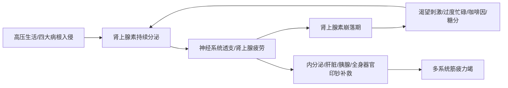
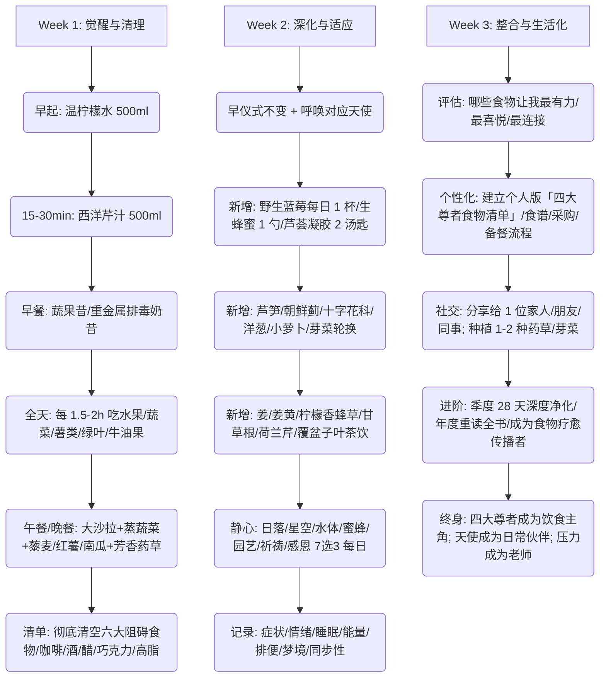
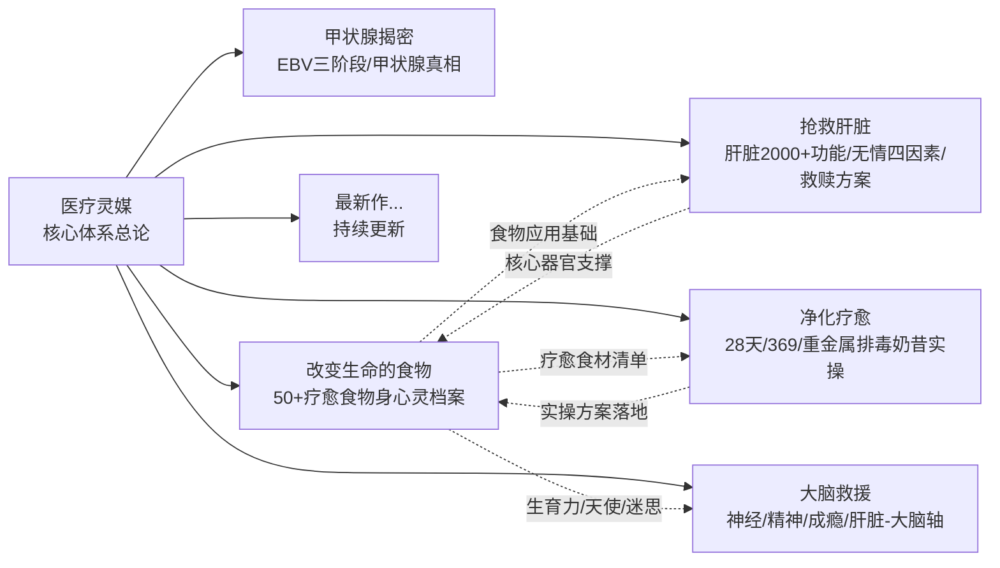

# 医疗灵媒：改变生命的食物核心体系

> **安东尼·威廉（Anthony William）** 继《医疗灵媒》总论后，聚焦「食物即药物、食物即灵性」的核心真相，揭示植物性食物超越营养学的疗愈维度，提供应对现代健康危机的完整食物方案。

## 核心架构总览

| 维度 | 核心内容 | 关键点 |
|------|----------|--------|
| **信息源头** | 高灵「慈悲」 | 同《医疗灵媒》总论，四岁起听闻高灵声音，以超级核磁共振般扫描能力获取领先医学数十年的食物真相 |
| **核心危机** | **四大病根 + 肾上腺素成瘾 + 阳光/活水危机 + 食物选择危机** | 辐射、重金属、病毒、DDT 四大病根为物理层根因；肾上腺素成瘾为生理机制；环境退化加剧脆弱性 |
| **核心方案** | **四大尊者食物体系** | 水果、蔬菜、药草香料、野生食物 —— 拥有适应原特质、蕴含大地之母与天堂智慧的神圣助力 |
| **疗愈维度** | 身体-情绪-灵性三位一体 | 每种食物同时提供：物理疗愈功效、情绪抚慰支持、灵性启发教诲 |
| **防护策略** | 避开六大阻碍食物 + 警惕饮食迷思 + 召唤改变生命天使 | 乳制品/蛋/玉米/小麦/芥花籽油/天然风味为六大阻碍食物；辨析主流饮食风尚谬误 |

---

## 一、现代健康危机的四大病根

> **「四大病根是人类生活中的隐形入侵者，是令我们夜晚辗转难眠的未知事物，也是让生命变得如此充满挑战且无法预料的原因。」**

### 辐射物
- **来源**：核试验/核灾残留（广岛、车诺比、福岛）、医疗影像（早期试鞋透视机）、电子设备、飞行、微波炉、环境辐射落尘
- **机制**：破坏细胞 DNA、削弱免疫系统、激活潜伏病毒、引发癌症/内分泌失调/骨质疏松/皮肤疾病
- **关键洞见**：辐射物飘浮大气中千年不落地，通过水土食物链进入人体，**代际传递** 是核心特征
- **交叉引用**：[[yi-liao-ling-mei-qiang-jiu-gan#无情四因素]] 肝脏专题中作为「无情四因素」之首

### 有毒重金属
- **核心成员**：汞（牙汞合金/鱼类/疫苗佐剂）、铝（除臭剂/锅具/药物）、铜（水管/避孕器/杀菌剂）、铅/砷/镉/镍
- **机制**：神经毒素、氧化应激、**喂养病毒**、阻塞酶反应、致癌、氧化产生有毒迳流伤害组织
- **代际放大**：汞在血脉中持续数千年，**每代增强**，导致自闭症/忧郁症/阿兹海默症/帕金森氏症/ADHD/不孕等
- **交叉引用**：[[yi-liao-ling-mei-qiang-jiu-gan#无情四因素]] 重金属排毒奶昔五大核心成分协同螯合；[[全频能量花精全书]] 花精协同排毒

### 病毒爆发
- **核心病毒**：**EB 病毒（60+ 变异株）**、带状疱疹、巨细胞病毒、HHV-6/7/10/11/12、莱姆病毒（实为病毒非细菌）
- **机制**：以肝脏/器官为大本营 → 分泌**神经毒素/皮疹毒素/神经炎因子** → 扰乱神经功能、迷惑免疫系统、驱动自身免疫/神经/皮肤/甲状腺疾病
- **诊断盲区**：血检仅显示抗体（过往感染），无法检测器官内活跃病毒；医学未发现全部变异株（如不起疹子带状疱疹）
- **交叉引用**：[[yi-liao-ling-mei]] 系列总论 EBV 四阶段；[[yi-liao-ling-mei-qiang-jiu-gan#肝脏捣乱者清单]] 肝脏作为病毒大本营

### DDT / 杀虫剂 / 除草剂
- **持久性**：禁用 40+ 年仍残留环境，**食物链逐级放大**、**代际传递**
- **机制**：抑制免疫系统、肝脏过度敏感、引发糖尿病、脾脏/心脏肿大、消化不良、偏头痛、慢性忧郁、皮肤问题、荷尔蒙扰乱
- **现代关联**：草甘膦等新型除草剂延续相同破坏模式
- **交叉引用**：[[yi-liao-ling-mei-qiang-jiu-gan#无情四因素]] 肝脏核心深处隔离存储持久性有机污染物

### 四大病根协同放大效应
| 组合模式 | 典型后果 |
|----------|----------|
| 辐射 + 病毒 | 辐射削弱免疫 → EBV 等病毒激活 → 多发性硬化症等神经疾病 |
| DDT 传承 + 重金属暴露 | DDT 让家族易感同类疾病 + 重金属喂养病毒 → 原本可排毒疗愈的病变成「遗传」绝症 |
| 重金属 + 病毒 | 重金属为病毒最爱粮食 → 病毒分泌神经毒素 → 狼疮/纤维肌痛/慢性疲劳/甲状腺疾病 |

> **核心希望**：**「只要保持警觉，就可以减少接触；只要够勤奋，就能解除毒素。运用本书提到的各种改变生命的食物，你就能给自己前所未有的保护。」**

---

## 二、肾上腺素成瘾：现代文明的隐形毒药

> **「我们本身的肾上腺素应该被归为第一级管制药品，它就是这么容易使人上瘾。」**

### 成瘾机制
- **进化错位**：原设计为「偶尔危及生命时激增」，现代成「持续适中浓度 + 频繁飙升」新常态
- **大脑打火机油隐喻**：肾上腺素点燃内在之火 → 提升思考速度/工作效率/科技发展/运动成就，**但燃烧殆尽更快**
- **神经代价**：强迫神经传导物质/电脉冲/神经胶质细胞/神经元超越极限 → 阿兹海默症/脑雾/记忆衰退/定向障碍/忧郁症/失眠/失智症
- **病毒共谋**：过量肾上腺素**喂养病毒**（EBV 等），远胜其他毒素危害

### 肾上腺素赤字循环

### 破解之道：少量多餐 + 压力重构
- **生理策略**：**每 1.5-2 小时进食一次**（葡萄糖 + 矿物盐），维持血糖稳定，避免肾上腺素/皮质醇被迫分泌
- **心理策略**：将压力视为**「传讯者、老师、朋友、身体工作者、教练」**，设定就寝界线，感谢压力赋予的使命感
- **交叉引用**：[[yi-liao-ling-mei-qiang-jiu-gan#降低脂肪——疗愈的前提]] 肝脏救赎方案同源；[[三分钟未来日记]] 习惯养成框架；[[写下来奇迹就会发生]] 血糖稳定与显化的生理前提

---

## 三、环境退化的双重打击：阳光减少与活水不足

### 阳光减少
- **真相**：臭氧层稀薄/污染物/钡雾霾形成白色薄膜 → **穿透阳光大幅减弱** → 植物光合作用受阻 → 农作物产量/营养密度下降
- **人体关联**：人体像植物进行「光合作用」，仰赖阳光提升酶/矿物质/维生素产量，**阳光不足 = 寿命缩短**
- **误区澄清**：主流恐惧紫外线危害，实为**阳光不足才是真正危险**

### 活水不足
- **昔日**：雨水/雪水富含矿物质/微量元素/生命力，「穷人的肥料」免施肥滋养作物
- **今朝**：天空毒素过多 → 自然净化过程**一并消除赋予生命的养分** → 落地雨水贫瘠 → 土壤去矿物质化 → 食物营养密度断崖式下跌
- **核心洞见**：**不是降水量问题，是水本身「缺乏」生命力**

---

## 四、四大尊者食物体系：对抗四大病根的神圣助力

> **「食物中的四大尊者远比我们所能理解的更神圣、更强大，因为它们从大地中生长而出，接受阳光的洗礼，并且在成形过程中一天又一天地忍受恶劣天气，所以跟大自然的神圣力量紧密链接。」**

### 体系总览

| 尊者类别 | 核心特质 | 代表食物 | 疗愈维度 |
|----------|----------|----------|----------|
| **水果** | 高生物利用度葡萄糖、矿物盐、抗氧化剂、**情绪抚慰/灵性升华** | 苹果/杏/酪梨/香蕉/莓果/樱桃/蔓越莓/椰枣/无花果/葡萄/奇异果/柠檬莱姆/芒果/瓜类/柳橙橘子/木瓜/西洋梨/石榴 | 燃料库、冷却肝脏、推送营养入细胞、抚慰孤独/忧郁/焦虑 |
| **蔬菜** | 矿物质宝库、适应原特质、重金属螯合、肝脏支持 | 朝鲜蓟/芦笋/西洋芹/十字花科/小黄瓜/叶菜/洋葱/马铃薯/小萝卜/芽菜菜苗/番薯 | 重建胃酸/胆汁、清洗肝脏、提供钠钾泵矿物盐、接地稳定 |
| **药草香料** | 高浓度植物化合物、抗病毒/抗菌/抗炎、神经系统修复 | 芳香药草/猫爪藤/芫荽/大蒜/姜/柠檬香蜂草/甘草根/荷兰芹/覆盆子叶/姜黄 | 抗 EBV/带状疱疹、肾上腺修复、淋巴清理、消化支持 |
| **野生食物** | **适应原巅峰**、极端环境求生智慧代际传承、最高频疗愈能量 | 芦荟/大西洋海菜/牛蒡/白桦茸/椰子/蒲公英/荨麻叶/生蜂蜜/红花苜蓿/玫瑰果/野生蓝莓 | 重生食物、探查潜在疾病、监控压力毒素、细胞级修复 |

### 核心原则
1. **不必戒掉其他食物**，无论何种饮食法，**多多摄取四大尊者即可改变生命**
2. **每天吃、一天吃好几次**、以最新鲜/完整/纯粹形式呈现
3. **适应原特质**：在恶劣环境生存的植物，将求生智慧深植基因，吃下即获得古老活智慧
4. **身心灵三位一体**：每种食物同时作用于身体症状、情绪状态、灵性成长

---

## 五、50 种改变生命的食物疗愈档案（第二部核心）

> **「你读完这本书就多了五十位新朋友，了解从土里长出来的食物是神赐予我们、用来拯救人类的礼物。」**

### 水果篇（18 种）

| 食物 | 核心疾病/症状缓解 | 情绪支持 | 灵性启发 | 食用诀窍 |
|------|------------------|----------|----------|----------|
| **野生蓝莓** | **重生食物**；重金属/辐射/病毒/ DDT 全谱排毒；脑雾/记忆/阿兹海默/癌症/自身免疫 | 面对绝望时带来希望、重生力量 | 极端环境求生智慧代际传承；监控身体压力毒素浓度 | **每日 1 杯冷冻野生蓝莓**；果昔/燕麦/沙拉 |
| **酪梨** | 与母乳最相近；肝脏/脑/神经修复；甲状腺/肾上腺/胰腺支持 | 母性般滋养灵魂；缓解被遗弃感 | 世界上最接近母乳的食物 | 成熟软吃；搭配柠檬汁防氧化 |
| **香蕉** | 葡萄糖/电解质/钾/镁宝库；消化/睡眠/焦虑/肌肉痉挛/血压 | 提供安全感、稳定感 | 隐藏天赋的象征（像马铃薯埋在土里） | 熟透有褐斑最好；果昔基底 |
| **柠檬/莱姆** | 肝脏排毒/胆汁重建/胃酸恢复/重金属螯合/维生素 C | 切断忧郁心情；净化负面能量 | 纯净/清澈的象征 | **空腹温柠檬水**；餐餐挤汁 |
| **椰枣** | 高葡萄糖/钾/镁/铁/钙/锌/硒；能量/贫血/骨骼/神经/生育力 | 长途旅行护身符；缓解孤单 | 丰盛/滋养的象征 | **每次 9 颗**发挥最大效益；填充坚果酱 |
| **苹果** | 果胶螯合重金属/辐射；消化/肝脏/胆囊/脑/癌症预防 | 抚慰孤单；带来安宁 | 智慧/分辨的象征 | 带皮吃；红苹果抗氧化最强 |
| **莓果类** | 抗氧化/抗癌/脑/心血管/皮肤/消化/病毒抑制 | 喜悦/轻盈/童心 | 丰盛/甜美人生 | 混合食用协同增效 |
| **柳橙/橘子** | 维生素 C/类黄酮/葡萄糖；免疫/肾上腺/肝脏/病毒/癌症 | 阳光能量；驱散阴霾 | 充满生命力的礼物 | 整颗吃含白络；现榨汁即喝 |
| **芒果** | β-胡萝卜素/维生素 A/C/B6/叶酸；眼/皮肤/免疫/消化/生育 | 安慰破碎的心 | 热带阳光的浓缩 | 成熟软吃；搭配辣椒粉/柠檬 |
| **瓜类** | 高水分/电解质/葡萄糖；肾脏/肝脏/皮肤/脱水/热潮红 | 清凉/平静/情绪降温 | 纯净水晶能量 | 空腹单独吃；西瓜/哈密瓜/甜瓜 |
| **葡萄** | 白藜芦醇/花青素/葡萄糖；心/脑/肝/肾/抗癌/病毒 | 丰盛/庆祝/感恩 | 生命之血的象征 | 含皮籽嚼碎；红紫葡萄最强 |
| **奇异果** | 维生素 C/酶/抗氧化；消化/免疫/睡眠/皮肤/心血管 | 清新/新开始 | 破茧成蝶的力量 | 连皮吃（刷净）营养双倍 |
| **石榴** | 抗氧化/多酚/铁/叶酸；心/血/生育/抗癌/更年期 | 再生/重生/女性力量 | 生命种子的守护者 | 直接吸食籽粒；榨汁过滤 |
| **西洋梨** | 果胶/纤维/铜/维生素 K；消化/肝脏/胆囊/骨骼/抗炎 | 温柔/包容/接纳 | 柔韧中藏刚毅 | 软熟吃；搭配肉桂/蜂蜜 |
| **无花果** | 钙/镁/钾/铁/纤维/酶；骨/消化/生育/皮肤/癌症 | 丰盈/滋养/神圣女性 | 古老智慧的容器 | **一次 9 颗**；鲜食/晒干皆宜 |
| **椰枣** | 见上 | 见上 | 见上 | 见上 |
| **杏** | β-胡萝卜素/维生素 A/C/E/钾/铁；眼/皮肤/免疫/血/抗癌 | 温暖/阳光/内在小孩疗愈 | 金色光芒的凝聚 | 带皮吃；晒干无硫磺最佳 |
| **木瓜** | 木瓜酶/维生素 C/A/叶酸/镁；消化/抗炎/免疫/皮肤/伤口 | 热情/流动/消化情绪 | 热带疗愈之泉 | 空腹吃消化酶最强；籽可食 |

### 蔬菜篇（11 种）

| 食物 | 核心疾病/症状缓解 | 情绪支持 | 灵性启发 | 食用诀窍 |
|------|------------------|----------|----------|----------|
| **西洋芹** | **簇盐重建胃酸/胆汁/肝脏排毒/杀灭病原体/神经修复**；消化/皮肤/自身免疫/脑雾/焦虑 | 平静/清晰/释放压力 | 纯净绿色治愈之光 | **空腹 500ml 纯汁**；静待 15-30 分钟 |
| **马铃薯** | 高生物利用度氨基酸/葡萄糖/钾/维生素 B6/C；肝脏/脑/消化/睡眠/焦虑/抑郁/体重 | **坚实力量基础**；接地/稳定；发掘隐藏天赋 | 埋藏宝藏的象征 | **蒸/烤/煮**；不加油/奶酪/培根；带皮吃 |
| **红薯/番薯** | β-胡萝卜素/维生素 A/C/E/B6/钾/锰/纤维；眼/免疫/皮肤/血糖/消化/抗癌 | 安慰/滋养/安全感 | 大地丰饶的馈赠 | 蒸烤为主；搭配椰子油/肉桂 |
| **朝鲜蓟** | 肝脏排毒/胆汁/消化/胆固醇/血糖/肾/皮肤/癌症/酒精修复 | 释放控制欲/完美主义 | 层层保护下的柔软核心 | 蒸食叶肉/心；煮水喝 |
| **芦笋** | 天门冬酰胺/叶酸/维生素 K/A/C/E/铬；肾/肝/生育/消化/抗炎/脑/抗癌 | 平衡/适应/灵活应变 | 向上生长的决心 | 轻蒸/快炒；保留脆嫩 |
| **十字花科** | 硫代葡萄糖苷/吲哚-3-甲醇/维生素 C/K/叶酸；**抗癌/肝脏解毒/甲状腺支持/荷尔蒙平衡** | 勇气/转化/突破 | 破土而出的生命力 | **熟吃避免甲状腺肿原**；搭配芥末酶激活 |
| **洋葱** | 洋葱素/槲皮素/硫化物；**减轻口臭/肝脏/心/血糖/骨/抗癌/病毒/细菌/过敏** | 清理情绪垃圾/释放压抑 | 层层剥开见真心 | 生吃/熟吃皆效；红洋葱抗氧化最强 |
| **叶菜类** | 叶绿素/镁/铁/钙/维生素 K/A/C/叶酸；**血/骨/肝/脑/消化/皮肤/抗癌/碱化** | 希望/新生/成长 | 向光生长的信念 | 每日大量；轮换种类；生吃/轻烫 |
| **小黄瓜** | 硅/钾/镁/维生素 K/C；补水/皮肤/肾/肝/血压/消化/关节/降温 | 清凉/平静/情绪降温 | 纯净水晶结构 | 连皮生吃；榨汁/沙拉/蘸酱 |
| **小萝卜** | 硫化物/维生素 C/叶酸/钾；肝脏/胆囊/消化/呼吸/皮肤/抗癌/黏液清理 | 释放愤怒/挫败 | 尖锐穿透力 | 生吃片/丝；叶可食营养更高 |
| **芽菜菜苗** | **适应原巅峰**；酶/维生素/矿物质/植物化合物浓度最高；消化/免疫/抗癌/修复/抗衰老 | 无限可能/新开始/希望 | 生命爆发的瞬间 | 生吃为主；每日一把；自家种植最鲜 |

### 药草香料篇（10 种）

| 食物 | 核心疾病/症状缓解 | 情绪支持 | 灵性启发 | 食用诀窍 |
|------|------------------|----------|----------|----------|
| **芫荽** | **重金属排毒五大核心之一**；穿透血脑屏障螯合汞/铝/铅；肝脏/脑/神经/皮肤/消化/焦虑/失眠 | 释放深层创伤/恐惧 | 深度清理/净化灵魂 | **重金属排毒奶昔每日 1 杯**；生吃叶茎 |
| **芳香药草** (迷迭香/百里香/牛至/鼠尾草/罗勒/薄荷) | 抗病毒/抗菌/抗真菌/抗炎/抗氧化；呼吸/消化/免疫/脑/记忆/肝脏/癌症/压力 | 提振精神/清晰/专注/喜悦 | 古老智慧/神圣仪式 | 生鲜最佳；茶饮/料理/精油吸入 |
| **猫爪藤** | **抗病毒/免疫调节/抗炎/抗癌**；EBV/莱姆/自身免疫/关节/消化/脑/神经 | 内在战士/保护力量 | 亚马逊神圣藤蔓 | 茶饮/酊剂/胶囊；空腹吸收最佳 |
| **大蒜** | 大蒜素/硫化物；**抗病毒/抗菌/抗真菌/抗寄生虫/心/血压/胆固醇/免疫/肝脏/癌症/重金属** | 保护/边界/驱散负面 | 强大净化守护者 | **生吃捣碎静置 10 分钟**激活大蒜素 |
| **姜** | 姜辣素/姜烯酚；**消化/恶心/炎症/痛经/关节/循环/免疫/脑/肝脏/抗癌/病毒** | 温暖/勇气/行动力 | 火之炼金术士 | 生姜茶/榨汁/料理；皮可吃 |
| **柠檬香蜂草** | **抗病毒/神经/甲状腺/消化/睡眠/焦虑/抑郁/记忆/心/肝脏/EBV/带状疱疹** | 平静/安宁/抚慰破碎心 | 蜜蜂最爱/甜美疗愈 | 鲜叶茶饮；酊剂/精油/浴盐 |
| **甘草根** | 甘草酸/类黄酮；**肾上腺/抗病毒/抗炎/消化/呼吸/肝脏/甲状腺/更年期/皮肤/癌症** | 支持/滋养/耐力 | 甜美中的力量 | 茶饮/酊剂/DGL 脱甘草酸制品 |
| **荷兰芹** | 维生素 K/C/A/叶酸/铁/抗氧化；**肾/肝/血/骨/消化/水肿/高血压/癌症/口气** | 清新/净化/新开始 | 绿色生命力象征 | 生吃/榨汁/装饰；茎叶皆用 |
| **覆盆子叶** | 香豆素/单宁/维生素 C/E/铁/钙/镁；**子宫/生育/怀孕/产后/经期/消化/喉咙/皮肤/荷尔蒙** | 母性/滋养/女性力量 | 女性智慧守护者 | 茶饮为主；孕期咨询专业人士 |
| **姜黄** | 姜黄素/精油；**抗炎/抗氧化/肝脏/脑/关节/心/消化/免疫/抗癌/抑郁/记忆/皮肤** | 金光/智慧/转化 | 太阳能量的凝聚 | **搭配黑胡椒/脂肪**吸收率提升 2000% |

### 野生食物篇（11 种）

| 食物 | 核心疾病/症状缓解 | 情绪支持 | 灵性启发 | 食用诀窍 |
|------|------------------|----------|----------|----------|
| **野生蓝莓** | 见水果篇核心条目 | 见上 | 见上 | 见上 |
| **大西洋海菜** | 碘/矿物质/多糖/岩藻多糖；**甲状腺/重金属/辐射/病毒/癌症/消化/皮肤/体重/骨/脑** | 海洋深度智慧/平静/韧性 | 古老海洋记忆守护者 | 干品泡发；汤/沙拉/炖菜；碘源谨慎 |
| **牛蒡** | 菊粉/木酚素/抗氧化；**血液净化/肝脏/肾/皮肤/消化/淋巴/癌症/关节/血糖/抗菌** | 深度清理/释放旧模式 | 大地深处的净化者 | 根茎蒸炖/泡茶/酊剂；皮富营养 |
| **白桦茸** | β-葡聚糖/三萜/抗氧化/黑色素；**免疫调节/抗癌/抗病毒/抗炎/肝脏/脑/皮肤/压力/衰老/辐射** | 战士/保护/生存智慧 | 极寒求生大师 | 热水萃取/煮茶/双重萃取酊剂 |
| **椰子** | 中链甘油三酯/月桂酸/电解质/纤维；**脑/能量/消化/免疫/皮肤/甲状腺/肝脏/病毒/真菌/寄生虫/体重** | 热带滋养/丰盛/流动 | 生命之树/全能给予者 | 水/肉/油/糖/花蜜全用；幼椰水最佳电解质 |
| **蒲公英** | 消胆碱/菊粉/维生素 A/C/K/铁/钙/钾；**肝脏/胆囊/肾/消化/皮肤/血糖/胆固醇/水肿/癌症/乳汁** | 坚韧/适应/随风飞舞的自由 | 无处不在的疗愈者 | 根烘焙代咖啡/叶生吃沙拉/花茶/酊剂 |
| **荨麻叶** | 叶绿素/铁/钙/镁/钾/维生素 A/C/K/组胺/血清素；**血/关节/过敏/前列腺/肾/肝/生育/乳汁/皮肤/贫血/炎症** | 保护/边界/内在力量 | 刺中藏柔/战士温柔 | **熟吃/泡茶/酊剂**消除刺毛；春季嫩叶最佳 |
| **生蜂蜜** | 酶/过氧化氢/植物化合物/益生菌/矿物质；**抗菌/抗病毒/抗真菌/伤口/消化/免疫/喉咙/睡眠/过敏/皮肤/脑/肝脏** | 甜美慰藉/喜悦/舒缓 | 蜜蜂炼金术/阳光液态黄金 | **生/未加热/未过滤**；茶/吐司/面膜/伤口 |
| **红花苜蓿** | 异黄酮/香豆素/维生素/矿物质；**淋巴/血液/皮肤/更年期/骨/生育/淋巴瘤/癌症/呼吸/肝脏/解毒** | 净化/释放/女性智慧 | 紫红净化之花 | 鲜花/叶茶饮/酊剂/芽菜；非发酵最佳 |
| **玫瑰果** | 维生素 C/类黄酮/类胡萝卜素/维生素 E/K/钙/镁/锌；**免疫/关节/皮肤/心/血管/肾/肝/脑/抗癌/病毒/炎症/胶原** | 爱/美/心灵敞开 | 玫瑰灵魂的精华 | 鲜果/干果茶/粉/酊剂/油；维 C 含量极高 |
| **芦荟** | 多糖/蒽醌/酶/维生素/矿物质/氨基酸；**消化/肠漏/便秘/皮肤/烧伤/免疫/血糖/胆固醇/肝脏/癌症/口腔/眼睛** | 清凉/舒缓/修复创伤 | 沙漠绿洲/生命之水 | **内叶凝胶生吃/榨汁**；外用凝胶；避免乳黄汁 |

> **交叉引用索引**：每种食物详细档案可建立独立子页面，通过 `[[食物名]]` 互联，如 `[[野生蓝莓]]` `[[西洋芹]]` `[[芫荽]]` `[[生蜂蜜]]` 等，并与 `[[yi-liao-ling-mei-qiang-jiu-gan#重金属排毒奶昔]]` `[[全频能量花精全书]]` `[[宝石与脉轮对应关系]]` 等自然疗法体系交叉引用。

---

## 六、生育力与食物的深层关联（第三部第一章）

> **「人类的未来取决于生育力，而生育力取决于肝脏健康、重金属负荷、病毒负荷、辐射暴露、DDT 传承、肾上腺素水平、营养储备、情绪状态、灵性连结。」**

### 不孕症潜在成因
| 维度 | 核心机制 | 关键因子 |
|------|----------|----------|
| **肝脏** | 肝脏储存/调节生殖激素、过滤毒素、储存铁/叶酸/B12/锌等生育营养素 | 脂肪肝/毒素阻塞 → 激素失调/营养缺乏 |
| **重金属** | 汞/铝/铅/镉穿透胎盘/血脑屏障 → 卵子/精子 DNA 损伤、着床失败、流产 | **代际传递** 放大每一代毒性 |
| **病毒** | EBV/带状疱疹/巨细胞病毒攻击生殖器官 → 子宫内膜异位/多囊卵巢/输卵管阻塞/精子质量下降 | 病毒神经毒素扰乱激素轴 |
| **辐射/DDT** | 辐射损伤生殖细胞 DNA；DDT 内分泌干扰/代际传递 → 精子数量/质量断崖式下跌 | 环境残留持续暴露 |
| **肾上腺素** | 慢性高肾上腺素 → 生殖系统「非必需」被关闭、孕酮偷盗合成皮质醇 | 生存模式压倒繁殖模式 |
| **营养储备** | 葡萄糖/矿物盐/维生素/矿物质/omega-3 不足 → 无法支持受孕/着床/胚胎发育 | 现代食物营养密度下降 |
| **男性生育力** | 精子对重金属/辐射/病毒/热/压力/营养极度敏感；精子生成周期 74 天需全程保护 | 精子数量/活力/形态/DNA 完整性 |

### 避开阻碍生育力因子
- **六大阻碍食物**（详见第八节）：乳制品/蛋/玉米/小麦/芥花籽油/天然风味
- **饮食迷思**（详见第七节）：高蛋白/生酮/间歇性断食/巨量维生素 D/注射 B12/油拉法/粪便微生物移植等
- **生活毒素**：塑化剂/微塑料/农药残留/合成香精/电磁场/压力/睡眠不足

### 使生殖系统恢复元气的疗愈食物
| 优先级 | 食物/方案 | 核心作用 |
|--------|-----------|----------|
| **第一** | **野生蓝莓、西洋芹汁、重金属排毒奶昔、早餐蔬果昔** | 深度排毒、重建肝脏/肾上腺、补充葡萄糖矿物盐 |
| **第二** | **酪梨、椰枣、无花果、石榴、红薯、马铃薯、芦笋、朝鲜蓟、叶菜、小黄瓜** | 高生物利用度生育营养素、激素前体、抗氧化保护 |
| **第三** | **生蜂蜜、椰子水、红花苜蓿、覆盆子叶、姜、姜黄、柠檬香蜂草、甘草根** | 肾上腺修复、子宫滋养、激素平衡、抗炎抗病毒 |
| **第四** | **大西洋海菜（碘谨慎）、白桦茸、牛蒡、蒲公英、荨麻叶、玫瑰果、芦荟** | 甲状腺支持、淋巴清理、血液净化、微量元素补给 |

### 透过静心提高生育力
- **看夕阳/日落**：每日 10-15 分钟，光谱刺激松果体/昼夜节律/褪黑素/血清素
- **凝视星空**：夜晚 5-10 分钟，扩大视野/连接宇宙/激活松果体
- **看海/水体/听水声**：负离子/声波/韵律安抚神经/清理气场
- **观蜜蜂/传粉者**：见证协作/丰盛/神圣几何/当下专注
- **种花/园艺/触土**：接地/菌群交换/土壤分枝杆菌提升血清素
- **祈祷/召唤天使**：大声真诚具体请求，声波/意图/自由意志声明
- **感恩清单**：每日写/说 3-10 件，重塑 RAS/多巴胺/血清素
- **交叉引用**：[[冥想正念手册]] 道路/蓝天/野马意象；[[佛脑]] HEAL 法内化积极体验；[[零极限与荷欧波诺波诺体系]] 清理记忆恢复零状态

---

## 七、有害健康的饮食风尚与潮流辨析（第三部第二章）

> **「许多饮食风潮都在说服我们某些其实有害的食物很健康……其实他们也没什么研究，那不过是人云亦云的『智慧』罢了。」**

| 饮食风尚/迷思 | 核心谬误 | 《改变生命的食物》真相 | 实操建议 |
|--------------|----------|------------------------|----------|
| **酸碱体质/pH 试纸** | 尿液/唾液 pH 反映身体酸碱度；碱性饮食防癌 | **身体严密维持血液 pH 7.35-7.45**；尿液 pH 仅反映肾脏排酸功能，非全身酸碱 | 专注**矿物盐/葡萄糖/绿叶/水果**天然碱化；忽略 pH 试纸 |
| **茄科恐惧症** | 茄科（番茄/马铃薯/茄子/辣椒）含生物碱致炎/关节痛/肠漏 | **茄科是强大疗愈食物**；马铃薯接地稳定，番茄番茄红素抗癌，辣椒维 C 之王 | **放心吃**；关节痛真因是病毒/重金属/肝脏毒素而非茄科 |
| **「甲状腺肿原」食物** | 十字花科/大豆/小米等干扰碘吸收导致甲状腺肿 | **十字花科熟吃无甲状腺肿原风险**；硫代葡萄糖苷抗癌/肝脏解毒/荷尔蒙平衡 | **熟吃十字花科**；大豆选有机发酵制品；碘源谨慎（病毒期加重） |
| **巨量维生素 D** | 高剂量 D3 预防一切疾病；缺乏是万病之源 | **合成维生素 D 是激素前体，非维生素**；巨量干扰钙/镁/维生素 A/K 平衡、加重肝脏负担 | **阳光/野生三文鱼/蛋黄/蘑菇**天然来源；植物源 D3 适量；检测 25(OH)D 而非盲补 |
| **维生素 B12 缺乏/注射** | 血检 B12 低即缺乏；注射针剂最有效 | **肝脏储存 B12 供应数年**；血检低实为肝脏透支储备；甲基+腺苷钴胺素舌下/液体吸收优于注射 | **肝脏疗愈+甲基钴胺素/腺苷钴胺素**复合制剂；关注同型半胱氨酸/MMA 指标 |
| **粪便漂浮分析** | 粪便浮沉判断消化/脂肪吸收/健康 | **粪便浮沉受气体/纤维/水分/菌群影响**，非可靠脂肪吸收指标 | 关注**大便形态/颜色/频率/感受**；布里斯托尔分型更实用 |
| **粪便微生物移植 (FMT)** | 移植健康菌群治愈一切肠道/自身免疫/脑疾病 | **未解决根因（病毒/重金属/肝脏/胆汁/肾上腺素）**；移植菌群无法在恶劣环境存活 | **肝脏/胆汁/胃酸/免疫/饮食/压力**全方位重建菌群原生环境 |
| **益生元/益生菌补充剂** | 大量补充益生菌/益生元重建菌群 | **胆汁/胃酸/肝脏/免疫/葡萄糖/矿物盐**才是菌群真正养料；补充剂多死于胃酸/胆汁 | **发酵食品/芦笋/韭菜/洋葱/大蒜/蒲公英/菊苣/绿香蕉**天然益生元 |
| **药草产品中的酒精** | 酒精提取药草精华是最佳溶剂 | **酒精破坏药草活性成分、伤肝脏/脑/肠道/免疫、喂养病毒** | **甘油/水/醋/油/蜂蜜**提取；或鲜药草/冷冻干燥粉/无酒精酊剂 |
| **油拉法** | 含油漱口 20 分钟排毒/美白/治百病 | **油在口腔乳化成乳浊液非排毒**；吞咽残油加重肝脏/消化负担；漱口时间过长颞下颌关节劳损 | **温盐水/生蜂蜜水/芦荟水/薄荷水**漱口；刷牙/牙线/舌刮才是根本 |

---

## 八、六大阻碍生命的食物（第三部第三章）

> **「这些食物喂养病原体、阻碍疗愈、加重症状，是疗愈路上的绊脚石。」**

| 阻碍食物 | 核心危害机制 | 典型症状/疾病关联 | 替代方案 |
|----------|--------------|-------------------|----------|
| **乳制品** | 酪蛋白/乳糖/生长激素/抗生素/脓细胞 → **喂养病毒/细菌/真菌、致炎、黏液生成、阻塞淋巴/鼻窦/肺/肠、荷尔蒙干扰** | 鼻窦炎/中耳炎/湿疹/银屑病/痤疮/消化/自身免疫/乳癌/前列腺癌/1 型糖尿病 | 椰子/杏仁/燕麦/腰果/大麻奶；营养酵母/牛油果/芝麻酱替代奶酪口感 |
| **蛋** | **病毒最爱饲料**（卵黄磷脂/胆固醇/蛋白）→ EBV/带状疱疹/链球菌/幽门螺杆菌/寄生虫疯狂复制；致敏/炎症/胆固醇 | 慢性疲劳/纤维肌痛/甲状腺/自身免疫/皮肤/消化/癌症/生育力/脑雾/记忆/过敏 | 亚麻蛋/奇亚蛋/苹果酱/熟香蕉/南瓜泥/豆腐/鹰嘴豆水 替代烘焙粘合 |
| **玉米** | **转基因/草甘膦残留高**；高果糖玉米糖浆/玉米油/玉米淀粉/改性淀粉/麦芽糊精 → 血糖飙升/喂养病原体/致炎/肝脏负担/肠道破坏 | 糖尿病/肥胖/脂肪肝/消化/皮肤/自身免疫/神经/生育力/体重/炎症 | 有机非转基因玉米极少；用**藜麦/小米/荞麦/苋菜/红薯/南瓜/藜麦粉/木薯淀粉**替代 |
| **小麦/麸质** | **现代小麦高麸质/农药/溴酸钾/添加剂** → 破坏肠道紧密连接/肠漏/分子模拟致自身免疫/喂养链球菌/阻塞淋巴/脑雾/神经炎 | 乳糜泻/麸质敏感/桥本/类风湿/红斑狼疮/多发性硬化/银屑病/湿疹/抑郁/焦虑/ADHD/自闭/脑雾/偏头痛 | **无麸质全谷物**：藜麦/小米/荞麦/糙米/黑米/红米/燕麦(纯无麸质)/苋菜/高粱/木薯/椰子/杏仁粉 |
| **芥花籽油** | **高温脱臭/漂白/去胶产生反式脂/氧化产物/草甘膦残留** → 致炎/喂养病原体/动脉硬化/肝脏毒性/细胞膜破坏/神经毒性 | 心血管/中风/认知衰退/阿兹海默/帕金森/炎症/肝脏/皮肤/体重/生育力/免疫 | **特级初榨橄榄油/椰子油/牛油果油/亚麻籽油(冷用)/核桃油(冷用)/芝麻油/葡萄籽油(少量)** |
| **天然风味** | **掩盖 50-100 种化学合成物**；含 MSG/谷氨酸钠/溶剂/防腐剂/增味剂 → 神经毒性/兴奋性毒性/喂养病毒/成瘾/内分泌干扰/肝脏负担 | 偏头痛/脑雾/焦虑/抑郁/失眠/神经痛/多动/自闭倾向/成瘾/体重/肝脏/消化/皮肤/过敏 | **真实食材**：鲜药草/香料/柠檬汁/醋/酵母抽提物/椰子氨基/芝麻油/营养酵母/自制高汤 |

> **交叉引用**：[[yi-liao-ling-mei-qiang-jiu-gan#肝脏捣乱者清单]] 肝脏专题同源清单；[[中医整体芳疗]] 精油替代合成香精；[[经络芳疗]] 嗅闻真实植物香气疗愈

---

## 九、改变生命的天使：不可见的疗愈联盟（第三部第四章）

> **「天使提高蔬菜与水果的营养价值、保护授粉者、促进每颗苹果与每片莴苣叶及万物生长、协助将食物带给饥饿之人、抵挡基因改造食物的制造、协助并支持有机食物运动、甚至影响天气型态。」**

### 呼唤天使的方法
1. **大声、真诚、具体** 说出请求
2. **自由意志声明**：「我自由意志选择呼唤 [天使名] 协助我 [具体事项]」
3. **感恩预支**：提前感谢已完成
4. **日常微练习**：餐前/种植/采买/烹饪/进食时呼唤

### 改变生命的十二位天使

| 天使 | 核心职能 | 呼唤场景 | 典型奇迹 |
|------|----------|----------|----------|
| **守护天使** | 个人全方位守护/引导/保护 | 任何时刻/危机/决策/睡前 | 避开车祸/选对医生/梦中指引/情绪安抚 |
| **大天使米迦勒** | 保护/切断负面连接/勇气/力量/真理/灵性战士 | 面对恐惧/攻击/能量吸血/需要边界/法律/正义 | 瞬间切断毒性关系/化解冲突/获得证据/胜诉 |
| **大天使拉斐尔** | **疗愈/医疗/旅行安全/情绪/成瘾/生育/动物** | 生病/手术/用药/旅行/焦虑抑郁/戒瘾/备孕/宠物病 | 手术顺利/药物副作用消失/怀孕/宠物康复/情绪平复 |
| **大天使加百列** | **生育/怀孕/分娩/育儿/创意/沟通/净化/新开始** | 备孕/流产/难产/产后/写作/表达/净化空间/新项目 | 绝望中怀孕/顺产/创意爆发/关系修复/空间轻盈 |
| **大天使乌列尔** | **智慧/洞察/解决问题/考试/决策/和平/和解/地球疗愈** | 困惑/考试/重大决定/冲突调解/环境焦虑/学习 | 灵感解题/化解家庭恩怨/找到失物/环保项目突破 |
| **大天使查米乌尔** | **爱/关系/自爱/宽恕/寻找失物/职业/金钱/内心平静** | 失恋/孤独/自卑/无法原谅/找东西/求职/财务/焦虑 | 吸引灵魂伴侣/修复亲子/原谅父母/找回传家宝/意外之财 |
| **大天使佐菲尔** | **美/和谐/秩序/整理/装饰/艺术/审美/喜悦/感恩** | 环境混乱/装修/创作/穿搭/心情低落/缺乏灵感/完美主义 | 家瞬间变美/创作流畅/穿搭获赞/心情雀跃/接纳不完美 |
| **大天使耶菲耶** | **心智清明/专注/记忆/学习/考试/冥想/灵性觉醒/大脑疗愈** | 脑雾/记忆力/备考/冥想分心/灵性练习/神经/阿兹海默/中风 | 思维清晰/考试高分/冥想深入/灵性体验/记忆改善 |
| **大天使梅塔特隆** | **神圣几何/生命之花/梅卡巴/儿童/水晶/灵性教育/靛蓝/水晶儿童** | 育儿/教育/水晶网格/神圣几何/特殊儿童/灵性教学/童年创伤 | 孩子平静/睡眠改善/水晶网格激活/几何冥想深入/创伤释放 |
| **大天使桑达尔芬** | **音乐/声音/祈祷/吟唱/振动/地球锚定/实相共创/显化/祈祷传递** | 唱诵/音疗/祈祷/显化/接地/实相创造/集体疗愈/声音疗愈 | 祈祷蒙应/显化加速/音疗深度/集体共振/接地稳固 |
| **大天使哈尼埃尔** | **月亮/周期/直觉/女性能量/情绪/梦境/水/仪式/神圣女性/更年期** | 月经/经前/更年期/直觉开发/梦境工作/水疗/女性圈/情绪潮汐 | 周期规律/经前舒缓/更年期平稳/直觉敏锐/梦境清晰/情绪流动 |
| **大天使耶雷密尔** | **生命回顾/灵魂计划/业力/宽恕/跨世疗愈/临终/过渡/祖先疗愈/前世** | 人生转折/宽恕困难/临终关怀/祖先模式/前世创伤/灵魂目的/业力释放 | 宽恕突破/祖先创伤释放/灵魂目的清晰/临终安详/跨世疗愈 |

### 天使带来的奇迹类型
- **食物层面**：提升营养价值/保护授粉者/影响天气保收成/阻挡转基因/支持有机运动
- **身体层面**：症状消失/检指标正常/手术顺利/药物减量/怀孕分娩顺遂
- **情绪层面**：焦虑抑郁消解/创伤释放/关系修复/自爱建立/内心平静
- **灵性层面**：直觉开启/使命清晰/同步性增加/显化加速/连接高我
- **环境层面**：居家和谐/社区转化/自然恢复/动物回归/水源净化

> **交叉引用**：[[与天使链接]] 守护天使/大天使/天使圣团实务练习；[[光的课程]] 净光兄弟会/默基瑟德天使团/天使级次静坐次第；[[灵魂的出生前计划]] 灵魂计划与天使协作视角

---

## 十、知识图谱交叉引用索引

| 本页概念 | 关联既有页面 | 关联说明 |
|----------|--------------|----------|
| 高灵「慈悲」/医疗灵媒源头 | [[yi-liao-ling-mei]]、[[yi-liao-ling-mei-qiang-jiu-gan]]、[[人体能量场与超感知力]]、[[ESP通灵智慧体系]] | 系列总论核心设定、HSP与通灵框架、肝脏专题同源 |
| 四大病根/重金属/辐射/DDT/病毒 | [[yi-liao-ling-mei-qiang-jiu-gan#无情四因素]]、[[yi-liao-ling-mei]]、[[中医整体芳疗]]、[[经络处方与易堵塞穴位]]、[[全频能量花精全书]] | 肝脏专题核心捣乱者；精油/经络/花精协同排毒 |
| 肾上腺素成瘾/少量多餐/葡萄糖/矿物盐 | [[yi-liao-ling-mei-qiang-jiu-gan#降低脂肪——疗愈的前提]]、[[三分钟未来日记]]、[[写下来奇迹就会发生]]、[[显化实践与专注力训练]] | 肝脏救赎方案同源；习惯养成、血糖稳定与显化的生理前提 |
| 四大尊者食物/50种疗愈食物档案 | [[yi-liao-ling-mei-qiang-jiu-gan#早餐蔬果昔]]、[[光疗氧疗花精整合疗法]]、[[人体气场彩光学]]、[[宝石与脉轮对应关系]] | 西芹汁/重金属排毒奶昔/蔬果昔核心食材；自然疗法体系互补 |
| EBV/带状疱疹/病毒机制 | [[yi-liao-ling-mei]]、[[人智医学]]、[[从心灵到细胞的疗愈]]、[[凯龙星灵魂的创伤与疗愈]] | 病毒四阶段/植物金属疗法/细胞层面疗愈/创伤疗愈原型 |
| 生育力/肝脏/重金属/病毒/肾上腺素 | [[yi-liao-ling-mei-qiang-jiu-gan#肝脏的天职]]、[[灵魂的出生前计划]]、[[从未知中解脱]]、[[出生前计划与因果疗愈]] | 肝脏储存生育营养素；出生前计划/灵魂协议视角 |
| 饮食迷思辨析/六大阻碍食物 | [[yi-liao-ling-mei-qiang-jiu-gan#关键误区澄清表]]、[[中国人九种体质揭开星座密码]]、[[中医整体芳疗]] | 肝脏专题误区澄清同源；体质-星座-食物交互；精油替代合成香精 |
| 改变生命天使/祈祷/静心/看日落星空 | [[冥想正念手册]]、[[与天使链接]]、[[光的课程]]、[[零极限与荷欧波诺波诺体系]]、[[佛脑]] | 世俗冥想/天使连接/光疗愈/清理记忆/HEAL内化法 |
| 野生蓝莓/西洋芹/芫荽/生蜂蜜/芦荟 | [[yi-liao-ling-mei-qiang-jiu-gan#重金属排毒奶昔]]、[[全频能量花精全书]]、[[人体气场彩光学]] | 核心疗愈食材跨体系应用；花精/光疗/气场协同 |

---

## 十一、实践路线图：21 天四大尊者食物整合计划

---

## 十二、核心金句摘录

> - **「这些来自『高灵』的信息往往超前现代科学……高灵想要带你超脱困惑之海，在你不确定可以相信哪一种理论时，提供你清楚的答案，并分享超前现今研究数十年的健康信息。」** —— 前言
> - **「慢性疾病不是基因问题，而是与你的祖先接触到，然后往下传给你的父母，之后再传给你的东西有关。」** —— 现代人面临的健康威胁
> - **「我们本身的肾上腺素应该被归为第一级管制药品，它就是这么容易使人上瘾。」** —— 肾上腺素成瘾
> - **「食物中的四大尊者远比我们所能理解的更神圣、更强大，因为它们从大地中生长而出，接受阳光的洗礼，并且在成形过程中一天又一天地忍受恶劣天气。」** —— 食物中的四大尊者
> - **「野生蓝莓是重生食物，能够在一切看似回天乏术时，使我们重获新生。」** —— 推荐序 克莉丝汀·诺瑟普
> - **「马铃薯体现了接地与稳定的特质，也提醒我们具备隐藏的天赋，也就是我们那些像马铃薯一样被埋在土里的面向。」** —— 推荐序 克莉丝汀·诺瑟普
> - **「压力不是想要杀死你，它是个试图与你沟通的伟大老师。」** —— 换一种观点面对压力
> - **「你有权健康，你有权拥有平静的心智，你有权获得可恢复精力的优质睡眠，你有权免于痛苦，你有权从疾病中痊愈，你有权预防患病，你有权调适并成长茁壮。」** —— 了解真相才能拯救自己的生命
> - **「天使提高蔬菜与水果的营养价值、保护授粉者、促进每颗苹果与每片莴苣叶及万物生长。」** —— 改变生命的天使
> - **「慈悲是最大关键。」** —— 后记

---

## 十三、系列著作谱系定位

> **页面维护提示**：本页依《医疗灵媒：改变生命的食物》中文版全书文本沉淀，涵盖第一部危机认知、第二部 50 种食物详细档案、第三部生育力/饮食迷思/阻碍食物/天使四大专题。后续可建立子页面：`[[50种改变生命食物详细档案]]`、`[[生育力食物方案全表]]`、`[[饮食迷思辨析深度版]]`、`[[六大阻碍食物替代指南]]`、`[[十二位改变生命天使实操手册]]`，并以 `[[wikilink]]` 互联。与 `[[yi-liao-ling-mei-qiang-jiu-gan]]` 肝脏专题形成「理论-食物-器官-方案」四位一体知识网络。

## 来源

- [医疗灵媒：改变生命的食物](../sources/医疗灵媒：改变生命的食物.md)
