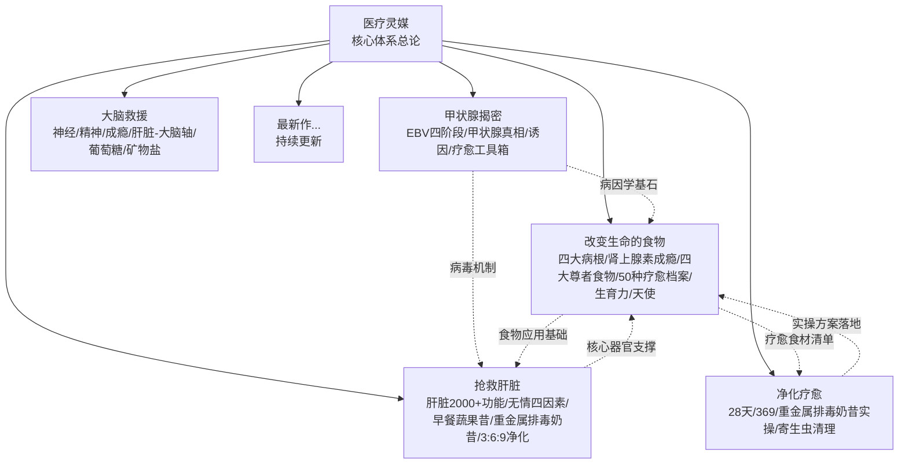
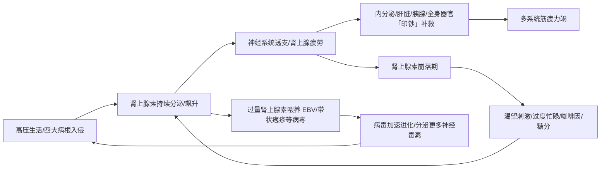
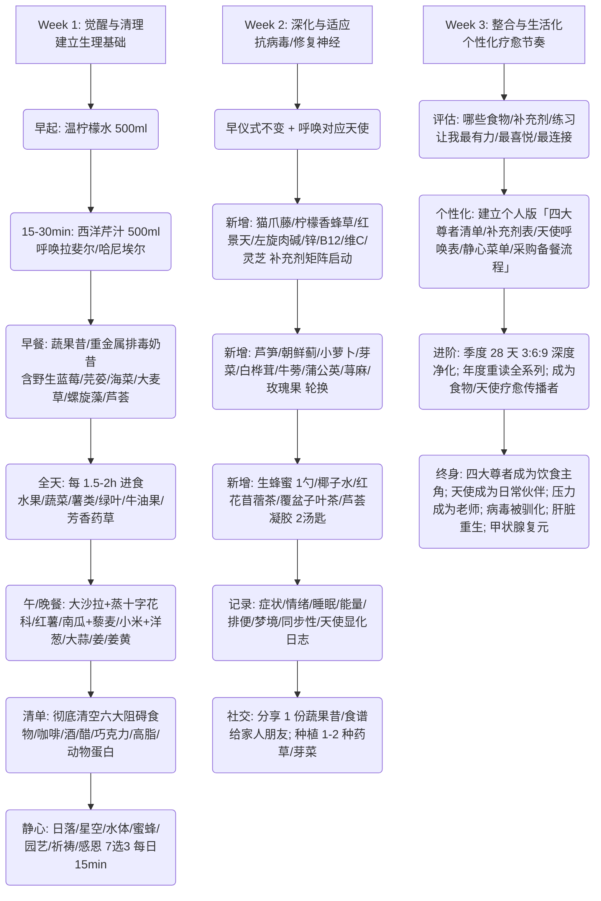

# 医疗灵媒系列总览

> **安东尼·威廉（Anthony William）** 自四岁起听闻高灵「慈悲」声音，以超级核磁共振般扫描能力获取领先医学数十年的健康真相。系列著作揭示慢性疾病真因非自体免疫、非基因、非心因，而是 **EB 病毒（甲状腺病毒）+ 四大病根（辐射、重金属、病毒、DDT）+ 肾上腺素成瘾** 的协同作用，提供 **食物即药物、食物即灵性** 的完整疗愈方案。

## 系列核心著作谱系

### 核心著作定位

| 著作 | 核心定位 | 关键贡献 |
|------|----------|----------|
| **《甲状腺揭密》** | **病因学奠基之作** | 揭示 **EB 病毒四阶段** 为甲状腺及神秘症状真因；详列 **22 大诱因清单**；确立「甲状腺非自体免疫、非基因、非老化」真相；提供九十天复元计划、疗愈食谱、睡眠秘密 |
| **《改变生命的食物》** | **食物疗愈百科全书** | 系统阐述 **四大病根**、**肾上腺素成瘾**、**阳光/活水危机**；建立 **四大尊者食物体系**（水果/蔬菜/药草香料/野生食物）；50 种食物 **身心灵三维档案**；生育力方案；辟谣饮食迷思；六大阻碍食物；十二位改变生命天使 |
| **《抢救肝脏》** | **器官级疗愈操作手册** | 肝脏 **两千多项功能**、**无情四因素**、**肝脏追踪系统**、**肝脏捣乱者清单**；**三大救赎方案**（早餐蔬果昔、重金属排毒奶昔、3:6:9 净化疗法）；百余症状定制食疗补充清单 |
| **《净化疗愈》** | **周期性深度排毒实操** | 28 天/3:6:9 清洁计划；重金属排毒奶昔标准化；寄生虫/霉菌/流感病毒清理方案 |
| **《大脑救援》** | **神经系统专项修复** | 肝脏-大脑轴；葡萄糖/矿物盐为脑燃料；神经递质修复；成瘾/焦虑/忧郁/失智根因与方案 |

---

## 核心理论支柱：EB 病毒四阶段理论（源自《甲状腺揭密》）

> **「甲状腺问题并非某人罹病的最终原因，出状况的甲状腺只不过是其中一种症状而已……造成甲状腺疾病那一长串症状的罪魁祸首，比甲状腺本身分布更广、更具侵略性。这个元凶就是甲状腺病毒——EB 病毒。」**

### 四阶段全景

| 阶段 | 名称 | 核心特征 | 主要症状/表现 | 关键转折 |
|------|------|----------|---------------|----------|
| **第一阶段** | **婴儿期/潜伏期** | 病毒潜藏血液，休眠缓慢复制 | 极轻微疲劳、易感冒/喉咙痛/耳痛；强免疫者可终身停留此期 | 遇诱因（压力/毒素/营养缺乏） → 活化 |
| **第二阶段** | **战争期/单核白血球增生症** | 病毒全面活化，攻击淋巴系统，极具传染性 | 喉咙痛、发烧、头痛、红疹、极度疲劳（大学高发期）；免疫系统标记/追踪/杀灭病毒 | 病毒撤退入器官（肝脏/脾脏/生殖系统）潜伏 |
| **第二阶段后期** | **器官驻留期** | 病毒以肝脏为大本营（汞/毒素为食），次及脾脏/生殖系统 | 莫名增重、疲劳、脑雾、消化不良、胆固醇/血糖异常、脾肿大、子宫肌瘤/多囊/前列腺问题、不孕 | 诱因触发（大压力/荷尔蒙变化/毒素暴露） → 北上攻甲状腺 |
| **第三阶段** | **甲状腺期** | 病毒钻入甲状腺组织，杀死细胞留疤，免疫系统产生抗体攻击病毒（被误判为抗甲状腺抗体） | **甲减/桥本氏/甲亢/葛瑞夫兹氏/结节/囊肿/甲状腺癌/甲状腺肿**；伴随疲劳/脑雾/心悸/掉发/皮肤干/焦虑/睡眠问题/潮红/肌肉痛；肾上腺素成瘾启动 | 病毒分泌神经毒素/皮肤毒素/副产品/尸体 → 干扰免疫/进入血液/淋巴 → 北上中枢神经 |
| **第四阶段** | **神秘疾病期/中枢神经期** | 神经毒素泛滥大脑/神经，引发神经炎、递质短路、氧气不足 | **纤维肌痛/慢性疲劳/类风湿/耳鸣/眩晕/梅尼尔/多发性硬化/肺纤维化/腿不宁/脑雾/记忆力丧失/焦虑/忧郁/偏头痛/关节痛/神经痛/心悸/飞蚊症/失眠/伤口难愈/ADHD误诊/躁郁误诊/白色念珠菌误诊/人格解离** | 肾上腺素爆发（车祸/坏消息/背叛/离婚/生产）加速恶化；高脂饮食降氧助病毒 |

### EB 病毒毒素四大类（第三、四阶段核心致病机制）

| 毒素类型 | 来源 | 核心危害 | 典型症状 |
|----------|------|----------|----------|
| **病毒副产品** | 病毒摄取重金属/肾上腺素/蛋后排泄 | 损害二尖瓣、心悸、器官组织腐蚀 | 心悸、心律失常 |
| **病毒尸体** | 病毒寿命约六周死亡累积 | 淤积肝脏/淋巴/肠道，阻塞过滤功能 | 疲劳、增重、水肿、便秘、胀气、潮红、心悸、脑雾、更年期症状 |
| **神经毒素** | 病毒重制重金属/毒素为泥状薄膜释出 | 干扰神经传导、引发神经炎、破坏细胞、迷惑免疫系统 | **剧痛、脑雾、记忆力丧失、困惑、忧郁、焦虑、偏头痛、关节/神经痛、飞蚊症、腿不宁、失眠、ADHD/躁郁/人格解离误诊根因** |
| **皮肤毒素** | 病毒利用肝脏残留铜/DDT/杀虫剂为燃料 | 经皮肤排出，引发过敏/炎症 | **湿疹、牛皮癣、干癣性关节炎、黄疸（新生儿代际传递）** |

### 病毒株分群与疾病谱（超过 60 变异株，分 6 群）

| 群别 | 特性 | 典型致病谱 |
|------|------|------------|
| **第一群** | 温和、进展慢 | 甲状腺肿、轻度背痛、隐性甲减 |
| **第二~三群** | 中等侵略性 | 良性结节、囊肿、桥本氏、甲减 |
| **第四~五群** | **高度侵略性、繁殖快** | **甲亢、葛瑞夫兹氏、甲状腺癌、多发性硬化症、重度神经症状** |
| **第六群** | 极强侵略性 | 疑难杂症、快速进展癌症、重度神经退行 |

> **医学盲区**：血检仅测抗体（示过去感染），无法检测器官内活跃病毒；医学未发现全部变异株（如不起疹子带状疱疹、新型 EBV）。

---

## 现代健康危机的四大病根（源自《改变生命的食物》）

> **「四大病根是人类生活中的隐形入侵者，是令我们夜晚辗转难眠的未知事物。」**

| 病根 | 核心机制 | 代际特征 | 协同放大效应 |
|------|----------|----------|--------------|
| **辐射物** | 核试验/医疗影像/电子设备/飞行残留 → 破坏 DNA、削弱免疫、激活潜伏病毒 | 大气千年不落地，水土食物链进入，**代际传递** | 辐射 + 病毒 → 免疫崩溃 → 多发性硬化等神经病 |
| **有毒重金属** | 汞/铝/铜/铅/砷/镉/镍 → 神经毒素、氧化应激、**喂养病毒**、阻塞酶反应 | 汞血脉持续千年，**每代增强** → 自闭/忧郁/阿兹海默/帕金森/ADHD/不孕 | 重金属 + 病毒 → 病毒狂繁 → 狼疮/纤维肌痛/慢疲/甲状腺病 |
| **病毒爆发** | **EBV 60+ 株**、带状疱疹、巨细胞、HHV-6~12、莱姆（实为病毒） → 分泌神经毒素/皮疹毒素/神经炎因子 | 代际垂直传染，家族聚集性发病 | DDT 传承 + 重金属 → 易感体质 + 病毒燃料 → 「遗传」绝症 |
| **DDT/杀虫剂/除草剂** | 禁用 40+ 年仍残留，**食物链放大、代际传递** → 抑制免疫、肝脏敏感、糖尿病、脾心肿大、荷尔蒙扰乱 | 新生儿肝脏含 DDT → 湿疹/牛皮癣/黄疸 | 三大病根合击 → 肝脏过载 → 全身系统性崩解 |

---

## 肾上腺素成瘾：现代文明的隐形毒药（跨书核心机制）

> **「我们本身的肾上腺素应该被归为第一级管制药品，它就是这么容易使人上瘾。」**

### 成瘾闭环

### 破解核心策略
1.  **生理层面**：**少量多餐（每 1.5-2 小时）** —— 葡萄糖 + 矿物盐维持血糖稳定，避免肾上腺素/皮质醇被迫分泌。
2.  **心理层面**：**压力重构** —— 视压力为「传讯者、老师、朋友、身体工作者、教练」；设定就寝界线；感谢压力赋予的使命感。
3.  **营养层面**：**四大尊者食物**持续供给适应原特质、葡萄糖、矿物盐、抗氧化剂。

> **交叉引用**：[[yi-liao-ling-mei-qiang-jiu-gan#降低脂肪——疗愈的前提]] 肝脏救赎方案同源；[[三分钟未来日记]] 习惯养成框架；[[写下来奇迹就会发生]] 血糖稳定与显化的生理前提。

---

## 疗愈核心方案体系

### 一、四大尊者食物体系（《改变生命的食物》）

> **「食物中的四大尊者远比我们所能理解的更神圣、更强大，因为它们从大地中生长而出，接受阳光的洗礼，并且在成形过程中一天又一天地忍受恶劣天气。」**

| 尊者类别 | 核心特质 | 代表食物 | 疗愈维度 |
|----------|----------|----------|----------|
| **水果** | 高生物利用度葡萄糖、矿物盐、抗氧化剂、**情绪抚慰/灵性升华** | 野生蓝莓、酪梨、香蕉、柠檬/莱姆、椰枣、苹果、莓果、柳橙、芒果、瓜类、葡萄、奇异果、石榴、西洋梨、无花果、杏、木瓜 | 燃料库、冷却肝脏、推送营养入细胞、抚慰孤独/忧郁/焦虑 |
| **蔬菜** | 矿物质宝库、适应原特质、重金属螯合、肝脏支持 | **西洋芹(簇盐重建胃酸/胆汁)**、马铃薯(接地/隐藏天赋)、红薯、朝鲜蓟、芦笋、十字花科(熟吃抗癌/解毒)、洋葱、叶菜、小黄瓜、小萝卜、芽菜菜苗(适应原巅峰) | 重建胃酸/胆汁、清洗肝脏、提供钠钾泵矿物盐、接地稳定 |
| **药草香料** | 高浓度植物化合物、抗病毒/抗菌/抗炎、神经修复 | **芫荽(重金属排毒五大核心)**、芳香药草(迷迭香/百里香/牛至/鼠尾草/罗勒/薄荷)、猫爪藤、**大蒜(生吃捣碎静置10分钟)**、姜、柠檬香蜂草、甘草根、荷兰芹、覆盆子叶、**姜黄(配黑胡椒/脂肪吸收率↑2000%)** | 抗 EBV/带状疱疹、肾上腺修复、淋巴清理、消化支持 |
| **野生食物** | **适应原巅峰**、极端环境求生智慧代际传承、最高频疗愈能量 | **野生蓝莓(重生食物/监控压力毒素)**、大西洋海菜(碘/甲状腺)、牛蒡、白桦茸(β-葡聚糖/免疫调节)、椰子、蒲公英、荨麻叶、**生蜂蜜(蜜蜂炼金术/阳光液态黄金)**、红花苜蓿、玫瑰果、**芦荟(内叶凝胶/消化/皮肤/烧伤)** | 重生食物、探查潜在疾病、监控压力毒素、细胞级修复 |

> **核心原则**：不必戒掉其他食物，**多多摄取四大尊者即可改变生命**；每天吃、一天吃好几次、最新鲜/完整/纯粹形式；身心灵三位一体同步作用。

### 二、肝脏三大救赎方案（《抢救肝脏》）

| 方案 | 核心成分 | 核心功能 | 适用阶段 |
|------|----------|----------|----------|
| **早餐蔬果昔** | 西洋芹汁/黄瓜/苹果/柠檬/生姜/芫荽/菠菜/浆果/椰子水/螺旋藻/大麦草汁粉/大西洋海菜/芦荟/蜂蜜 | 温和唤醒肝脏、补充葡萄糖矿物盐、启动排毒、稳定肾上腺素 | **每日基础/终身早餐** |
| **重金属排毒奶昔** | **野生蓝莓、芫荽、大西洋海菜、大麦草汁粉、螺旋藻、芦荟、椰子水/橙汁** | 五大核心螯合剂协同，**穿透血脑屏障清除汞/铝/铜/铅** | **每日必喝/深度排毒期加量** |
| **3:6:9 净化疗法** | 3天/6天/9天阶梯式：单一蔬果昔 → 增加蒸蔬菜/沙拉/藜麦 → 全植物性整体食物 | 深度清理肝脏/胆囊/肠道/血液/淋巴；重置味蕾/代谢/免疫 | **季度深度净化/症状顽固期突破** |

### 三、甲状腺九十天复元计划（《甲状腺揭密》第三部）

| 阶段 | 核心任务 | 关键行动 |
|------|----------|----------|
| **第 1-30 天：停止喂养病毒** | 移除六大阻碍食物、降低脂肪、停止诱因暴露 | 彻底清空乳制品/蛋/玉米/小麦/芥花籽油/天然风味；早餐蔬果昔/重金属排毒奶昔启动；呼唤对应天使 |
| **第 31-60 天：主动清除病毒** | 抗病毒食物/补充剂强力介入、肾上腺修复 | 大量芳香药草/猫爪藤/柠檬香蜂草/大蒜/姜/姜黄；甲状腺专用补充剂（锌/维生素B12/碘谨慎/左旋肉碱/维生素C/灵芝/红景天）；静心练习（日落/星空/水体/蜜蜂/园艺/祈祷/感恩） |
| **第 61-90 天：重建与巩固** | 恢复甲状腺组织、平衡荷尔蒙、建立生活化疗愈节奏 | 个性化四大尊者清单/食谱/备餐流程；分享给他人；种植药草/芽菜；季度 28 天深度净化；年度重读全书 |

### 四、补充剂精准矩阵（跨书核心清单）

| 补充剂 | 核心作用 | 关键形式/品质要求 | 典型剂量范围(参考书中建议) |
|--------|----------|------------------|----------------------------|
| **锌** | 抗病毒核心、免疫重建、甲状腺修复、伤口愈合 | **硫酸锌/葡萄糖酸锌/柠檬酸锌** 无酒精/无天然风味/无明胶 | 15-30 mg/日（疗愈期可增至 50-75 mg 短期） |
| **维生素 B12** | 神经修复、甲基化、红细胞生成、肝脏储备补充 | **甲基钴胺素 + 腺苷钴胺素** 复合制剂，舌下/液体优于注射 | 1000-5000 mcg/日 |
| **维生素 C** | 抗氧化、肾上腺支持、胶原合成、重金属螯合协同 | **脂质体/酯化/全食物源** 缓冲型，非玉米源 | 1000-3000 mg/日（分次） |
| **灵芝/云芝/虫草/舞茸** | 免疫调节、抗病毒/抗癌、肝脏保护、适应原 | **热水萃取子实体/菌丝体** 有机认证 | 500-1000 mg/日 |
| **红景天** | 肾上腺适应原、抗疲劳、提升血清素/多巴胺、甲状腺支持 | **3% 酚苷/1% 水飞蓟素标准化** 无填充剂 | 200-400 mg/早午餐前 |
| **左旋肉碱** | 脂肪酸转运入线粒体、心脏/肌肉/大脑能量、甲亢代谢支持 | **左旋肉碱酒石酸盐/乙酰左旋肉碱** 植物胶囊 | 500-1000 mg/空腹 |
| **碘(慎用)** | 甲状腺激素合成原料，**仅限碘缺乏确证/非急性病毒期** | **钾碘酸钾/海带/海菜** 微量精准 | 150-300 mcg/日（病毒活跃期禁用） |
| **维生素 D3(慎用)** | 免疫调节，**巨量干扰钙/镁/A/K 平衡、加重肝脏负担** | **植物源/羊毛脂源** 配 K2/Mg/维A | 1000-2000 IU/日（检测 25(OH)D 指导） |
| **猫爪藤** | 抗病毒/免疫调节/抗炎/抗癌/关节/消化/神经 | **内皮/树皮** 无酒精酊剂/胶囊 | 500-1000 mg/日 |
| **柠檬香蜂草** | **抗 EBV/带状疱疹/神经/甲状腺/睡眠/焦虑/抑郁/记忆** | 鲜叶茶/无酒精酊剂/精油 | 每日多杯茶/酊剂 2-4ml x3 |

> **交叉引用**：[[yi-liao-ling-mei-jia-zhuang-xian-jie-mi#补充剂清单]] 甲状腺专用补充剂详表；[[yi-liao-ling-mei-qiang-jiu-gan#关键补充剂]] 肝脏专用补充剂详表；[[全频能量花精全书]] 花精协同情绪/灵性层面。

### 五、改变生命的十二位天使（《改变生命的食物》第三部第四章）

> **「天使提高蔬菜与水果的营养价值、保护授粉者、促进每颗苹果与每片莴苣叶及万物生长。」**

| 天使 | 核心职能 | 呼唤场景 | 典型奇迹 |
|------|----------|----------|----------|
| **守护天使** | 个人全方位守护/引导/保护 | 任何时刻/危机/决策/睡前 | 避开车祸/选对医生/梦中指引/情绪安抚 |
| **大天使米迦勒** | 保护/切断负面连接/勇气/力量/真理/灵性战士 | 面对恐惧/攻击/能量吸血/需要边界/法律/正义 | 瞬间切断毒性关系/化解冲突/获得证据/胜诉 |
| **大天使拉斐尔** | **疗愈/医疗/旅行安全/情绪/成瘾/生育/动物** | 生病/手术/用药/旅行/焦虑抑郁/戒瘾/备孕/宠物病 | 手术顺利/药物副作用消失/怀孕/宠物康复/情绪平复 |
| **大天使加百列** | **生育/怀孕/分娩/育儿/创意/沟通/净化/新开始** | 备孕/流产/难产/产后/写作/表达/净化空间/新项目 | 绝望中怀孕/顺产/创意爆发/关系修复/空间轻盈 |
| **大天使乌列尔** | **智慧/洞察/解决问题/考试/决策/和平/和解/地球疗愈** | 困惑/考试/重大决定/冲突调解/环境焦虑/学习 | 灵感解题/化解家庭恩怨/找到失物/环保项目突破 |
| **大天使查米乌尔** | **爱/关系/自爱/宽恕/寻找失物/职业/金钱/内心平静** | 失恋/孤独/自卑/无法原谅/找东西/求职/财务/焦虑 | 吸引灵魂伴侣/修复亲子/原谅父母/找回传家宝/意外之财 |
| **大天使佐菲尔** | **美/和谐/秩序/整理/装饰/艺术/审美/喜悦/感恩** | 环境混乱/装修/创作/穿搭/心情低落/缺乏灵感/完美主义 | 家瞬间变美/创作流畅/穿搭获赞/心情雀跃/接纳不完美 |
| **大天使耶菲耶** | **心智清明/专注/记忆/学习/考试/冥想/灵性觉醒/大脑疗愈** | 脑雾/记忆力/备考/冥想分心/灵性练习/神经/阿兹海默/中风 | 思维清晰/考试高分/冥想深入/灵性体验/记忆改善 |
| **大天使梅塔特隆** | **神圣几何/生命之花/梅卡巴/儿童/水晶/灵性教育/靛蓝/水晶儿童** | 育儿/教育/水晶网格/神圣几何/特殊儿童/灵性教学/童年创伤 | 孩子平静/睡眠改善/水晶网格激活/几何冥想深入/创伤释放 |
| **大天使桑达尔芬** | **音乐/声音/祈祷/吟唱/振动/地球锚定/实相共创/显化/祈祷传递** | 唱诵/音疗/祈祷/显化/接地/实相创造/集体疗愈/声音疗愈 | 祈祷蒙应/显化加速/音疗深度/集体共振/接地稳固 |
| **大天使哈尼埃尔** | **月亮/周期/直觉/女性能量/情绪/梦境/水/仪式/神圣女性/更年期** | 月经/经前/更年期/直觉开发/梦境工作/水疗/女性圈/情绪潮汐 | 周期规律/经前舒缓/更年期平稳/直觉敏锐/梦境清晰/情绪流动 |
| **大天使耶雷密尔** | **生命回顾/灵魂计划/业力/宽恕/跨世疗愈/临终/过渡/祖先疗愈/前世** | 人生转折/宽恕困难/临终关怀/祖先模式/前世创伤/灵魂目的/业力释放 | 宽恕突破/祖先创伤释放/灵魂目的清晰/临终安详/跨世疗愈 |

> **呼唤公式**：**大声 + 真诚 + 具体 + 自由意志声明（「我自由意志选择呼唤 [天使名] 协助我 [具体事项]」）+ 感恩预支**。

---

## 交叉引用知识图谱

| 本系列核心概念 | 关联既有页面 | 关联说明 |
|----------------|--------------|----------|
| **高灵「慈悲」/医疗灵媒源头** | [[yi-liao-ling-mei-jia-zhuang-xian-jie-mi]]、[[yi-liao-ling-mei-qiang-jiu-gan]]、[[人体能量场与超感知力]]、[[ESP通灵智慧体系]] | 系列总论核心设定、HSP与通灵框架、肝脏专题同源 |
| **EB 病毒四阶段/病毒毒素/变异株** | [[yi-liao-ling-mei-jia-zhuang-xian-jie-mi]]、[[yi-liao-ling-mei]]、[[从心灵到细胞的疗愈]]、[[凯龙星灵魂的创伤与疗愈]] | 病因学奠基；细胞层面疗愈；创伤疗愈原型 |
| **四大病根/重金属/辐射/DDT/病毒** | [[yi-liao-ling-mei-qiang-jiu-gan#无情四因素]]、[[yi-liao-ling-mei-gai-bian-sheng-ming-de-shi-wu]]、[[中医整体芳疗]]、[[经络处方与易堵塞穴位]]、[[全频能量花精全书]] | 肝脏专题核心捣乱者；精油/经络/花精协同排毒 |
| **肾上腺素成瘾/少量多餐/葡萄糖/矿物盐** | [[yi-liao-ling-mei-qiang-jiu-gan#降低脂肪——疗愈的前提]]、[[三分钟未来日记]]、[[写下来奇迹就会发生]]、[[显化实践与专注力训练]] | 肝脏救赎方案同源；习惯养成、血糖稳定与显化的生理前提 |
| **四大尊者食物/50种疗愈食物档案** | [[yi-liao-ling-mei-qiang-jiu-gan#早餐蔬果昔]]、[[光疗氧疗花精整合疗法]]、[[人体气场彩光学]]、[[宝石与脉轮对应关系]] | 西芹汁/重金属排毒奶昔/蔬果昔核心食材；自然疗法体系互补 |
| **肝脏 2000+ 功能/无情四因素/追踪系统/救赎方案** | [[yi-liao-ling-mei-qiang-jiu-gan]]、[[yi-liao-ling-mei-jia-zhuang-xian-jie-mi#肝脏与甲状腺]]、[[人智医学]] | 核心器官支撑全系列疗愈；人智医学乙太身对应 |
| **生育力/肝脏/重金属/病毒/肾上腺素** | [[yi-liao-ling-mei-qiang-jiu-gan#肝脏的天职]]、[[灵魂的出生前计划]]、[[从未知中解脱]]、[[出生前计划与因果疗愈]] | 肝脏储存生育营养素；出生前计划/灵魂协议视角 |
| **饮食迷思辨析/六大阻碍食物** | [[yi-liao-ling-mei-qiang-jiu-gan#关键误区澄清表]]、[[中国人九种体质揭开星座密码]]、[[中医整体芳疗]] | 肝脏专题误区澄清同源；体质-星座-食物交互；精油替代合成香精 |
| **改变生命天使/祈祷/静心/看日落星空** | [[冥想正念手册]]、[[与天使链接]]、[[光的课程]]、[[零极限与荷欧波诺波诺体系]]、[[佛脑]] | 世俗冥想/天使连接/光疗愈/清理记忆/HEAL内化法 |
| **野生蓝莓/西洋芹/芫荽/生蜂蜜/芦荟** | [[yi-liao-ling-mei-qiang-jiu-gan#重金属排毒奶昔]]、[[全频能量花精全书]]、[[人体气场彩光学]] | 核心疗愈食材跨体系应用；花精/光疗/气场协同 |

---

## 实践路线图：21 天系列核心方案整合启动

---

## 系列核心金句摘录

> - **「这些来自『高灵』的信息往往超前现代科学……高灵想要带你超脱困惑之海，在你不确定可以相信哪一种理论时，提供你清楚的答案，并分享超前现今研究数十年的健康信息。」** —— 《甲状腺揭密》前言
> - **「慢性疾病不是基因问题，而是与你的祖先接触到，然后往下传给你的父母，之后再传给你的东西有关。」** —— 《甲状腺揭密》现代人面临的健康威胁
> - **「你的身体只会日以继夜地支持你，因为你的身体会无条件地爱你。」** —— 《甲状腺揭密》责怪的游戏
> - **「甲状腺问题并非某人罹病的最终原因，出状况的甲状腺只不过是其中一种症状而已……这个元凶就是甲状腺病毒——EB 病毒。」** —— 《甲状腺揭密》带有病毒的甲状腺
> - **「我们本身的肾上腺素应该被归为第一级管制药品，它就是这么容易使人上瘾。」** —— 《改变生命的食物》肾上腺素成瘾
> - **「食物中的四大尊者远比我们所能理解的更神圣、更强大，因为它们从大地中生长而出，接受阳光的洗礼，并且在成形过程中一天又一天地忍受恶劣天气。」** —— 《改变生命的食物》食物中的四大尊者
> - **「野生蓝莓是重生食物，能够在一切看似回天乏术时，使我们重获新生。」** —— 《改变生命的食物》推荐序 克莉丝汀·诺瑟普
> - **「压力不是想要杀死你，它是个试图与你沟通的伟大老师。」** —— 《改变生命的食物》换一种观点面对压力
> - **「你有权健康，你有权拥有平静的心智，你有权获得可恢复精力的优质睡眠，你有权免于痛苦，你有权从疾病中痊愈，你有权预防患病，你有权调适并成长茁壮。」** —— 《甲状腺揭密》了解真相才能拯救自己的生命
> - **「天使提高蔬菜与水果的营养价值、保护授粉者、促进每颗苹果与每片莴苣叶及万物生长。」** —— 《改变生命的食物》改变生命的天使
> - **「慈悲是最大关键。」** —— 《甲状腺揭密》后记

---

## 页面维护与扩展指南

1.  **子页面拆分建议**：
    - `[[EB病毒四阶段详解与变异株谱系]]` —— 深化病因学奠基页
    - `[[50种改变生命食物详细档案库]]` —— 食物身心灵三维档案可检索库
    - `[[甲状腺九十天复元计划实操手册]]` —— 分周食谱/补充剂/静心/天使呼唤清单
    - `[[肝脏救赎三大方案标准化SOP]]` —— 蔬果昔/排毒奶昔/369净化精确配比与操作流程
    - `[[十二位改变生命天使实操手册]]` —— 呼唤公式/场景/见证案例/冥想导引
    - `[[医疗灵媒补充剂精准矩阵数据库]]` —— 品牌/形式/剂量/协同/禁忌交叉表

2.  **交叉引用维护原则**：
    - 新增子页面必加 `[[wikilink]]` 回链本总览页与对应专题页（甲状腺/食物/肝脏）
    - 核心概念（EBV四阶段、四大病根、肾上腺素成瘾、四大尊者、无情四因素、重金属排毒五大核心）在所有相关页保持术语统一
    - 与既有自然疗法体系（中医/芳疗/花精/光疗/经络/宝石/冥想/显化）保持双向 `[[wikilink]]` 互联

3.  **内容更新触发点**：
    - 安东尼·威廉新书出版/播客核心新信息
    - 临床反馈验证新疗愈组合/剂量调整
    - 科学研究新发现与高灵信息交叉验证（如 EBV 变异株/重金属螯合机制/肠脑轴/线粒体功能）

> **系列定位宣言**：医疗灵媒系列非单一疗法，乃 **病因学真相（EBV/四大病根/肾上腺素）+ 器官级修复（肝脏/甲状腺/大脑/肾上腺）+ 分子营养干预（四大尊者/补充剂矩阵）+ 能量医学（天使/静心/显化）+ 灵性进化（慈悲/自由意志/灵魂计划）** 的 **五维一体化疗愈范式**。本页为该范式的元导航与知识图谱中枢。

## 来源

- [医疗灵媒：甲状腺揭密](../sources/医疗灵媒：甲状腺揭密.md)
- [医疗灵媒：改变生命的食物](../sources/医疗灵媒：改变生命的食物.md)
- [医疗灵媒：抢救肝脏](../sources/医疗灵媒：抢救肝脏.md)
