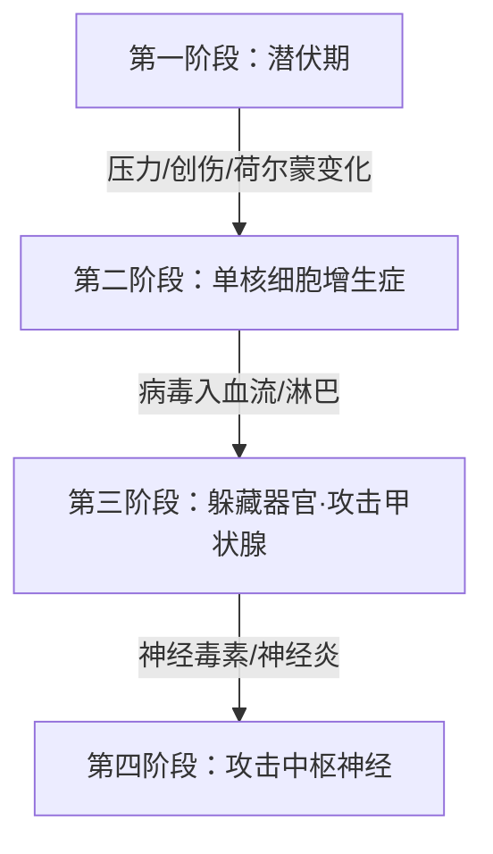

# 医疗灵媒核心体系

> **安东尼·威廉（Anthony William）** 自称“医疗灵媒”，四岁起即听闻高灵“慈悲”声音，获传领先医学数十年的健康资讯。本书系统揭示慢性疑难杂症的真实病因、EB病毒四阶段机制、自身免疫谬误、食疗排毒方案，以及灵魂/心/精神三要素的整合疗愈观。

## 核心架构总览

| 维度 | 核心内容 | 关键点 |
|------|----------|--------|
| **信息源头** | 高灵“慈悲” | 活生生的“词”，最接近神，位于神指尖，非天使、非人、非指导灵 |
| **致病核心** | EB病毒（Epstein-Barr Virus） | 四阶段演进：潜伏→单核细胞增生→躲藏器官攻击甲状腺→攻击中枢神经 |
| **核心谬误** | 自身免疫说 | **“身体不会自我攻击”**；自身免疫疾病实为病毒/毒素引发 |
| **疗愈三支柱** | 排毒、滋养、心灵净化 | 禁吃清单、疗愈食物/补充剂、静心/祈祷/天使协助 |
| **存在三要素** | 灵魂、心、精神 | 灵魂存记忆/经验，心存爱/慈悲/喜悦，精神指意志/体力 |

---

## 一、高灵“慈悲”传导机制

### 高灵身份与定位
- **名称**：**慈悲** —— 活生生的“词”，最接近神的词
- **位阶**：神指尖坐着“慈悲”；神是“爱”，位于所有词之上
- **功能**：天使与其他存有来寻求指引；在人间仅直接与安东尼对话
- **特质**：理解苦难，是平静、喜悦、希望的灵魂；无慈悲则彼等虚无

### 传导方式
- **听觉定位**：右耳外侧，立体环绕声，非内在声音
- **视觉扫描**：高灵创造强白光，透视委托人身体内部（致“雪盲”，需30-60分钟恢复）
- **即时性**：深度解读仅需3分钟；解释建议需10-30分钟
- **不受限**：跨越时空（电话解读）、不受锡箔纸/首饰干扰、可读自己/亲友

### 与典型灵媒差异
| 特征 | 典型灵媒 | 安东尼·威廉 |
|------|----------|-------------|
| 声音来源 | 内在/心灵感应 | 右耳外侧实体声 |
| 稳定性 | 忽强忽弱 | 极度清晰、持续不断 |
| 自我解读 | 通常不能 | 定期获知自身健康 |
| 时空限制 | 需同场/入定 | 电话远程即可 |
| 领先医学 | 否 | 数十年 |

> **交叉引用**：[[从心灵到细胞的疗愈]] 亦探讨濒死经验与能量疗愈的桥接；[[人体能量场与超感知力]] 详述 HSP 与通灵的关系。

---

## 二、EB病毒四阶段致病机制

> **核心主张**：绝大多数慢性疑难杂症（纤维肌痛、慢性疲劳、多发性硬化、类风湿、甲状腺失调、偏头痛等）实为 **EB病毒不同变异株** 在四阶段演进所致。

### 四阶段演进图谱



| 阶段 | 别名 | 核心动态 | 典型表现/误诊 |
|------|------|----------|----------------|
| **第一阶段** | 潜伏期 | 病毒在血液/器官静默复制，伺机而动 | 无症状或极轻微疲劳 |
| **第二阶段** | 单核细胞增生症 | 病毒大量增殖，入侵淋巴/脾/肝 | 传染性单核球症、极度疲劳、发烧、喉痛、脾肿大；常误诊为白血病、脑膜炎、狼疮 |
| **第三阶段** | 躲藏器官·攻击甲状腺 | 病毒藏身肝/脾/甲状腺等器官，分泌神经毒素，引发甲状腺炎 | 桥本氏甲状腺炎、甲减/甲亢、结节、甲状腺癌；女性尤甚 |
| **第四阶段** | 攻击中枢神经 | 神经毒素引发神经炎、脑炎、脊髓炎 | 纤维肌痛、慢性疲劳综合征、多发性硬化、类风湿、偏头痛、耳鸣、眩晕、心悸、失眠、焦虑、抑郁 |

### 关键机制
- **神经毒素**：病毒代谢产物，引发神经炎症、肌肉痛、认知障碍
- **变异株差异**：>60种变异株，决定症状表型（如某株偏甲状腺、某株偏神经）
- **共因子**：重金属（汞/铝/铜）、农药、DDT、辐射、压力、荷尔蒙波动 —— **助病毒增殖/毒性释放**
- **误诊链**：医学界不知此机制，将同一病毒不同阶段表现拆分为十余种“疾病标签”

> **交叉引用**：[[人智医学]] 中槲寄生疗法亦关注病毒/免疫调节；[[零极限与荷欧波诺波诺体系]] 强调清理记忆/程序以恢复自愈力。

---

## 三、自身免疫说的根本谬误

### 核心宣称
> **“身体不会自我攻击。”**  
> 自身免疫疾病（狼疮、类风湿、多发性硬化、桥本氏、Graves病等）实为 **病毒（主EBV）+ 毒素（重金属/化学物）+ 共因子** 导致的免疫系统**针对病原体/毒素的反应**，而非攻击自身组织。

### 证据逻辑
1. **抗体实为针对病毒/毒素**：抗核抗体、抗甲状腺抗体实为对EBV神经毒素/病毒蛋白的交叉反应
2. **免疫系统在保护**：炎症、肿胀、疼痛是免疫系统围堵病毒/修复受损组织的表现
3. **抑制免疫反而有害**：类固醇、生物制剂抑制免疫 → 病毒失控 → 长期恶化
4. **疗愈实证**：针对病毒/毒素的食疗方案使“自身免疫指标”逆转、症状消失

### 受害群体与后果
- **女性占比极高**（甲状腺、纤维肌痛、狼疮等 80-90% 为女性）
- **标签化伤害**：被告知“身体背叛你”、“终身服药”、“心理作用” → 灵魂/心受创
- **医疗资源错配**：数十年研究经费投入错误靶点，患者等待真答案

> **交叉引用**：[[灵魂的出生前计划]] 探讨疾病作为灵魂课题的安排；[[业力心理学]] 论述因果法则与自由意志。

---

## 四、食疗排毒方案：禁吃与疗愈清单

### 核心原则
- **“加速年代”毒素暴增**：农药、重金属、塑化剂、辐射、基改食品、抗生素残留
- **排毒 > 单纯限制**：主动清除体内毒素/病毒，而非仅避免摄入
- **肝脏为核心**：肝脏储存毒素/病毒，疗愈首重肝脏排毒修复
- **碱性/电解质/葡萄糖**：维持血糖稳定、电解质平衡、细胞水合，支持肾上腺/神经

### 绝对禁吃清单（“非食物”/“喂养病毒/毒素”）

| 类别 | 代表项目 | 核心危害机制 |
|------|----------|--------------|
| **蛋类** | 全蛋/蛋白/蛋黄 | 病毒最爱饲料；羽毛/皮屑残留过敏原 |
| **乳制品** | 牛奶/奶酪/酸奶/黄油/酪蛋白/乳清 | 饲料病毒/细菌；酪蛋白致炎；阻碍淋巴引流 |
| **麸质谷物** | 小麦/大麦/黑麦/斯佩耳特/燕麦(污染) | 喂养病毒；破坏肠道紧密连接；致炎 |
| **猪肉/猪油** | 培根/火腿/香肠/猪油/明胶 | 高脂/毒素储存库；猪体内病毒易跨种传播 |
| **养殖鱼** | 三文鱼/罗非鱼/鲶鱼/虾/贝类 | 抗生素/农药/PCB/重金属高残留 |
| **玉米/大豆/菜籽油** | 转基因主力作物 | 农药/草甘膦残留；喂养病毒；致炎 |
| **天然香料/人工香精** | “天然香料”=化学合成；MSG/酵母抽提物 | 神经毒素；掩盖劣质原料；兴奋毒性 |
| **人工甜味剂** | 阿斯巴甜/三氯蔗糖/糖精/乙酰磺胺酸钾 | 神经毒素；破坏肠道菌群；代谢干扰 |
| **醋/发酵醋** | 苹果醋除外 | 醋酸抑制肝脏排毒；喂养酵母/病毒 |
| **酒精** | 所有酒类 | 肝脏毒素；脱水；破坏B族维生素；喂养病毒 |
| **咖啡/巧克力/可可** | 含咖啡因/可可碱产品 | 肾上腺刺激→皮质醇飙升→免疫抑制；可可喂养病毒 |
| **盐(精制/食盐)** | 食盐/加工食品隐形盐 | 脱水；掩盖天然风味；加碘/抗结剂有害 |
| **防腐剂/添加剂** | BHA/BHT/TBHQ/亚硝酸盐/磷酸盐 | 致癌/神经毒性/内分泌干扰 |

### 核心疗愈食物（高频推荐，统计自全书）

| 梯队 | 食物 | 核心功能 | 关键营养/机制 |
|------|------|----------|----------------|
| **S级** | **野生蓝莓** | 重金属螯合、神经修复、血脑屏障保护 | 抗氧化极高、花青素、适应原 |
| | **芫荽叶(香菜)** | 重金属排毒(汞/铝/铜)、血脑屏障穿透 | 螯合剂、植物营养素 |
| | **植物性 DHA/EPA** | 大脑/神经/视网膜修复、抗炎 | 海藻油、非鱼源 |
| | **酪梨(牛油果)** | 肝脏修复、电解质/葡萄糖平衡、荷尔蒙前体 | 单不饱和脂肪、钾、谷胱甘肽 |
| **A级** | **芹菜汁(空腹 500ml)** | 胃酸恢复、肝脏排毒、电解质/矿物盐补充 | 簇盐、钠钾泵支持 |
| | **螺旋藻/绿藻** | 重金属螯合、蛋白/维B12/铁补充 | 绿藻细胞壁结合重金属 |
| | **大西洋沙棘/接骨木莓** | 抗病毒、免疫调节、呼吸道保护 | 花青素、黄酮、维C |
| | **红薯/山药/南瓜** | 肾上腺修复、复合碳水、β-胡萝卜素 | 稳定血糖、滋养脾胃 |
| | **绿叶菜(菠菜/羽衣甘蓝/芝麻菜)** | 矿物盐/叶绿素/维K/叶酸 | 碱化、造血、肝脏支持 |
| **B级** | **柠檬/青柠水** | 肝脏冲洗、电解质/维C、碱化 | 柠檬酸钾、类黄酮 |
| | **姜/姜黄/大蒜/洋葱** | 抗病毒/抗菌/抗炎/循环促进 | 姜辣素/姜黄素/大蒜素/槲皮素 |
| | **亚麻籽/奇亚籽/大麻籽** | Omega-3/纤维/雌激素平衡 | ALA、木酚素 |
| | **野生三文鱼/沙丁鱼(极少量)** | DHA/EPA/B12/硒 | 非养殖、低汞 |
| | **蜂蜜(生/未巴氏杀菌)** | 抗菌/伤口愈合/免疫/睡眠 | 过氧化氢酶、植物营养素 |

### 关键补充剂清单（配合食疗，剂量需医师指导）

| 补充剂 | 核心作用 | 典型适用症 |
|--------|----------|------------|
| **维生素 C (酯式/脂质体)** | 抗病毒/抗氧化/肾上腺/胶原/重金属螯合 | 所有慢性病、感染、压力 |
| **锌(液体/吡啶甲酸锌)** | 免疫/抗病毒/甲状腺/伤口/味觉 | EBV、甲状腺、痤疮、脱发 |
| **B12(甲基钴胺素+腺苷钴胺素)** | 神经/甲基化/能量/红细胞/脑修复 | 疲劳、神经病变、抑郁、记忆力 |
| **维生素 D3 (植物源)** | 免疫调节/骨骼/情绪/甲状腺 | 自身免疫、抑郁、骨质疏松 |
| **镁(甘氨酸/苹果酸/苏糖酸镁)** | 肌肉/神经/睡眠/血糖/心律/排毒 | 焦虑、失眠、纤维肌痛、偏头痛 |
| **L-赖氨酸** | 抗疱疹病毒/胶原/钙吸收 | 唇疱疹、带状疱疹、EBV |
| **金缕梅/甘草根/柠檬百里香/紫锥菊** | 抗病毒/肾上腺/淋巴/免疫 | 病毒期、肾上腺疲劳 |
| **MSM/硫酸软骨素/葡萄糖胺** | 关节/软骨/硫供给/排毒 | 类风湿、关节痛、皮肤 |
| **NAC/谷胱甘肽(脂质体)** | 肝脏解毒/黏液溶解/抗氧化/肺部 | 肝脏毒性、呼吸道、重金属 |

> **交叉引用**：[[中医整体芳疗]] 融合精油与经络调理；[[经络处方与易堵塞穴位]] 提供徒手疏通经络自愈法；[[全频能量花精全书]] 以量子共振花精作用能量体。

---

## 五、灵魂/心/精神三要素疗愈观

> **“要成为一名慈悲的疗愈者，你必须适应每一种独特的状况与人格，以减轻对方的疼痛与苦难。高灵告诉我，这份同理心是疗愈最重要的元素。”**

### 三要素定义与功能

| 要素 | 定位 | 核心功能 | 损伤表现 | 疗愈路径 |
|------|------|----------|----------|----------|
| **灵魂** | 意识核心，“机器中的鬼魂” | 储存记忆/经验/希望/信心；死后携带记忆穿越星际 | 裂痕(创伤/背叛/自背叛)、遗失部分(黑暗房间) → 能量/生命力流失 | 灵性学习/冥想/祈祷/天使协助/承认创伤/时间疗愈 |
| **心** | 物质心脏区域，爱/慈悲/喜悦之居所 | 行动指南针(灵魂迷失时指引)；安全网(弥补灵魂损伤)；记录善意 | 破碎/受伤(失恋/失去/失望) → 无法给予/接受爱 | 自爱/慈悲行/宽恕/感恩/连接自然/服务他人 |
| **精神** | 意志与体力 | 攀爬/奔跑/打斗；维持身体运作寻找疗愈机会 | 支离破碎/耗竭/瘫痪 → 放弃求生/疗愈 | 轻度运动/赏鸟/看日落/呼吸/微小目标/重建动力 |

### 临床整合应用
- **扫描优先序**：身体症状 → 灵魂裂痕/缺失 → 心伤 → 精神状态
- **同源治疗**：
  - 灵魂层面：静心、祈祷、天使召唤、阿卡西记录阅读 [[阿卡西纪录体系与宇宙阿卡西祈祷文]]
  - 心层面：镜子工作 [[louise-hay-you-can-heal-your-life]]、宽恕练习 [[chu-xue-zhe-de-ming-xiang-shu]]、内在小孩疗愈 [[尤尼希皮里与内在小孩]]
  - 精神层面：接地 [[neng-liang-ping-heng]]、呼吸法 [[swami-rama-meditation-guide]]、微动作启动
- **三位一体**：灵魂完整 → 撑过星际旅程；心强健 → 指引行动；精神充足 → 执行疗愈

> **交叉引用**：[[从未知中解脱]] 详述出生前计划与灵魂课题；[[登出键体系与莫子]] 论觉察/现象/释三要素；[[零极限与荷欧波诺波诺体系]] 以清理记忆恢复零状态。

---

## 六、重点慢性病的真实病因与疗愈要点

| 疾病标签 | 真实病因核心 | 核心疗愈策略 |
|----------|--------------|--------------|
| **甲状腺失调(桥本/甲减/甲亢/结节/癌)** | EBV第三阶段攻击甲状腺 + 重金属/毒素 | 禁蛋/奶/麸质/玉米/大豆/猪肉；芹菜汁、野生蓝莓、芫荽、锌、B12、维D、碘(慎用)、海藻 |
| **类风湿/纤维肌痛/慢性疲劳** | EBV第四阶段神经毒素致神经炎/肌炎 + 肾上腺疲劳 | 抗病毒饮食 + 肾上腺修复(频繁进食/葡萄糖/矿物盐/适应原) + 重金属排毒 |
| **多发性硬化** | EBV神经毒素破坏髓鞘 + 重金属(汞/铝) | 同类风湿 + 高剂量B12/维D/EPA/辅酶Q10/α-硫辛酸 |
| **偏头痛/眩晕/耳鸣** | EBV神经毒素刺激迷走/前庭/听神经 + 肝脏毒血 | 肝脏排毒(芹菜汁/柠檬水/蒲公英根) + 电解质/镁/B2/辅酶Q10 |
| **第二型糖尿病/低血糖** | 肾上腺疲劳(皮质醇/肾上腺素波动)致胰岛素抵抗，非单纯胰岛素问题 | 降低脂肪(尤其动物脂) → 肝脏腾空储糖空间；频繁少量进食(葡萄糖+矿物盐)；禁蛋/奶/麸质 |
| **抑郁/焦虑/PTSD** | 1)大脑葡萄糖不足 2)EBV/重金属神经毒素 3)电解质/矿物盐缺乏 4)肾上腺素风暴 5)灵魂/心创伤 | 碳水化合物(水果/薯类)供脑葡萄糖 + 矿物盐/镁/B族/锌/Omega-3 + 灵魂/心疗愈 |
| **更年期症状** | EBV/毒素(DDT/辐射/重金属)攻击生殖系统 + 肾上腺疲劳，非单纯雌激素下降 | 肝脏/淋巴排毒 + 肾上腺修复 + 植物雌激素(亚麻/发酵大豆/红三叶草) + 野生蓝莓/芫荽 |
| **自闭症/ADHD** | 汞/铝等重金属沉积脑中线管道/基底节，非遗传/肠道问题 | 重金属排毒(螺旋藻/绿藻/芫荽/野生蓝莓/大西洋沙棘/维C/锌/镁) + 禁蛋/奶/麸质/玉米/大豆 |
| **念珠菌/带状疱疹/莱姆病** | 均为病毒(带状疱疹>15株/莱姆病毒非细菌) + 环境毒素协同，非酵母/细菌主导 | 抗病毒方案(赖氨酸/维C/锌/紫锥菊/柠檬百里香/甘草/接骨木莓) + 免疫支持而非抑制 |

---

## 七、二十八天疗愈净化法 & 二十一天使协助

### 28天净化核心流程
| 周期 | 重点 | 典型食谱结构 |
|------|------|--------------|
| **第1周** | 肝脏深度排毒、建立芹菜汁习惯 | 早：柠檬水→芹菜汁(500ml)→水果餐；午/晚：大量绿叶/十字花/红薯/藜麦/牛油果/沙拉 |
| **第2周** | 重金属螯合、病毒抑制 | 加入：螺旋藻/绿藻/芫荽/野生蓝莓/大西洋沙棘/接骨木莓/亚麻籽 |
| **第3周** | 肾上腺修复、电解质/葡萄糖稳定 | 频繁进食(每1.5-2h)：枣/无花果/苹果/香蕉/红薯/芒果+芹菜/黄瓜汁 |
| **第4周** | 整合、过渡可持续长期方案 | 评估症状改善，调整补充剂剂量，建立终身维护模版 |

**关键避坑**：
- 绝不断碳水(水果/薯类/南瓜/藜麦/小米/荞麦) —— 大脑/肾上腺/肝脏需葡萄糖
- 绝不高脂(生酮/原始高脂) —— 脂肪阻碍肝脏排毒/胰岛素敏感度/病毒清除
- 空腹芹菜汁不可替代/稀释/加料

### 二十一种菁华天使
> “二十一位菁华天使与超过十万个无名天使都愿意帮助我们，我们只须以真诚与决心大声说出来。”

| 天使 | 专长领域 | 召唤关键词 |
|------|----------|------------|
| **米迦勒** | 保护/断裂负面连结/勇气 | “米迦勒天使，请保护我免受一切伤害” |
| **拉斐尔** | 疗愈/医疗指引/身心恢复 | “拉斐尔天使，请疗愈我的[具体部位/状况]” |
| **加百列** | 沟通/灵性信息/生育/新开始 | “加百列天使，请帮助我清晰表达/接收指引” |
| **乌列尔** | 智慧/照亮真相/决策清晰 | “乌列尔天使，请照亮我的道路” |
| **梅塔特隆** | 圣几何/阿卡西记录/儿童/敏感者 | “梅塔特隆天使，请协助我的灵性成长” |
| …(其余16位含砂拉风、哈尼埃尔、耶霍维、查姆埃尔、杰瑞米尔、拉古埃尔、萨里埃尔、拉兹尔、伊娃、纳西雅、奥里翁、帕查、奎尼亚、拉斐拉、萨麦尔、特兹卡特利波卡、乌里尔) | 各司其职 | 真诚呼唤名字+具体请求 |

> **交叉引用**：[[与天使链接]] 详述守护天使/大天使/天使圣团连接实务；[[光的课程]] 系列涉及天使级次与光疗愈体系。

---

## 八、静心与灵性实践：零成本高效疗愈

| 实践 | 操作要点 | 机制 |
|------|----------|------|
| **看夕阳/日落** | 每日日落时凝视 10-15 分钟，不戴眼镜/隐形眼镜 | 光谱刺激松果体/昼夜节律/褪黑素/血清素；灵魂层面“见证结束与释放” |
| **凝视星空** | 夜晚仰望星空 5-10 分钟，呼吸放松 | 扩大视野/透视/连接宇宙/缩小自我困境/激活松果体 |
| **看海/水体** | 站在水边观看波浪/流水，听声音 | 水的负离子/声波/韵律安抚神经/清理气场/连接情绪流动 |
| **观蜜蜂/传粉者** | 静坐观察蜜蜂采蜜 5 分钟 | 见证协作/丰盛/神圣几何/当下专注/心率变异性改善 |
| **种花/园艺** | 双手触土、播种、浇水、收获 | 接地/菌群交换/创造力/耐心/生命力连接/土壤分枝杆菌提升血清素 |
| **祈祷/召唤天使** | 大声、真诚、具体地说出请求 | 声波/意图/自由意志声明/吸引高频协助/重塑潜意识程序 |
| **感恩清单** | 每日写/说 3-10 件感恩之事 | 重塑 RAS(网状激活系统)/多巴胺/血清素/吸引同频体验 |

> **交叉引用**：[[冥想正念手册]] 以道路/蓝天/野马意象训练注意力；[[佛脑]] 以 HEAL 法内化积极体验；[[三分钟未来日记]] 以选择性注意力显化。

---

## 九、关键误区澄清表

| 流行认知 | 医疗灵媒视角 | 实操建议 |
|----------|--------------|----------|
| **“自身免疫=身体攻击自己”** | **错误**；实为免疫系统攻击病毒/毒素 | 停止免疫抑制，转为抗病毒/排毒/修复 |
| **“甲状腺需补碘/避十字花科”** | 碘需谨慎(病毒期加重)；十字花科助肝排毒 | 适量海藻碘+大量十字花科(熟吃) |
| **“糖尿病=胰岛素问题/低碳水”** | 肾上腺/肝脏问题；大脑/肝需葡萄糖 | 中低脂+高优质碳水(水果/薯类)+频繁餐 |
| **“念珠菌=酵母/抗糖/抗真菌”** | 病毒+毒素主导；酵母是清道夫 | 抗病毒方案+肝脏排毒+益生菌(非发酵食品) |
| **“带状疱疹=单一病毒/疫苗预防”** | >15 株变异病毒；疫苗无法覆盖所有 | 终身抗病毒饮食/补充剂/压力管理 |
| **“莱姆病=蜱虫/细菌/抗生素”** | 病毒+环境毒素协同；抗生素伤肠/肝 | 抗病毒/重金属排毒/免疫重建 |
| **“高蛋白/生酮/间歇性断食万能”** | 高脂/高蛋白/长时间空腹 → 肝脏/肾上腺/胰腺负担加重 | 规律进食(1.5-2h/次)、低脂(占热量10-15%)、高碳水(水果/蔬菜/谷薯) |
| **“补钙防骨质疏松/奶制品最佳钙源”** | 奶喂养病毒/酸性负荷致骨钙流失；植物钙/矿物盐/维D/K2/承重运动更优 | 芝麻/绿叶/无花果/杏仁/植物钙+维D3/K2+阳光+运动 |
| **“鱼油/Omega-3 必补”** | 鱼油易氧化/重金属/PCB；植物性 DHA/EPA(海藻)更洁净有效 | 海藻油 DHA/EPA + 亚麻/奇亚/大麻籽 ALA |
| **“益生菌/发酵食品修复肠道”** | 发酵食品(醋/酸奶/康普茶/酸菜)含醋/组胺/酵母 → 喂养病毒/炎症 | 益生元(水果/蔬菜纤维/抗性淀粉)滋养原生菌群+植物性益生菌补充剂 |

---

## 十、知识图谱交叉引用索引

| 本页概念 | 关联既有页面 | 关联说明 |
|----------|--------------|----------|
| 高灵传导/通灵 | [[人体能量场与超感知力]]、[[ESP通灵智慧体系]]、[[与指导灵沟通]] | HSP、超感官、指导灵沟通框架 |
| EB病毒/病毒致病 | [[人智医学]]、[[从心灵到细胞的疗愈]] | 植物/金属疗法、细胞层面疗愈 |
| 自身免疫谬误 | [[零极限与荷欧波诺波诺体系]]、[[业力心理学]] | 清理程序、因果法则视角 |
| 食疗/排毒/重金属 | [[中医整体芳疗]]、[[经络处方与易堵塞穴位]]、[[全频能量花精全书]] | 精油/经络/花精协同排毒 |
| 灵魂/心/精神三要素 | [[灵魂的出生前计划]]、[[登出键体系与莫子]]、[[从未知中解脱]] | 灵魂课题、觉察三要素、出生前计划 |
| 肾上腺/压力/葡萄糖 | [[超脑零极限]]、[[心灵魔法显化的神经科学]] | 大脑能量管理、显化神经机制 |
| 静心/祈祷/天使 | [[冥想正念手册]]、[[与天使链接]]、[[光的课程]] | 世俗冥想、天使连接、光疗愈体系 |
| 28天净化/芹菜汁 | [[三分钟未来日记]]、[[写下来奇迹就会发生]] | 习惯养成、书写显化、潜意识重塑 |

---

## 十一、实践路线图（新手入门建议）

```mermaid
graph LR
    A[阅读全书建立认知] --> B[清理厨房：清空禁吃清单]
    B --> C[采购核心疗愈食材+补充剂]
    C --> D[Day 1：空腹柠檬水→芹菜汁500ml]
    D --> E[建立每1.5-2h进食节奏：水果/薯类/蔬菜/绿叶/牛油果]
    E --> F[第1周末：加入螺旋藻/绿藻/芫荽/野生蓝莓]
    F --> G[第2周：加入每日静心(看日落/星空/海/蜜蜂/种花 10min)]
    G --> H[第3周：召唤天使(米迦勒/拉斐尔/加百列)协助特定疗愈]
    H --> I[第4周：评估症状/能量/情绪/睡眠/排便变化]
    I --> J[调整剂量/食材/实践，转入长期维护模版]
    J --> K[定期复盘：每季28天深度净化/每年重读全书]
```

---

## 十二、核心金句摘录

> - **“疗愈的真相，此刻就在你手中。”** —— 前言
> - **“身体不会自我攻击。”** —— 第二章
> - **“慈悲是对苦难的理解。在受苦的人被理解之前，是不可能有平静、喜悦或希望的。”** —— 第一章·高灵对话
> - **“当你在这尘世的时间结束，你的灵魂应该要足够完整，才能撑过穿越星际的旅程，而神会在星辰之外的地方迎接它。”** —— 第一章·灵魂要素
> - **“医学界也应该做出其他领域已做到的飞跃性发展……现在是医学界承认诊断检验有时是不足或不可靠的、医生的训练有时会令他们只能依靠猜测的结果工作的时候了。”** —— 推荐序/前言
> - **“疗愈是神给我们的最大自由之一，疗愈是宇宙、光或更高源头的法则，而不是人类的法则，因此它会给予真正的公平正义。”** —— 第二章

---

> **页面维护提示**：本页依《医疗灵媒》中文版全书文本沉淀，核心体系、食物清单、疾病对照表均忠实原著。后续可按需拆分为“EB病毒四阶段详解”、“禁吃清单完整版”、“二十一天使档案”、“28天净化日志模版”等子页面，并以 `[[wikilink]]` 互联。

## 来源

- [医疗灵媒](../sources/医疗灵媒.md)
