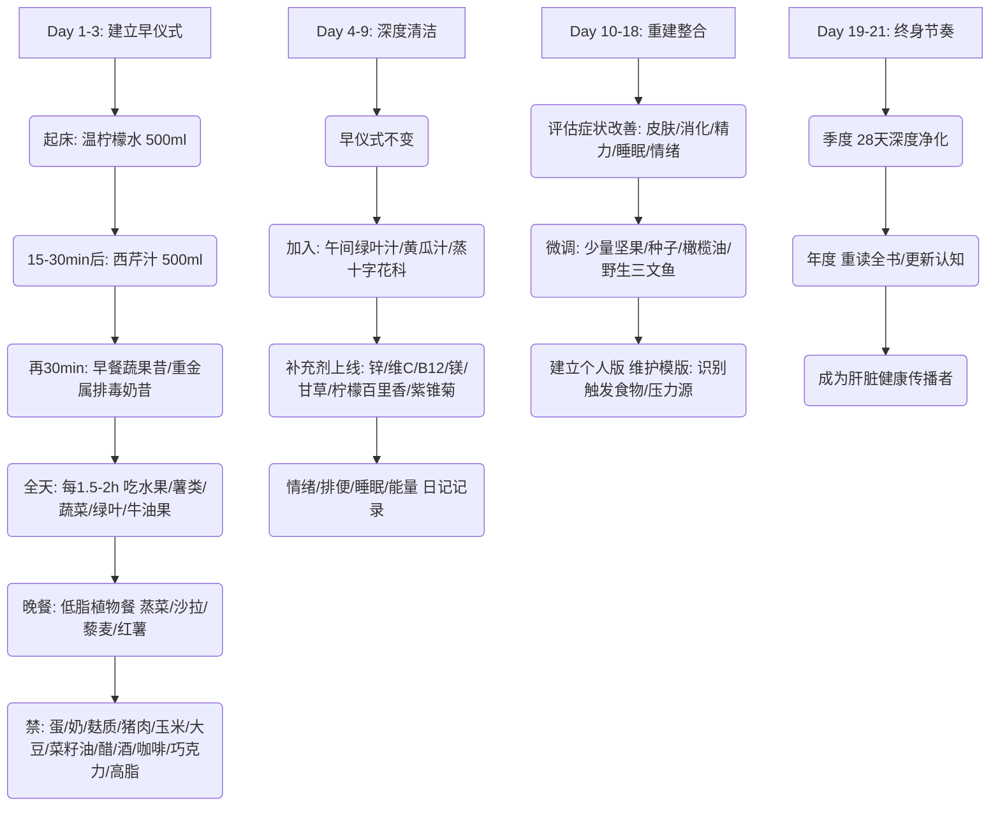
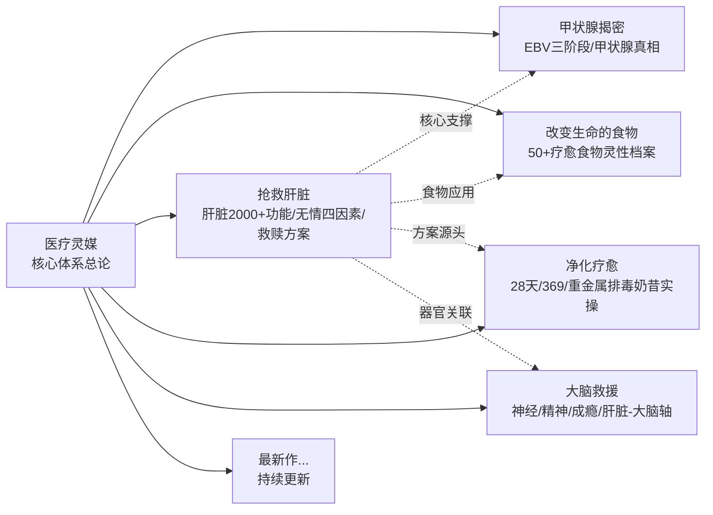

# 医疗灵媒：抢救肝脏核心体系

> **安东尼·威廉（Anthony William）** 继《医疗灵媒》《甲状腺揭密》《改变生命的食物》后，聚焦肝脏这一「身体最忠诚的盟友」，揭示其执行两千多项功能的真相，指出肝脏濒危是现代慢性病流行的隐形根源，并给出系统性的「肝脏救赎方案」。

## 核心架构总览

| 维度 | 核心内容 | 关键点 |
|------|----------|--------|
| **信息源头** | 高灵「慈悲」 | 同《医疗灵媒》总论，四岁起听闻高灵声音，以超级核磁共振般的扫描能力获取领先医学数十年的肝脏真相 |
| **核心器官** | **肝脏** | 身体真正的调节生理机能器官、第三大脑、记忆器官、燃料储存库、药房、过滤器、保护胰腺的屏障 |
| **致病根源** | **无情四因素** | 辐射、有毒重金属、DDT、病毒爆发（以EB病毒为首） —— 现代环境导致肝脏负荷过大的四大核心捣乱者 |
| **核心机制** | 肝脏追踪系统 / 处理脂肪保护胰腺 / 储存葡萄糖糖原 / 维生素矿物质储存槽 / 消除与留置毒素 | 肝脏通过胆汁分泌分级（绿/黄/橘/红/超级红灯）应对脂肪；储存糖原维持血糖与肝脏自身运作；隔离毒素于核心深处 |
| **疗愈三支柱** | 降低脂肪摄入、补充葡萄糖与矿物盐、清除病毒毒素 | 早餐蔬果昔、空腹西芹汁、重金属排毒奶昔、3:6:9 净化疗法、针对性营养补充与食疗清单 |
| **存在三要素** | 灵魂、心、精神 | 同系列核心观：肝脏健康与灵魂完整、心的慈悲喜悦、精神意志力三位一体互动 |

---

## 一、肝脏的天职：被遗忘的两千多项功能

### 真正的调节生理器官 —— 处理脂肪，保护胰腺
- **胆汁分泌分级机制**：肝脏依据饮食脂肪比例与质量，动态调整胆汁分泌量与成分（绿灯<15%健康脂 → 超级红灯>30%含劣质脂）。
- **保护胰腺逻辑**：血液脂肪过多 → 氧气下降 → 大脑心脏优先供氧 → 肝脏拼命分泌胆汁分解脂肪 → 若肝脏不堪重负，脂肪溢入淋巴/血管 → 阻碍胰岛素输送葡萄糖 → 胰岛素阻抗 → 胰腺衰竭（糖尿病）。
- **关键洞见**：「胰岛素阻抗实为脂肪包围细胞阻碍葡萄糖进入；健康碳水化合物是揭露真相的『蓝光灯』，非凶手。」

### 生命燃料库 —— 储存葡萄糖与糖原
- **血糖稳定器**：饥饿/高强度运动/压力时，肝脏将糖原分解为葡萄糖，精准调配浓度释入血液，防止低血糖晕厥、肾上腺素/皮质醇飙升。
- **肝脏最爱的燃料**：**葡萄糖（天然糖源：水果、椰子水、生蜂蜜、地瓜、南瓜、马铃薯）**。葡萄糖兼具冷却肝脏（冷却液）、喂养肝脏精灵（小叶细胞）、推送营养素入细胞三重功能。
- **反糖谬误澄清**：「只有脂肪才会变成脂肪；天然糖携带关键营养素，精制糖+脂肪才是祸首。」

### 身体的药房 —— 维生素与矿物质储存槽
- **储存广度**：每一种维生素、矿物质、荷尔蒙、化学化合物均有专属储存口袋（显微尺度组织，医学未完全发现）。
- **缺乏信号的真相**：血检显示维生素D/B12/铁等低，实为「肝脏已透支储备助你度过难关」，而非单纯摄入不足。

### 双层保护机制 —— 消除与留置
- **消除路径**：胆汁→胆囊→大肠→粪便；肾脏→尿液；自由基入血（最后手段）。
- **留置策略**：将溶剂、杀虫剂、病毒、重金属隔离于肝脏核心深处，远离血液循环。
- **心脏关联**：肝脏阻塞 → 毒素/自由基残留入血 → 血液变稠 → 心脏泵血阻力增大（高血压/心悸/心房颤动） → 生物膜脱落堵塞瓣膜。

---

## 二、看不见的风暴：无情四因素与肝脏捣乱者

> **「我们正面临肝脏濒危的历史时刻。环境乌烟瘴气，肝脏只能默默担起清洁工作。」**

### 无情四因素
| 因素 | 来源示例 | 肝脏损伤机制 |
|------|----------|--------------|
| **辐射** | 核试验残留、医疗影像、电子设备、飞行、微波炉 | 破坏细胞DNA、削弱肝脏再生力、激活潜伏病毒 |
| **有毒重金属** | 汞（牙汞合金/鱼/疫苗佐剂）、铝（除臭剂/锅具/药物）、铜（水管/避孕器/杀菌剂）、铅/砷/镉 | 神经毒素、氧化应激、喂养病毒、阻塞酶反应、致癌 |
| **DDT/杀虫剂/除草剂** | 环境残留（禁用数十年仍存）、草甘膦、有机磷、有机氯 | 持久性有机污染物，储存于脂肪/肝脏，代际传递，内分泌干扰 |
| **病毒爆发** | **EB病毒（60+变异株）**、带状疱疹、单纯疱疹、巨细胞病毒、HHV-6/7、莱姆病毒(实为病毒非细菌) | 以肝脏为大本营，分泌神经毒素/皮疹毒素/神经炎因子，驱动自身免疫/神经/皮肤/甲状腺疾病 |

### 肝脏捣乱者清单（书中持续更新）
- **病原体层**：EB病毒各阶段、带状疱疹变异株、链球菌（肠道/鼻窦/皮肤）、H. pylori、寄生虫。
- **毒素层**：药物残留（抗生素/类固醇/避孕药/止痛药）、香料/人工香精/MSG/阿斯巴甜/三氯蔗糖、醋（除苹果醋）、酒精、咖啡因/可可/巧克力、精制盐、防腐剂/添加剂、塑化剂/微塑料、香烟/电子烟。
- **食物层**：**蛋（病毒最爱饲料）、乳制品（酪蛋白致炎/喂养病毒）、麸质谷物（破坏肠道紧密连接）、猪肉/猪油（高毒素储存/跨种病毒）、养殖鱼/虾/贝（重金属/抗生素/PCB）、玉米/大豆/菜籽油（转基因/草甘膦/致炎）、高脂肪饮食（生酮/原始/高蛋白均导致高脂）**。
- **压力/生理层**：慢性压力/肾上腺素风暴、脱水/电解质缺乏、睡眠不足、情绪创伤/灵魂裂痕。

---

## 三、肝脏救赎方案：核心疗愈协议

### 早餐蔬果昔 —— 启动肝脏的每日仪式
> **克莉丝汀·诺瑟普医师推荐版本**：2-3根有机香蕉 + 1.5-2杯冷冻缅因野生蓝莓 + 1勺有机冷冻樱桃 + 2-3杯水打碎。
- **功能**：补充高生物利用度葡萄糖、矿物盐、抗氧化花青素、电解质；零脂肪负担，让肝脏专注排毒而非消化。

### 空腹西芹汁 —— 肝脏排毒的黄金标准
- **剂量**：每日清晨空腹 **500ml (16oz)** 纯有机西芹汁，静待15-30分钟再进食。
- **机制**：簇盐 恢复胃酸、重建胆汁储备、清洗肝脏毒素堆积、提供钠钾泵所需矿物盐、杀灭病原体。

### 重金属排毒奶昔 —— 每日必喝的螯合剂
- **配方（标准版）**：2根香蕉 + 2杯野生蓝莓 + 2杯香菜叶(芫荽) + 1杯欧芹 + 1小勺螺旋藻 + 1小勺绿藻 + 1小勺大西洋沙棘粉 + 1勺椰子水/水。
- **五大核心成分协同**：野生蓝莓(拉出)、香菜(穿透血脑屏障螯合汞/铝)、螺旋藻(结合)、绿藻(吸附)、大西洋沙棘(修复/维C)。

### 3:6:9 净化疗法 —— 分阶段深度重启
| 阶段 | 天数 | 核心策略 | 关键动作 |
|------|------|----------|----------|
| **第一阶段：稳定与准备** | Day 1-3 | 降低脂肪、建立早餐/西芹汁/排毒奶昔习惯、补水 | 晚餐前仅吃水果/蔬菜/绿叶/红薯/藜麦/牛油果；晚餐低脂植物餐 |
| **第二阶段：深度清洁** | Day 4-9 | 强化重金属排毒、病毒抑制、肾上腺修复 | 增加绿叶汁、蒸蔬菜、特定抗病毒补充剂(锌/维C/B12/甘草/柠檬百里香/紫锥菊)；每1.5-2小时进食一次(葡萄糖+矿物盐) |
| **第三阶段：重建与整合** | Day 10-18 | 过渡可持续长期模版、评估症状改善 | 重新引入健康脂肪(牛油果/坚果/种子)小量；建立终身维护节奏；识别个人「肝脏捣乱者」触发点 |

### 降低脂肪—— 疗愈的前提
- **原则**：无论健康/不健康脂肪，**总热量占比 <15-20%（疗愈期更低）**。
- **原因**：高脂=超级红灯=肝脏耗尽胆汁/钙/矿物/能量=无暇排毒/储糖/护胰/滤血。
- **误区澄清**：「生酮/高蛋白/间歇性断食长期损伤肝脏；肝脏需要规律葡萄糖供给。」

---

## 四、针对百余症状的定制化食疗与补充清单（书末章节框架）

> **前言/序言预告的覆盖范围**：痤疮、肠躁症(IBS)、肾上腺问题、胀气、自身免疫问题、便秘、糖尿病、黑眼圈、湿疹、干癣、疲劳、胆囊感染/结石、痛风、心悸、高血压、高胆固醇、热潮红、黄疸、肝脏老化、雷诺氏症、季节性情绪失调(SAD)、体重增加、静脉曲张等。

### 通用核心补充剂（配合上述方案，剂量遵医嘱）
| 补充剂 | 核心作用 | 对应肝脏/症状 |
|--------|----------|--------------|
| **维生素 C (酯式/脂质体)** | 抗病毒/抗氧化/肾上腺/胶原/螯合重金属 | 全身性排毒、免疫、疲劳、皮肤 |
| **锌(液体/吡啶甲酸锌)** | 免疫/抗病毒/甲状腺/伤口/味觉 | EBV、甲状腺、痤疮、湿疹、脱发 |
| **B12(甲基+腺苷钴胺素)** | 神经/甲基化/能量/红细胞/脑修复 | 疲劳、脑雾、神经病变、抑郁、记忆力 |
| **维生素 D3 (植物源)** | 免疫调节/骨骼/情绪/甲状腺 | 自身免疫、抑郁、骨质疏松 |
| **镁(甘氨酸/苹果酸/苏糖酸)** | 肌肉/神经/睡眠/血糖/心律/排毒 | 焦虑、失眠、纤维肌痛、偏头痛、心悸 |
| **L-赖氨酸** | 抗疱疹病毒/胶原/钙吸收 | 唇疱疹、带状疱疹、EBV |
| **金缕梅/甘草根/柠檬百里香/紫锥菊** | 抗病毒/肾上腺/淋巴/免疫 | 病毒急性期、肾上腺疲劳 |
| **NAC/谷胱甘肽(脂质体)** | 肝脏解毒/黏液溶解/抗氧化 | 肝脏毒性、呼吸道、重金属 |

---

## 五、静心与灵性实践：零成本的肝脏疗愈力

> **「肝脏与心情上的幸福感有紧密链接。和肝脏产生链接，就像和自己的心灵产生链接一样。」**

| 实践 | 操作要点 | 肝脏/身心机制 |
|------|----------|--------------|
| **看夕阳/日落** | 每日日落凝视 10-15 分钟，不戴眼镜 | 光谱刺激松果体/昼夜节律/褪黑素/血清素；灵魂层面「见证结束与释放」 |
| **凝视星空** | 夜晚仰望 5-10 分钟，呼吸放松 | 扩大视野/透视/连接宇宙/缩小自我困境/激活松果体 |
| **看海/水体/听水声** | 站在水边观看波浪/流水 | 负离子/声波/韵律安抚神经/清理气场/连接情绪流动 |
| **观蜜蜂/传粉者** | 静坐观察 5 分钟 | 见证协作/丰盛/神圣几何/当下专注/HRV改善 |
| **种花/园艺/触土** | 双手触土、播种、浇水 | 接地/菌群交换/土壤分枝杆菌提升血清素/创造力/耐心 |
| **祈祷/召唤天使** | 大声、真诚、具体说出请求 | 声波/意图/自由意志声明/吸引高频协助/重塑潜意识 |
| **感恩清单** | 每日写/说 3-10 件 | 重塑 RAS/多巴胺/血清素/吸引同频体验 |

> **交叉引用**：[[冥想正念手册]] 道路/蓝天/野马意象训练注意力；[[佛脑]] HEAL法内化积极体验；[[零极限与荷欧波诺波诺体系]] 清理记忆恢复零状态。

---

## 六、关键误区澄清表（肝脏专题版）

| 流行认知 | 《抢救肝脏》视角 | 实操建议 |
|----------|------------------|----------|
| **「脂肪肝=吃太多糖/水果」** | **错误**；真因=高脂饮食+毒素/病毒导致肝脏无法处理脂肪，糖是替罪羊 | 降低脂肪(尤其动物/油炸/加工油)，大量吃水果/薯类/蔬菜葡萄糖 |
| **「胆囊结石/切除=解决问题」** | 胆囊是肝脏的储备罐；切除后肝脏失去缓冲，胆汁持续滴漏伤肠 | 保胆囊：低脂+西芹汁+柠檬水+牛油果/橄榄油微量刺激胆汁流动 |
| **「高胆固醇/高血压=遗传/盐/胆固醇摄入」** | 肝脏阻塞/毒血/胆汁不足导致心脏泵血阻力大/血管修补需胆固醇 | 抢救肝脏核心方案(低脂/西芹汁/排毒奶昔/葡萄糖/矿物盐) |
| **「糖尿病/胰岛素阻抗=碳水化合物过多」** | 脂肪阻碍胰岛素/葡萄糖入细胞；肝脏糖原耗尽靠肾上腺素维生 | 中低脂+高优质碳水(水果/薯类)+频繁餐(每1.5-2h)+锌/铬/镁/B12 |
| **「湿疹/银屑病=自身免疫/过敏/肠道漏」** | 肝脏核心深处储存铜/汞/病毒(EBV/带状疱疹) → 皮疹毒素经皮肤排出 | 重金属排毒奶昔+抗病毒方案(赖氨酸/维C/锌/紫锥菊/甘草/柠檬百里香)+低脂 |
| **「痛风=嘌呤/红肉/海鲜/啤酒」** | 肝脏/肾脏毒素过载尿酸排泄受阻；真凶=高脂/毒素/病毒而非单纯嘌呤 | 樱桃汁/西芹汁/柠檬水/低脂植物餐/重金属排毒/维C/锌/镁 |
| **「更年期/热潮红=雌激素下降」** | EBV/毒素(DDT/辐射/重金属)攻击生殖系统+肾上腺疲劳，非单纯激素 | 肝脏/淋巴排毒+肾上腺修复(葡萄糖/矿物盐/适应原)+植物雌激素(亚麻/红三叶草) |
| **「甲状腺结节/癌=碘缺乏/过量/辐射」** | EBV第三阶段攻击甲状腺+重金属/毒素协同；碘需谨慎(病毒期加重) | 抗病毒/排毒核心方案+适量海藻碘+大量十字花科(熟吃)/锌/硒/B12 |
| **「自身免疫=身体攻击自己」** | **核心谬误**；实为免疫系统攻击病毒/毒素(EBV神经毒素/重金属) | 停止免疫抑制，转为抗病毒/排毒/修复肝脏 [[yi-liao-ling-mei]] |
| **「高蛋白/生酮/断食=万能抗炎」** | 高脂/高蛋白/长空腹 → 肝脏/肾上腺/胰腺负担加重，长期必崩 | 规律进食(1.5-2h/次)、低脂(10-15%)、高碳水(水果/蔬菜/谷薯) |

---

## 七、知识图谱交叉引用索引

| 本页概念 | 关联既有页面 | 关联说明 |
|----------|--------------|----------|
| 高灵「慈悲」/医疗灵媒源头 | [[yi-liao-ling-mei]]、[[人体能量场与超感知力]]、[[ESP通灵智慧体系]] | 系列总论核心设定、HSP与通灵框架 |
| EB病毒四阶段/病毒致病 | [[yi-liao-ling-mei]]、[[人智医学]]、[[从心灵到细胞的疗愈]] | 病毒机制、植物金属疗法、细胞层面疗愈 |
| 无情四因素/重金属/辐射/DDT | [[中医整体芳疗]]、[[经络处方与易堵塞穴位]]、[[全频能量花精全书]] | 精油/经络/花精协同排毒 |
| 肝脏胆汁/脂肪/糖原/储存机制 | [[超脑零极限]]、[[心灵魔法显化的神经科学]] | 大脑能量管理、葡萄糖为燃料的神经基础 |
| 肾上腺/葡萄糖/矿物盐/频繁进食 | [[三分钟未来日记]]、[[写下来奇迹就会发生]] | 习惯养成、血糖稳定与显化的生理前提 |
| 3:6:9净化/西芹汁/重金属排毒奶昔 | [[光疗氧疗花精整合疗法]]、[[人体气场彩光学]] | 自然疗法体系互补、光/氧/花精协同 |
| 灵魂/心/精神三要素与肝脏 | [[灵魂的出生前计划]]、[[登出键体系与莫子]]、[[从未知中解脱]] | 灵魂课题、觉察三要素、出生前计划视角 |
| 静心/祈祷/天使/看日落星空 | [[冥想正念手册]]、[[与天使链接]]、[[光的课程]] | 世俗冥想、天使连接、光疗愈体系 |

---

## 八、实践路线图：新手21天肝脏重启（精简版）

---

## 九、核心金句摘录

> - **「肝脏是你最好的朋友，负责执行医学与科学界尚未发现的两千多种重要功能。」** —— 第一章
> - **「如果肝脏不需要花那么多时间与精力防止胰脏摄取脂肪，就能释出更多的精力进行其他重要且惊人的功能。」** —— 第二章
> - **「葡萄糖，也就是糖，就是真正的燃料……肝脏需要被糖包围的营养素，因为糖能帮助营养素发挥作用。」** —— 第三章
> - **「医师告诉你缺乏某种维生素与矿物质时，实际上要说的往往是：『你的肝脏有点问题。』」** —— 第四章
> - **「我们不希望你再继续遭受片刻的痛苦了。我的毕生职志，就是要把这样的讯息传递给你。」** —— 致读者
> - **「抢救肝脏，就能够抢救心脏、大脑、免疫系统、皮肤、肠道……」** —— 第一章
> - **「疗愈是神给我们的最大自由之一，疗愈是宇宙、光或更高源头的法则，而不是人类的法则，因此它会给予真正的公平正义。」** —— 《医疗灵媒》总论，亦适用本书

---

## 十、系列著作谱系定位

> **页面维护提示**：本页依《医疗灵媒：抢救肝脏》中文版前言至第一部第四章文本沉淀，核心体系、胆汁分级、糖原机制、无情四因素、3:6:9框架、误区澄清表忠实原著。后续章节（第二部「看不见的风暴」、第三部「宣战」、第四部「肝脏救赎」详细症状方案）框架已建立，待归档文本补全后扩充子页面：`[[肝脏追踪系统详解]]`、`[[无情四因素深度档案]]`、`[[3:6:9净化疗法实操手册]]`、`[[百余症状肝脏方案索引]]`，并以 `[[wikilink]]` 互联。

## 来源

- [医疗灵媒：抢救肝脏](../sources/医疗灵媒：抢救肝脏.md)
