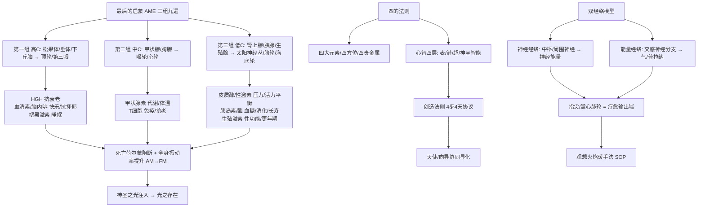

# 启动神秘疗愈能量：古代神秘学院进阶课程核心索引

> 《启动神秘疗愈能量》是道格拉斯·德龙《古代神秘学院入门书》的进阶续作，面向已完成「首次启蒙」或灵性觉醒初期的学习者，系统传授古埃及/亚特兰蒂斯神秘学院的高阶疗愈技法与心智创造法则。

## 书籍定位与两册关系

| 维度 | 《古代神秘学院入门书》 | 《启动神秘疗愈能量》 |
|------|------------------------|----------------------|
| **受众** | 零基础入门者 | 已完成首次启蒙/灵力觉醒者 |
| **核心仪式** | 首次启蒙、基础脉轮冥想、THOH/MAY 唱诵 | **最后的启蒙**、AME 三组唱诵、四的法则显化 |
| **脉轮工作** | 七大脉轮基础开通、昆达里尼唤醒 | AME 唱诵精准对应七脉轮-内分泌腺体、死亡荷尔蒙调节 |
| **心智模型** | 未系统阐述 | **心智四层级**（表/潜/超/神圣智能）+ **四的法则**创造框架 |
| **疗愈技法** | 基础能量疗愈、气场阅读 | 神经/能量经络双轨模型、观想火焰暖手法、专业治疗师培养 |
| **交叉引用** | 本书第1、3章多处回溯入门书技法 | 入门书为「预备课程」，进阶书为「专业认证」 |

> **编注**：书中反复提示「请参照《古代神秘学院入门书》」——两册构成完整的 **古代神秘学院课程体系**：入门书奠基「能量觉知与基础脉轮操作」，进阶书深化「生理机制解析、心智创造法则、临床级疗愈技法」。

---

## 第一章：最后的启蒙仪式

### 仪式源流与场域
- **起源**：亚特兰蒂斯疗愈殿堂 → 约一万年前迁徙至埃及 → 大金字塔「国王墓室」/ 卡纳克圣湖
- **时机**：午夜，大祭司引领进阶生经秘密阶梯、大回廊、矮门进入国王墓室
- **核心动作**：檀香熏烛、围圈而坐、呼吸预备 → **AME 三组九遍唱诵** → 十分钟完成

### 预备呼吸法：双轨开启上中丹田
| 呼吸法 | 吸气部位 | 闭气 | 呼气 | 遍数 | 直接作用脉轮 | 生理锚点 |
|--------|----------|------|------|------|--------------|----------|
| **心轮呼吸** | 胸腔/肺部 | 5秒 | 嘴巴均匀吐气 | 3 | **心轮**（间接喉轮、顶轮） | 胸腺、甲状腺 |
| **太阳神经丛呼吸** | 横膈膜/腹部 | 5秒 | 嘴巴均匀吐气 | 3 | **太阳神经丛**（间接脐轮、海底轮） | 肾上腺、胰腺 |

> **机制**：吸入「气/宇宙能量/普拉纳」→ 转换脑波 → 扩张光场 → 为高频唱诵建立接收态。

### AME 唱诵三组九遍精密协议

#### 第一组：高至中音 C — 启动上丹田三腺两轮
- **发音**：A-A-A-M-M-M-E（押韵 game，无 g），缓慢均匀吐气
- **遍数**：3 遍，每遍后放松数秒
- **注意力导引**：
  1. 第三眼（眉心）感受压力/刺痒
  2. 第三眼持续保持
  3. **顶轮（百会）** 引导振动上行，感受刺痒/压力/喜悦
- **直击腺体**：
  - **松果体** → 分泌 **褪黑激素**（情绪向好）+ 共振 **下丘脑** → 释放 **脑内啡/血清素**（喜悦、睡眠、学习平衡）
  - **脑下垂体（前/后叶）** → 释放 **生长激素 (HGH)**、促甲状腺激素、泌乳素、黑色素细胞刺激素 (MSH)
- **脉轮效果**：顶轮、第三眼**全开**；喉轮轻微受影响

#### 第二组：中央 C — 激活中丹田双轮三腺
- **音调**：较第一组略低（中央 C 或下行 1-2 度）
- **发音/遍数**：同第一组，3 遍
- **注意力**：喉轮 → 心轮 → 专注心轮胸腔共鸣
- **直击腺体**：
  - **甲状腺/副甲状腺** → 甲状腺激素（新陈代谢、体温、生长）、甲状旁腺激素（钙磷平衡、肾脏净血）
  - **胸腺** → T 细胞（T3/T4，免疫、抗老化）
- **脉轮效果**：喉轮、心轮**深度开启**；太阳神经丛轻微受影响
- **体感**：振动/脉动/喜悦感、飘飘然

#### 第三组：低 C（或略高）— 扎根下丹田三轮三腺
- **呼吸法**：**太阳神经丛呼吸**（横膈膜吸气、闭气 5 秒）
- **发音**：更低沉 A-A-A-M-M-M-E
- **遍数/注意力流向**：
  1. 太阳神经丛（脐上 1-3 英寸）温暖/刺痒/振动
  2. 脐轮（脐下 1-3 英寸）引导振动下行
  3. **海底轮（会阴/生殖器）** 共鸣暖意/喜悦
- **直击腺体**：
  - **肾上腺皮质** → 类固醇（矿物质平衡）、性激素（性欲/活力平衡）
  - **肾上腺髓质** → 微量肾上腺素/去甲肾上腺素（温和「战/逃」→ 活力）
  - **胰腺** → 胰高血糖素/胰岛素（血糖平衡）、**消化酶**（延缓老化关键）
  - **生殖腺** → 睾酮/雌激素/孕酮（性功能调节、更年期缓冲）

### 唱诵后即时灵力增强清单
- 灵视/超听觉/超感应增强
- 创造力/直觉/同频共感/治疗力提升
- 连结造物主/上帝源头
- 前世记忆与知识获取
- 灵魂出体能力发展
- 气场/脉轮接收更高频能量
- 明确更高人生目的

> **实务提示**：古代为单次仪式，现代可**每 1-2 月复诵**；直觉指引再启蒙时机。

---

## 第二章：唱诵的生理机制深度解析

### 振动医学核心模型：声 → 神经 → 内分泌 → 全身共振

```
AME 声波频率
   ↓
松果体/脑下垂体/下丘脑共振（第一组）
甲状腺/胸腺共振（第二组）
肾上腺/胰腺/生殖腺共振（第三组）
   ↓
交感神经系统（脊柱两侧）传导高频能量
   ↓
中枢神经系统 → 全身腺体器官
   ↓
内分泌腺体以更高频率功能化
   ↓
身体振动速率提升（AM → FM 广播台隐喻）
   ↓
神圣之光/圣灵/宇宙能量更多注入
   ↓
成为「物质世界中的光之存在」
```

### 关键激素与生理效应对照表

| 腺体 | 主要激素 | AME 组别 | 核心生理/心理效应 | 临床启示 |
|------|----------|----------|-------------------|----------|
| **松果体** | 褪黑激素、血清素 | 第一组 | 情绪稳定、睡眠优化、抗抑郁、直觉唤醒 | 替代/辅助 SSRI 抗抑郁药物渐进减量 |
| **脑下垂体前叶** | **生长激素 (HGH)**、促甲状腺激素、泌乳素、MSH | 第一组 | **抗衰老/逆龄**、新陈代谢平衡、皮肤光泽、泌乳/勃起功能 | 35 岁后 HGH 锐减，唱诵可延缓甚至逆转老化 |
| **脑下垂体后叶** | 储存/释放下丘脑激素（催产素、加压素） | 第一组 | 社交连结、水电解质平衡 | 心智直接调控释放时机与剂量 |
| **下丘脑** | 释放激素调控垂体；**快乐中枢** | 第一组 | 脑内啡释放 → 高峰体验 | 直通「喜悦源头」 |
| **甲状腺/甲旁腺** | 甲状腺激素、PTH | 第二组 | 代谢率↑、体温↑、钙磷平衡、神经组织健康 | 甲减/畏寒/代谢迟缓者受益显著 |
| **胸腺** | T 细胞因子 | 第二组 | 免疫增强、抗老化核心 | 胸腺随年龄萎缩，唱诵可功能性再生 |
| **肾上腺皮质** | 皮质醇、醛固酮、性激素前体 | 第三组 | 压力缓冲、电解质平衡、性欲/活力调节 | 皮质醇失调（倦怠/焦虑）可平衡 |
| **肾上腺髓质** | 肾上腺素、去甲肾上腺素 | 第三组（微弱） | 适度唤醒→活力；过量→焦虑 | 唱诵倾向「温和安抚」而非过度激发 |
| **胰腺** | 胰岛素、胰高血糖素、消化酶 | 第三组 | 血糖稳态、**消化酶分泌↑（长寿关键）** | 消化不良/酶缺乏/糖代谢失衡辅助 |
| **生殖腺** | 睾酮、雌激素、孕酮 | 第三组 | 性功能平衡、更年期缓冲、生殖健康 | 性冷淫/性功能障碍/更年期综合征辅助 |

### 死亡荷尔蒙：衰老的生化开关与唱诵干预
- **定义**：脑下垂体/下丘脑协同分泌，**极度加速老化**的未完全鉴定分泌物
- **触发链条**：
  1. HGH 随年龄锐减（35-40 岁拐点）
  2. 内分泌系统失衡 → 激素释放量/比例偏离
  3. **死亡荷尔蒙** 同步释放 → 浓度渐增 → **速老化**（目击式衰老）
- **头号诱因**：**慢性压力** → 内分泌耗竭 → 死亡荷尔蒙释放
- **AME 第一组 + MAY 唱诵 双重阻断**：
  - 第一组高频共振 → 刺激 HGH 大量释放 → 重建内分泌平衡 → **减缓/停止死亡荷尔蒙分泌**
  - MAY 唱诵（入门书顶轮专用）直接作用脑下垂体/下丘脑 → **快速终止死亡荷尔蒙释放**
- **实操建议**：月度/双月度 AME 全套 + 每日 MAY 2-3 遍维护

> **跨书呼应**：入门书《古代神秘学院入门书》第 7 章详述 **MAY 唱诵**（中音 C，M-M-A-A-Y-Y，第三眼→顶轮，刺痛/眩晕=顶轮开启），进阶书此处明确其**抗衰老药理学定位**。

---

## 第三章：心智与脑的差异——双轨架构与神圣三位一体

### 本体论区分：心智 ≠ 脑
| 维度 | **脑** | **心智** |
|------|--------|----------|
| 本质 | 生化器官、物质肉体一部分 | 连结永恒灵魂的灵性「器官」 |
| 运作 | 纯电子机械、自动执行 | 守卫/导演：调控脑、内分泌、全身 |
| 连结 | 无直接天界连结 | **直接连结造物主/天界/神圣智能** |
| 功能 | 存储/处理信息、执行指令 | 认知感/存在感来源、创造力源头、灵性进化主体 |

### 双轨和谐运作与器官移植启示
- **肉体器官 ↔ 灵性器官** 频率共振/反馈回路（如心脏↔灵性心）
- 器官移植排斥本质：**肉体新器官与宿主灵性器官无频率连结** → 需时整合
- **能量疗愈价值**：高频振动能直接作用灵性器官→反馈修复肉体器官

### 神圣之光/宇宙能量自上而下充电路径
```
永恒灵魂/心智（神圣智能连结点）
   ↓ 高频振动/光能进入
大脑新皮层（灰质 2-4mm，数十亿神经元）→ 神经元激活 → 刺痛/王冠感（顶轮位置）
   ↓ 能量扩展
松果体（直觉/前世记忆唤醒）
脑下垂体（圣灵启示/天使连结）
下丘脑（前世情感升起）
丘脑（协调前世记忆完整回溯）
脑边缘系统：
  - 海马组织（似曾相识触发）
  - 嗅球（前世嗅觉记忆）
  - 丘脑（情感-记忆整合）
   ↓
全脑/全身细胞振动频率提升 → 脑力使用率 10% → 20-30%+
   ↓
心灵能力（预知/似曾相识/前世/灵视/超听觉）唤醒
```

### MAY 唱诵回顾与气的深呼吸：入门书核心技法的进阶定位
| 技法 | 入门书定位 | 进阶书重释 |
|------|------------|------------|
| **MAY 唱诵** | 顶轮开启、连结造物主 | **脑下垂体/新皮层/边缘系统协同激活**、**死亡荷尔蒙终止剂** |
| **气的深呼吸** | 基础能量吸入、气场扩展 | **三的法则/三角法则**显化：正/负极能量按神圣智能分配入红细胞 → 充电血液 → 脉轮/气场亮度↑ → 影响他人场域 |

> **三的法则几何隐喻**：圣父/圣子/圣灵 = 正极/负极/神圣智能分配者 = 完成/稳定/创造。

---

## 第四章：四的法则与心智四层级创造框架

### 四的法则跨文化锚点
| 传统 | 四的象征 | 核心隐喻 |
|------|----------|----------|
| 北美原住民（克里/苏/阿帕契） | 四方位/四色/四人种/葬礼四天 | 方向、种族和谐→人间天堂、灵魂完全返宇宙 |
| 基督教神秘主义 | 耶稣十字架四伤口 | 受难完成/圆满 |
| 犹太卡巴拉（《创造之书》/《光辉之书》） | 四大元素/四方位/四贵金属（金银铜铁） | 创造基础构件、神圣结构 |

### 心智四层级：创造/显化的完整链路

```
┌─────────────────────────────────────┐
│  神圣智能 / 神圣心智 / 宇宙智慧      │  ← 智慧海洋、造物主源头、无所不包
│         （超意识的特殊组成部分）      │
├─────────────────────────────────────┤
│  超意识                              │  ← 集体意识节点、天界知识入口、天使/向导通讯
│  （连结神圣智能）                    │
├─────────────────────────────────────┤
│  潜意识                              │  ← 隐性信念/恐惧/模式存储库、β/α/θ/δ 脑波桥接
│  （表意识之下）                      │
├─────────────────────────────────────┤
│  表意识                              │  ← 清醒思想/观念/认知、β 波（>14Hz）、专注练习主场
│  （清醒现实实相）                    │
└─────────────────────────────────────┘
```

### 创造/显化法则操作手册：四步四天协议

#### 前置条件：表/潜意识冲突清理（21 天专注练习）
- **β 状态清醒期**：每日 3-5 句肯定语（如「我内心平静、我健康、我快乐」）
- 思考 + 大声朗读，3-4 次/天
- 灵性觉醒者自然滑入 **α 状态（8-13Hz）** → 效果加速

#### 表/潜意识连结协议（入睡前 7-10 天）
- **α 轻度→中度（~8Hz）**：表意识释放思想入潜意识
- **θ 深层（<7Hz）**：积极观念在潜意识生根
- **δ/θ 深度睡眠（3-4Hz）**：
  - 表/潜/超意识三连通
  - **天使/向导传递讯息、灵魂旅行、天界教学殿堂参访**
- 每季度可换新肯定语清单重练

#### 创造法则核心练习（连续 4 晚入睡前/深冥想）
| 步骤 | 操作 | 关键点 |
|------|------|--------|
| 1 | 深度放松，请求天使/向导协助 | α/θ 状态最易连结光之灵 |
| 2 | **观想目标已实现全感官体验**（面试握手/客户来访/生意繁荣） | 喜悦/感激/成就感**具身化**「仿佛正在发生」 |
| 3 | 默念 **「我要求什么，就会得到什么」** | 释放意图，不执着 |
| 4 | **完全放下**，入睡或心智漫步 | **关键**：不再细究，让能量模式以高频无线电波射入宇宙 |

#### 显化后行动原则
- **平静安度显化窗口期**（小愿望天/周，大愿望月/季）
- **同步性增强、生活变和谐** → 不怀疑、不干扰
- **机会显现时必须行动**（面试/谈判/决策）— 直觉导引、真诚呈现
- **无论结果，心智力量已强力运作** → 更多机会涌入

---

## 第五章：古老疗愈技法——双经络模型与临床级手法

### 神经经络 vs 能量经络：解剖与能量双重解剖学

| 维度 | **神经经络** | **能量经络** |
|------|--------------|--------------|
| 物理基础 | 中枢神经（脊髓）↔ 周围神经 → 手指/脚趾末端 | 交感神经两侧 → 全身 → 手指/脚趾末端 |
| 核心能量 | **神经能量**（脉冲/信号） | **疗愈能量/气/普拉纳**（高频振动、神圣能量一部分） |
| 关键节点 | **神经节**（中枢-交感交界、脊柱上） | **手掌/脚掌脉轮**、**指尖末端** |
| 临床对应 | 西医神经传导、反射弧 | **中医针灸经络**、能量疗愈出口 |
| 相互关系 | 部分连接、大多极度接近、平行分布 |  |

> **核心洞见**：**「指尖是疗愈能量向外释放的终端」**，手掌脉轮+指尖治疗点+手脉轮三位一体 = 强力疗愈通道。

### 观想火焰暖手法：手脉轮激活标准化流程
1. **心轮呼吸**（第 1 章）→ 放松
2. **双掌相对 3 英寸**，腰部/大腿高度，站/坐均可
3. **观想**：热血/能量如热水顺双臂下流 → 双手掌心
4. **全神贯注掌心**，呼吸正常 → 天生治疗师掌心速热→全手扩散
5. **关键扩展**：意念稍分神 → **想象温暖夏夜篝火/烛火** → 火焰能量注入双手
6. **结果**：手脉轮进一步打开 → 更多自然疗愈能量流出 → 进入患者/案主体内

> **进阶提示**：此法为**治疗他人前的必做预备练习**；配合《古代神秘学院入门书》「开放掌轮法」形成完整手脉轮开发体系。

---

## 交叉引用网络：入门书 ↔ 进阶书核心节点映射

| 进阶书章节/概念 | 入门书对应章节/技法 | 整合应用建议 |
|------------------|----------------------|--------------|
| **AME 第一组** | MAY 唱诵（顶轮）、THOH 唱诵（第三眼） | 早晚 MAY/THOH 维护，月度 AME 全套深度重置 |
| **心轮/太阳神经丛呼吸** | 基础脉轮冥想（第 4-6 章） | 每日晨间 3+3 遍为 AME 唱诵预备态 |
| **死亡荷尔蒙阻断** | MAY 唱诵、脉轮能量流技巧 | 每日 MAY 2-3 遍 + 季度 AME = 抗老化栈 |
| **四的法则显化** | 肯定句练习、镜子工作、吸引力法则基础 | 入门书建立「正向思维底座」，进阶书提供「四层级心智精密操作协议」 |
| **神经/能量经络双轨** | 气场扫描/阅读、脉轮平衡、基础疗愈手法 | 进阶书提供解剖学锚定与临床级输出标准 |
| **观想火焰暖手法** | 开放掌轮法、基础疗愈手位 | 进阶法作为「治疗前热身」标准化 SOP |
| **前世回溯/灵魂出体** | 星光体出游、脉轮冥想、THOH/MAY | 进阶书给出生物学机制（脑区/腺体）与强化协议 |

---

## 核心知识图谱速查



---

## 实践路线图：从入门到专业治疗师

| 阶段 | 核心任务 | 关键技法 | 验证指标 |
|------|----------|----------|----------|
| **预备期（入门书）** | 脉轮觉知、基础唱诵、气场阅读 | THOH/MAY、脉轮冥想、首次启蒙 | 能感知气场色彩、脉轮开合、基础疗愈感应 |
| **进阶期（进阶书 1-3 章）** | 最后的启蒙、内分泌-脉轮精密对应、死亡荷尔蒙管理 | AME 全套、心轮/太阳神经丛呼吸、MAY 维护 | 体感明确（刺痒/振动/喜悦）、情绪稳定、抗老化体感、直觉跃升 |
| **心智掌控期（第 4 章）** | 表/潜/超/神圣四层心智整合、四的法则显化 | 21天专注、7-10天连结、4天创造协议 | 同步性增强、目标显化率↑、生活和谐度↑ |
| **临床实操期（第 5 章+）** | 双经络疗愈、手脉轮标准化输出、专业治疗师建立 | 观想火焰暖手法、神经/能量经络诊断、指尖疗愈能量导引 | 案主反馈显著、可复制疗愈协议、建立专业声誉 |
| **持续进化** | 定期复诵 AME、MAY 日课、季度创造法则、向导协作深化 | 全书技法循环精进 | 灵力持续增强、更高人生目的清晰、服务集体觉醒 |

---

## 关键术语双语对照表

| 中文术语 | 英文原文 | 备注 |
|----------|----------|------|
| 最后的启蒙 | Final Initiation / Last Initiation | 古代神秘学院进阶毕业仪式 |
| 首次启蒙 | First Initiation | 入门书核心仪式 |
| 心轮呼吸 | Heart Chakra Breathing | 胸腔吸气、5秒闭气 |
| 太阳神经丛呼吸 | Solar Plexus Breathing | 横膈膜吸气、5秒闭气 |
| AME 唱诵 | AME Chanting / Toning | A-A-A-M-M-M-E 押韵 game |
| MAY 唱诵 | MAY Chanting / Toning | M-M-A-A-Y-Y 中音 C |
| 死亡荷尔蒙 | Death Hormone | 脑下垂体/下丘脑协同分泌、加速衰老 |
| 四的法则 | Law of Four / Square Law | 跨文化神圣数字、创造完成数 |
| 心智 | Mind | 连结灵魂/天界的灵性器官 |
| 脑 | Brain | 生化物理器官 |
| 神圣智能 | Divine Intelligence | 宇宙智慧、造物主源头 |
| 超意识 | Superconscious | 集体意识节点、天界知识入口 |
| 潜意识 | Subconscious | 隐性信念/恐惧存储 |
| 表意识 | Conscious Mind | 清醒认知、β脑波主场 |
| 神经经络 | Nerve Meridians / Neural Pathways | 中枢/周围神经解剖结构 |
| 能量经络 | Energy Meridians | 交感神经分支、气/普拉纳流动通道 |
| 观想火焰暖手法 | Visualizing Flame Hand-Warming Technique | 手脉轮激活临床预备标准流程 |
| 气 / 普拉纳 | Chi / Prana | 宇宙能量/生命力、正负极双极性 |
| 三的法则 | Law of Three / Triangle Law | 正极/负极/神圣智能分配者 = 完成数 |

---

## 相关页面交叉引用

- **同作者核心体系**：[[activating-mystical-healing-power]]（进阶书总览）、[[古代神秘学院入门书]]（入门书总览，待建立）
- **脉轮-内分泌深度映射**：[[中脉七轮]]、[[人体能量场与超感知力]]、[[chakra-clearing-doreen-virtue]]
- **唱诵/声音疗愈**：[[光的课程系列三行星四]]（金字塔疗愈唱诵）、[[soham-healing-system]]（泛音唱诵/光语）
- **心智模型与显化**：[[belief-creates-reality-practice]]（王怡仁/赛斯四步实修）、[[xiang-yu-zhou-xia-ding-dan]]（向宇宙下订单）、[[luck-creation-principles]]（运气科学显化）
- **抗衰老/激素调节**：[[yi-zhu-lun-ming]]（一柱论命与生理周期）、[[fei-wei-zong-qi-li-lun]]（以肺为宗/宗气抗老）
- **能量经络与疗愈**：[[ren-shen-shu]]（仁神术安全能量锁）、[[soham-techniques-and-meridians]]（SoHam 经络技法）、[[neijing-huxi-yangsheng-fa]]（内经呼吸养生）
- **古埃及/亚特兰蒂斯源流**：[[ancient-egyptian-book-of-the-dead]]、[[entry-ancient-egyptian-priestess]]、[[egyptian-mythological-legends]]
- **前世/灵魂出体/灵魂计划**：[[brian-weiss-many-lives-many-masters]]、[[30天學會靈魂出體]]、[[birth-pre-life-plan]]（待建立）
- **四的法则/神圣几何**：[[drunvalo-melchizedek]]（生命之花/梅尔卡巴）、[[cong-xin-jue-xing]]（从心觉醒/梅尔卡巴）

---

> **结语**：本书将「古代神秘学院」的**口传秘仪**转化为**可验证的生理-心理-能量三层操作手册**。AME 三组唱诵精准锚定七脉轮-七腺体，四的法则给出心智四层级的显化工程学协议，双经络模型为能量疗愈提供解剖学依据。配合入门书 THOH/MAY/脉轮冥想基础，构成从**觉醒入门 → 生理重构 → 心智掌控 → 临床输出**的完整灵性职业化路径。

## 来源

- [启动神秘疗愈能量](../sources/启动神秘疗愈能量.md)
