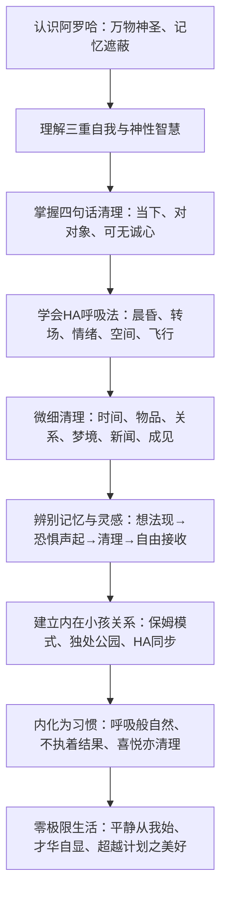

## 概述

《阿啰哈》记录了作者与修·蓝博士（Dr. Ihaleakala Hew Len）的相遇与实修历程，系统呈现夏威夷古老疗法**荷欧波诺波诺**（Ho'oponopono）的现代应用体系。本书以“阿啰哈”精神为入口，阐述**三重自我**（尤哈内/尤尼希皮里/欧玛库阿）与**神性智慧**的关系，确立“清理记忆、归零当下”的核心范式，并提供**四句话清理**、**HA呼吸法**、时间/物品/关系清理等可落地工具，辅以大量实修案例与博士语录。

> **核心定位**：不探究起因、直接清理；不需诚心、只需重复；问题即机会、清理即自由。

---

## 一、阿罗哈精神：清理的入口与连接

### “阿罗哈”的原意
> **“现在的我正在神性智慧的面前。”**  
> 万物皆由神圣存在创造，背后皆有无限伟大的存在。若无法感受神圣，皆因内在记忆重播遮蔽。

### 实操要诀
- **触发时机**：对他人有反应、看见不想看的东西、无法喜欢自己时 → 说“阿罗哈”
- **作用机制**：无论是否诚心，说出瞬间即启动清理，消除记忆隔阂，恢复完美关系
- **态度**：不强迫认同“丑即是美”，只清理内在隔阂，真相自显

> **交叉引用**：[[零极限与荷欧波诺波诺体系]] 中“平静由我开始”责任归属原则与此同源。

---

## 二、荷欧波诺波诺核心架构

### 从传统到现代
| 维度 | 传统荷欧波诺波诺 | 现代荷欧波诺波诺大我意识疗法 |
|------|------------------|-------------------------------|
| 操作者 | 卡胡那（特定治疗师） | 任何人、任何地点、独自进行 |
| 核心义 | “Ho’o”（目标/道路）+ “Ponopono”（完美） → 将错误导正至完美 | 同义，强调个人100%责任 |
| 适用范围 | 争执、疾病等社区问题 | 人际、金钱、健康、工作、恋爱、情绪等全生命议题 |

### 问题根源：记忆重播
- **记忆定义**：非仅个人感官记忆，含宇宙诞生以来所有存在（动植物、无机物）的体验累积
- **运作模式**：内在小孩（潜意识）每秒重播1500万位元记忆 → 反射为情绪、事件、问题
- **真实状态**：零、自由、空无、纯真、与神性智慧随时连接
- **解决之道**：清理记忆，恢复连接

### 构成“我”的三重自我
| 自我 | 夏威夷语 | 角色 | 对应原型 |
|------|----------|------|----------|
| **意识** | Uhane (尤哈内) | 感官、大脑运作、思考决策 | 母亲 |
| **潜意识/内在小孩** | Unihipili (尤尼希皮里) | 累积记忆、驱动情感身体重播 | 孩子 |
| **超意识** | Aumakua (欧玛库阿) | 连接神性智慧、灵性桥梁 | 父亲 |

> **三重自我平衡** = 与神性智慧连接 = 零极限状态  
> **交叉引用**：[[尤尼希皮里与内在小孩]] 详述内在小孩作为潜意识核心角色的定位、三位一体架构与对话实操。

---

## 三、清理核心技法

### 四句话清理法（基础工具）
> **谢 谢 你 / 对 不 起 / 请 原 谅 / 我 爱 你**

- **操作原则**：
  - 无需发自内心，如按删除键般重复即可
  - 可仅用“我爱你”单句
  - **关键点**：在感受到问题/情绪的**当下**，对相关人/事/物/计划重复
  - 意识（尤哈内）启动 → 内在小孩（尤尼希皮里）感知 → 记忆消除

- **进阶认知**：
  - **期待即记忆**：“清理后会怎样”的期待本身是记忆，会阻碍清理 → 察觉期待即清理
  - **不执着结果**：高阶实践者“为了清理而清理”，习惯成自然而不拘泥成果
  - **喜悦也要清理**：愿望实现的幸福感亦属记忆，清理后留下真爱
  - **日常化**：如呼吸般自然，不论好坏体验皆清理

### HA呼吸法（身心同步工具）
> **“任何时候都能进行的清理法”** —— 作者最爱工具，特别有效于羞愧、憎恨、紧张、自卑、自我表现欲等记忆。

#### 基本姿势与手势
  
  


#### 呼吸流程（①-④为一组，重复7次）
  
  
  


#### 实操场景与效验
| 场景 | 效果 |
|------|------|
| 晨起/就寝前 | 释放梦境记忆，导正轴心，心情平静 |
| 赴陌生地点/初次见面/开会前 | 纯净仪式，减少被牵鼻子、说错话、紧张 |
| 离开办公室/吵架后的房间 | 清理空间残留情绪记忆 |
| 搭飞机前中后 | 博士亲传：身体疼痛=飞机/土地疼痛，HA呼吸化解时差身痛 |
| 突发心痛事件/见类似景象 | 掌握能做之事，整理环境，储备活力 |
| 怒火上涌/强求竞争心起 | 转化为呼吸，非压抑，事后常发现不再执着或自得其所 |

> **适用提示**：有呼吸障碍或数数易乱者，心中想象“HA呼吸”同效；可依个人节奏韵律调整。

---

## 四、实操领域：时间、物品、关系清理细节

### 时间清理
> **“时间有自性，若不好好珍惜，时间就会溜走。”**

- **核心洞见**：
  - 迟到 → 向时间与内在小孩道歉，非向人
  - 时间感“过快/过慢” → 清理该体验
  - 敷衍时间 → 宇宙不再给时间；被时间嫌弃 → 处处无着落
- **日常微清单**：
  - 早起清理当天行程、搭乘电车、看时钟所见
  - 用餐听隔壁吵架、爱店公休 → 清理小事释放被阻事物
  - 提早完成开心时 → 说“我爱你”
- **本质**：今生应清理记忆 = 你与时间共同拥有 = 因时间存在才能表现“自我”

### 物品清理
> **“万物有自性（灵魂），喜爱/厌恶皆为记忆，执着腐蚀本然之爱。”**

- **iPhone案例**：方便→依赖→沉迷→厌倦→疲惫 → 清理“喜爱/厌恶/方便/免费/付费”标签 → 物品重拾才能、自身获自由
- **免费物品**：面纸、免费软件 → 清理“免费=低价值”判断 → 接收物品原本才能与讯息
- **博士示范**：叉子落地 → 捡起亲吻 → “珍贵的清理机会” → 万物喜闻“我爱你”（无理由之爱）
- **关键转折**：
  - “我爱你，因为……” → 痛苦、条件式
  - “我爱你”（无理由） → 归零、认可存在、才华流动、超越计划的美好发生

### 关系清理
> **“究竟要怎样的伴侣你才满意？内在小孩在传达讯息。”**

- **投射即内在**：对他人不满/不完整感 = 内在小孩呼唤被看见
- **理想伴侣清单**（不说谎、随时在、温柔、不怒、守信、称赞…） → 全是内在小孩渴望被对待的方式
- **实操范式**：
  1. 察觉对外期待/不满 → 2. 转向内在小孩：“对不起，忽略你了，请原谅” → 3. 与内在小孩共处（公园、看电影前后、独处） → 4. 清理浮现情感
- **独处重构**：“一个人”非孤单，乃三重自我联手之至高状态 → 吸引真正共鸣者
- **社交前后**：见面前与内在小孩站在一起 → 分离时清理悲伤 → 自然遇美好邂逅/化解棘手问题

---

## 五、灵感与记忆的辨别：行动的真相

### 记忆的伪装
- **灵光一现瞬间** → 想法以“生命状态”存在 → 责任：清理想法与自己，整理呈现应有样貌
- **随即涌现的声音**：“做不到/没能力/会被说/丢脸/让人失望” → **全是记忆重播**
- **未完成的梦想/计划** → 如肮脏垃圾桶压心头 → 期待膨胀成锁链 → 即使实现也只形成新记忆

### 博士指引的清理路径
1. **对想法说四句话** → 如照顾新生婴儿
2. **察觉判断即清理** → 无判断则无需清理
3. **释放期待/焦躁**（皆为记忆） → 梦想实现亦清理
4. **对想法说**：“你自由了，有事再告诉我” → 安心顺从灵感
5. **东西/内在小孩在“只重结果金钱”下强硬产出 = 虐待** → 归家（神性智慧准备的家）知一切

### 灵显显化的标准
> **“并非只有表现于外才是自我表现。表现前必须先面对内在小孩，清理、清理、再三清理。灵感产生变化，以自由状态接收灵感，身边一切助你以最完美形态连接对象。此真正表现，才是灵感。”**

- **清理延长线上** → 慢慢找回真正存在与光芒
- **无需他人评价/比较** → 环境中一人即可，伙伴是内在小孩

---

## 六、修·蓝博士经典语录集锦

### 核心原则类
| 主题 | 语录 |
|------|------|
| **唯一任务** | “你只有一项任务，就是找回‘真正的自己’。” |
| **清理优先** | “与其思考，不如清理。与其信奉，不如清理。归零，或不归零，仅此而已。” |
| **平静源头** | “Peace begins with me——平静从我开始。” |
| **记忆本质** | “记忆并非坏事/恶，常支撑我们；不处理则迷失自己，悲剧始于此。” |
| **零分即爱** | “Love（网球零分）=无分数/奖金/得失/无的状态。爱带我们回舍弃一切之零，经由清理愤怒/恐惧/自责归零，达成整体性。” |
| **内在战争** | “库凯帕=头脑便秘。便秘出疹。‘真的不懂、不知道’的立场在清理时极重要。” |
| **才能显化** | “任何存在具备完美才能。清理归零，相关存在取回才华、平衡，发生超越大脑计划之事。” |

### 实修指引类
| 场景 | 语录 |
|------|------|
| **恐惧/爱二选一** | “恐惧和爱只能选一个，现在你选哪一个？”“记忆或爱，每个当下瞬间只能活在一个中。” |
| **不诚实于内在小孩** | “不论多小的约定/想法，内在小孩都听见。违背初衷说‘再一下’ = 黑色大石压身。” |
| **过度忘我** | “快乐时也要让内在小孩坐大腿上。太过忘我听不见其声 = 失去完整‘一个人’=真正的自己。” |
| **批判土地/新闻** | “清理成见。记忆重播的判断阻挡对方展现真才华。你是为获得清理机会来到这土地。” |
| **善待自己** | “善待自己、爱自己 = 对神性智慧的感谢。首先照顾内在小孩，尽情活在当下瞬间。” |
| **梦境清理** | “试着清理梦中景象。梦中有意见也清理。工作到此为止，这是清理关键，必为你开启真正自己的门。” |

### 自我清理话语（博士亲用/传授）
> **格式**：博士常以“Love said.”开头，或直接对内在小孩/物品/时间说话。

#### 确认真我系列
```
Love said: I am the “I”.
爱说：我就是我。
Love said: I am the eternal light beam.
爱说：我就是永远持续发光的物体。
Love said: I am freedom.
爱说：我就是自由。
Love said: I am home.
爱说：我就是家。
```

#### 记忆比喻与状态检视
- “未清理状态 = 未更新越跑越慢的电脑 / 见人掉东西不知所措如无法融入工作 / 塞满头发的浴室排水孔”
- “现在的你，是什么状态？”

#### 梦境与微细清理
- “趁心灵休息时，清理梦中所见及对梦的意见。工作到此为止，是清理关键，必开启真正自己的门。”

#### 内在小孩关系建立
```
今天和内在小孩过一天，做他的保姆。
开心/悲伤/生气都在一起。
偶尔独自去公园，体验真正的“一个人”（三自我俱全）。
对映入眼帘/耳内声/思绪/寒热说体验。
从清理开始对话，配合呼吸，HA呼吸法是最棒沟通方式。
不论爱或恐惧，都要和内在小孩在一起。
回家路/隔天晨/两三天后持续。
牵着他的手，带回真正的家。
当你和内在小孩在一起，光线才终于照在你身上。
比任何关系都重要的，是你和内在小孩的关系。
```

#### 生命屋子建造
```
现在在内心盖屋子：安定、安心、平静三元素组成。
着眼生命，不在内在小孩展现的故事里迷路。
随时记着：每一件体验都是找回真正自己的提示。
```

#### 珊瑚与体验的记忆量
- “一小片珊瑚残骸含数百万生物与死亡记忆。你的一个体验播放着数不尽记忆。即使视为秘密，内在小孩也老老实实重播直到你割舍。”

#### 拯救自我即拯救世界
- “拯救自己 = 拯救母亲/孩子/公司/地球。你我皆是人类代表。”

---

## 七、关键概念辨析表

| 概念对 | 记忆侧 | 灵感/零极限侧 |
|--------|--------|----------------|
| **来源** | 过去累积重播 | 神性智慧/当下直觉 |
| **感受** | 重、焦虑、执着、期待、恐惧、评判 | 轻、安心、清晰、自由、知晓下一步 |
| **关系模式** | “我爱你因为…” 条件式、痛苦 | “我爱你” 无理由、归零、才华流动 |
| **时间感** | 过快/过慢/不够用/被嫌弃 | 丰富、创造性、引导至正确处 |
| **物品观** | 标签化（免费/贵/方便/累） | 尊重自性、接收才能讯息 |
| **独处感** | 孤单、寂寞、难为情 | 三自我联手、至高状态、吸引共鸣 |
| **表现动力** | 结果/金钱/他人评价/比较 | 清理延长线、内在小孩满足、灵感驱动 |
| **问题态度** | 解决/逃避/改造外在 | 机会/清理入口/归零通道 |

---

## 八、实修路线图（从入门到内化）



---

## 九、交叉引用索引

| 主题 | 关联页面 | 说明 |
|------|----------|------|
| **体系总览** | [[零极限与荷欧波诺波诺体系]] | 乔·维泰利与修·蓝博士完整体系、第五真言、金鼓/蓝网工具、切断阿卡连 |
| **内在小孩深度** | [[尤尼希皮里与内在小孩]] | 三位一体架构、100%责任、对话范例、聆听道歉实操、身心关系影响 |
| **第五真言** | [[第五真言我原谅自己]] | “我原谅自己”语法反常含义、取代四句话、情绪疗愈与丰盛应用 |
| **清理框架** | [[框架与向往的清理]] | “框架/向往”作为核心清理对象、乐趣判断、微调、平静由我开始 |
| **信念工作** | [[信念创造实相实修]] | 王怡仁医师四步法：静心/觉察/感受/赞美，赛斯教导本地化 |
| **显化双轨** | [[显化实践与专注力训练]] | 《创造金钱》显化体系 + 《写下来奇迹》百日书写法结合 |
| **神经科学视角** | [[显化的大脑网络与神经系统]] | DMN/SN/CEN/注意网络、迷走神经、快乐激素、心脏电磁场 |
| **心灵魔法** | [[心灵魔法显化的神经科学]] | 詹姆斯·多提六步骤、价值标记、重夺注意力、神经可塑性 |

---

## 十、附录：书中经典案例速览

| 案例 | 触发点 | 清理对象 | 转化结果 |
|------|--------|----------|----------|
| **银杏树初体验** | 博士拉手摸树+“冰蓝” | 伤痛记忆 | 心情瞬间平静沉稳，首次接触内在小孩 |
| **早餐咖啡时刻** | 博士问“恐惧还是爱” | 晨起累积的攻击/孤单记忆 | 咖啡香蔓延、博士面孔清晰、行程自明 |
| **冲绳海边外婆** | 见破烂老妇联想外婆 | 对外婆丢脸/金钱恐惧记忆 | 身姿挺直、老妇微笑、外婆成护身符、家族安详 |
| **台湾餐厅转变** | 清理“服务差/赌博/不如日本”成见 | 对土地/人/店的批判记忆 | 同店同员服务超三星级、遇可爱警察、植物暖意 |
| **叔叔前妻钟乳洞** | 旅行突想起前妻 | 开心/难过交织情绪 | 心情神清气爽、半年后叔叔生活大变、全家喝茶和解 |
| **博士用餐仪式** | 坐前看椅/餐前观餐具/谢服务生/餐点迟到清理 | 对空间/物/人/焦虑的记忆 | 餐点即到、事物获认可闪亮、行程按部就班、存在感安心 |
| **iPhone清理** | 博士问“谢过iPhone吗” | 依赖/免费/付费标签、厌倦感 | 物品重拾才能、自身获自由、清理持续进行中 |

---

> **结语**：荷欧波诺波诺非信仰、非技巧、非正向思考，乃**“不探究起因、直接清理”**的范式转移。每个当下，记忆或爱二选一；清理即自由，平静从我开始。愿每位读者在《阿啰哈》的引领下，找回真正的自己，活出零极限的光芒。

**Aloha。** 🌺

## 来源

- [啊啰哈](../sources/啊啰哈.md)
