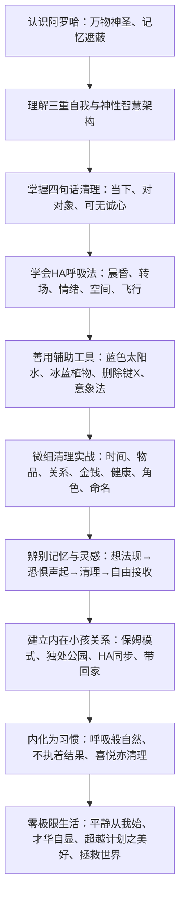

## 概述

《四句话变幸福》（Zero Limits / The Book of Ho'oponopono）与《阿啰哈》记录了伊贺列阿卡拉·修·蓝博士（Dr. Ihaleakala Hew Len）传授的夏威夷古老疗法**荷欧波诺波诺回归自性法**（Self I-Dentity through Ho'oponopono®, SITH®）现代应用体系。本书以“阿啰哈”精神为入口，阐述**三重自我**（尤哈内/尤尼希皮里/奥玛库阿）与**神性智慧**的关系，确立“清理记忆、归零当下”的核心范式，并提供**四句话清理**、**HA呼吸法**、**蓝色太阳水**、**冰蓝**、**删除键X**、时间/物品/关系清理等可落地工具，辅以大量实修案例（夏威夷州立医院精神科病房、个人疗愈见证）与博士语录。

> **核心定位**：不探究起因、直接清理；不需诚心、只需重复；问题即机会、清理即自由；100%承担责任、归零得灵感。

---

## 一、阿罗哈精神：清理的入口与连接

### “阿罗哈”的原意
> **“现在的我正在神性智慧的面前。”**  
> 万物皆由神圣存在创造，背后皆有无限伟大的存在。若无法感受神圣，皆因内在记忆重播遮蔽。

### 实操要诀
- **触发时机**：对他人有反应、看见不想看的东西、无法喜欢自己时 → 说“阿罗哈”
- **作用机制**：无论是否诚心，说出瞬间即启动清理，消除记忆隔阂，恢复完美关系
- **态度**：不强迫认同“丑即是美”，只清理内在隔阂，真相自显

> **交叉引用**：[[零极限与荷欧波诺波诺体系]] 中“平静由我开始”责任归属原则与此同源。

---

## 二、荷欧波诺波诺核心架构

### 从传统到现代 (SITH®)
| 维度 | 传统荷欧波诺波诺 | 现代荷欧波诺波诺回归自性法 (SITH®) |
|------|------------------|-------------------------------|
| 操作者 | 卡胡那（特定治疗师）主导群体对谈 | 任何人、任何地点、独自进行 |
| 核心义 | “Ho’o”（目标/道路）+ “Ponopono”（完美） → 将错误导正至完美 | 同义，强调个人100%责任 |
| 适用范围 | 争执、疾病等社区问题 | 人际、金钱、健康、工作、恋爱、情绪等全生命议题 |

### 问题根源：记忆重播
- **记忆定义**：非仅个人感官记忆，含宇宙诞生以来所有存在（动植物、无机物、祖先）的体验累积。
- **运作模式**：潜意识（尤尼希皮里）每秒重播 **1100万位元** 记忆 → 反射为情绪、事件、问题、疾病。意识（尤哈内）每秒仅掌握 **15位元**。
- **真实状态**：零、自由、空无、纯真、与神性智慧随时连接（相当于佛教“空”/“无我境界”）。
- **解决之道**：清理记忆，恢复连接。

### 构成“我”的三重自我与神性智慧
> **结构流向**：神性智慧 → 奥玛库阿（超意识/父亲） → 尤哈内（意识/母亲） → 尤尼希皮里（潜意识/内在小孩/孩子） → 显化现实

| 自我 | 夏威夷语 | 角色定位 | 对应原型 | 关键数据 |
|------|----------|----------|----------|----------|
| **超意识** | Aumakua (奥玛库阿) | 连接神性智慧、灵性桥梁、传递灵感 | 父亲 | 接收神性智慧的Mana能量 |
| **意识** | Uhane (尤哈内) | 感官、大脑运作、思考决策、选择清理 | 母亲 | 每秒15位元；接纳内在小孩 |
| **潜意识/内在小孩** | Unihipili (尤尼希皮里) | 累积记忆、驱动情感身体重播、储存体验 | 孩子 | 每秒1100万位元；需被爱、被照顾 |
| **神性智慧** | Divinity | 生命源头、零的空间、无限爱 | — | 赐予灵感、转化记忆 |

> **三重自我平衡** = 与神性智慧连接 = 零极限状态  
> **交叉引用**：[[尤尼希皮里与内在小孩]] 详述内在小孩作为潜意识核心角色的定位、三位一体架构与对话实操。

---

## 三、清理核心技法工具箱

### 四句话清理法（基础万能工具）
> **谢 谢 你 / 对 不 起 / 请 原 谅 / 我 爱 你**

- **操作原则**：
  - 无需发自内心，如按删除键般机械式重复即可（“机械式地对尤尼希皮里说”）。
  - 可仅用“我爱你”单句（涵盖前三句）。
  - **关键点**：在感受到问题/情绪的**当下**，对相关人/事/物/计划/记忆本身重复。
  - 流程：意识（尤哈内）启动清理 → 内在小孩（尤尼希皮里）感知 → 请求超意识(奥玛库阿) → 神性智慧转化 → 记忆消除。

- **进阶认知**：
  - **期待即记忆**：“清理后会怎样”的期待本身是记忆，会阻碍清理 → 察觉期待即清理。
  - **不执着结果**：高阶实践者“为了清理而清理”，习惯成自然而不拘泥成果。
  - **喜悦也要清理**：愿望实现的幸福感亦属记忆，清理后留下真爱。
  - **日常化**：如呼吸般自然，不论好坏体验皆清理（“人生就是每天不断清理”）。
  - **顺序**：第一清理自己，第二清理家人，第三清理他人/世界。

### HA呼吸法（身心同步、调整心灵环境的进阶工具）
> **“任何时候都能进行的清理法”** —— 作者最爱工具，特别有效于羞愧、憎恨、紧张、自卑、自我表现欲等记忆。“HA”在夏威夷语中意为“神圣的灵感/气息”。

#### 基本姿势与手势 (Mudra)
1.  坐在椅子上，脊背挺直，双脚踩地。
2.  双手放在大腿上，**各用大拇指、食指与中指围成一个圈**，双手的圈套在一起（其余手指放松）。

#### 呼吸流程（①-④为一组，重复7次）
1.  **吸气 (7秒)**：想象神圣的气息，心中慢慢从一数到七，用鼻子吸气。
2.  **闭气 (7秒)**：闭气七秒。
3.  **呼气 (7秒)**：慢慢用鼻子吐气七秒，想象自己吐出不好的记忆。
4.  **闭气 (7秒)**：之后再闭气七秒。

#### 实操场景与效验
| 场景 | 效果/博士亲传 |
|------|----------------|
| 晨起/就寝前 | 释放梦境记忆，导正轴心，心情平静。 |
| 赴陌生地点/初次见面/开会前 | 纯净仪式，减少被牵鼻子、说错话、紧张。 |
| 离开办公室/吵架后的房间 | 清理空间残留情绪记忆。 |
| 搭飞机前中后 | **博士亲传**：身体疼痛=飞机/土地疼痛，HA呼吸化解时差身痛。 |
| 突发心痛事件/见类似景象 | 掌握能做之事，整理环境，储备活力。 |
| 怒火上涌/强求竞争心起 | 转化为呼吸，非压抑，事后常发现不再执着或自得其所。 |

> **适用提示**：有呼吸障碍或数数易乱者，心中想象“HA呼吸”同效；可依个人节奏韵律调整；通勤/工作场合可意念进行。

### 蓝色太阳水（环境与身心辅助清理工具）
> **又名“奇迹之水”“生命之水”**。

#### 制作方式
1.  准备蓝色玻璃瓶（葡萄酒空瓶或透明瓶包蓝色玻璃纸）。
2.  装入自来水/矿泉水，**不可用金属盖**（用塑料、软木、保鲜膜+橡皮筋）。
3.  阳光下暴晒 **30-60分钟**；阴雨天用白炽灯（钨丝灯）照射，日光灯无效。
4.  制作完成后倒入他容器效果不变。

#### 用法
- **饮用**：普通水/饮品滴入几滴，一天理想量2公升，冷热不影响，生水建议尽早饮尽。
- **外用**：做菜、洗澡水、洗头/脸、洗衣服。
- **环境净化**：工作桌放置3/4杯，自动清理提升专注力、清理电脑电磁波记忆。
- **急救**：难以控制内心时，加入1-2滴鲜柠檬汁饮用。
- **意念替代**：外出无水时，想象饮用同效。

### 冰蓝 - 触碰植物清理疼痛记忆
> **“冰蓝”是指冰河的颜色，想象此色并触碰植物，对着问题在心中唸出。**

- **核心功能**：清理疾病/受伤等肉体疼痛记忆、灵性/物理/经济/物质层面的内心疼痛、受虐待记忆。
- **植物对应表**（触碰/压花随身携带均有效）：

| 植物 | 对应清理领域 |
|------|--------------|
| **银杏叶** | 肝脏问题、消除毒素记忆 |
| **枫叶** | 心脏与呼吸系统 |
| **柿子叶** | 生殖功能、生理痛、妇科问题（子宫内膜异位症等） |
| **香水百合** | 对死亡的恐惧记忆 |
| **酒瓶椰子** | 经济与金钱问题 |

> **案例**：作者初见博士，博士拉手摸银杏树说“冰蓝”，作者伤痛记忆瞬间平静，首次接触内在小孩。

### 删除键 “X” - 清理上瘾/虐待/关系破裂深层记忆
> **功能**：消除上瘾、虐待、关系破裂记忆，回溯心理阴影产生的时间轴，重新调整至正常位置，助保持冷静、专注清理。

- **用法**：
  - 问题发生时，心中想象“X”，或对潜意识记忆说“X”。
  - 对名片、贺卡、圣诞卡用手指画“X”，促进关系/清理担忧对方健康的记忆。

### 想象回家 / 马桶冲水法（即时情绪稳定可视化）
- **回家法**：身在外地/学校/职场产生负面情绪 → 想象回家放松画面（玄关鲜花、车库汽车、窗灯、开门味道、宠物嬉戏）。
- **马桶冲水法**：期待破灭烦躁时 → 想象用脚踩冲水阀马桶（非按钮式），将烦乱记忆卷入水流全数带走，反复踩踏。

---

## 四、实操领域深度：时间、物品、关系、金钱、健康、角色

### 时间清理
> **“时间有自性，若不好好珍惜，时间就会溜走。”**

- **核心洞见**：
  - 迟到 → 向时间与内在小孩道歉，非向人。
  - 时间感“过快/过慢” → 清理该体验。
  - 敷衍时间 → 宇宙不再给时间；被时间嫌弃 → 处处无着落。
- **日常微清单**：
  - 早起清理当天行程、搭乘电车、看时钟所见。
  - 用餐听隔壁吵架、爱店公休 → 清理小事释放被阻事物。
  - 提早完成开心时 → 说“我爱你”。
- **本质**：今生应清理记忆 = 你与时间共同拥有 = 因时间存在才能表现“自我”。

### 物品清理
> **“万物有自性（灵魂），喜爱/厌恶皆为记忆，执着腐蚀本然之爱。”**

- **iPhone案例**：方便→依赖→沉迷→厌倦→疲惫 → 清理“喜爱/厌恶/方便/免费/付费”标签 → 物品重拾才能、自身获自由。
- **免费物品**：面纸、免费软件 → 清理“免费=低价值”判断 → 接收物品原本才能与讯息。
- **博士示范**：叉子落地 → 捡起亲吻 → “珍贵的清理机会” → 万物喜闻“我爱你”（无理由之爱）。
- **关键转折**：
  - “我爱你，因为……” → 痛苦、条件式。
  - “我爱你”（无理由） → 归零、认可存在、才华流动、超越计划的美好发生。

### 关系清理（伴侣/亲子/他人）
> **“究竟要怎样的伴侣你才满意？内在小孩在传达讯息。”**

- **投射即内在**：对他人不满/不完整感 = 内在小孩呼唤被看见。
- **理想伴侣清单**（不说谎、随时在、温柔、不怒、守信、称赞…） → 全是内在小孩渴望被对待的方式。
- **实操范式**：
  1.  察觉对外期待/不满 → 2. 转向内在小孩：“对不起，忽略你了，请原谅” → 3. 与内在小孩共处（公园、看电影前后、独处） → 4. 清理浮现情感。
- **独处重构**：“一个人”非孤单，乃三重自我联手之至高状态 → 吸引真正共鸣者。
- **社交前后**：见面前与内在小孩站在一起 → 分离时清理悲伤 → 自然遇美好邂逅/化解棘手问题。
- **伴侣出轨/冲突**：即使觉对方错，清理“是我内在什么记忆让伴侣出轨/冲突”，否则换人同演。

### 金钱清理
> **“消除记忆、顺从自然流动，就更懂得包容金钱。”**

- **机制**：负债/破产 = 心累积对金钱记忆（源于“没钱很麻烦”）。
- **悖论**：越拚命追求钱，钱离越远（记忆重播让尤尼希皮里痛苦，阻挡灵感）。
- **清理对象**：赚钱快乐、奖金兴奋、被偷/借不回痛苦，**好坏记忆皆清**。
- **结果**：金钱反映内在；清理记忆非消除金钱，乃确保空间接收灵感 → 用钱大方→人缘好→互助→流动顺畅。

### 健康/疾病/身体清理
> **“疾病不过是记忆罢了，当心裡不舒畅，就会以疾病之姿显现在身体上。”**

- **食物无善恶**：“究竟是吃着对身体不好的食物，还是吃着你认定对身体不好的食物？”博士吃汉堡、抽雪茄不生病，因清理“食物不健康”记忆。用餐前说“谢谢你”给食物与制作者。
- **命名影响**：名字承载命名者记忆/期待 → 取名前清理归零、询问对方（含宠物/公司）想要的名字。
- **遗传/家族记忆**：生病非命运，乃祖先传承“疾病”记忆；清理可断代际传递。
- **案例**：福嶋洋子清理子宫内膜异位症（柿子叶+蓝水+四句话）→ 肿瘤消失、病名除名；日野智子清理父母病危/父债务/精神病 → 母康复、父平静、债务超付获退款。

### 角色与工作清理
> **“每个人都有专属角色，既无法找人代演，也无法抗拒被赋予的角色。”**

- **误区**：瞧不起某工作/羡慕他人 → 管太多、被记忆阻碍。
- **真相**：拚尽全力投入，任何工作都是神圣工作。
- **实操**：对现在的工作说“谢谢你，我爱你” → 清理雾念 → 适合则灵感安排转机，不适合则自然离职且神清气爽。

---

## 五、灵感与记忆的辨别：行动的真相

### 记忆的伪装与干扰
| 阶段 | 现象 | 本质 | 应对 |
|------|------|------|------|
| **灵光一现** | 想法以“生命状态”存在 | 灵感/责任 | 清理想法与自己，整理呈现应有样貌 |
| **随即涌现的声音** | “做不到/没能力/会被说/丢脸/让人失望” | **全是记忆重播** | 察觉即清理 |
| **未完成的梦想/计划** | 如肮脏垃圾桶压心头，期待膨胀成锁链 | 记忆/执着 | 即使实现也只形成新记忆 → 清理期待/焦躁 |

### 博士指引的清理路径
1.  **对想法说四句话** → 如照顾新生婴儿。
2.  **察觉判断即清理** → 无判断则无需清理。
3.  **释放期待/焦躁**（皆为记忆） → 梦想实现亦清理。
4.  **对想法说**：“你自由了，有事再告诉我” → 安心顺从灵感。
5.  **东西/内在小孩在“只重结果金钱”下强硬产出 = 虐待** → 归家（神性智慧准备的家）知一切。

### 灵感显化的标准
> **“并非只有表现于外才是自我表现。表现前必须先面对内在小孩，清理、清理、再三清理。灵感产生变化，以自由状态接收灵感，身边一切助你以最完美形态连接对象。此真正表现，才是灵感。”**

- **清理延长线上** → 慢慢找回真正存在与光芒。
- **无需他人评价/比较** → 环境中一人即可，伙伴是内在小孩。

---

## 六、经典案例：夏威夷州立医院精神科病房

> **背景**：博士以心理学家身分受雇治疗犯下强暴、吸毒、杀人等重罪的罪犯。病房肃杀、患者对员工施暴常态化、离职率极高、患者戴手铐脚镣。

### 博士所做之事
- **完全未进行传统諮商/疗法**。
- **仅在心里持续清理**：“谢谢、对不起、请原谅、我爱你”。
- **对象**：自己的记忆（对患者的偏见、执拗、绝望感…）。
- **过程**：内在记忆与患者记忆共享 → 身体感受疼痛 → 视为转化开端 → 更专注清理 → 旁人质疑“他都不为患者諮商，在做什么？” → 坚信持续清理能解决。

### 结果（数月后）
- 患者与员工表情有生气、大楼恢复舒适氛围。
- **患者不再需要手铐脚镣、暴力行为平息**。
- 重新开始生活活动，为回归社会准备。
- 全病房呈现前所未有的协调状态。

> **核心启示**：“记忆是一切现象的根源。正是我们的记忆造就了眼前的局面。我每天反复对记忆说‘我真的很爱你’，持续传递爱的讯息。”

---

## 七、修·蓝博士经典语录集锦

### 核心原则类
| 主题 | 语录 |
|------|------|
| **唯一任务** | “你只有一项任务，就是找回‘真正的自己’。” |
| **清理优先** | “与其思考，不如清理。与其信奉，不如清理。归零，或不归零，仅此而已。” |
| **平静源头** | “Peace begins with me——平静从我开始。” |
| **记忆本质** | “记忆并非坏事/恶，常支撑我们；不处理则迷失自己，悲剧始于此。” |
| **零分即爱** | “Love（网球零分）=无分数/奖金/得失/无的状态。爱带我们回舍弃一切之零，经由清理愤怒/恐惧/自责归零，达成整体性。” |
| **内在战争** | “库凯帕=头脑便秘。便秘出疹。‘真的不懂、不知道’的立场在清理时极重要。” |
| **才能显化** | “任何存在具备完美才能。清理归零，相关存在取回才华、平衡，发生超越大脑计划之事。” |

### 实修指引类
| 场景 | 语录 |
|------|------|
| **恐惧/爱二选一** | “恐惧和爱只能选一个，现在你选哪一个？”“记忆或爱，每个当下瞬间只能活在一个中。” |
| **不诚实于内在小孩** | “不论多小的约定/想法，内在小孩都听见。违背初衷说‘再一下’ = 黑色大石压身。” |
| **过度忘我** | “快乐时也要让内在小孩坐大腿上。太过忘我听不见其声 = 失去完整‘一个人’=真正的自己。” |
| **批判土地/新闻** | “清理成见。记忆重播的判断阻挡对方展现真才华。你是为获得清理机会来到这土地。” |
| **善待自己** | “善待自己、爱自己 = 对神性智慧的感谢。首先照顾内在小孩，尽情活在当下瞬间。” |
| **梦境清理** | “试着清理梦中景象。梦中有意见也清理。工作到此为止，这是清理关键，必为你开启真正自己的门。” |

### 自我清理话语（博士亲用/传授格式：常以“Love said.”开头）

#### 确认真我系列
```
Love said: I am the “I”.
爱说：我就是我。
Love said: I am the eternal light beam.
爱说：我就是永远持续发光的物体。
Love said: I am freedom.
爱说：我就是自由。
Love said: I am home.
爱说：我就是家。
```

#### 记忆比喻与状态检视
- “未清理状态 = 未更新越跑越慢的电脑 / 见人掉东西不知所措如无法融入工作 / 塞满头发的浴室排水孔”
- “现在的你，是什么状态？”

#### 内在小孩关系建立
```
今天和内在小孩过一天，做他的保姆。
开心/悲伤/生气都在一起。
偶尔独自去公园，体验真正的“一个人”（三自我俱全）。
对映入眼帘/耳内声/思绪/寒热说体验。
从清理开始对话，配合呼吸，HA呼吸法是最棒沟通方式。
不论爱或恐惧，都要和内在小孩在一起。
回家路/隔天晨/两三天后持续。
牵着他的手，带回真正的家。
当你和内在小孩在一起，光线才终于照在你身上。
比任何关系都重要的，是你和内在小孩的关系。
```

#### 生命屋子建造
```
现在在内心盖屋子：安定、安心、平静三元素组成。
着眼生命，不在内在小孩展现的故事里迷路。
随时记着：每一件体验都是找回真正自己的提示。
```

#### 珊瑚与体验的记忆量
- “一小片珊瑚残骸含数百万生物与死亡记忆。你的一个体验播放着数不尽记忆。即使视为秘密，内在小孩也老老实实重播直到你割舍。”

#### 拯救自我即拯救世界
- “拯救自己 = 拯救母亲/孩子/公司/地球。你我皆是人类代表。”

---

## 八、关键概念辨析表

| 概念对 | 记忆侧 (重播/问题) | 灵感/零极限侧 (自由/解) |
|--------|--------|----------------|
| **来源** | 过去累积重播 (宇宙诞生至今) | 神性智慧/当下直觉 |
| **数据量** | 1100万位元/秒 (潜意识) | 无限/零 |
| **感受** | 重、焦虑、执着、期待、恐惧、评判、便秘感 | 轻、安心、清晰、自由、知晓下一步、流动 |
| **关系模式** | “我爱你因为…” 条件式、痛苦、占有 | “我爱你” 无理由、归零、才华流动 |
| **时间感** | 过快/过慢/不够用/被嫌弃/恐惧死亡 | 丰富、创造性、引导至正确处/零=无时间世界 |
| **物品观** | 标签化（免费/贵/方便/累/脏） | 尊重自性、接收才能讯息、物品闪亮 |
| **独处感** | 孤单、寂寞、难为情 | 三自我联手、至高状态、吸引共鸣 |
| **表现动力** | 结果/金钱/他人评价/比较/虐待内在小孩 | 清理延长线、内在小孩满足、灵感驱动 |
| **问题态度** | 解决/逃避/改造外在/怪罪他人/钻牛角尖 | 机会/清理入口/归零通道/100%责任 |
| **金钱观** | 執著/匮乏/恐惧/欺诈/蒙受损失 | 流动/包容/反映内在/灵感引导/足够空间 |
| **健康观** | 食物有毒/疾病是命/基因决定/恐惧死亡 | 食物无罪/疾病是记忆/清理可逆/死亡=换装回归光 |

---

## 九、实修路线图（从入门到内化）



---

## 十、交叉引用索引

| 主题 | 关联页面 | 说明 |
|------|----------|------|
| **体系总览/第五真言** | [[零极限与荷欧波诺波诺体系]] | 乔·维泰利与修·蓝博士完整体系、第五真言“我原谅自己”、金鼓/蓝网工具、切断阿卡连 |
| **内在小孩深度** | [[尤尼希皮里与内在小孩]] | 三位一体架构、100%责任、对话范例、聆听道歉实操、身心关系影响 |
| **第五真言详解** | [[第五真言我原谅自己]] | “我原谅自己”语法反常含义、取代四句话、情绪疗愈与丰盛应用 |
| **清理框架/向往** | [[框架与向往的清理]] | “框架/向往”作为核心清理对象、乐趣判断、微调、平静由我开始 |
| **信念工作/赛斯** | [[信念创造实相实修]] | 王怡仁医师四步法：静心/觉察/感受/赞美，赛斯教导本地化 |
| **显化双轨实践** | [[显化实践与专注力训练]] | 《创造金钱》显化体系 + 《写下来奇迹》百日书写法结合 |
| **神经科学视角** | [[显化的大脑网络与神经系统]] | DMN/SN/CEN/注意网络、迷走神经、快乐激素、心脏电磁场 |
| **心灵魔法/多提** | [[心灵魔法显化的神经科学]] | 詹姆斯·多提六步骤、价值标记、重夺注意力、神经可塑性 |

---

## 十一、附录：书中经典案例速览

| 案例 | 触发点/背景 | 核心清理对象/工具 | 转化结果 |
|------|------------|------------------|----------|
| **银杏树初体验** | 博士拉手摸树说“冰蓝” | 伤痛记忆、冰蓝/植物 | 心情瞬间平静沉稳，首次接触内在小孩 |
| **早餐咖啡时刻** | 博士问“恐惧还是爱” | 晨起累积攻击/孤单记忆 | 咖啡香蔓延、博士面孔清晰、行程自明 |
| **冲绳海边外婆** | 见破烂老妇联想外婆 | 对外婆丢脸/金钱恐惧记忆 | 身姿挺直、老妇微笑、外婆成护身符、家族安详 |
| **台湾餐厅转变** | 清理“服务差/赌博/不如日本”成见 | 对土地/人/店的批判记忆 | 同店同员服务超三星级、遇可爱警察、植物暖意 |
| **叔叔前妻钟乳洞** | 旅行突想起前妻 | 开心/难过交织情绪 | 心情神清气爽、半年后叔叔生活大变、全家喝茶和解 |
| **博士用餐仪式** | 坐前看椅/餐前观餐具/谢服务生/迟到清理 | 对空间/物/人/焦虑记忆 | 餐点即到、事物获认可闪亮、行程按部就班、存在感安心 |
| **iPhone清理** | 博士问“谢过iPhone吗” | 依赖/免费/付费标签、厌倦感 | 物品重拾才能、自身获自由、清理持续进行中 |
| **夏威夷州立医院** | 暴力罪犯病房、手铐脚镣、高离职 | 博士仅清理自己记忆 | 暴力平息、解除束缚、恢复活动、病房协调 |
| **福嶋洋子** | 子宫内膜异位症、肿瘤、贫血 | 柿子叶+蓝水+四句话+尤尼希皮里对话 | 肿瘤消失、病名除名、生理期不痛、大小儿子就业/康复 |
| **日野智子** | 母病危昏迷、父精神病/暴力/千万债务 | 持续清理、律师协助、信任流程 | 母康复行走、父平静走路、债务超付退款300万、家团聚 |
| **安部知子** | 身体崩溃站不稳、资金断裂、事业停摆 | 报名即清理、四句话、灵感指引贷款/叔叔让房 | 身体瞬间恢复、叔叔赠房车位、事业两周规划成型、捨弃大量书籍只用荷欧波诺波诺 |
| **石川功惠** | 幼子意外离世、茫然若失、想殉情 | 博士拥抱安慰、尤尼希皮里对话/天花板显现 | 悲伤30分钟消失、见儿子在天堂快乐、遇见最重要的人(自己)、再次怀孕 |

---

> **结语**：荷欧波诺波诺非信仰、非技巧、非正向思考，乃**“不探究起因、直接清理”**的范式转移。每个当下，记忆或爱二选一；清理即自由，平静从我开始。愿每位读者在《四句话变幸福》与《阿啰哈》的引领下，找回真正的自己，活出零极限的光芒。

**Aloha。** 🌺

## 来源

- [四句话变幸福](../sources/四句话变幸福.md)
