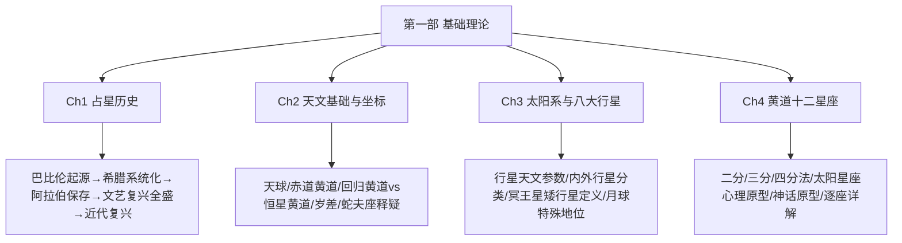

## 书籍概况

- **书名**：《占星全书——畅销增订版》
- **作者**：鲁道夫（Rodolphe）
- **版本**：增订版（2016 年 3 月于伦敦作序），初版距增订版相隔 12 年（一个木星周期）
- **定位**：兼顾初学者入门与进阶者参考的系统性占星教材；融合传统占星技法、心理占星视角与现代天文知识
- **教学理念核心隐喻**：引用荣格「树根须深达地狱，树冠方能触及天堂」，以**木星 12 年回归周期**象征人生螺旋式成长——非线性直上，而是曲折、停滞、回溯中不断深化根系与拓展视野。

## 编写特色：传统与创新的双轨并行

| 维度 | 传统承继 | 创新拓展 |
|------|----------|----------|
| **历史脉络** | 完整梳理巴比伦、埃及、希腊、阿拉伯、中世纪、文艺复兴至近现代占星发展史 | 引入现代天文发现（如冥王星重新定义、岁差修正、蛇夫座争议）校准传统认知 |
| **技法体系** | 保留整宫制/分宫制、相位、推运、合盘等经典技法框架 | 融合心理占星原型理论（太阳=英雄原型、金星多重指向）、统计实证（高葛林实验）、汉堡学派中点理论 |
| **教学路径** | 由历史→天文基础→行星→星座→宫位→相位→综合判读的阶梯式结构 | 强调「符号多重指向性」与「进入星盘让星盘说话」的实务导向，配合 Academy of Astrology 教学体系落地 |
| **哲学底色** | 托勒密《四书》、柏拉图《蒂迈欧》四元素、赫尔墨斯「天上如是，人間亦然」 | 荣格同步性、原型理论、个体化历程；将占星定位为「心理成长地图」而非宿命预测 |

> **作者自述**：增订版修订动力源于 12 年咨询实践中对「占星符号多重指向」的深刻体认——金星不止代表女性/爱情，更延伸至友谊、社交、金钱等生活面向；星盘解读应服务于当下的成长议题，而非单纯吉凶判断。

## 结构体系：四大核心板块（第一部·基础理论）

本书第一部「占星学的基础理论」由四章构成，奠定全书知识骨架：

---

## 章节内容摘要

### 第一章 占星学的历史 —— 从神谕到心理成长的演进

#### 起源·巴比伦与巨石阵
- **巨石阵考古佐证**：位于英格兰索尔兹伯里，建立于公元前三千年。外圈 56 个奥布瑞洞对应月食 56 年周期，脚跟石标夏至日出。金斯与霍伊尔认为石柱排列符合 19 年朔望月周期（梅顿周期）。
- **巴比伦楔形文字泥板**：公元前 1850 年亨利·莱亚德在尼尼微发现《金星书卷》（约前 2300–1700 年），记录金星位置与君主健康，是巴比伦占星最有力证据。
- **核心贡献**：黄道十二等分雏形、迦勒底秩序（七星速度排序：月→水→金→日→火→木→土）、祭司解读天意服务君王。

#### 分支·埃及
- **天狼星与尼罗河**：埃及观测天狼星（Sirius）偕日升预测洪水，金字塔国王室通道指向猎户座腰带 ζ 星（Alnilam），映射法老灵魂升天（奥西里斯神话）。
- **星座符号演变**：迦勒底占星传入埃及，部分符号变更（如双子座从男女握手变为符号、天蝎座变形），水瓶座以水号符号取代挑水瓶。

#### 希腊化·个人化转向
- **哲学奠基**：柏拉图《蒂迈欧》确立天球论、四元素说、小宇宙观（天上如是，人间亦然）；毕达哥拉斯引入数字占卜；希波克拉底四液说将四元素映射体液，开启医学占星。
- **关键技术突破**：希帕恰斯发现岁差（春分点西移）；托勒密（Claudius Ptolemy AD 120–180）定春分点为白羊 0°，**回归黄道体系**确立，著作《天文学大成》《占星四书》成正统。

#### 阿拉伯·保存与创新
- **典籍保存**：巴格达建立图书馆，翻译希腊文献为阿拉伯文。阿尔金迪引入亚里士多德/柏拉图世界观。
- **技法创新**：阿布马谢整理「阿拉伯点」（虽源于巴比伦/托勒密，经其系统化广泛应用），融合希波克拉底神秘哲学、炼金术与占星，强化神秘主义色彩。

#### 中世纪·三大分支确立
- **学科地位**：1225 年波隆那大学列占星为正式学科。
- **三分支**：决疑占星（出生图）、时辰占卜、世俗占星并行。代表人物：米迦勒·斯科特（神圣罗马帝国腓特烈二世御用）、吉多·博纳蒂（《天文之书》）、阿尔伯特·马格努斯、阿奎那（试图调和占星与神学）。

#### 文艺复兴·全盛期
- **宫廷占星师**：约翰·迪（伊丽莎白一世御用）、诺斯特拉达姆斯（法兰西皇室）。
- **分宫制创新**：瑞吉蒙塔努斯创新分宫法→普拉西德（Placidus de Tito）设计普拉西德分宫制（现主流）。
- **科学化尝试**：第谷·布拉赫精密观测数据→开普勒继承并证实日心说，试图科学化占星，提出特殊相位理论，启发后世汉堡学派中点理论。

#### 近代·没落与重生
- **科学革命冲击**：理性主义、牛顿万有引力、伽利略望远镜→天文学独立，占星没落。
- **19 世纪神智学复兴**：艾伦·里奥（Alan Leo）创办占星杂志、撰写 30 本教材，称「现代占星之父」；查尔斯·卡特、玛格丽特·霍恩建立英国占星学院。
- **20 世纪转型三大潮流**：
  1. **心理占星**：荣格引入同步性、原型理论；心理占星师大量使用心理学词汇。
  2. **统计实证**：高葛林（Michel Gauquelin）1970 年代统计验证行星在上升/天顶角度对职业影响（火星→运动员、月亮→政治家）。
  3. **汉堡学派/创新体系**：维特/艾伯廷中点理论、阿迪泛音/九分盘、巴克利系统化时辰占卜教学。

> **跨页引用**：历史脉络与 [[zhanxing-yu-zhen-wo]] 中「古典占星技术（整宫制、行星状态、本命主星）」、[[nei-xing-xing]]「心理占星核心基石」形成呼应。

---

### 第二章 占星学的基础知识 —— 天球坐标与黄道系统

#### 核心坐标体系
| 概念 | 定义 | 占星应用 |
|------|------|----------|
| **天球** | 地心视角的投影球面，恒星附着其上 | 星盘绘制的几何基础 |
| **天球赤道** | 地球赤道向天球投影，分南北半球，赤纬 0° | 赤经起点参考 |
| **黄道面** | 地球公转轨道平面，太阳视运动路径 | 黄道十二宫分布基平面 |
| **黄赤交角** | 23°26′（地轴倾斜） | 季节更替、四分点/二至点形成 |
| **春分点** | 黄道与赤道春季交点，黄经 0° | 回归黄道白羊座起点 |

#### 黄道系统的关键分歧
- **回归黄道** ：以春分点为 0°，十二等分 30°，西方主流占星采用  
- **恒星黄道** ：以固定恒星（白羊座 α 星）为 0°，印度占星采用，随岁差缓慢漂移  
- **天文黄道** ：依实际星座边界划分，含蛇夫座，十三宫不等分  

> **书中对照表**（第 30 页）详列三系统日期差异，例如 4 月 21 日：回归黄道=金牛、恒星黄道=白羊、天文黄道=白羊（末段）。  
> **作者立场**：坚持回归黄道教学，同时说明三系统差异由来，避免「交界日双重人格」等伪概念。

#### 蛇夫座释疑
- 蛇夫座自托勒密时代即存在，非现代天文新发现  
- 占星保留十二等分体系是教学与符号系统的实用选择，非无视天文事实  
- 英文区分 *Sign*（占星宫位）与 *Constellation*（天文星座），中文易混淆

> **关联页面**：[[huangdao-shier-gong-tixi]] 黄道十二宫与身体部位对应；[[zheng-gong-zhi-yu-shier-gong-wei]] 整宫制原理与实务。

#### 太阳经过黄道星座对照表

| 星座 | 回归黄道 | 恒星黄道 | 天文黄道（太阳实际经过日期） |
|------|----------|----------|------------------------------|
| 白羊座 | 3月21日–4月19日 | 4月14日–5月14日 | 4月19日–5月13日 |
| 金牛座 | 4月20日–5月20日 | 5月15日–6月14日 | 5月14日–6月19日 |
| 双子座 | 5月21日–6月20日 | 6月15日–7月16日 | 6月20日–7月20日 |
| 巨蟹座 | 6月21日–7月22日 | 7月18日–8月16日 | 7月21日–8月9日 |
| 狮子座 | 7月23日–8月22日 | 8月17日–9月16日 | 8月10日–9月15日 |
| 处女座 | 8月23日–9月22日 | 9月17日–10月17日 | 9月16日–10月30日 |
| 天秤座 | 9月23日–10月22日 | 10月18日–11月16日 | 10月31日–11月22日 |
| 天蝎座 | 10月23日–11月21日 | 11月17日–12月15日 | 11月23日–11月29日 |
| 射手座 | 11月22日–12月21日 | 12月16日–1月14日 | 11月30日–12月17日 / 12月18日–1月18日 |
| 摩羯座 | 12月22日–1月19日 | 1月15日–2月12日 | 1月19日–2月15日 |
| 水瓶座 | 1月20日–2月18日 | 2月13日–3月14日 | 2月16日–3月11日 |
| 双鱼座 | 2月19日–3月20日 | 3月15日–4月13日 | 3月12日–4月18日 |

---

### 第三章 太阳系与八大行星 —— 天文实测与占星意涵双轨呈现

#### 太阳系形成简史
- **银河系定位**：太阳位于猎户旋臂内侧，距银心约 2.6 万光年。
- **形成机制**：约 46 亿年前超新星激波触发星际云坍缩 → 原始太阳 + 原始行星盘。
- **行星分化**：
  - **内行星/类地行星**（水金地火）：岩石/金属聚积，高密度
  - **外行星/类木行星**（木土天海）：冰/气体吸积，低密度、大质量、环系统卫星系统丰富

#### 行星档案卡（节选关键参数与占星对应）

| 行星 | 天文关键参数 | 占星核心意涵（书中定位） | 关联页面 |
|------|--------------|--------------------------|----------|
| **太阳** | 唯一恒星，98% 质量，光球 6000K，核心 1500 万 K | 生命力、自我实现、英雄原型、父权意识 | [[nei-xing-xing]]、[[shengshang-xingzuo]] |
| **水星** | 0.38 AU，88 天公转，3:2 自转公转共振，极大温差（700K–90K） | 思维、沟通、感知阈限、炼金术墨丘利 | [[shui-xing-shen-hua-yu-xin-li-fenxi]] |
| **金星** | 0.72 AU，公转近圆，逆向自转 243 天，极强温室效应（740K，90 大气压） | 价值观、审美、关系模式、金钱/社交多重指向 | [[jin-xing-xing-zuo-lian-ai-feng-ge-yu-mi-ji]]、[[jin-xing-xing-zuo-ai-qing-mo-shi]] |
| **地球** | 1 AU，液态水、板块构造、磁场保护 | 具身意识载体 | — |
| **月球** | 38.4 万 km，潮汐锁定，逐年远离 38 mm | 情绪、习惯、早年母体体验、过去世模式 | [[arroyo-astrology-karma-transformation]] |
| **火星** | 1.52 AU，686 天公转，奥林帕斯山 24 km，稀薄 CO₂ 大气 | 行动力、欲望、冲突、分离冲动 | [[tian-xie-zuo-yuan-xing-neng-liang-ceng-ci]] |
| **木星** | 5.2 AU，11.86 年公转，自转 9.9 h，磁层超土星轨道，318 地球质量 | 成长、哲学、扩展、12 年周期隐喻 | 本书教学理念核心 |
| **土星** | 9.54 AU，29.5 年公转，密度最低 0.7，显著环系统，47+ 卫星 | 结构、限制、业力、时间成熟度 | [[arroyo-astrology-karma-transformation]] |
| **天王星** | 19.2 AU，84 年公转，侧卧自转（98°倾斜），蓝色甲烷大气 | 突变、觉醒、个体化解放 | [[ming-wang-xing-ling-hun-yan-hua-zhi-lv-juan-yi]] |
| **海王星** | 30 AU，165 年公转，风速 2000 km/h，大蓝斑风暴 | 幻象、灵性、溶解边界、集体无意识 | — |
| **冥王星** | 39.5 AU，248 年公转，倾斜椭圆轨道，2006 年定义为矮行星，卡戎卫星 | 深层转化、权力、灵魂演化、生死重生 | [[ming-wang-xing-ling-hun-yan-hua-zhi-lv-juan-yi]]、[[冥王星灵魂亲密关系演化]] |

> **特色**：每颗行星均给出**天文实测数据**（轨道半径、公转周期、自转、物理结构、磁场、卫星系统）与**占星神话/心理意涵**并列，体现「天文为体、占星为用」编写原则。

#### 小行星带与特殊小行星
- **位置**：火星木星间（90%）、土星天王星间、海王星带
- **主要小行星**：谷神星、智神星、婚神星、灶神星
- **凯龙星**：土星天王星间，近代占星重要，**勿与冥卫一卡戎混淆**
- **占星执掌**：书中承诺后续章节详述小行星占星意涵

---

### 第四章 黄道上的十二星座 —— 分类学体系与心理原型深度解析

#### 三大分类法矩阵

| 分类法 | 依据 | 分组 | 核心特质关键词 |
|--------|------|------|----------------|
| **二分法** | 阳/阴交替 | 阳性（白羊、双子、狮子、天秤、射手、水瓶） 阴性（金牛、巨蟹、处女、天蝎、摩羯、双鱼） | 阳=主动外向 / 阴=内向承接 |
| **三分法** | 季节位置 | **基本宫**（白羊/巨蟹/天秤/摩羯） **固定宫**（金牛/狮子/天蝎/水瓶） **变动宫**（双子/处女/射手/双鱼） | 基本=开启/固定=维持/变动=转化 |
| **四分法** | 四元素 | **火**（白羊/狮子/射手） **土**（金牛/处女/摩羯） **风**（双子/天秤/水瓶） **水**（巨蟹/天蝎/双鱼） | 火=灵感行动/土=具象建构/风=概念连接/水=情感融合 |

> **跨页引用**：分类法详解见 [[xing-zuo-san-yuan-xing-yu-si-zheng]]、[[ji-ben-gong-xing-ge-gong-lve]]、[[shi-er-xing-zuo-ji-ben-te-zhi-yu-jing-dian-pai-hang]]。

#### 太阳星座心理原型框架
- **太阳** = 意识层面的「英雄原型」，承袭父权/英雄叙事，象征「我想成为何种英雄」「用何种特质克服困难」「何种目标让我荣耀」  
- **太阳星座** = 个体渴望被世界看见、施展创意/生命力/领导力的**发展方向**  
- **太阳落宫** = 上述特质投射的**生活领域**（如三宫=学习沟通、六宫=工作服务）

#### 逐座原型速览（书中已完成白羊、金牛，其余增订版补全）

| 星座 | 神话原型 | 元素/特质 | 太阳落座核心心理主题 | 关键词（优/挑） |
|------|----------|-----------|----------------------|-----------------|
| **白羊座** | 金羊救佛力克索斯，金羊毛引发伊阿宋远征 | 火/基本/阳 | **开创者/先驱**：「我要第一个到达」—以速度与行动证明存在 | 自信开创/冲动三分钟热度 |
| **金牛座** | 宙斯化金牛掠欧罗巴，命名欧洲大陆 | 土/固定/阴 | **建构者/享受者**：「我要稳稳拥有」—透过感官实感与资源积累确立安全感 | 坚韧踏实/固执占有 |
| **双子座** | 卡斯托尔与波鲁克斯双子神话 | 风/变动/阳 | **连接者/信使**：「我要理解并传递」—以好奇心编织信息网络 | 机智多变/分散浅薄 |
| **巨蟹座** | 巨蟹夹赫拉克勒斯，赫拉升为星座 | 水/基本/阴 | **守护者/滋养者**：「我要建立情感巢穴」—以记忆与共情编织归属感 | 共情保护/情绪防御 |
| **狮子座** | 尼米亚狮被赫拉克勒斯制服 | 火/固定/阳 | **创作者/领袖**：「我要闪耀被爱」—以慷慨与戏剧性确认自我价值 | 慷慨热情/傲慢控制 |
| **处女座** | 德墨忒尔/阿斯特赖亚持麦穗 | 土/变动/阴 | **精炼者/服务者**：「我要完善秩序」—以分析与实务提升系统效率 | 严谨实用/挑剔焦虑 |
| **天秤座** | 阿斯特赖亚持天平，正义女神 | 风/基本/阳 | **调和者/美学家**：「我要平衡美好」—以审美与协商构建关系之美 | 优雅公正/优柔依赖 |
| **天蝎座** | 猎户被天蝎螫死，宙斯升为对立星座 | 水/固定/阴 | **转化者/炼金术士**：「我要穿越生死」—以深度融合与危机重生掌握力量 | 洞察深沉/嫉妒控制 |
| **射手座** | 凯隆半人马，射手指向天蝎心脏 | 火/变动/阳 | **探索者/哲学家**：「我要追寻真理」—以信仰与远见拓展生命版图 | 乐观自由/浮夸逃避 |
| **摩羯座** | 潘神逃提丰化山羊鱼尾 | 土/基本/阴 | **建筑者/权威**：「我要攀登顶峰」—以自律与时间换取社会成就 | 责任坚韧/压抑悲观 |
| **水瓶座** | 伽倪墨得斯为宙斯斟酒 | 风/固定/阳 | **革新者/群体觉醒者**：「我要打破旧制」—以理想与网络重构集体未来 | 独特人道/冷漠叛逆 |
| **双鱼座** | 阿佛洛狄忒与厄洛斯化鱼逃提丰 | 水/变动/阴 | **神秘者/共融者**：「我要溶解边界」—以想象与慈悲触摸集体无意识 | 慈悲直觉/逃避迷失 |

> **神话与心理双轨**：每座均给出希腊神话源头 → 象征意涵 → 太阳落座心理动力 → 优势与挑战清单，形成「神话—原型—心理—实务」四层解读链条。

#### 白羊座详解（书中完整呈现示例）
- **天文位置**：赤经 2h04m、赤纬 21°，α/β/γ 星为四五等星
- **占星起点**：回归黄道 0°–29°，每年 3/21 春分点起
- **太阳在白羊**：火相/基本/阳 → 自我创新、外放自信、喜欢创新、昂首阔步、短跑爆发力强、缺乏耐心（除非水星/土星/水土相月亮上升补足）
- **职业倾向**：军警消、运动员、牙医等（火星守护星影响）
- **财富观**：金钱非首要，除非二宫/一宫/上升守护星落财位

---

## 教学路径与后续系列丛书脉络

《占星全书》为**核心基石**，作者随后衍生专题深化系列：

| 书籍 | 定位 | 承接本章节 |
|------|------|------------|
| 《占星辞典》 | 符号/术语百科 | Ch2–Ch4 符号体系 |
| 《占星流年》 | 推运技法体系 | Ch3 行星周期/相位 |
| 《人际合盘占星全书》 | 关系占星/合盘 | Ch4 星座互动/Ch3 行星合盘 |
| 《心理占星学全书》 | 心理原型/个体化 | Ch4 太阳原型/Ch3 行星心理意涵 |
| 《高阶占星技巧》 | 进阶技法/实战 | 全书综合应用 |

> **作者注**：12 年（一个木星期）从「想避开问题」转向「用星盘看困境触发何种过去体验、指向哪个成长方向」，正是全系列教学从**技法习得**到**生命实践**的范式转移。

---

## 交叉引用导航

- **历史脉络延伸**：[[ba-bi-lun-xing-zhan-xue]] 巴比伦星占源流、[[xing-zhan-xue-yu-tian-wen-xue-shi]] 星占与天文学史  
- **坐标系统深化**：[[zheng-gong-zhi-yu-shier-gong-wei]] 整宫制原理、[[huangdao-shier-gong-tixi]] 黄道宫位与身体对应  
- **行星专题**：[[nei-xing-xing]] 内行星心理占星、[[shui-xing-shen-hua-yu-xin-li-fenxi]] 水星炼金隐喻、[[jin-xing-xing-zuo-ai-qing-mo-shi]] 金星爱情模式、[[tian-xie-zuo-yuan-xing-neng-liang-ceng-ci]] 天蝎/冥王星/婚神星深层动力  
- **星座原型**：[[shi-er-yuan-xing-xing-zuo]] 韩良露十二原型星座、[[xing-zuo-yuan-xing-ai-qing-mo-shi]] 原型爱情动力、[[xing-zuo-yuan-xing-shen-hua-yu-su-ming-gong-ke]] 神话宿命功课  
- **教学体系**：[[zhanxing-shuji-mulu-yu-zhuti-daohang]] 占星书籍总目录与主题导航

---

## 版本记录与编辑说明

- 本页依据《占星全书——畅销增订版》第一部（基础理论）全文归档内容结构化沉淀  
- 章节编号、表格数据、神话叙事均忠实还原书本原文，未加入外部推测  
- 后续册别（宫位、相位、相位配置、推运、合盘、小行星等）待后续归档补全时再扩展页面或新建子页面  
- 所有 [[wikilink]] 指向现有知识库页面，若目标页尚未创建将显示为待建立链接

## 来源

- [占星全书收藏版](../sources/占星全书收藏版.md)
