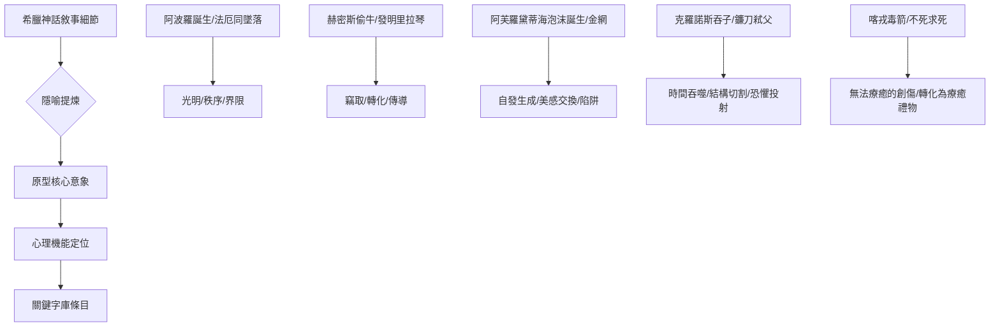

## 書目與核心定位

| 書目 | 作者 | 核心貢獻 | 本頁整合重點 |
|------|------|----------|--------------|
| **《占星全書收藏版》** | 魯道夫 | 太陽系天體天文物理參數、黃道坐標體系、行星分類、星座三分四正法 | 提供 **天文骨架**：軌道、直徑、質量、組成、衛星等硬數據，以及回歸/恆星黃道、歲差、宮位劃分等結構基礎 |
| **《占星揚升指南》** | 佚名（傳統與靈性整合派） | 希臘神話原型敘事、神話到心理原型的映射邏輯、關鍵字庫構建實作流程 | 提供 **神話血肉**：十大行星與凱龍星的神話故事細節、原型心理機能、關鍵字萃取演示 |

> **交叉引用**：本頁為 [[zhanxing-quanshu-rudolf]] 與 [[zhanxing-yangsheng-zhinan]] 的深化融合頁；另參見 [[zhanxing-shuji-mulu-yu-zhuti-daohang]] 占星書目總覽、[[zhanxing-tianwen-jichu-yu-huangdao-tixi]] 天文坐標詳解、[[nei-xing-xing]] 內行星心理占星專題。

---

## 第一部 天文骨架與神話血肉：雙軌對照表

### 恆星與衛星

| 天體 | 天文參數（魯道夫） | 希臘神話原型（揚升指南） | 核心心理機能 | 關鍵字萃取示範 |
|------|-------------------|-------------------------|--------------|----------------|
| **太陽** | 恆星、G2V、1.989×10³⁰ kg、核心 1.5×10⁷ K | **阿波羅**：光明、秩序、預言、藝術、法厄同駕車墜落的傲慢與界限 | 意識自我、生命力、意志、父權原型、英雄之旅發起者 | 生命力、男性原型、父親、創造力、心臟、意識追尋 |
| **月球** | 衛星、3,476 km、潮汐鎖定、同步自轉 | **阿忒密斯/狄米特/黑卡蒂** 三相女神：處女獵手、豐穀母神、冥界引路者 | 潛意識、情緒記憶、母體原型、本能保護、週期性節律 | 情緒、母親、習慣、大眾、安全感、胃/乳房、潛意識需求 |

### 類地行星（個人行星）

| 行星 | 天文參數 | 希臘神話原型 | 心理機能映射機制 | 關鍵字庫構建路徑 |
|------|----------|--------------|------------------|------------------|
| **水星** | 0.387 AU、4,880 km、高鐵核心、無大氣 | **赫密斯**：信使、盜賊、靈魂引路者、發明文字/度量衡、權杖雙蛇（脊椎/脈輪/DNA隱喻） | 認知處理、語言建構、學習風格、溝通媒介、身心傳導 | 思維、溝通、商業、短途旅行、學習、神經系統、雙螺旋隱喻 |
| **金星** | 0.723 AU、12,104 km、厚 CO₂ 大氣、逆向自轉 | **阿芙羅黛蒂**：海泡沫誕生、美與愛慾女神、金蘋果爭議、赫菲斯托斯金網捕姦 | 價值評估、審美愉悅、關係協調、藝術創造、資源吸引 | 愛慾、美感、價值觀、藝術、伴侶、享受、吸引力法則 |
| **火星** | 1.524 AU、6,794 km、薄大氣、兩極乾冰 | **阿瑞斯/馬爾斯**：希臘暴衝戰神 vs 羅馬城邦守護者、雅典娜以智勝力 | 生存衝動、行動力、性慾、攻擊/防禦、能量輸出方式 | 行動、慾望、衝突、運動、鋼鐵、手術、切割、征服 |
| **地球** | 1 AU、生命載體 | **蓋婭**：大地之母、萬物生成矩陣 | 化身場域、具象實相、感官體驗容器 | 身體、物質世界、感官、顯化平台 |

### 類木行星（社會與世代行星）

| 行星 | 天文參數 | 希臘神話原型 | 心理機能映射機制 | 關鍵字庫構建路徑 |
|------|----------|--------------|------------------|------------------|
| **木星** | 5.2 AU、14.3 萬 km、95+ 衛星、大紅斑 | **宙斯**：逃脫吞噬、克里特島長大、推翻父權、風流擴張、雷霆萬鈞 | 擴張信念、哲理框架、幸運/膨脹雙面、高等教育、法律秩序 | 擴展、幸運、哲學、旅行、肝臟、信念系統、膨脹陷阱 |
| **土星** | 9.54 AU、12 萬 km、環系統、密度 0.7 | **克羅諾斯**：鐮刀弒父、吞噬子女、時間之王、泰坦統治者 | 結構限制、業力時間、權威內化、邊界設定、恐懼/精熟雙軌 | 限制、業力、骨骼、膝蓋、時間、自律、品質保證、壓抑轉化 |
| **天王星** | 19.2 AU、5.1 萬 km、側臥 98°、27 衛星 | **烏拉諾斯**：天空之神、被閹割生出阿芙羅黛蒂、克羅諾斯篡位 | 突變創新、叛逆解脫、神經電擊、群體覺醒、範式轉移 | 突變、科技、叛逆、自由、神經系統、斷裂、閃電穿透 |
| **海王星** | 30 AU、4.9 萬 km、極強風、大藍斑 | **波賽頓/尼普頓**：海神、迷霧、梅杜莎、奧德修斯十年漂流 | 溶解邊界、集體無意識、幻象/靈性雙面、藝術靈感、犧牲救贖 | 幻象、靈性、溶解、藝術、足部、傳染病、迷途、合一渴望 |
| **冥王星** | 39.5 AU、2,274 km、柯伊伯帶、雙行星系統 | **哈帝斯/普路托**：冥王、綁架珀耳塞福涅、地下寶藏、死者統治 | 深度轉化、陰影整合、權力/控制、生死循環、集體業力 | 轉化、重生、權力、陰影、核能、禁忌、火山爆發隱喻 |

### 矮行星與關鍵小行星

| 天體 | 天文分類 | 希臘神話原型 | 獨特心理機能 | 關鍵字庫專門區 |
|------|----------|--------------|--------------|----------------|
| **穀神星** | 矮行星/小行星帶最大 | **德墨忒爾**：尋女、埃琉西斯秘儀、豐收/饑荒循環 | 養育模式、飲食/身體關係、母職投射、環境保護 | 養育、收穫、飲食失調、親子互動、生態關懷 |
| **智神星** | 大型小行星、高反照率 | **帕拉斯·雅典娜**：宙斯腦中誕生、智慧戰略、織布比賽、正義女神 | 模式識別、策略智慧、免疫系統、父權秩序中的女性力量 | 智慧策略、正義、免疫、模式辨識、創意解決 |
| **婚神星** | 大型小行星 | **朱諾/赫拉**：宙斯正妻、嫉妒報復、婚姻契約守護者 | 伴侶契約、平等/權力鬥爭、第八宮深度親密、嫉妒轉化 | 婚姻、契約、嫉妒、權力平衡、靈魂伴侶門檻 |
| **灶神星** | 大型小行星、表面極亮 | **維斯塔/赫斯提亞**：聖火守護、處女誓言、犧牲昇華 | 專注奉獻、性能量昇華、儀式神聖化、腸道/專注力 | 專注、神聖火焰、儀式、昇華、腸道健康 |
| **凱龍星** | 半人馬小行星、土天軌道間 | **喀戎**：半人馬導師、海克力士毒箭誤傷、不死卻求死、普羅米修斯交換 | **核心創傷→療癒者**三重性：受傷者/傷人者/療癒者、薩滿式穿越 | 核心創傷、受傷療癒者、薩滿、整合身心靈、鑰匙隱喻 |

---

## 第二部 神話意象 → 心理原型映射機制

### 映射三階段模型



### 映射操作規則（依《占星揚升指南》方法論）

| 規則 | 說明 | 實例 |
|------|------|------|
| **人性化投射原則** | 神祇擁有人類喜怒哀樂、謊言背叛，讓身體化身份的我們能共鳴 | 宙斯風流、赫拉嫉妒、赫密斯誕生即偷牛撒謊 |
| **極性光譜法** | 同一神話呈現低階（陰影）與高階（昇華）兩極，對應發展程度 | 火星：阿瑞斯暴衝 → 馬爾斯守護；冥王星：暴力綁架 → 寶藏守護 |
| **轉化三角：事件→情緒→信念** | 神話事件觸發原型情緒，凝結為核心信念，成為心理濾鏡 | 克羅諾斯吞子 → 對失去控制的恐懼 → 「必須控制一切才安全」土星信念 |
| **身體錨定對應** | 神話意象與身體部位/生理機能鎖定，提供具象驗證點 | 金星掌管腎/靜脈/喉嚨；土星掌管骨/膝/齒/皮膚；月球掌管胃/乳/體液 |
| **跨層級共振** | 個人行星（日月水金火）↔ 社會行星（木土）↔ 世代行星（天海冥）形成發展階梯 | 太陽（意識）→ 木星（信念擴張）→ 天王星（範式突破）→ 冥王星（本質蛻變） |

---

## 第三部 神話故事作為關鍵字庫構建源頭的方法論

### 關鍵字庫建構四步驟（依《占星揚升指南》附錄「給初學者的表格練習」）

#### 步驟 1：神話素材蒐集與結構化標記
- **來源**：希臘羅馬神話原典（荷馬、赫西俄德、奧維德）、神話辭典、心理學解讀（希臲、凱倫·哈奈、莫伊耶）
- **標記維度**：
  - 角色原型（英雄/陰影/導師/陷阱者）
  - 關鍵事件（誕生/試煉/背叛/犧牲/昇華）
  - 象徵物件（權杖/鐮刀/金蘋果/毒箭/聖火）
  - 情緒基調（狂喜/恐懼/嫉妒/慈悲/憤怒）
  - 身體/生理隱喻

#### 步驟 2：隱喻提煉與核心意象命名
| 行星 | 神話核心事件 | 提煉意象 | 命名標準化 |
|------|-------------|----------|------------|
| 太陽 | 法厄同駕車失控墜落 | **界限內的光輝** | 陽光不僅給予，更需駕馭 |
| 月亮 | 狄米特尋女九天九夜 | **週期性尋回** | 失落→尋找→重聚的情緒潮汐 |
| 水星 | 赫密斯用里拉琴換回阿波羅牛群 | **語言轉化衝突** | 溝通能化解偷竊的業力 |
| 金星 | 帕里斯判定金蘋果引發特洛伊戰爭 | **選擇即犧牲** | 價值排序必然伴隨放棄 |
| 火星 | 雅典娜以智勝阿瑞斯 | **智慧馭暴力** | 行動力需認知引導 |
| 木星 | 宙斯變形誘姦、雷霆懲罰 | **擴張的代價** | 幸運背後的責任邊界 |
| 土星 | 克羅諾斯吞子被石頭欺騙 | **時間的欺騙性** | 結構終將被新生取代 |
| 天王星 | 被閹割性器拋海誕生愛女 | **創傷催生美感** | 斷裂處長出新連結 |
| 海王星 | 奧德修斯自稱「沒有人」逃離獨眼巨人 | **自我消融求生** | 無我即穿透幻象之鑰 |
| 冥王星 | 哈帝斯獻石榴籽綁定珀耳塞福涅 | **黑暗中的契約** | 深淵交換才能季節輪迴 |
| 凱龍星 | 喀戎以不死換普羅米修斯獲釋 | **創傷換自由** | 療癒者必先受傷 |

#### 步驟 3：心理機能歸類與關鍵字展開
使用 **「名詞-動詞-形容詞」三維矩陣** 擴充：

```markdown
## 以火星為例的關鍵字矩陣

| 維度 | 核心詞 | 擴展詞彙 | 神話錨點 |
|------|--------|----------|----------|
| **名詞（實體/概念）** | 行動、衝突、慾望、鋼鐵、切割、征服、競爭、防衛 | 運動、手術、軍隊、刀劍、火山、閃電、紅色、鐵 | 阿瑞斯戰車、馬爾斯長矛、雅典娜盾牌 |
| **動詞（過程/能量流向）** | 衝鋒、切割、防衛、征服、競爭、勃發、穿透、分離 | 起始、突破、捍衛、爭取、釋放、爆發 | 赫密斯偷牛瞬間、海克力士十二任務 |
| **形容詞（質地/狀態）** | 衝動、勇猛、暴烈、直接、銳利、紅熱、原始、生存導向 | 粗魯/精煉、盲目/策略、破壞/建設 | 希臘阿瑞斯 vs 羅馬馬爾斯雙極 |
```

#### 步驟 4：情境化造句與驗證迴路
**公式**：`行星關鍵字 + 星座修飾語 + 宮位場域 + 相位動態 = 具體敘事`

| 層次 | 範例（火星落獅子座五宮） | 驗證指標 |
|------|------------------------|----------|
| **基礎句** | 我（太陽/火星）以戲劇化方式（獅子）表達創作衝動（五宮） | 觀察實際創作風格 |
| **相位擴充** | 火星合冥王星：創作過程伴隨強迫性重寫、權力鬥爭 | 追蹤創作阻力模式 |
| **逆行/行運觸發** | 火星逆行五宮：舊創作專案回溯、內在批評聲音放大 | 記錄逆行期間夢境/情緒 |
| **神話隱喻驗證** | 海克力士殺獅披皮：作品成為展示自我的「戰利品」 | 檢視作品發表動機 |

---

## 第四部 十大行星與凱龍星：神話-心理-天文三層深度檔案

### ☉ 太陽：意識的太陽神阿波羅
| 層面 | 內容 |
|------|------|
| **天文** | G2V 主序星、質量佔太陽系 99.86%、光譜標準、日冕質量拋射影響地磁 |
| **神話** | 德爾島誕生、德爾斐神諭、法厄同駕車墜落、馬爾西阿斯剝皮、尼俄柏兒女慘案 |
| **原型映射** | **英雄之旅發起者** → 意識自我整合中心、父權秩序建構者、光明/陰影分界線 |
| **心理機能** | 意志力電池、身份認同錨點、生命意義追尋、男性原型投射場 |
| **關鍵字庫核心** | 生命力、意識、父親、英雄、心臟、脊椎、黃金、中天、夏至、創造力 |
| **陰影/陷阱** | 自戀膨脹、暴君父權、拒絕陰影、法厄同式失控、過度認同角色 |
| **轉化路徑** | 接納凡人界限 → 成為光的管道而非光本身 → 照亮他人而非致盲 |

### ☽ 月亮：三相女神的潮汐矩陣
| 層面 | 內容 |
|------|------|
| **天文** | 唯一大型衛星、潮汐鎖定、穩定地軸傾角、調節地球氣候節律 |
| **神話** | 阿忒密斯助產/獵戶座悲劇、狄米特尋女/埃琉西斯秘儀、黑卡蒂十字路口/魔法女王 |
| **原型映射** | **內在母嬰雙位一體** → 潛意識容器、情緒記憶庫、本能保護系統、週期性節律調節器 |
| **心理機能** | 安全感基底、習慣自動駕駛、母體投射場、大眾情緒共振器 |
| **關鍵字庫核心** | 情緒、母親、記憶、習慣、胃/乳/子宮、潮汐、公開、過去、養育、防禦 |
| **陰影/陷阱** | 情緒劫持、母嬰糾纏、投射尋母/尋子、黑卡蒂魔法濫用、拒絕成長 |
| **轉化路徑** | 有意識餵養內在嬰兒 → 建立內在母性容器 → 情緒成為資訊而非主宰 |

### ☿ 水星：赫密斯的雙螺旋傳導系統
| 層面 | 內容 |
|------|------|
| **天文** | 最接太陽、公轉 88 日、自轉公轉 3:2 共振、極端溫差、無大氣、巨大鐵核心 |
| **神話** | 誕生即偷阿波羅牛群、發明里拉琴贖罪、靈魂引路者、睡眠/夢境之神、商業/盜竊/旅行保護神 |
| **原型映射** | **認知與溝通的媒介者** → 語言建構現實、身心傳導橋樑、學習風格編碼器、陰陽界限穿越者 |
| **心理機能** | 思維速度/模式、語言表達/接收、短期記憶、手眼協調、神經訊號傳導 |
| **關鍵字庫核心** | 思維、溝通、學習、商業、短途旅行、手臂/肺/神經、里拉琴/權杖/翼鞋、雙子/處女雙主 |
| **陰影/陷阱** | 語言暴力、謊言堆疊、資訊焦慮、過度理性化切斷情感、赫密斯式脫罪循環 |
| **轉化路徑** | 覺察內心對話 → 語言服務靈魂而非自我防衛 → 成為清淨傳導管道 |

### ♀ 金星：海泡沫誕生的價值鍊金術師
| 層面 | 內容 |
|------|------|
| **天文** | 逆向自轉、超旋轉大氣、溫室效應極端、最亮行星、晨星/昏星雙相 |
| **神話** | 烏拉諾斯精血海泡沫誕生、帕里斯金蘋果、阿瑞斯通姦被金網捕獲、阿多尼斯悲劇、普賽克試煉 |
| **原型映射** | **吸引力法則具象化** → 價值評估引擎、審美愉悅門檻、關係協調儀、資源磁鐵 |
| **心理機能** | 自我價值感、愉悅導向、藝術創造力、伴侶選擇模板、社交潤滑劑 |
| **關鍵字庫核心** | 愛、美、價值、藝術、伴侶、金錢、腎/靜脈/喉、銅/綠寶石、金牛/天秤雙主 |
| **陰影/陷阱** | 物質交換愛、虛榮陷阱、嫉妒報復、依賴外在認同、阿芙羅黛蒂式享樂主義 |
| **轉化路徑** | 內在價值錨定 → 創造而非索取美 → 關係成為雙向成長場域而非交易市場 |

### ♂ 火星：從阿瑞斯到馬爾斯的馭暴術
| 層面 | 內容 |
|------|------|
| **天文** | 紅色行星、稀薄 CO₂ 大氣、奧林帕斯山最大火山、兩極乾冰、福波斯/戴摩斯恐懼/恐慌衛星 |
| **神話** | 阿瑞斯暴衝被雅典娜智勝、阿佛洛狄忒通姦、特洛伊戰爭站錯邊、羅馬馬爾斯為建城祖先、十月馬祭 |
| **原型映射** | **生存能量的釋放與導向器** → 衝動→策略、破壞→建設、征服→防衛、性慾→創造力 |
| **心理機能** | 行動啟動、怒氣/攻擊調節、性能量表達、競爭驅動、身體邊界捍衛 |
| **關鍵字庫核心** | 行動、慾望、衝突、鋼鐵、切割、運動、手術、頭部/肌肉/血、鐵/紅碧璽、白羊/天蠍雙主 |
| **陰影/陷阱** | 盲目衝動、暴力傾向、性壓抑/濫用、慢性憤怒、自我破壞 |
| **轉化路徑** | 雅典娜介入：認知引導行動 → 馬爾斯化：能量服務保護與建設 → 聖戰士：為愛而戰 |

### ♃ 木星：宙斯的擴張與膨脹雙面鏡
| 層面 | 內容 |
|------|------|
| **天文** | 最大行星、類太陽組成、大紅斑持續 350 年、伽利略四衛星、強磁場、彗星捕手 |
| **神話** | 克里特島隱養、梅提斯吐藥救兄弟、推翻泰坦、奧林匹斯建制、風流擴張、普羅米修斯懲罰 |
| **原型映射** | **信念系統的擴張引擎** → 幸運/恩典、哲理框架、法律秩序、高等教育、長途旅行、肝臟代謝 |
| **心理機能** | 樂觀濾鏡、意義構建、風險承受、資源吸引、教師/導師原型投射 |
| **關鍵字庫核心** | 擴展、幸運、哲學、旅行、法律、教育、肝/大腿/脂肪、錫/青金石、射手/雙魚雙主 |
| **陰影/陷阱** | 盲目樂觀、過度承諾、教條主義、享樂主義、宙斯式權力濫用 |
| **轉化路徑** | 覺察信念來源 → 擴張服務真理而非自我膨脹 → 成為智慧分配者而非囤積者 |

### ♄ 土星：克羅諾斯的時間鍊金爐
| 層面 | 內容 |
|------|------|
| **天文** | 低密度 0.69、壯觀環系統（冰/岩）、泰坦衛星有大氣、六極磁場、公轉 29.5 年 |
| **神話** | 鐮刀弒父烏拉諾斯、吞噬五子、被石頭欺騙、黃金時代統治者、農業/時間/收割之神 |
| **原型映射** | **結構與界限的建築師** → 時間壓縮、恐懼/精熟雙軌、權威內化、業力兌現、品質保證 |
| **心理機能** | 自律能力、延遲滿足、現實檢驗、骨骼/齒/關節結構、社會規範內化 |
| **關鍵字庫核心** | 限制、業力、時間、骨骼、膝蓋、皮膚、鉛/黑曜石、魔羯/水瓶雙主、權威、考驗 |
| **陰影/陷阱** | 慢性恐懼、僵化防衛、權威投射、完美主義癱瘓、克羅諾斯式吞噬創新 |
| **轉化路徑** | 接納限制為煉金容器 → 恐懼轉化為精熟 → 成為自己的權威建築師 |

### ♅ 天王星：烏拉諾斯的閃電穿透者
| 層面 | 內容 |
|------|------|
| **天文** | 側臥 98°、極端季節、傾斜磁場、米蘭達斷層峭壁、27 衛星命名自莎士比亞/蒲柏 |
| **神話** | 蓋婭長子/配偶、厭惡子女囚禁塔爾塔洛斯、被克羅諾斯閹割、精血化阿芙羅黛蒂、預言宙斯將被推翻 |
| **原型映射** | **範式破壞者與創新種子** → 突變/覺醒、神經電擊、科技突破、群體意識躍遷、自由/叛逆 |
| **心理機能** | 直覺閃現、習慣打斷、獨特性宣稱、集體無意識突現點、未來時間線錨定 |
| **關鍵字庫核心** | 突變、創新、科技、叛逆、自由、神經、小腿/踝/循環、鈾/電氣石、水瓶主星 |
| **陰影/陷阱** | 為叛逆而叛逆、情感抽離、混亂製造者、固執怪異、烏拉諾斯式冷漠殘酷 |
| **轉化路徑** | 金星調和：創傷催生美感 → 成為覺醒催化劑而非破壞者 → 服務集體進化 |

### ♆ 海王星：波賽頓的溶解與合一之海
| 層面 | 內容 |
|------|------|
| **天文** | 最強風速 2100 km/h、大藍斑、崔同衛星逆向軌道、鑽石雨假說、公轉 165 年 |
| **神話** | 宙斯/哈帝斯/波賽頓三分天下、雅典城爭奪失敗、梅杜莎/珀耳修斯、奧德修斯十年迷途、特里同號角 |
| **原型映射** | **邊界溶解者與靈性溶劑** → 幻象/覺醒、藝術靈感、犧牲/救贖、集體無意識直連、療癒/成癮 |
| **心理機能** | 想像力、同理心、直覺通靈、藝術表達、靈性渴望、免疫/淋巴系統 |
| **關鍵字庫核心** | 幻象、靈性、溶解、藝術、足部、傳染病、海/霧/夢、鉑/紫水晶、雙魚主星 |
| **陰影/陷阱** | 逃避現實、物質成癮、救世主情結、邊界缺失、受害者認同、迷霧中迷失 |
| **轉化路徑** | 土星容器：溶解服務整合 → 臣服高我而非物質 → 成為療癒管道而非受害者 |

### ♇ 冥王星：哈帝斯的地下寶藏守門人
| 層面 | 內容 |
|------|------|
| **天文** | 矮行星、柯伊伯帶最大、卡戎雙行星系統、心形冰原、稀薄大氣昇華/凍結週期、公轉 248 年 |
| **神話** | 綁架珀耳塞福涅、石榴籽契約、俄耳甫斯求妻、海克力士捕刻耳柏洛斯、普路托財富之神 |
| **原型映射** | **蛻變與權力的鍊金爐** → 陰影整合、生死循環、深層慾望、集體業力、核能/地熱、財富/權力 |
| **心理機能** | 潛意識深層、權力動力學、性/金錢/生死三大禁忌、火山爆發式釋放、靈魂契約兌現 |
| **關鍵字庫核心** | 轉化、重生、權力、陰影、核能、禁忌、生殖/排泄/免疫、鈈/黑曜石、天蠍主星 |
| **陰影/陷阱** | 控制狂、暴力/虐待、貪婪囤積、陰影投射、核毀滅幻想 |
| **轉化路徑** | 俄耳甫斯式下冥界 → 珀耳塞福涅式季節往返 → 成為寶藏守護者而非掠奪者 |

### ⚷ 凱龍星：喀戎的創傷療癒者三重奏
| 層面 | 內容 |
|------|------|
| **天文** | 半人馬小行星、1977 年發現、橢圓軌道跨越土星/天王星、彗星活動、環系統疑似、公轉 50.7 年 |
| **神話** | 半人馬族導師、教導阿基里斯/伊阿宋/海克力士、海克力士毒箭誤傷、不死卻求死、與普羅米修斯交換、升星座人馬座 |
| **原型映射** | **核心創傷→療癒禮物轉化器** → 受傷者/傷人者/療癒者三重性、薩滿式穿越、土星→天王星鑰匙 |
| **心理機能** | 早期創傷錨點、投射式療癒、同理心深度、整合身心靈、替代療法/薩滿實踐 |
| **關鍵字庫核心** | 創傷、療癒、薩滿、導師、整合、鑰匙、替代療法、半人馬、橋樑、業力課題 |
| **陰影/陷阱** | 救世主投射、創傷競賽、拒絕療癒、過度認同受害者、喀戎式自我犧牲陷阱 |
| **轉化路徑** | 面對創傷具體化 → 停止外部化投射 → 成為受傷療癒者 → 開啟土星→天王星進化之門 |

---

## 第五部 關鍵字庫實戰應用：從神話到諮詢的完整鏈路

### 諮詢流程中的神話隱喻植入技術

| 階段 | 操作 | 神話隱喻功能 | 範例話術 |
|------|------|--------------|----------|
| **1. 問題釐清** | 邀請來訪者描述核心困擾 | 識別激活的行星原型 | 「您描述的這種『被吞噬又無法消化』的感覺，很像克羅諾斯吞子卻被石頭欺騙的土星體驗。」 |
| **2. 星盤定位** | 確認相關行星/宮位/相位 | 神話提供診斷框架 | 「土星落十二宮合海王星，克羅諾斯在霧海中吞子——結構在無意識中溶解，恐懼無處著陸。」 |
| **3. 隱喻共振** | 共同探索神話細節 | 活化右腦意象、繞過防衛 | 「如果您是珀耳塞福涅，吃下幾顆石榴籽？每年必須在冥界待幾個月？這對應您的冥王星行運。」 |
| **4. 行動轉化** | 共創具體實踐步驟 | 神話結局提供轉化藍圖 | 「海克力士不是殺死喀戎，而是讓他免於永恆痛苦。您的療癒不是消除創傷，而是讓它成為禮物。」 |
| **5. 追蹤驗證** | 後續諮詢回顧神話進度 | 神話階段對應療癒里程碑 | 「上次您在『尋找女兒』階段（狄米特），這次是否進入『埃琉西斯秘儀』階段——建立新儀式？」 |

### 關鍵字庫維護與演進機制

1. **個人神話日誌**：每日記錄夢境/同步事件/情緒觸發點，標記對應行星神話意象
2. **來訪者案例庫**：去識別化後，按行星/神話主題分類，建立「神話-現實」對照表
3. **跨文化對照**：引入埃及/美索不達米亞/印度/中國對應神話，驗證原型普遍性
4. **科學錨點更新**：神經科學/演化心理學新發現（如鏡像神經元/多巴胺/迷走神經）回饋關鍵字庫生理層面
5. **版本控制**：每季審查關鍵字庫，標記「核心穩定/情境擴展/待觀察/已棄用」四狀態

---

## 附錄：關鍵數值與神話錨點速查卡

| 天體 | 軌道週期 | 逆行頻率 | 核心神話錨點 | 關鍵字庫種子詞（前 5 個） | 主要身體錨點 |
|------|----------|----------|--------------|--------------------------|--------------|
| 太陽 | 365.25 日 | 無 | 法厄同駕車 | 生命力、意識、父親、英雄、心臟 | 心臟、脊椎、右眼 |
| 月球 | 27.32 日 | 無 | 狄米特尋女 | 情緒、母親、記憶、習慣、胃 | 胃、乳房、左眼、體液 |
| 水星 | 87.97 日 | 年 3-4 次 | 赫密斯偷牛/里拉琴 | 思維、溝通、學習、旅行、神經 | 肺、手臂、神經系統 |
| 金星 | 224.70 日 | 19 月 1 次 | 海泡沫誕生/金網 | 愛、美、價值、藝術、伴侶 | 腎、靜脈、喉嚨 |
| 火星 | 686.98 日 | 26 月 1 次 | 雅典娜智勝阿瑞斯 | 行動、慾望、衝突、切割、鋼鐵 | 肌肉、血、頭部、性器 |
| 木星 | 11.86 年 | 年 1 次 | 宙斯風流/雷霆 | 擴展、幸運、哲學、旅行、肝 | 肝、大腿、脂肪代謝 |
| 土星 | 29.46 年 | 年 1 次 | 克羅諾斯吞子/鐮刀 | 限制、業力、時間、骨骼、膝 | 骨、齒、膝、皮膚 |
| 天王星 | 84.01 年 | 年 1 次 | 烏拉諾斯被閹/阿芙羅黛蒂誕生 | 突變、創新、自由、神經、小腿 | 神經、小腿、踝、循環 |
| 海王星 | 164.8 年 | 年 1 次 | 奧德修斯自稱無人/迷霧 | 幻象、靈性、溶解、藝術、足 | 足、淋巴、免疫、夢境 |
| 冥王星 | 248.1 年 | 年 1 次 | 珀耳塞福涅石榴籽/俄耳甫斯 | 轉化、權力、陰影、重生、禁忌 | 生殖、排泄、免疫深層 |
| 凱龍星 | 50.7 年 | 年 1 次 | 毒箭誤傷/與普羅米修斯交換 | 創傷、療癒、薩滿、鑰匙、整合 | 全身能場、脈輪轉化點 |

---

## 版本記錄

- **2025-01-15** v1.0：建立魯道夫天文參數與《占星揚升指南》神話原型雙軌對照架構
- **2026-11-14** v2.0：深化「神話→心理原型映射機制」、「關鍵字庫構建四步驟」、「諮詢實戰隱喻植入技術」，補充十大行星與凱龍星三層深度檔案，完善交叉引用網絡

---

## 交叉引用總表

| 專題方向 | 核心頁面 | 本頁對應章節 |
|----------|----------|--------------|
| 天文坐標與黃道系統 | [[zhanxing-tianwen-jichu-yu-huangdao-tixi]] | 第一部、附錄 |
| 內行星心理占星 | [[nei-xing-xing]]、[[shui-xing-shen-hua-yu-xin-li-fenxi]] | 第四部 水金火 |
| 外行星演化占星 | [[ming-wang-xing-ling-hun-yan-hua-zhi-lv-juan-yi]]、[[tian-xie-zuo-yuan-xing-neng-liang-ceng-ci]] | 第四部 木土天海冥 |
| 小行星與凱龍星專題 | [[hun-shen-xing-jin-shen-xing-ai-shen-xing]]、[[kai-long-xing-ling-hun-de-chuang-shang-yu-liao-yu]] | 第四部 穀智婚灶凱 |
| 星座神話與原型 | [[xing-zuo-yuan-xing-ai-qing-mo-shi]]、[[xing-zuo-yuan-xing-shen-hua-yu-su-ming-gong-ke]] | 第二部映射機制 |
| 宮位生命循環 | [[zhanxing-yangsheng-zhinan]]（十二宮位生命循環） | 第五部諮詢流程 |
| 關鍵字庫實作表格 | [[zhanxing-yangsheng-zhinan]]（附錄表十二/給初學者表格練習） | 第三部步驟 4 |
| 合盤/關係占星 | [[han-lianglu-juno-marriage-asteroid]]、[[han-lianglu-synastry-law-of-attraction]] | 金星/火星/婚神星檔案 |
| 醫學/身體占星 | [[huangdao-shier-gong-tixi]]、[[ni-de-shen-ti-jiu-shi-12-xing-zuo]] | 各行星身體錨點欄位 |
| 占星歷史脈絡 | [[xing-zhan-xue-yu-tian-wen-xue-shi]] | 第一部天文骨架背景 |

> **使用建議**：研讀本頁時，左手開啟對應行星深度檔案（第四部），右手開啟 [[zhanxing-yangsheng-zhinan]] 關鍵字庫實作表格，雙軌並行「神話閱讀→關鍵字萃取→情境造句→案例驗證」四步驟，三個月可建立個人化、神話錨定、心理驗證的占星關鍵字庫。

## 来源

- [占星扬升指南](../sources/占星扬升指南.md)
