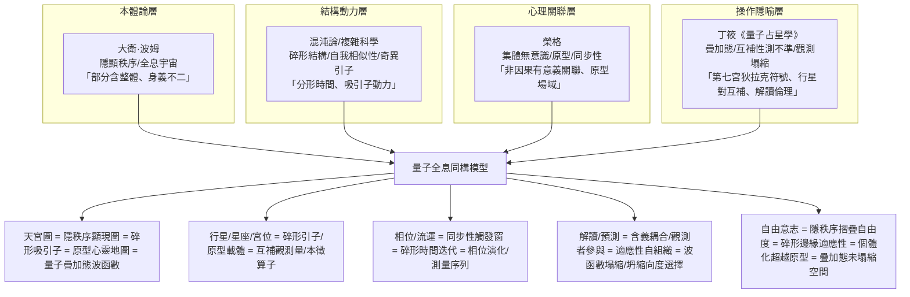

## 概述

本頁面整理自秦瑞生《實力占星系列》第一冊第一章〈占星學的哲學基礎〉與丁筱《量子占星學》核心理論，系統闡述占星學運作機制的**三大經典哲學支柱**與**一套量子力學操作隱喻框架**。三大支柱為：**大衛·波姆的隱顯秩序與全息宇宙模型**、**混沌論與複雜科學的碎形結構與自我相似性**、以及**榮格的集體無意識、原型與同步性理論**。丁筱《量子占星學》在此基礎上，引入量子力學形式體系（疊加態、互補性/測不準原理、觀測塌縮），為占星具體技法（宮位、行星、解讀）提供了可操作的「量子隱喻」模型。四者相互交織，共同支撐「天人感應」（宏觀宇宙與微觀人類的對應關係）與「量子全息同構」的哲學基石定位，解釋占星學為何能在非因果關聯性下運作。

> **核心書目**：
> 1. 秦瑞生《實力占星系列》第一冊（含作者自序、王祥萱序、史守志序、第一章全文）。
> 2. 丁筱《量子占星學》（序、目錄、第一章、第二章、第三章節選）。
> **參考頁面**：[[qin-ruisheng-shi-li-zhan-xing-di-yi-ce]]、[[liang-zi-zhan-xing-xue]]。

---

## 第一支柱：大衛·波姆的隱顯秩序與全息宇宙——本體論基石

### 核心觀點

1.  **不可分割的整體性**：宇宙是一個不可分割的整體，任何分離、獨立的部分分析都缺乏基礎。
2.  **整體動態**：宇宙運作呈現多層次秩序的綻放與摺疊。上一層秩序綻放為下一層，下一層又摺疊藏於上一層，形成不斷展開的整體動態。
3.  **隱秩序與顯秩序**：
    - **隱秩序**：不可見的深層實相，包含所有潛在信息與秩序。
    - **顯秩序**：我們可感知的三維世界（物質、時間、空間），由隱秩序綻放而顯現。
4.  **身義觀念**：物質（身）與心理（義）是同一實相的兩面，由「含義」連結，構成意識的根本特質。

### 全息攝影隱喻

波姆以全息攝影說明：全息照片的每一部分皆含整體影像，對應「整體包含於每一部分，每一部分展開成整體」。此概念與腦神經科學（普利布蘭）及西藏佛教三身說（法身、報身、化身）不謀而合。

### 對占星學的啟示：宏微同構的本體論依據

| 啟示 | 說明 |
|------|------|
| **宏微對應** | 全息概念提供「上天如此，地下如此」的結構性隱喻：小宇宙（人）與大宇宙（星空）為同一隱秩序的不同綻放。 |
| **非機械作用** | 占星運作非行星射線直接作用於大腦，而是行星與人類由「含義型態」耦合的動態過程。 |
| **秩序科學** | 解讀天宮圖如同顯現隱秩序之圖；占星學是研究精緻秩序與行星笛卡兒秩序之交互關係。 |
| **原型先驅** | 占星假設的原型為隱秩序的先驅顯現，其循環型態與行星移行同步，使占星家得以分析特定行星原型。 |

> **交叉引用**：波姆理論亦見於 [[huanxiangxr-21-cosmology]] 中的「玄無自我更新」與全息體系；另可參考 [[divination-fundamentals]] 中關於「象徵性思維」與「時間幻象」的討論。

---

## 第二支柱：混沌論、複雜科學與碎形結構——結構論與動力論模型

### 核心概念

| 概念 | 內涵 |
|------|------|
| **非線性動力** | 因果非比例，微小初始差異可導致巨大結果差異（蝴蝶效應）。 |
| **碎形結構** | 曼德布洛特圖案揭示自然界普遍存在的自我相似幾何：局部與整體同構，層層遞迴。 |
| **自我類似性** | 系統各因子具碎形型態，能自我組織、適應，經循環回饋在混沌與秩序邊緣維持穩定。 |
| **奇異引子** | 相空間中系統被吸引的幾何結構，具碎形特質，代表系統的深層秩序模式。 |
| **突現** | 低層次單元自組織為高層次系統，產生宏觀新特質（如細胞→組織→器官→人體）。 |

### 對占星學的七大啟示：命盤即碎形吸引子

1.  **碎形幾何即生命藍圖**：天宮圖為生命的碎形幾何，每一層次（星座、宮位、行星、相位）皆含整體信息。
2.  **整體性互動**：人與星辰、環境、地球與天球關係為整體性呈現，非單向因果。
3.  **天宮圖作奇異引子**：命盤為論述事件、性格、婚姻等型態的吸引子框架。
4.  **要素皆為引子**：星座、宮位、行星、敏感點均具自我類似性，如海王星象徵海洋、酒精、浪漫、藝術等多樣性。
5.  **時空碎形結構（分形時間）**：
    - 次限：一日代表一年（一日即一年碎形）
    - 主限：天球自轉4分鐘代表一年
    - 後天宮位：黃道星座每日運轉碎形
    - 星座：一年四季碎形
    - 大年：歲差移轉黃道星座碎形
    - 測定圖：地球作黃道碎形
    - 相位：黃道360°碎形；中點盤、泛音盤為更高階碎形
6.  **蝴蝶效應與預測謙卑**：命運預測不可能100%準確，複雜科學證明亂中有序，仍有規律可循。
7.  **雙生子差異解釋**：初始條件微小差異（出生時空細微不同）導致生命軌跡分歧，符合碎形敏感依賴初值特性。

> **交叉引用**：碎形與自我相似性概念亦見於 [[huanxiangxr-21-world-matrix-invasion]] 的「世界矩阵」分形結構；另可參考 [[zhanxing-shuji-mulu-yu-zhuti-daohang]] 中「非主流技法」下的泛音盤、中點理論等碎形應用。

---

## 第三支柱：榮格的集體無意識、原型與同步性——心理學與關聯論機制

### 三大核心概念

| 概念 | 定義 | 關鍵特徵 |
|------|------|----------|
| **集體無意識** | 超越個人經驗、人類共同繼承的心靈基層 | 儲存普遍意象、神話主題、跨文化共通符號；類比物理場、量子場、阿賴耶識 |
| **原型** | 集體無意識中的先天心理結構/意象表徵 | 人格面具、陰影、阿尼瑪/阿尼姆斯、大母、英雄、聖童、智慧老人、本我等；具光明/陰影雙面；推動個體化歷程 |
| **同步性** | 非因果關聯的有意義巧合原理 | 同一時間點發生的事件無因果關聯，卻共享相同意義；分三類：精神內容與客觀行動暗合、主觀狀態與遠距幻象暗合、當下象徵預示未來 |

### 同步性與量子論的共振

- **EPR 佯謬與貝爾定理**證實量子非定域性：粒子無需媒介即時聯繫，對應同步性「無因果關聯卻有意義連結」。
- **波姆隱秩序**提供本體論基礎：隱秩序中過去、現在、未來為連綿當下，歷史為摺疊態的展開，同步性各類型得以合理解說。

### 對占星學的三大啟示

1.  **天宮圖元素即原型**：行星、星座、敏感點、後天宮位皆具原型特質；出生天象透過同步性昭示對應人間事件。
2.  **天宮圖為心靈地圖**：由原型先驗秩序構建，描述個體內在世界結構，進而映照外在事件。
3.  **時事占星建構於集體無意識**：重大災難（地震、天災）引發群體歇斯底里，為集體無意識顯現；星象與集體事件關聯即此機制。

> **交叉引用**：榮格原型理論在心理占星中應用極廣，參見 [[nei-xing-xing]]（內行星與原型）、[[sasportas-twelve-houses]]（十二宮位生命過程）、[[han-lianglu-12-zodiac-planetary-interactions]]（星座演化意識）；同步性概念亦見於 [[divination-fundamentals]]「業力恐懼釋放與改變未來」及 [[zhanxing-zhan-xin]] 古典與心理占星融合實戰。

---

## 第四維度：丁筱《量子占星學》——量子力學操作隱喻框架（理論落地層）

在上述三大哲學支柱之上，丁筱《量子占星學》引入**量子力學形式體系**作為具體操作隱喻，將抽象的「全息、碎形、同步性」轉化為可在命盤分析中直接應用的「量子邏輯」。此舉確立了**量子全息與占星同構**的哲學基石定位。

### 第七宮：伴侶/敵人疊加態——狄拉克符號化的關係本質

**核心隱喻**：第七宮（夫妻宮/合作宮）不代表確定的「伴侶」或「敵人」，而是兩種本徵態的**相干疊加態**。

> **術語說明**：第七宮的人是伴侶與敵人的叠加（coherent superposition）。用狄拉克 (Dirac P. A. M.) 的符號來寫：
> $$ |\text{第七宮的人}\rangle = \alpha |\text{伴侶}\rangle + \beta |\text{敵人}\rangle $$
> 類似的疊加狀態無論在西洋占星或紫微斗數屢見不鮮。相對的宮位效應就是疊加，一個行星同時具有兩種特性也是疊加。依照量子力學，疊加狀態你要不去弄清楚它，不要去測量它，不要去問「你到底成不成」，一旦測量就會改變狀態。

**哲學意涵**：
- **關係的非二元性**：伴侶與敵人非對立，而是同一量子態的兩個本徵值可能性。
- **觀測者參與**：命主（觀測者）的意識狀態、期待、業力模式（測量儀器）決定了波函數塌縮為哪個本徵態。
- **相干性維持**：關係的質量取決於能否維持疊加態的相干性（即容納矛盾、不強求塌縮為單一標籤），一旦過早「測量」（定性判斷），即喪失關係的量子潛能。

### 行星對互補性與測不準原理——動態平衡的量子邏輯

**核心隱喻**：行星對（太陽-月亮、木星-土星、金星-火星）構成**互補性對應**，精確對應海森堡測不準原理：無法同時精確測量一對互補變數（如位置/動量），在占星中表現為無法同時極大化一對互補行星能量的特定屬性。

| 行星對 | 互補屬性（隱喻位置/動量） | 占星呈現：測不準關係 | 丁筱原文依據 |
| :--- | :--- | :--- | :--- |
| **太陽 ☉ / 月亮 ☽** | **意識/無意識** **自我形象/情感需求** **白晝/夜晚** | 過度強調太陽（自我意志、外在形象），月亮（情感安全感、習慣模式）必然處於模糊/被壓抑狀態，反之亦然。無法同時擁有「完全清醒的自我」與「完全安全的內在」。 | 「太陽與月亮是互補的。對物理學的人來說『互補』代表著特殊的意義：量子力學中，測不準原理說明，兩個互補的物理量無法同時精準量測。占星中是否有這種關係條件？太陽與月亮是互補的。」 |
| **木星 ♃ / 土星 ♄** | **擴張/收縮** **機會/限制** **信心/恐懼** **魂在物質上/物質加於靈魂上** | 追求極致的木星式擴張（樂觀、冒險、成長），必然犧牲土星式結構（紀律、邊界、現實檢驗）。極致的土星壓抑（恐懼、控制、僵化），必然阻礙木星機會的流動。 | 「木星與土星成對：土星 ♄ 是物質加於靈魂上。木星 ♃ 則是魂在物質之上……同樣的木星與土星是互補的。」 |
| **金星 ♀ / 火星 ♂** | **吸引/行動** **和諧/衝突** **享樂/慾望** **符號上下倒轉關係** | 過度金星化（討好、妥協、唯美），火星能量（主動追求、穿透、戰鬥）被壓抑；過度火星化（侵略、衝動、競爭），金星能量（關係連結、美感、價值觀）受損。符號關係（♂為♀倒轉）暗示二者為同一能量的極性反轉。 | 「金星 ♀ 與火星 ♂ 也成對：火星原本的符號恰好是金星的符號上下倒轉過來……金星與火星也是互補的。這點值得大家研究。」 |

**操作啟示**：
- **命盤診斷重心轉移**：不再問「這顆行星強不強」，而問「這對互補行星的**不確定性關係**目前處於何種平衡態？」
- **流運解讀**：大行星流運（如木星回歸、土星回歸）本質上是**測不準關係的週期性相位變化**——當木星相位精確（機會窗口打開），土星相位必然模糊（結構壓力隱性），反之亦然。

### 觀測即塌縮：命盤解讀的主觀性與倫理

**核心隱喻**：占星師解讀命盤的過程，即**量子測量過程**。命盤（波函數/疊加態）在被觀測（解讀）前，包含所有可能性；解讀行為（提問、聚焦、詮釋）導致波函數塌縮為特定敘事。

> **原文依據**：「依照量子力學，疊加狀態你要不去弄清楚它，不要去測量它，不要去問『你到底成不成』，一旦測量就會改變狀態。不過這並不說明運命是遵照量子力學演變的。出現這個問題只是老子說的『道可道非常道』。我們用一般的語言去描述一個在這個語言中沒有的東西必然出現偏差。」

**三層意涵**：
1.  **認識論謙卑**：沒有「上帝視角」的客觀命盤，只有「觀測者相依」的關係性命盤。同一命盤，不同占星師（不同測量基底）、不同時機（不同相干性）、不同提問（不同投影算子），塌縮出不同現實。
2.  **倫理責任**：占星師的詮釋即「測量儀器」。負面預測（如「你第七宮是敵人」）若被當事人信納（量子纏繞），極大概率塌縮為該現實（自我實現預言/觀測者效應）。**占星諮詢本質上是協助當事人選擇塌縮向度的過程。**
3.  **自由意志空間**：波函數塌縮前的疊加態空間，即**自由意志操作空間**。知曉模式（測量統計規律）即獲得超越模式的槓桿——這呼應波姆「含義」層面、複雜科學「適應性自我組織」、榮格「個體化過程」。

---

## 綜合整合：量子全息同構模型——四層架構統一圖譜

### 關鍵整合論點對照表

| 整合層面 | 波姆 (全息/隱顯) | 混沌/複雜 (碎形/引子) | 榮格 (原型/同步性) | 丁筱 (量子隱喻/操作) | 統一語境：量子全息同構 |
| :--- | :--- | :--- | :--- | :--- | :--- |
| **本體論** | 不可分割整體、身義雙面 | 碎形整體性、自我相似 | 集體無意識場域、原型先驗結構 | 波函數/疊加態、非定域性 | **全息量子場**：宇宙與人為同一量子全息場的不同激發態 |
| **結構論** | 部分含整體、綻放/摺疊 | 自我相似、奇異引子 | 普遍意象、原型意象 | 本徵態、本徵算子、互補變數 | **碎形算子代數**：命盤要素為全息場中的本徵算子，具碎形自我相似與原型投影雙重屬性 |
| **動力論** | 隱秩序綻放/摺疊 | 奇異引子吸引/自組織/適應 | 同步性有意義巧合/個體化 | 相位演化/測量序列/塌縮 | **自組織測量動力學**：生命過程為在同步性觸發下，透過觀測者參與，於碎形引子吸引盆地中進行波函數塌縮向度選擇的自組織過程 |
| **認知論** | 觀察者參與/含義耦合 | 觀察者改變系統/敏感依賴初值 | 意識與無意識融合/主觀驗證 | 觀測即塌縮/解讀倫理/自由意志槓桿 | **參與式認識論**：認識即共同創造，占星師與當事人形成量子糾纏測量鏈，共同塌縮命運波函數 |
| **方法論** | 天宮圖為「顯現隱秩序之圖」 | 天宮圖為「奇異引子圖像」 | 天宮圖為「原型心靈地圖」 | 天宮圖為「疊加態波函數/互補觀測儀」 | **量子全息儀**：天宮圖同時是全息干涉圖、碎形吸引子圖譜、原型投影儀、量子測量儀 |

---

## 實務意涵與現代占星發展新範式

### 超越機械決定論與純心理隱喻：確立「關係性實在論」
占星非「行星射線致使事件」（機械論），非純「心理投射」（主觀論），而是**含義型態的同步共振/量子糾纏關係性實在**。
- **預測重定義**：從「預言未來」轉為「識別疊加態機率分佈、輔助當事人選擇塌縮向度」。
- **事件分析**：重大事件（婚姻、疾病、轉職）視為**宏觀量子隧穿/相變**，由微觀疊加態經觀測/相位觸發累積而成。

### 整合古典、心理、演化、印度占星：四大流派的量子全息映射
| 流派核心 | 量子全息同構映射 | 丁筱補充視角 |
| :--- | :--- | :--- |
| **古典占星** (事件、宮主星、相位、飛星) | **碎形引子的具體觸發規則/本徵值方程精確解** | 強調球差、時間延遲、逆行轉向為「測量儀器解析度/相干時間」參數 |
| **心理占星** (原型、個體化、相位心理) | **原型即本徵態/觀測基底；個體化即基底轉換/波函數重組** | 第七宮疊加態、行星對互補性為「原型互補對」的量子力學形式化 |
| **演化占星** (業力、冥王星、南北交點、轉世) | **隱秩序跨生世摺疊/纏繞態；冥王星為量子隧穿/相變算子** | 逆行、轉向為「業力波函數在隱秩序中的摺疊/展開關鍵節點」 |
| **印度占星** (恆星黃道、分限、業力、瑜伽) | **不同座標系的量子態展開基（恆星vs回歸 = 不同測量基底）；分限為分形時間算子** | 歲差差異即「坐標系選擇導致的相對論性觀測差異」 |

### 占星諮詢倫理升級：從「解讀」到「量子協作」
- **知情同意即量子糾纏建立**：雙方明確議題、預期、邊界，建立測量協議。
- **詮釋語言即旋轉算子**：用詞選擇（挑戰/機會、業力/課題、受害者/創造者）直接旋轉當事人波函數基底，決定塌縮概率振幅分佈。
- **追蹤回饋即弱測量/量子非拆解測量**：持續追蹤而非一次性斷言，維持疊加態相干性，保留可能性空間。

### 跨學科驗證路徑具體化
- **量子生物學/腦神經科學**：驗證「觀察者參與」與「全息腦」（Pribram）、微管量子計算。
- **非線性時間序列/複雜網絡分析**：驗證「碎形時間結構」（主限/次限/流年/相位）對生命事件時間序列的吸引子預測力。
- **跨文化神話/深度心理/語言學**：驗證「原型普遍性」與「同步性現象」的語義場結構（如行星符號語義向量空間分析）。
- **量子資訊理論**：建立命盤要素（行星、星座、宮位、相位）的**量子比特/量子門/量子電路模型**，模擬解讀過程為量子計算過程。

---

## 參考與延伸閱讀導航

| 頁面 | 關聯主題 | 本頁對應章節 |
| :--- | :--- | :--- |
| [[qin-ruisheng-shi-li-zhan-xing-di-yi-ce]] | 本書完整架構：哲學基礎、占星史五階段、古典+現代+印度整合、16組名人命盤實證 | 第一、二、三支柱理論來源 |
| [[liang-zi-zhan-xing-xue]] | 丁筱《量子占星學》核心體系總覽：科學方法論、行星符號、十二宮量子疊加、相位球差、歲差、紫微比較、逆行實證 | 第四維度理論來源、具體技法應用 |
| [[zhanxing-shuji-mulu-yu-zhuti-daohang]] | 占星書目總覽與主題導航（基礎入門、星座性格、宮位相位、行運預測、關係合盤、醫學占星、心理占星、古典實戰等) | 知識庫定位 |
| [[astrology-made-simple-series]] | 入門教材架構：星盤四大要素、十二星座分類、行星符號、宮位制、歲差、排盤軟體 | 基礎知識鏈接 |
| [[divination-fundamentals]] | 占卜核心哲學：象徵性思維、時間幻象、業力恐懼釋放、改變未來、通靈感知開發 | 同步性/觀測者效應延伸 |
| [[nei-xing-xing]] | 心理占星核心：內行星（水金火）作為個體化旅程基石，薩司波塔斯與格林講座實錄 | 原型理論應用 |
| [[sasportas-twelve-houses]] | 十二宮位心理占星框架：自然黃道對應生命過程，上升點/天底深度解析 | 宮位原型/碎形引子具體化 |
| [[han-lianglu-12-zodiac-planetary-interactions]] | 十二星座演化意識與十大行星落座心理特質 | 行星-星座互補性/疊加態素材 |
| [[zhanxing-zhan-xin]] | 希斯莉《占星占心》古典與心理融合實戰案例（婚姻、事業、健康、感情） | 觀測塌縮/關係性實在論實踐 |
| [[arroyo-astrology-karma-transformation]] | 亞若優《占星、業力與轉化》：三種業力、土星業力王、水象宮位業債、日月法則 | 演化占星/隱秩序摺疊視角 |
| [[ming-wang-xing-ling-hun-yan-hua-zhi-lv-juan-yi]] | 格林《冥王星：靈魂演化之旅》：冥王星雙欲望、南北交點業力軸、四演化階段 | 冥王星/相變算子/業力波函數 |
| [[zhanxing-tianwen-jichu-yu-huangdao-tixi]] | 占星天文基礎：回歸/恆星黃道、歲差、蛇夫座、坐標系 | 丁筱「歲差/坐標系」量子觀測基底差異的物理基礎 |
| [[huanxiangxr-21-cosmology]] | 純無/玄無本體論、六面體系、世界矩陣、全息體系 | 波姆全息/隱顯秩序的東方形而上學對應 |
| [[huanxiangxr-21-world-matrix-invasion]] | 世界矩陣分形結構、四維矩陣/三維圈、入侵論 | 碎形/分形結構的宏觀宇宙學對應 |

---

## 結語

占星學的哲學基礎已完成從**形而上學推測**到**跨學科理論整合**再到**量子形式化操作隱喻**的三級躍遷。

1.  **波姆**給出了**本體論許可**：宇宙允許非局域、全息、含義耦合的關聯。
2.  **混沌/複雜科學**給出了**結構動力學模型**：生命為碎形吸引子上的自組織過程，命盤為其幾何圖譜。
3.  **榮格**給出了**心理關聯機制**：原型與同步性解釋「為什麼是這些符號」及「為什麼時間節點有效」。
4.  **丁筱《量子占星學》**給出了**操作邏輯與倫理框架**：疊加態（關係本質）、互補性/測不準（行星對動態平衡）、觀測塌縮（解讀倫理與自由意志空間），將前三者凝聚為可在諮詢室、研究中直接應用的**量子全息同構儀**。

認清此「四位一體」機制，占星師可在**事件預測與心理輔導、宿命論與自由意志、古典技法與現代科學、個體命運與集體演化**之間，建立真正具備**本體論深度、結構論精度、動力論解釋力、操作論指導性**的整合性實務框架。這正是「量子占星學」確立**量子全息與占星同構哲學基石定位**的歷史意義所在。

## 来源

- [占星学上](../sources/占星学上.md)
- [占星学量子](../sources/占星学量子.md)
