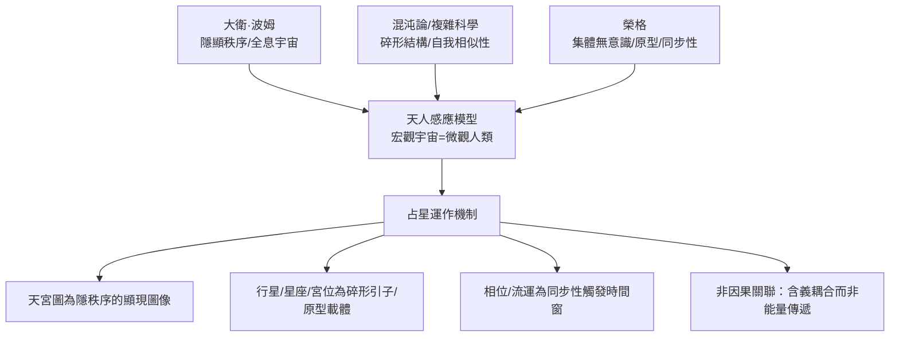

## 概述

本頁面整理自秦瑞生《實力占星系列》第一冊第一章〈占星學的哲學基礎〉，系統闡述占星學運作機制的三大哲學支柱：**大衛·波姆的隱顯秩序與全息宇宙模型**、**混沌論與複雜科學的碎形結構與自我相似性**、以及**榮格的集體無意識、原型與同步性理論**。這三者相互交織，為「天人感應」（宏觀宇宙與微觀人類的對應關係）提供了跨學科的理論基礎，解釋占星學為何能在非因果關聯性下運作。

> **來源書目**：秦瑞生《實力占星系列》第一冊（含作者自序、王祥萱序、史守志序、第一章全文）。另可參考 [[qin-ruisheng-shi-li-zhan-xing-di-yi-ce]] 之總覽頁面。

---

## 第一支柱：大衛·波姆的隱顯秩序與全息宇宙

### 核心觀點

1. **不可分割的整體性**：宇宙是一個不可分割的整體，任何分離、獨立的部分分析都缺乏基礎。
2. **整體動態**：宇宙運作呈現多層次秩序的綻放與摺疊。上一層秩序綻放為下一層，下一層又摺疊藏於上一層，形成不斷展開的整體動態。
3. **隱秩序與顯秩序**：
   - **隱秩序**：不可見的深層實相，包含所有潛在信息與秩序。
   - **顯秩序**：我們可感知的三維世界（物質、時間、空間），由隱秩序綻放而顯現。
4. **身義觀念**：物質（身）與心理（義）是同一實相的兩面，由「含義」連結，構成意識的根本特質。

### 全息攝影隱喻

波姆以全息攝影說明：全息照片的每一部分皆含整體影像，對應「整體包含於每一部分，每一部分展開成整體」。此概念與腦神經科學（普利布蘭）及西藏佛教三身說（法身、報身、化身）不謀而合。

### 對占星學的啟示

| 啟示 | 說明 |
|------|------|
| **宏微對應** | 全息概念提供「上天如此，地下如此」的結構性隱喻：小宇宙（人）與大宇宙（星空）為同一隱秩序的不同綻放。 |
| **非機械作用** | 占星運作非行星射線直接作用於大腦，而是行星與人類由「含義型態」耦合的動態過程。 |
| **秩序科學** | 解讀天宮圖如同顯現隱秩序之圖；占星學是研究精緻秩序與行星笛卡兒秩序之交互關係。 |
| **原型先驅** | 占星假設的原型為隱秩序的先驅顯現，其循環型態與行星移行同步，使占星家得以分析特定行星原型。 |

> **交叉引用**：波姆理論亦見於 [[huanxiangxr-21-cosmology]] 中的「玄無自我更新」與全息體系；另可參考 [[divination-fundamentals]] 中關於「象徵性思維」與「時間幻象」的討論。

---

## 第二支柱：混沌論、複雜科學與碎形結構

### 核心概念

| 概念 | 內涵 |
|------|------|
| **非線性動力** | 因果非比例，微小初始差異可導致巨大結果差異（蝴蝶效應）。 |
| **碎形結構** | 曼德布洛特圖案揭示自然界普遍存在的自我相似幾何：局部與整體同構，層層遞迴。 |
| **自我類似性** | 系統各因子具碎形型態，能自我組織、適應，經循環回饋在混沌與秩序邊緣維持穩定。 |
| **奇異引子** | 相空間中系統被吸引的幾何結構，具碎形特質，代表系統的深層秩序模式。 |
| **突現** | 低層次單元自組織為高層次系統，產生宏觀新特質（如細胞→組織→器官→人體）。 |

### 混沌論與複雜科學特性對照

| 維度 | 混沌論 | 複雜科學 |
|------|--------|----------|
| 核心發現 | 簡單系統極敏感、不可預測、非線性、奇異引子存在 | 亂中有序，碎形結構支撐自我組織、循環回饋、適應性 |
| 時間觀 | 未來不能由過去決定 | 初始微誤差經非線性迭代擴大，但系統具吸引子維持模式 |

### 對占星學的七大啟示

1. **碎形幾何即生命藍圖**：天宮圖為生命的碎形幾何，每一層次（星座、宮位、行星、相位）皆含整體信息。
2. **整體性互動**：人與星辰、環境、地球與天球關係為整體性呈現，非單向因果。
3. **天宮圖作奇異引子**：命盤為論述事件、性格、婚姻等型態的吸引子框架。
4. **要素皆為引子**：星座、宮位、行星、敏感點均具自我類似性，如海王星象徵海洋、酒精、浪漫、藝術等多樣性。
5. **時空碎形結構**：
   - 次限：一日代表一年（一日即一年碎形）
   - 主限：天球自轉4分鐘代表一年
   - 後天宮位：黃道星座每日運轉碎形
   - 星座：一年四季碎形
   - 大年：歲差移轉黃道星座碎形
   - 測定圖：地球作黃道碎形
   - 相位：黃道360°碎形；中點盤、泛音盤為更高階碎形
6. **蝴蝶效應與預測謙卑**：命運預測不可能100%準確，複雜科學證明亂中有序，仍有規律可循。
7. **雙生子差異解釋**：初始條件微小差異（出生時空細微不同）導致生命軌跡分歧，符合碎形敏感依賴初值特性。

> **交叉引用**：碎形與自我相似性概念亦見於 [[huanxiangxr-21-world-matrix-invasion]] 的「世界矩阵」分形結構；另可參考 [[zhanxing-shuji-mulu-yu-zhuti-daohang]] 中「非主流技法」下的泛音盤、中點理論等碎形應用。

---

## 第三支柱：榮格的集體無意識、原型與同步性

### 三大核心概念

| 概念 | 定義 | 關鍵特徵 |
|------|------|----------|
| **集體無意識** | 超越個人經驗、人類共同繼承的心靈基層 | 儲存普遍意象、神話主題、跨文化共通符號；類比物理場、量子場、阿賴耶識 |
| **原型** | 集體無意識中的先天心理結構/意象表徵 | 人格面具、陰影、阿尼瑪/阿尼姆斯、大母、英雄、聖童、智慧老人、本我等；具光明/陰影雙面；推動個體化歷程 |
| **同步性** | 非因果關聯的有意義巧合原理 | 同一時間點發生的事件無因果關聯，卻共享相同意義；分三類：精神內容與客觀行動暗合、主觀狀態與遠距幻象暗合、當下象徵預示未來 |

### 同步性與量子論的共振

- **EPR 佯謬與貝爾定理**證實量子非定域性：粒子無需媒介即時聯繫，對應同步性「無因果關聯卻有意義連結」。
- **波姆隱秩序**提供本體論基礎：隱秩序中過去、現在、未來為連綿當下，歷史為摺疊態的展開，同步性各類型得以合理解說。

### 對占星學的三大啟示

1. **天宮圖元素即原型**：行星、星座、敏感點、後天宮位皆具原型特質；出生天象透過同步性昭示對應人間事件。
2. **天宮圖為心靈地圖**：由原型先驗秩序構建，描述個體內在世界結構，進而映照外在事件。
3. **時事占星建構於集體無意識**：重大災難（地震、天災）引發群體歇斯底里，為集體無意識顯現；星象與集體事件關聯即此機制。

> **交叉引用**：榮格原型理論在心理占星中應用極廣，參見 [[nei-xing-xing]]（內行星與原型）、[[sasportas-twelve-houses]]（十二宮位生命過程）、[[han-lianglu-12-zodiac-planetary-interactions]]（星座演化意識）；同步性概念亦見於 [[divination-fundamentals]]「業力恐惧釋放與改變未來」及 [[zhanxing-zhan-xin]] 古典與心理占星融合實戰。

---

## 三支柱整合：天人感應與非因果關聯機制

### 關鍵整合論點

| 整合層面 | 說明 |
|----------|------|
| **本體論** | 波姆「不可分割整體」= 混沌論「碎形整體性」= 榮格「集體無意識場域」 |
| **結構論** | 全息「部分含整體」= 碎形「自我相似」= 原型「普遍意象」 |
| **動力論** | 隱秩序綻放/摺疊 = 奇異引子吸引/自我組織 = 同步性有意義巧合 |
| **認知論** | 身義雙面 = 觀察者參與/主觀化 = 意識與無意識融合（個體化） |
| **方法論** | 天宮圖為「顯現隱秩序之圖」=「奇異引子圖像」=「原型心靈地圖」 |

---

## 實務意涵與現代占星發展

1. **超越機械決定論**：占星非「行星射線致使事件」，而是**含義型態的同步共振**；預測為概率性模式識別，非絕對宿命。
2. **整合古典與心理派**：
   - 古典占星重事件預測（行星落宮、相位、飛星、宮主星）對應**碎形引子的具體觸發規則**。
   - 心理占星重原型心理過程對應**集體無意識/原型的個體化展開**。
   - 印度占星業力/轉世觀對應**隱秩序跨生世摺疊與同步性業力模式**。
3. **自由意志空間**：波姆「含義」層面、複雜科學「適應性自我組織」、榮格「個體化過程」均為自由意志操作留出空間——**知曉模式即獲得超越模式的槓桿**。
4. **跨學科驗證路徑**：
   - 量子生物學/腦神經科學驗證「觀察者參與」與「全息腦」。
   - 非線性時間序列分析驗證「碎形時間結構」（主限、次限、流年）。
   - 跨文化神話學/深度心理學驗證「原型普遍性」與「同步性現象」。

---

## 參考與延伸閱讀

| 頁面 | 關聯主題 |
|------|----------|
| [[qin-ruisheng-shi-li-zhan-xing-di-yi-ce]] | 本書完整架構：哲學基礎、占星史五階段、古典+現代+印度整合、16組名人命盤實證 |
| [[zhanxing-shuji-mulu-yu-zhuti-daohang]] | 占星書目總覽與主題導航（基礎入門、星座性格、宮位相位、行運預測、關係合盤、醫學占星、心理占星、古典實戰等） |
| [[astrology-made-simple-series]] | 入門教材架構：星盤四大要素、十二星座分類、行星符號、宮位制、歲差、排盤軟體 |
| [[divination-fundamentals]] | 占卜核心哲學：象徵性思維、時間幻象、業力恐懼釋放、改變未來、通靈感知開發 |
| [[nei-xing-xing]] | 心理占星核心：內行星（水金火）作為個體化旅程基石，薩司波塔斯與格林講座實錄 |
| [[sasportas-twelve-houses]] | 十二宮位心理占星框架：自然黃道對應生命過程，上升點/天底深度解析 |
| [[han-lianglu-12-zodiac-planetary-interactions]] | 十二星座演化意識與十大行星落座心理特質 |
| [[zhanxing-zhan-xin]] | 渌絲莉《占星占心》古典與心理融合實戰案例（婚姻、事業、健康、感情） |
| [[arroyo-astrology-karma-transformation]] | 亞若優《占星、業力與轉化》：三種業力、土星業力王、水象宮位業債、日月法則 |
| [[ming-wang-xing-ling-hun-yan-hua-zhi-lv-juan-yi]] | 格林《冥王星：靈魂演化之旅》：冥王星雙欲望、南北交點業力軸、四演化階段 |

---

## 結語

占星學的哲學基礎並非單一理論，而是**量子全息本體論、非線性碎形動力學、深度心理學同步性原理**的三重奏。這三大支柱共同支撐了「天人感應」的非因果關聯機制：星空與人生為同一隱秩序的不同綻放層次，以碎形自我相似結構呈現，透過原型與同步性在特定時空節點產生有意義的共振。認清此機制，可使占星師在**事件預測與心理輔導、宿命論與自由意志、古典技法與現代心理**之間建立更具整合性的實務框架。

## 来源

- [占星学上](../sources/占星学上.md)
