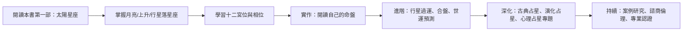

# 占星自学圣经

> **献词**  
> 我要把這本書獻給威廉。  
> 他的太陽在巨蟹座，教會了我愛的意思；  
> 他的月亮在處女座，則使我明白工作的意義。

---

## 版本史与出版脉络

| 版本 | 年份 | 关键特征 |
|------|------|----------|
| 首版 | 1982 | 入选「月订读书俱乐部」、文學學會、一心读书俱乐部选书，确立经典地位 |
| 修订版 | 2008（中文版参考此版） | 新增「每个星座的内心世界」、「别人眼中的你」、二十一世紀世界大事預測、1900-2100 年行星曆表 |
| 中文版 | 2010 年代 | 由圆方出版社引进，附七位华语占星专家推荐序，形成本土化推荐脉络 |

> **月订读书俱乐部**：成立于 1926 年，美国全國性读书俱乐部始祖，付费会员每月从专家推荐的五本书中选一本自动寄送。

---

## 专家推荐脉络（中文版七序）

| 推荐人 | 身份 | 核心评价 |
|--------|------|----------|
| **天空为限** | 《说说算命都是纯统计学》《揭秘十二宫位》作者 | 称其为「第一本清楚明解的工具书」，强调术语章节让读者能读懂讨论内容，触发探索之心 |
| **安格斯** | 星座教授 | 肯定「占星不求人，自己也能帮自己上课」，称章节清晰循序渐进，适合初阶至中阶 |
| **艾曼达** | 专业占星师、塔罗占卜师 | 比喻为「开启多面占星的门窗」，赞赏神话原型切入法与美式/英派差异的展示 |
| **星宿老师 Farris Lin** | 占星协会会长 | 定位为「星象大观」，认为编排系统适合自学探索，是理想的「占星学导论」 |
| **戴鹏飞** | FB「宇宙象征占星社」版主、《高阶占星学解锁技巧》作者 | 透露本书为其 1999 年入占星领域的启蒙书，建立了主星、守护星、互容等核心概念 |
| **罗华美 Willow Mystic** | 灵魂能量疗愈师与灵性占星老师 | 视为「开启占星学那扇对的门」，阅读不生乏味，能消化吸收 |
| **苏飞雅** | 美国占星协会(ISFA)认证占星师, ELLE专栏作家 | 详述五部结构教学逻辑，指出现代/古典占星守护星差异，提供补正说明 |

---

## 体系架构：五部教学框架

| 部别 | 章节 | 核心内容 | 教学定位 |
|------|------|----------|----------|
| **第一部：太陽星座** | Ch.1-4 | 十二星座详解、太陽星座看愛情、星座區間與交界、占星學相關概念 | 满足基础需求：自我、愛情、健康三面向 |
| **第二部：月亮與上升** | Ch.5-7 | 月亮星座、上升星座、其他八顆行星落星座 | 掌握太陽、月亮、上升「三大指標」 |
| **第三部：宮位與相位** | Ch.8-10 | 十二宮位、相位、閱讀自己的命盤（練習題） | 落實「行星、星座、宮位、相位」四大重點 |
| **第四部：預測與關係** | Ch.11-13 | 行星過運、合盤關係、世界預測 | 進階應用：流年、關係、世運 |
| **第五部：歷史與神話** | Ch.14-15 | 占星學歷史、黃道帶傳說（神話背景） | 建立文化根基與原型思維 |
| **第六部：術語詞彙** | — | 占星學專有名詞中英對照 | 快速查閱，打通閱讀障礙 |
| **第七部：星曆表** | — | 1900-2100 年行星曆表 | 實務工具：離線排盤核心資料 |

> **作者教学主张**：本书不是百科全书，而是「浅显易懂的指南」，提供全面知识；占星学无法改变人生，只能让你明白如何面对人生大戏，提供资讯、指引与安心。

---

## 核心教学特色

### 三大指標優先教學法
- **太陽星座**：人生大戲的角色、性格輪廓 → [[十二星座基本特质与经典排行]]
- **月亮星座**：情感需求、內在反應、養育模式 → [[han-lianglu-astrology-mom-handbook]]
- **上升星座**：外在人格面具、宮位起點、生命劇本 → [[shengshang-xingzuo]]

### 四大核心要素整合
| 要素 | 符號 | 對應頁面 |
|------|------|----------|
| 行星 | 十大行星 | [[zhanxing-xingxing-tianwen-yu-yiyi]]、[[nei-xing-xing]] |
| 星座 | 黃道十二宮 | [[zodiac-sign-correspondences]]、[[黄道十二宫体系]] |
| 宮位 | 十二宮位 | [[sasportas-twelve-houses]]、[[zhenggongzhi-yu-shier-gongwei]] |
| 相位 | 五大相位+次要相位 | [[aspect-interpretation-framework]]、[[minor-aspects-psychological-astrology]] |

### 神話原型作為關鍵字庫源頭
- 每顆行星、星座皆溯源希臘/羅馬神話 → [[zhongshen-de-xing-kong]]
- 作者建議：卡關時從神話原型角度思考 → [[arroyo-astrology-psychology-four-elements]]

### 實務導向：星盤閱讀步驟化
- 提供九步/三步驟解讀流程 → [[classical-astrology-three-step-analysis]]
- 附實戰案例：歐普拉、珍妮弗·羅培茲等名人命盤

### 包容性術語與曆表工具
- 第六部術語表打通中英詞彙障礙
- 第七部星曆表支援離線排盤 → [[astrology-chart-calculation-methods]]

---

## 第一部核心內容導覽：太陽星座十二宮

> **教學邏輯**：以太陽星座為入口，依序呈現「守護星/符號/關鍵字/對宮/身體部位/幸運要素/名人/內在/外在/特質」標準化模板，建立統一認知框架。

| 星座 | 守護星 | 元素/三方 | 特質/四正 | 對宮 | 核心關鍵字 | 交叉引用 |
|------|--------|-----------|-----------|------|------------|----------|
| **牡羊座** | 火星 | 火/陽/開創 | ♈ | 天秤座 | 勇敢、自我中心、衝動 | [[白羊座恋爱攻略]]、[[基本宫性格攻略]] |
| **金牛座** | 金星 | 土/陰/固定 | ♉ | 天蠍座 | 可親、務實、固執、感官享樂 | [[金牛座恋爱攻略]]、[[golden-venus-taurus]] |
| **雙子座** | 水星 | 風/陽/變動 | ♊ | 射手座 | 反應敏捷、雙重性、溝通 | [[zhanxing-xingxing-tianwen-yu-yiyi#水星]] |
| **巨蟹座** | 月亮 | 水/陰/開創 | ♋ | 摩羯座 | 忠誠、情感豐富、防禦性 | [[han-lianglu-astrology-mom-handbook#月亮星座]]、[[darby-costello-moon-in-astrology]] |
| **獅子座** | 太陽 | 火/陽/固定 | ♌ | 水瓶座 | 熱情、自信、表演、慷慨 | [[zhanxing-xingxing-tianwen-yu-yiyi#太陽]] |
| **處女座** | 水星 | 土/陰/變動 | ♍ | 雙魚座 | 分析、服務、完美主義 | [[han-lianglu-12-zodiac-planetary-interactions#處女座]] |
| **天秤座** | 金星 | 風/陽/開創 | ♎ | 牡羊座 | 和諧、關係、審美 | [[han-lianglu-juno-marriage-asteroid#金星]] |
| **天蠍座** | 冥王星/火星 | 水/陰/固定 | ♏ | 金牛座 | 強烈、轉化、深度 | [[tian-xie-zuo-yuan-xing-neng-liang-ceng-ci]]、[[han-lianglu-juno-marriage-asteroid]] |
| **射手座** | 木星 | 火/陽/變動 | ♐ | 雙子座 | 探索、哲理、自由 | [[zhanxing-xingxing-tianwen-yu-yiyi#木星]] |
| **摩羯座** | 土星 | 土/陰/開創 | ♑ | 巨蟹座 | 責任、結構、野心 | [[arroyo-astrology-karma-transformation#土星]] |
| **水瓶座** | 天王星/土星 | 風/陽/固定 | ♒ | 獅子座 | 創新、群體、理想 | [[zhanxing-xingxing-tianwen-yu-yiyi#天王星]] |
| **雙魚座** | 海王星/木星 | 水/陰/變動 | ♓ | 處女座 | 直覺、犧牲、融合 | [[zhanxing-xingxing-tianwen-yu-yiyi#海王星]]、[[双鱼座心理学性格]] |

> **註**：書中太陽星座日期為概略值，精確星座請以真太陽時排盤為準 → [[ziwei-doushu-paipan-zhenshishi-jiaozheng]]、[[astrology-chart-calculation-methods]]

---

## 現代與古典占星守護星差異補正（蘇飛雅序註）

| 星座 | 現代守護星（本書採用） | 古典守護星 | 差異說明 |
|------|------------------------|------------|----------|
| 水瓶座 | 天王星 | 土星 | 本書以天王星為主，古典視土星為主、天王星為輔助 |
| 雙魚座 | 海王星 | 木星 | 本書以海王星為主，古典視木星為主 |
| 天蠍座 | 冥王星 | 火星 | 本書以冥王星為主，古典視火星為主 |

> **建議**：初學者先掌握現代體系，進階時對照古典守護星深化 → [[planetary-condition-traditional-astrology]]、[[arabic-parts-and-fixed-stars]]

---

## 與既有知識頁交叉引用網絡

### 入門教材體系
- [[astrology-made-simple-series]]：《占星學其實很簡單！》叢書入門篇，與本書同屬入門首選，互補術語與排盤實作
- [[zhanxue-quan-zhi-yin]]：《占星學全指引》包容性占星百科，提供日夜極性替代男女二元標籤
- [[zhanxing-biji-zhaohui-zhenshi-ziji]]：《占星筆記》雙軌實作法（星盤+關於我筆記），本書可作為其理論底本

### 核心技法深化
- [[zhanxing-yu-ce-ji-fa-ti-xi]]：預測技法體系（行星過運、二次推運、太陽弧、行星回歸、蝕圖）
- [[han-lianglu-synastry-law-of-attraction]]：合盘吸引力法則，本書 Ch.12 為其基礎版
- [[zhanxing-tuxing-xiangwei-quanshu]]：圖形相位全書，本書相位章為入門版

### 專題延伸
- [[ceres-asteroid-nurturing]]：谷神星養育模式，補充本書未涵蓋的小行星
- [[chiron-healing]] / [[chiron-healing-power]]：凱龍星創傷療癒，擴展本書行星範疇
- [[neizai-de-tiankong]]：斯蒂芬·福里斯特《內在的天空》演化占星視角，提供成長導向補充

---

## 學習路徑建議

---

## 經典名言摘錄

> 「我們在特定的時刻、特定的地點出生。就像特定年份釀造的葡萄酒，我們的身上都帶有那一個年份以及季節的特質。」  
> —— 卡爾·古斯坦夫·榮格

> 「占星學無法改變你的人生——只有你自己能這麼做。占星學提供了資訊與指引，最重要的是讓你安心。」  
> —— 喬安娜·沃弗克

> 「這本書告訴你，你必須全面了解占星學。你會學到關於太陽星座，還有月亮星座、上升星座，行星與宮位的認知。」  
> —— 喬安娜·沃弗克

---

## 附錄：作者簡介

**喬安娜·沃弗克**  
- 1940 年 10 月 3 日生於哥倫比亞波哥大（太陽天秤、水星天秤、金星獅子、火星處女）  
- 美國職業占星師、作家，丈夫為國際知名天文學家 William Woolfolk（太陽巨蟹、月亮處女）  
- 著作除本書外，尚有《占星學大全》《占星學與你》等

---

## 相關頁面索引

- 入門教材對照：[[astrology-made-simple-series]]、[[zhanxue-quan-zhi-yin]]、[[zhanxing-biji-zhaohui-zhenshi-ziji]]
- 核心四要素：[[zhanxing-xingxing-tianwen-yu-yiyi]]、[[zodiac-sign-correspondences]]、[[sasportas-twelve-houses]]、[[aspect-interpretation-framework]]
- 專題深化：[[han-lianglu-synastry-law-of-attraction]]、[[zhanxing-yu-ce-ji-fa-ti-xi]]、[[neizai-de-tiankong]]、[[arroyo-astrology-psychology-four-elements]]
- 實務工具：[[astrology-chart-calculation-methods]]、[[ziwei-doushu-paipan-zhenshishi-jiaozheng]]、[[arabic-parts-and-fixed-stars]]

## 来源

- [占星自学圣经](../sources/占星自学圣经.md)
