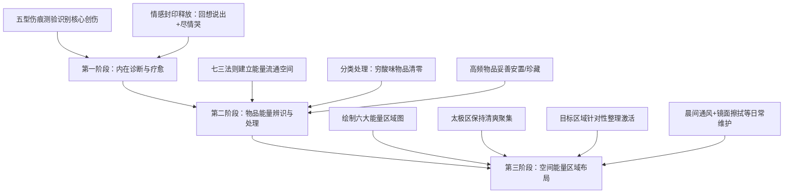

# 召唤宇宙能量的幸运整理术

> **核心理念**：扫除穷酸旧物，畅通风水气场，打开正能量开关，让健康与富裕自动找上门。以**宇宙能量频率**为核心，构建从**内在净化**（心理创伤疗愈）到**外在环境布局**（风水能量区域）的开运整理完整框架。

---

## 一、核心理论体系：宇宙能量与频率共振

### 宇宙能量的本质与运作机制

- **宇宙能量** = 高频能量，人类依靠接收它维持活力
- **能量接收优先序**：生存本能（活下去、避开危险）→ 基础需求（睡眠、饮食、伴侣）→ 精细欲求（学习、新衣、休闲）→ **整理收纳欲望**（优先序较低）
- **关键洞察**：当产生"想整理"念头时，代表基本生存需求已满足，有余力接收更多宇宙能量补给

### 情绪频率与能量输送管

| 情绪状态 | 频率特征 | 对能量输送管影响 | 结果 |
|---------|---------|----------------|------|
| **正向情感**（喜悦、喜爱、幸福、好心情） | 高频 | 畅通无阻 | 宇宙能量持续补给，整理本能自然涌现 |
| **负面情绪**（难过、悲伤、憎恨、后悔、寂寞、不安、担心） | 低频 | 阻塞/遮断 | 仅能接收生存最低能量，陷入无整理欲望状态 |

> **实操原则**：「想要整理」的心情是上天给的重要讯息 → 意识到此点是提升行动的关键

### 整理开关与成长环境

- **整理开关**：人类内在天生具备，无需过度紧张
- **错误开启方式**：严厉强迫（"不整就挨骂"）→ 产生强迫心态、过度洁癖、抑郁倾向或极端垃圾屋状态
- **环境影响**：
  - 父母代劳整理 → 孩子整理机能不易开启
  - 父母严厉强迫 → 恐惧驱动的整理，伴随冰冷气息
- **破解之道**：订下"能做的时候再做"的轻松规则 → 心情放松 → 宇宙能量易进入 → 形成正向循环

### 运气流动与捕捉法则

- **运气流动高度**：约胸口同高位置（视线可及处）
- **捕捉关键**：与运气的"轻盈活泼频率"成为好朋友
- **宇宙法则衡量标准**：轻盈、轻薄、所需分量、尽可能不持有、能舍去东西
- **实践路径**：吸收丰富宇宙能量 → 无底购物欲望消失 → 自然想丢弃不需要之物 → 珍惜真正喜爱的物品 → 温暖优质能量循环 → 运气提升

---

## 二、内在净化系统：五型心理伤痕模型与疗愈

### 五型伤痕诊断表（核心识别工具）

| 类型 | 核心伤痕 | 典型行为模式 | 物品关系特征 | 疗愈方向 |
|------|---------|-------------|-------------|---------|
| **A型：逃避现实型** | 金钱相关创伤（丢失大笔钱、被骗、破产、裁员） | 对高价物品抗拒、只买便宜货/折扣品、大量囤积导致腐败、无法决定丢弃 | 囤积能量发威，富裕能量难循环 | 抚平金钱伤痛 → 吸取优质能量 → 囤积心情消失 |
| **B型：情感饥渴型** | 幼年未获足够疼爱（父母压力大、兄弟姐妹多） | 讲究名牌/高价/奢华物品掩饰自信缺乏、买后失去兴趣懒于保养、囤积衣服/饰品/能量石/疗愈商品 | 象征累积悲伤，非真正想要之物 | 发觉内心伤痛 → 净化负面情感 → 学会珍惜物品 |
| **C型：过度焦虑型** | 人际创伤（父母专制/言语攻击/虐待/霸凌） | 无法拒绝邀约/推销、无法丢弃他人赠予之物、囤积纸类文件、对放手抗拒 | 温柔阻碍导致物品累积，负面能量左右自我 | 练习重视真实感受 → 只买真正想要之物 → 建立可信人际 |
| **D型：自我毁灭型** | 被比较/指责不擅长事项的童年经验 | 追求样板间完美居所、他人可见处精心整理/不可见处偷懒、极端化（彻底打扫或完全不打扫）、要求100%完美导致不行动 | 缺乏弹性整理能力，长期待在杂物环境 | 认知被尊重方式 → 丢弃"不完美不被尊敬"想法 → 整理包包/衣橱 |
| **E型：危机敏感型** | 家庭氛围恶劣/被拖累/权力施压 → 自责生命严峻辛苦 | 对"便宜/划算/回本"敏感、折扣季扫货、囤积库存（健康器材/减肥食品/网购）、压力与物品量成正比、易遭诈欺/投资失败 | 郁闷堆积 → 疯狂购物 → 恶性循环 → 可能制造垃圾屋 | 倾吐心中不满/自责/后悔 → 放下重担 → 环境自然整洁 |

### 解放情感封印·疗愈内心伤痕（通用疗愈流程）

1. **回想并说出被封印的话语**：尽可能回想难过/悲伤/挂念之事，说出当时忍耐未说的话（"不要走"、"你好过分"等），**无论什么话语都要努力说出口**
2. **用力哭、尽情哭**：从封印的悲伤/痛苦中解放 → 身心变轻松
   - 若伤痛过重难以回想：给时间，过去会慢慢被唤醒，**不要焦急**

> **核心信念**：伤痕虽是弱点，却是让人生更丰裕的关键钥匙

---

## 三、物品能量辨识与处理原则：从"穷酸味"到"高频共振"

### 物品能量的基本法则

- **能量来源**：非物品本身，而是**我们对它们的情感**产生正向/负向影响
- **正向循环**：一见钟情 → "想穿这件走在街上" → 血清素+催产素分泌 → 脑波与宇宙共振 → 富足幸福能量诞生
- **负向循环**：看到无用/脏污/不需之物 → "得想办法处理"不安 → 阻断宇宙能量 → 夺走能量 → 引发麻烦烦躁事件
- **人人皆有能量侦测器**：直觉判断"真高兴！"或"好讨厌！"即藏有灵魂之声

### 七三法则：能量流通的收纳要领

- **核心原则**：保留**三成空位**（空间七・三法则）
- **运作机制**：
  - 100%塞满 → 打开抽屉感到紧张
  - 保留30%余裕 → 产生"还有空位/没问题"想法 → 心情拥有余裕
- **执行标准**：物品占用范围超七成 = 含有不需要之物 → 找出"丢掉无所谓"之物
- **三大问题物品**：「不需要、老旧、用不习惯」持续夺走新鲜能量
- **绝对法则**：「不购买、不囤积、不拿取」——即使有剩余空间也勿立即塞满

### 物品分类处理标准大全（精选核心类别）

| 物品类别 | 核心判断标准 | 处理方法 | 能量原理 |
|---------|-------------|---------|---------|
| **朋友土特产/礼物** | 购买动机：人情/面子/关爱 → 关爱类最难处理 | 视为"关爱能量承载工具" → 收到瞬间能量已移转 → 放心舍弃（脏污/不快除外） | 收到礼物瞬间情感已下车抵达，物品剩余仅为载体 |
| **前任赠予物品/纪念品** | 含不再需要的能量 | 直接丢垃圾桶，念名字道谢："○○○，一直以来谢谢了" | 依恋随道谢一起净化，易邂逅新恋情 |
| **现任恋人赠予物品** | 充满"最喜欢你"心意 | 妥善保管于"高级住宅区"（铺餐垫/桌巾、膜拜心情布置特别区域） | 保管方式即"感谢珍惜我"的证据，存正向意念 |
| **一年以上未穿衣服** | 除"看不愉快/心情不好/毫不犹豫可丢"外均可保留 | 犹豫时先留下，遵守七三法则；送人先洗涤晒干（消除80%原主人能量）；丢弃说"谢谢发挥能量" | 净化持续 → 收入增加/搬宽敞处/体型变苗条 → 自然容纳 |
| **未使用皮包/饰品** | 含使用者强大能量，不适合转赠 | 坏掉/他人赠送/二手未用 → 丢弃；同款色留一代表；真心道谢后分装袋单独丢弃 | 运气惊人上升；后续限定全新/稍高价/一见钟情之物 |
| **一年以上护身符/签诗** | 护身符：代受邪气，一年吸取相当邪气 → 处理助运气上升 | 白纸包裹大声道谢"感谢守护"丢家中垃圾桶；签诗吸收阻碍负面能量 → 同处理 | 护身符职责已尽；签诗大吉常在状况最差时出现调整能量 |
| **感受不到光辉/喜悦的能量石** | 光辉变异/看不开心 = 职责已尽 | 纸包丢家中垃圾桶，说"谢谢照顾" | 完成使命石头留存 → 负面频率充满房间 → 消极易疲倦 |
| **童年玩偶** | 含心念/助人力量，珍惜让表情越可爱栩栩如生 | 充满回忆犹豫时 → 继续留置；数量多感"得想办法" → 处理非最爱者 | 玩偶是上天派来看你的使者，感觉得足时职责圆满 |
| **他人来信/卡片** | 写完瞬间寄信人职责尽；读完瞬间吸取收件人不需之气 | 回想寄件人笑容说"谢谢"丢垃圾桶（白纸/白信封包更慎重） | 信件拿到读完瞬间职责尽，剩余仅不需能量 |
| **缺角餐具** | 盛装食物能量之器，缺角/脏污 → 视觉触觉不安全 | 坚决处理，改用漂亮完整餐具 | 继续使用 → 宇宙能量之门无声关闭 |
| **闲置密封盒/便当盒/厨房用品** | "总有一天会用" = 99%幻想 | 问自己"现在需要用吗？"5秒无答 → 全扔 | 基本只需菜刀/砧板/锅子即可做所有料理 |
| **不用餐具组** | 与喜好不合/有抗拒感 → 乘载"讨厌意念" | 聚集确认数量 → 二手店/跳蚤市场卖给喜欢者（最佳）→ 无法卖则道谢丢弃 | 每日用具影响心理状态大，喜爱好用者给予巨大能量 |
| **孩子作品/劳作** | 看时觉"好开心"瞬间 → 记忆+喜悦频率连結成组合存入"动力区域" | 留下无论如何想保存者，其余说"谢谢记录成长"处理 | 遇人生重大问题时 → 无意识向动力区域求支持力量 |
| **求学笔记本/单字本** | 努力证明 = 灿烂闪耀自尊，含积极正面意念 | 偶尔翻阅让引以为傲心情复苏；数量多以不阻碍空间为前提选几本放易取处 | 回头看 = 夸奖自己 → 能量引领至最大限度 |
| **学生奖状/奖杯** | 非关键能量载体，努力证据已上传大脑 | 看时心平气和 → 豪爽丢弃说"感谢给我得奖状能量"；介意则拍照保留 | 灵魂不在意他人评价，每一刻都在最大努力生活 |
| **可爱漂亮空盒/纸袋** | "哪天可能会用" = 99%幻想 | 问"现在要拿它做什么？"5秒无语 → 全丢；珍惜使用可留 | 存放再好仍附水分油脂吸收负面能量，内在充满老旧气息 |
| **不在身边不在意的书** | 散发最大能量5时刻：相遇/到手/兴奋阅读/邂逅新知/反复阅读 | 深入理解/有更新见解/不再感动 → 清除对象；建议当垃圾处理勿送人 | 读过一次你的能量已进书中，喜爱有意义者代天守护你 |
| **照片/相簿** | 实体照片藏极大能量，看实体者能为持有者放大数倍能量 | 喜欢/独照/合照必冲洗做迷你相簿（厚封面+贴纸装饰=高能量）；每主题精选5张 | 数码照片能量弱，实体相册翻阅带来活力 |
| **往生亲友遗物/父母留物** | 不舍 = 仍有依恋/寂寞/不安情感 | 人生新阶段思念升华不再不舍 = 对方传达"净化期到了/恭喜更上层楼" → 感谢缘分处理 | 白纸包裹分开垃圾说"谢谢"处理；天国亲友见不受束缚笑容的你最开心 |

### 特殊类别处理要点

- **文件资料**：真正需要约占2%（百张留两张）→ 一次分类"明显不需/有需" → 二次分"有兴趣/没那么有兴趣" → 前两类放心处理 → 信念锚定："新资讯会在很棒时机来临！"
- **美容器具**：真正美丽从内散发，不需依靠物品；沉睡器具 = 对幸福匮乏焦虑 → 停止电视网购 → 恢复冷静
- **乐器**：师傅手工制作 = 极高频率 → 即使作摆设也发优质能量；与前世渊源深（喜特定乐器者上辈子多与宫廷有缘） → 感受跨时空喜悦可视为灵魂伴侣珍惜；看不开心/灰尘不在意/藏角落松口气 → 需处理
- **感动短语备忘卡**：距书写超一年 → 已拥有更高频率无所获 → 说"谢谢当时帮助我"丢弃 → 邂逅下阶段好话
- **冰箱门磁铁/信件**：冰箱侧面/五斗柜/衣柜侧面保持洁净 = 协调能量平衡机能 → 仅留5个讨喜磁铁，修理广告一张足矣，通知单压最低量
- **室外园艺用品/花瓶**：庭院/阳台 = 福神入口+邪气出口 → 堆闲置物品 → 好气难进邪气无去处充斥家中 → 全清理；同容量花瓶留一只
- **节庆摆饰**：「女儿节人偶不快收起，女儿会晚嫁」实为「摆设不合季节物品运气下滑」 → 节日过迅速收拾 → 新能量始循环

---

## 四、外在环境布局：风水能量区域图与空间设计

### 居家能量流动基础认知

- **能量来源**：宇宙倾注上天能量 + 地球大地能量（山→风/水流动）
- **人体对应**：呼吸=风、血液=水 → 国家/县市/社区/住宅/书桌/抽屉均运转此体系
- **核心原则**：乘风水而来的能量在共振场所发挥作用 → 需让自我/环境拥有良好气流
- **邪气特征**：低频（灰尘/霉菌/湿气/霸凌/暴力/未超度幽魂/憎恨愤怒）→ 好狭窄处/角落/物体缝隙/下方滞留
- **中央区域（太极）**：能量汇聚处如台风眼安定沉稳 → **不摆物品、设为人群聚集地** → 安稳有效获得能量
  - 若中央为厕所/厨房/浴室/走廊/楼梯/储藏间 → 不视为太极，但用心打扫保持整洁亦能循环优质气流
- **晨间通风**：起床后开窗1-3分钟（夜间户外空气受净化，晨气能量极高）

### 六大能量区域图（以玄关为底边，中央为太极）

> **绘制方法**：以居家纵横最长处圈内框（外框：公寓=玄关周围+阳台，独栋=占地）→ 内框纵横三等分 → 正中央=太极 → 太极四顶点连至四角划分四条线 → 若形状复杂补成方形虚设角落

| 区域名称 | 核心对应生活面向 | 关键词 |
|---------|----------------|-------|
| **太极·运气提升区域**（中央） | 出人头地、身心健康、良缘、求子 | **全方位核心枢纽** |
| **人际好转区域** | 人际关系、人气、亲子、婆媳、沟通能力 | 善用"光"与"气" |
| **工作发发展区域** | 工作、人脉、读书、合格、专注力、灵感 |  |
| **金钱运提升区域** | 财产、存款、收入提升、名声 | 房屋角落（边长约50cm） |
| **梦想实现区域** | 恋爱、美丽、目标达成、自我肯定、自我确立 |  |
| **创造安定人生区域** | 安全、安心、小孩成长、不动产 |  |
| **召唤福神区域**（外框周围） | 所有运气提升 | 公寓=玄关周围+阳台，独栋=占地周边 |

#### 各户型适用范围示例

- **公寓案例**：太极位于客厅/餐厅/和室重叠处 → 每个角落均为金钱运提升区域 → 全部好好整理
- **独栋案例**：和室/客厅/餐厅与太极部分重叠；中央玄关/楼梯虽非太极但保持整洁亦可循环优质气流

### 区域激活实操指南（节选核心原则）

#### 善用"光"与"气" → 好人缘百分百
- **核心动作**：好好擦拭会发亮物品（镜子/手机电脑屏幕/门把等反光面）
- **能量逻辑**：镜子反映本心 → 保持无雾无垢 → 自我闪闪发光 → 找回自信本色 → 不在意他人评价 → 被责骂化挫折为反省材料 → 生成化坏事为好事能量

#### 打造不让邪气靠近的环境
- **重点清理**：狭窄处、角落、物体缝隙、低处滞留区
- **维持原则**：洁净干燥、空气流通、无霉菌灰尘湿气淤泥黏液污垢

#### 空间大小决定选择可能性（现存能量法则）
- **桌上一餐垫空间** → 大脑想"吃饭/喝茶/写信"
- **需更大空间之事**（摆满料理/铺大画纸挥洒） → 杂乱空间大脑想不到
- **法则本质**：衡量以现有物品条件获最大幸福，不妄想不可能之事
- **实践**：整齐环境 > 杂乱空间 → 产生更多积极活跃选择（邀友派对/开英语教学班等） → 空间越宽广选择越多 → 循环优质能量 → 认知自我可能性广度

---

## 五、完整实践框架：从内在净化到外在布局的开运路径

### 三阶段开运整理流程

### 核心信念锚点（随时可用的心理工具）

| 场景 | 信念锚点语句 |
|------|-------------|
| 丢弃文件焦虑 | **"新的资讯会在很棒的时机来临！"** |
| 处理礼物愧疚 | **"关爱能量已在收到瞬间移转，物品仅为载体"** |
| 丢弃衣物浪费感 | **"对衣服的谢意会转为对周围感谢能量回到身边"** |
| 面对乐器不舍 | **"喜爱程度越高越痛，但看不开心/灰尘不在意 = 需处理"** |
| 整理陷入停滞 | **"能做的时候再做就好" → 放松 → 宇宙能量进入 → 正向循环** |

### 日常维护微习惯

1. **晨间3分钟通风**（最高能量空气入屋）
2. **镜面/屏幕/门把擦拭**（好人缘开关）
3. **冰箱门/柜侧保持洁净**（能量平衡协调）
4. **节庆饰品过节即收**（防旧能量拖累运气）
5. **定期检视七三法则执行度**（抽屉/衣柜/储物空间）

---

## 六、交叉引用与延伸知识网络

### 核心概念关联页面

- [[EFT情绪释放技巧]] — 情绪封印释放的补充工具（敲击疗法处理"说出被封印话语"后的残余情绪）
- [[脉轮净化与能量平衡]] — 对应"宇宙能量输送管"畅通的生理能量对应系统
- [[风水宝地模式]] — 居家能量区域图的宏观风水理论延伸
- [[九型人格]] — 五型伤痕模型的人格类型学对应参考
- [[内在小孩疗愈]] — B型/E型伤痕核心为幼年创伤，关联内在小孩工作
- [[显化实践与专注力训练]] — "想整理"念头作为显化信号的机制解析
- [[能量石疗愈体系]] — 能量石职责周期与处理原则的专业补充

### 实践工具延伸

- **情绪温度计**：监测整理过程中的频率状态 → 参考[[显化实操与情绪温度计]]
- **愿望清单/愿景板**：配合"梦想实现区域"布置 → 参考[[三分钟未来日记]]
- **定期能量审计**：季度检视五型伤痕复发/物品能量降级/区域布局偏移

---

## 七、核心金句摘录

> "当你有了'想要整理'的心情，那正是运气即将提升的证据。打扫神明降临在身边的日子，也将到来。"

> "整理并不是想要就能做到的事情，而是需要让宇宙能量降临到我们身上，才能够持续地进行。"

> "衡量如何以现有的物品、条件，获得最大的幸福，而不会去多想不可能实现的事情，这是大脑的一种思考构造——我称之为『现存能量法则』。"

> "物品藏有人的意念。所有东西都藏着人的心念，会为周围的人带来影响。"

> "开始想要整理的时候，意味著净化已经开始。"

---

## 八、附录：快速自检清单

- [ ] 完成五型伤痕测验，识别核心创伤类型
- [ ] 执行"回想说出+尽情哭"情感释放练习
- [ ] 全屋执行七三法则检视，清理超70%占用空间
- [ ] 按分类处理标准处理各类"穷酸味"物品
- [ ] 绘制自家六大能量区域图（以玄关为底边）
- [ ] 太极区清空物品，设为聚集空间
- [ ] 目标提升领域对应区域深度整理
- [ ] 建立晨间通风+镜面擦拭微习惯
- [ ] 设定季度复盘时间点

---

> **最终提醒**：整理是**身心灵同步升级**的仪式。每一次对物品的放手，都是对内在束缚的释放；每一寸空间的留白，都是为宇宙能量预留的降落跑道。愿你在"扔、留、摆"的每个选择中，都能听见灵魂说：**"谢谢，我准备好迎接更好的自己了。"**

## 来源

- [召唤宇宙能量的幸运整理术](../sources/召唤宇宙能量的幸运整理术.md)
