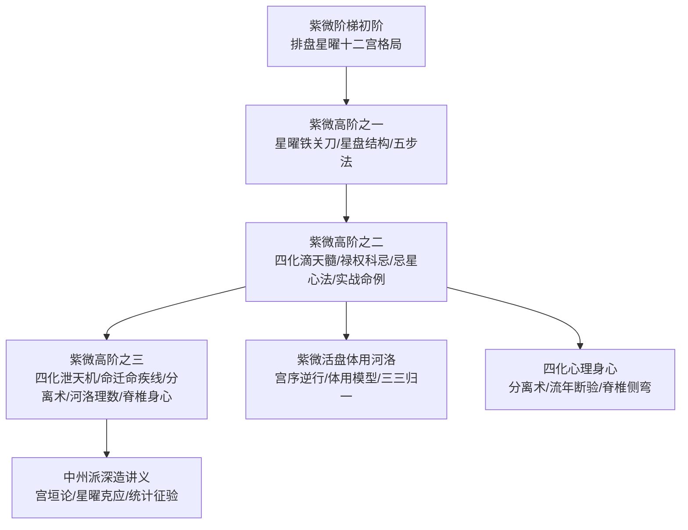

# 紫微高阶之二·四化滴天髓

> **书籍信息**  
> 作者：劝学斋主  
> 书名：《紫微高阶之二·四化滴天髓》  
> 版本：戊子年（2008）仲春序于台北劝学斋  
> 系列定位：紫微高阶系列第二册，承接《紫微高阶之一·星曜铁关刀》，后续为《紫微高阶之三·四化泄天机》《紫微高阶之四·飞星拦江网》

---

## 核心体系速览

| 维度 | 核心内容 | 对应章节 |
|------|----------|----------|
| **四化原理** | 四象变化、禄权科三吉忌一凶、四化不单独存在、先天河图转后天洛书 | 第一章 |
| **先后天四化** | 生年四化为先天/实质、大限流年宫干四化为后天/表现、后天为阳需动作配合 | 第二章、第三章 |
| **十二宫断验** | 命迁身心、财福钱财、官禄事业、田宅住宅、父疾情绪健康、兄友子女六亲 | 第二章、第七章 |
| **忌星心法** | 忌有两端（过犹不及）、斥力与黏力、化腐朽为神奇、趋禄避忌、以禄科解忌 | 第七章、第四章 |
| **特殊忌格** | 逆水忌、入库忌、拆马忌、反弓忌、进退马、绝命忌、纠缠忌、是非忌、循环忌 | 第十二章 |
| **实战应用** | 流年遁数、动静态空间套盘、住宅套命盘、他人套命盘 | 第五章 |
| **疑难命例** | 鼻咽癌（反弓+绝命+福德三盘破）、中风（大官化禄忌冲+发射台重叠）、双禄交流自化忌 | 第六章、附录 |

---

## 第一章 认识四化

### 一、四化原理

#### ◇ 四化：四即四象，化即变化
- **四象**：老阴、老阳、少阴、少阳，对应易经乾卦「元亨利贞」
- **变与化**：「变」越变越大，「化」越化越小，四化乃变化凸显之四种现象
- **群体意识**：每个时代有其信仰体系（如张天师五斗米道、朱熹姓名学），形成集体共识场

#### ◇ 化禄、化权、化科称三吉，化忌称化凶
- **一忌抵三吉**：化忌专搞破坏，禄权科碰忌即砸
- **四化不单独存在**：如飞机挂导弹，四化须挂于星曜之下
- **语法隐喻**：星曜为名词时四化为形容词，星曜为动词时四化为副词

#### ◇ 先天河图转后天洛书与四化关系
| 先天河图 | 后天洛书 | 四化启示 |
|----------|----------|----------|
| 木(1、6)在东 | 震卦木在东 | 权禄可变动（火金对调） |
| 火(2、7)在南 | 离卦火在南 | 科忌极稳定（不因时空改变） |
| 金(4、9)在西 | 兑卦金在西 | 学问越给越多、越懂越稳 |
| 水(3、8)在北 | 坎卦水在北 | 「先天之宝为道，后天之宝为德」 |

#### ◇ 『一症数脉、一脉数症』与四诊心法用在斗数
| 中医四诊 | 斗数对应 | 实操要点 |
|----------|----------|----------|
| **望诊** | 观察眼神气色 | 破军女「耗→空→虚→怨→恨」阶段判断 |
| **闻诊** | 听言语声调、嗅心态 | 「未医命、先医心」，消极颓丧者先建立信心 |
| **问诊** | 询问生活遭遇、婚姻状况 | 打破宿命论，留80%挪移空间 |
| **切诊** | 综合心境想法核对命盘 | 同命盘不同年龄/时机给不同建议 |

#### ◇ 化禄是经济、化权是政治、化科是文化
- **陈怡安博士企业心理学三原动力**：经济(禄)、政治(权)、文化(科)
- **化忌打破三吉**：忌碰禄=经济砸、忌碰权=政治砸、忌碰科=文化砸
- **解题策略**：拿钱(禄)买书上课、拿毅力(权)认真自修，以禄权解文化问题

---

### 二、四化话家常

| 场域 | 化禄(柔) | 化权(刚) | 化科(柔) | 化忌(两端) |
|------|----------|----------|----------|------------|
| **灯光** | 采光充足 | 强光 | 可调浪漫光 | 110V插220V瞬亮即毁 / 对面远光灯亮但看不见 |
| **感情** | 缠绵悱恻 | 毛手毛脚霸占 | 浪漫罗曼蒂克 | 干柴烈火（速燃速灭） |
| **接吻** | 热吻 | 强吻 | 轻吻 | 狂吻、偷吻 |
| **树木** | 枝叶茂盛 | 高大不问茂盛 | 盆栽苗圃 | 砍掉、修剪 |
| **空间** | 长方形 | 正方形 | 较小 | 乱（不等于脏） |
| **饮食** | 好吃 | 硬吃 | 优雅吃 | 猛吃或不吃 |

> **忌星两端**：过犹不及，极阴极阳即化忌。偏阴偏阳皆有弊病。

---

### 三、四化论理想

#### ◇ 禄权科最好禄在财、权在官、科在命
- **禄在财**：入本位，财帛星入财帛宫，进出旺盛
- **权在官**：入本位，官禄星入官禄宫，开创奋斗
- **科在命**：随和不计较，做人不计较、做事要计较（命官三合）
- **忌星最佳**：形成逆水忌或入库忌，各得其所

#### ◇ 做人不计较，做事得计较
- **化科在命**：面貌宽松、开玩笑（做人范畴）
- **化权在官**：手头事顶真认真、不马虎（做事范畴）
- **实例**：作者任主管时嘻嘻哈哈但坐经理位代行职务整顿迟到下属

#### ◇ 科为小禄、权为小忌；禄科为柔、权忌为刚
- **刚柔并济**：剛星遇柔化/柔星遇刚化为佳
- **权忌为刚**：权为小忌，化忌更刚；权遇柔星则刚柔并济
- **直接执行四化好处**：知禄权科忌好在何处直接照做，如座右铭成习惯成自然，属「顿悟」层面

#### ◇ 四化与天地人关系
| 位类 | 地支 | 禄星性质 | 忌星性质 |
|------|------|----------|----------|
| **天位** | 子午卯酉 | 天赐之禄（自然） | 天赐之忌（因果伤害，难处理） |
| **地位** | 辰戌丑未 | 劳碌之「碌」（四墓库约束） | 比较认命 |
| **人位** | 寅申巳亥 | 奔波之「碌」（四马地翻身） | 比较浮动 |

> **星气使然/气性使然/天性使然**：王充《论衡》「火不畏热、水不怕寒」，星曜控制傀儡般的人生

---

## 第二章 通论四化

### 一、广谈四化

#### ◇ 四化第一层意义：禄为财、权为势、科为名、忌为困
- **第二层蛻变**：禄=热情乐观情缘、权=奋斗义理、科=名实问题、忌=两端极致

#### ◇ 禄在命与他宫之情缘
- **生年禄在命**：先天缘，对自己有情缘→乐观者对自己仁慈
- **自化禄在命**：后天缘，表现乐观但实质未必
- **仁慈定义**：先对自己仁慈，再对别人仁慈，有指标内容，非妇人之仁

#### ◇ 禄为情缘，权为义理
- **家讲情(禄)不讲理(权)**，社会权太多则枯燥痛苦
- **权过多害处**：「应该」无限上纲，背负无数应该难喘息
- **高阶命理**：知情缘为禄、义理为权，权禄并用=有情有义

#### ◇ 兴趣是化禄，毅力是化权
- **缺一不可**：只权苦、只禄易熄火白白耗命
- **恒心毅力真相**：断断续续不怕断、只怕不续；空几天补今天再补昨天，永恒非无间断

#### ◇ 禄是能力、权是权力，强调权力损伤能力
- **实例**：作者任经理自视无权力，反展现能力完成托付
- **权力是裹糖衣毒药**：彰显权力损害能力，虚胖权力侵犯他人

#### ◇ 禄权科在我宫为自立(力)格
| 类型 | 定义 | 发射台(生年干)位置 |
|------|------|-------------------|
| **纯自立** | 禄权科全在我宫，生年干也在我宫 | 好坏自己来 |
| **非纯自立** | 生年干在他宫 | 起头借他力/教我 |

> **生年干为四化发射台/气结点**：《紫微进阶》一干论命法、《紫微高阶一》暗命宮用法皆本此

---

### 二、先后天四化

#### ◇ 定义
- **先天四化**：生年干化出的一组禄权科忌
- **后天四化**：大限、流年、流月、流日、各宫宫干四化

#### ◇ 化禄为缘份：先天缘好还是后天缘好？
- **后天缘更好**：后天属阳有动作对待关系；先天属陰只是相敬如宾过去式
- **后天四化若吉要有动作配合**：动吉生吉、动凶生凶、不动不生吉凶
- **趋吉避凶即动吉避凶**：趋近禄权科=动吉，避开忌=避凶

#### ◇ 缘起必缘灭、有因必有果、有对必有恃
- 先天/后天缘好不代表不离婚，对恃因果皆相对

---

### 三、谈化禄
- **禄在命**：除非逢财星否则不做财解；禄照为虚禄坐为实，虚比无好
- **活禄在迁**：「夫子文章盖世」正解为迁移宫禄星动态发挥
- **化禄在田宅**：兼论本田(先天)大田(后天)
- **禄存/化禄在福德**：谓之「有荫财」

### 四、谈化权
- **权本质**：力量，具成就性与伤害性
- **最佳用法**：权衡与权宜
- **权在命官**：霸气与霸道分辨；命化权照夫妻态度差别大
- **天机权在财命例** / **权星在福德宫**

### 五、谈化科
- **名实问题**：名只是法律道德作用与被误解
- **AB帐号法**：体会名实后解决漏财妙法
- **科在官**：适合学术研究；科星在命官不同意恩
- **科为小禄**：命迁不同；生年科在兄友、科在财帛宫

### 六、淡化忌心（核心心法）

#### ◇ 忌星本质
- **两端过犹不及**：偏阴偏阳弊病，极阴极阳即化忌
- **斥力与黏力**：让人心虚但真要给「虚心」
- **解厄核心原则**：化腐朽为神奇

#### ◇ 忌星固执与化解
- **择事固执非择善固执**：可化忌为禄
- **不跟别人比，跟昨天的自己比**：煩三月→三天→三时→三分→三秒
- **忌在命迁毛病**：脊椎弯曲判断法、自我整脊疗法、西藏板凳疗法

#### ◇ 六亲宫位忌星表现
| 宫位 | 忌星含义 | 化解建议 |
|------|----------|----------|
| **兄友** | 欠众生债（无有也得给） | 送钓竿教钓鱼，勿给鱼；注意床位 |
| **命宫** | 欠自己的债 | 面对自己的忌想办法解决 |
| **迁移** | 车祸、外出问题 | 低调行事非躲藏自闭 |
| **父母** | 出口直伤人、情绪化动物 | 稀释法：展开时空思考、不以他人错惩罚自己 |
| **夫妻** | 隔阂、吵架不为人知至决裂 | 抓关键几样让对方决定，其余放手 |
| **田宅** | 标准「入库忌」/泄气处 | 注意房屋泄气、自化忌易被拆 |
| **子女** | 欠小孩债/生育状况 | 第一胎特别注意 |
| **财帛** | 漏财 | 执行AB帐号 |

> **忌星一多即「累、烦、病」**：忌星太多要稳住心情；受忌有可原谅/不可原谅之分

---

## 第三章 深论四化（第十二章原序）

### 一、四化真谛

#### ◇ 忌有两端，禄权科有两面性
- **五行互藏**：禄中有权科忌、权中有禄科忌、科中有禄权忌、忌中有禄权科
- **禄中有权科忌**：感情中含义理(权)、名分(科)、执着(忌)
- **忌中有禄权科**：失败中含贵人(禄)、毅力(权)、好书好课(科)
- **忌中有科实例**：突破命格唯有找好书读、找好课听

### 二、月类自化与三种型态
- **禄自禄**：乐观、金钱、贵人表现不同
- **权自权**：可能滥权、错失良机、花拳绣腿
- **科自科**：「有书读而不知珍惜」
- **忌自忌**：讳称「一又四分之三忌」
- **田宅生忌自忌**：抢时机解救命例

### 三、化禄/权/科逢忌心法

#### ◇ 四种忌心组合特征
| 组合 | 核心特征 | 关键词 |
|------|----------|--------|
| **禄忌心** | 反复不定 | 心情波动大 |
| **权忌心** | 辗转不停 | 不停奔波变动 |
| **科忌心** | 不停打绕 | 罗唆、陀罗 |
| **忌忌心** | 双重强化 | 极度固执 |

#### ◇ 化解必备条件
- **权可以挡忌**、**忌可以挡禄**、**科可以解忌** —— 需刚柔并济、有制约关系
- **禄忌加阴煞、科忌加陀罗**更增特性

#### ◇ 禄忌同宫看权：为了改变是否要硬拗？
- **禄自化忌「弄巧成拙」**：如何解？看权星制约
- **命迁有禄有忌**：时开朗时不开朗
- **财帛生年忌自化禄** / **田宅生年禄自化忌(幼年家道中落)** / **田宅生忌自禄(由坏转好)**

#### ◇ 权忌心细节
- **田宅生忌自权**：辛苦后增加
- **权自化忌 vs 忌自化权**：有别
- **权忌在财帛**：周转；**在夫妻** / **在疾厄**

#### ◇ 科忌心：啰唆打绕陀罗如何办？
- **台视女记者忌自科在迁移**命例

### 四、二三化星再自化组合
禄权自化禄/权、禄科自化禄/科、禄忌自化禄/忌、权科自化权/科、权忌自化权/忌、科忌自化科/忌

### 五、各种忌心分类大全

#### ◇ 射出忌体系
- **自化/射出忌超六宫**：不可能朝八晚五安稳度日
- **命宫射禄/忌、迁移射忌**；**命迁互射忌**：在家外出都呆不住
- **射出忌最怕对宫自化** → 顺水忌/水流忌

#### ◇ 逆水忌（健康忌核心）
| 条件 | 定义 | 关键点 |
|------|------|--------|
| **我宫逆水忌** | 忌星逆向流回本宫 | 分辨我宫/他宫来源 |
| **疾厄逆水忌** | 谓之「健康忌」 | 易被误解，需命例辨析 |
| **十干年别研究** | 甲至癸年对照表 | 见书表格（丁戊己庚辛壬癸年数据） |

#### ◇ 入库忌（可久发/二流/脱身法）
- **定义**：忌星入墓库（辰戌丑未）形成特殊格局
- **艺人白某入库忌发二十年** / **做啥赚啥**命例
- **可久发组合**：文昌星与生月关系、辛年忌出生月规律、己年生忌生月时规律
- **十种羊陀夹忌脱身妙法**：羊陀夹忌也有两端；剖腹产勿用命宫逆水/入库忌

#### ◇ 拆马忌心
- **定义**：第二类入库忌同时为拆马忌
- **大限命宫拆马忌**：懂「多态统一」反使生命精彩
- **本疾/财帛拆马忌** / **第二类拆马忌尾转坏现象**

#### ◇ 反弓忌
- **定义与避开法** / **命例**

#### ◇ 进退马
- **命在卯夫在丑**：进马禄、退马忌特殊命例 / 退马忌实事解说

#### ◇ 绝命忌（两种）
- **蔡辰洲两种绝命忌都中奖** / **都中奖死于丁亥年** / **满贯绝命忌** / **两绝命忌又被丙干整死**

#### ◇ 纠缠忌（犀牛照角忌）：难以取舍 / 命例
#### ◇ 是非忌：禄来忌去，不均衡不公平
#### ◇ 循环忌：互化忌，可好可坏，操控在自己

---

## 第四章 趋避篇（实修心法）

### 一、学习与行动
- **书法/剑道/斗数「近、破、离」**：靠近师门、破除执着、离开依赖
- **假设你是谁，依其风格行事**：会有意想不到效果
- **基础功夫**：趋、避、解是动词，必须有动作才能趋吉避凶解厄

### 二、以禄科解己忌（核心操作）
- **以科解忌、以禄解忌** ≠ 科忌交战、禄忌交战
- **解厄分轻重缓急**：重则全方位下手，轻则拿掉压垮骆驼最后一根稻草
- **碰忌以禄科表现**：解忌心法

### 三、解忌杂谈实务
| 主题 | 核心要点 |
|------|----------|
| **巨门忌化解三部曲** | 具体三步操作 |
| **自化忌太多** | 怎么办？ |
| **命化科至子女、子女自化忌** | 子女讲不听如何办？ |
| **对小孩少「管」(权忌)多「教」(科)** | 核心教养原则 |
| **面对自己的忌想办法解决** | 七分精明三分憨最有利 |
| **改善几分就获益** | 无须全改 |
| **阴阳运用到做事软硬原则** | 柔者刚之、刚者柔之 |

---

## 第五章 运用篇（实战技法）

### 一、流年遁数
- **看丙戌年为何外灾频传**：流年遁数推演
- **流年遁数法可用许多方面**：不限年度大事

### 二、动静态空间套入命盘
- **如何趋吉**：空间方位与命盘宫位对应
- **接洽生意方位套入命盘**：即知成不成
- **大限忌入方位十年如何运用**：策略性调整

### 三、住宅套入命盘
- **屋宅VS命盘怎么看**：九宫八卦对应十二宫
- **文昌位要弄好**：知识信息爆炸时代关键

### 四、他人套入我命盘
- **另一人VS你命盘**：丙辰男套入壬戌女命盘实例
- **人际互动吉凶即时判断**

---

## 第六章 论命篇（疑难命例深度剖析）

### 一、论命观念
- **本命、大限、流年三者如何串联**：三层动态互动
- **财帛化忌入命化禄入父母** / **大官化忌入本官注意大官化禄去向**
- **子田为桃花用位，体在夫妻**
- **命财官各带出一组四正位**
- **车祸撞人损财/被撞损身**辨析
- **南半球论命**：大命体用移至大迁，大迁仅为北半球大命之用位

### 二、实战命例详析

#### ◇ 鼻咽癌命例（附录四同源）
| 关键断点 | 命理呈现 | 化解路径 |
|----------|----------|----------|
| **双重绝命格** | 既是反弓忌也是绝命忌 | 福德宫参一脚，用陀罗尼咒化解 |
| **田宅宫关键** | 为何要看田宅？ | 阳宅是帮凶，大疾重叠本田 |
| **忌自化禄解厄** | 忌自化禄问题 | 由妻命盘看其疾厄互证 |
| **财宫有漏** | 钱财流失 | 执行AB帐号法止漏 |
| **福德三盘皆破** | 不得掉以轻心 | 化解动作要不断、每年查流年招煞三宫 |

#### ◇ 中风命例详析
| 层面 | 命理铁证 | 解法要点 |
|------|----------|----------|
| **同盘不同命** | 有相同命盘者患精神官能症自杀 | 验证命理非宿命论 |
| **大官化禄入照本官、忌冲大命** | 禄逢冲破与化禄解忌差别极大 | 精准区分两者操作迥异 |
| **发射台重叠** | 生年忌化忌冲破生年禄，忌非同小可 | 重叠越多状况越重 |
| **时间维度** | 一时不能改不代表永远不能改 | 阳宅解决后每年注意外局影响 |
| **福德三盘皆破** | 陀罗尼咒要加紧做 | 向解忌方求医求神 |
| **实地勘查** | 梅花心易占卜住宅、佛桌犯病符、卧室犯「二五交加必损主」 | 环境调理配合命理化解 |

#### ◇ 双禄交流却自化忌命例
- **禄马交驰/双禄交流**看似大贵，奈何忌来破双禄
- **最怕疾福一路忌缠忌破** / 火星双马加速应验

---

## 附录精华（劝学斋主斗数开讲/心法实录）

### 附录一：两个广播明星之死（2006.11.15）
- **陈京**：禄马交驰双禄交流，忌破双禄，最怕疾福一路忌缠忌破，火星双马加速
- **黄瑞琪**：廉杀坐命慈直相，太阳忌要低调非躲藏自闭，艺人娱乐别人忘娱乐自己

### 附录二：关掉业障那部机器（2005.12.07）
| 道家三障 | 斗数化忌对应 | 核心心法 |
|----------|----------------|----------|
| 趋吉有理避凶有由 | 菩萨畏因众生怕果 | 防未患治未病 |
| 显意识→身心→潜意识 | 性心灵整体健康 | 业障如机器产出灾病 |
| 人生唯选择实践无是非 | 以身心为桥梁 | **关掉业障那部机器** |
| 容许他人犯错=了知非包容 | 妈妈回归初衷无婆媳问题 | 好运赚钱歹运赚学问 |

### 附录三：王淑品「一条虫变一条龙」（高雄班学员自述）
- 从命理小白到专业命理师的蜕变实录

### 附录四：从斗数推论阳宅鼻咽癌命例（2006.10.19）
- 大限忌冲命/福先查疾厄 → 大疾化忌冲本宫及大福 → 大疾重叠本田阳宅帮凶 → 福德皆破陀罗尼咒加紧 → 向解忌方求医求神 → 梅花心易占卜宅缺失 → 佛桌犯病符、卧室犯二五交加

### 附录五：横剖思想星曜（2005.04.02高雄左营海总）
| 星曜 | 思想功能 | 运作方式 | 核心关系 |
|------|----------|----------|----------|
| **天机** | 思想状能心 | 进行态/停止态 | 与廉贞特定关系 |
| **廉贞** | 思想局限/范定/指引 | 业障所在 | 与天机互补 |
| **巨门** | 思想交会(交错/交融) | 是非所在 | 与贪狼互动 |
| **贪狼** | 思想动力/欲望所在 | 与巨门互动 | 欲望驱动 |

---

## 交叉引用知识网络

### 紫微斗数体系内关联
- **前置基础**：[[ziwei-jie-ti-chu-jie]]（紫微阶梯初阶排盘星曜十二宫格局）
- **进阶星曜论**：[[ziwei-gao-jie-zhi-yi]]（星曜铁关刀、星盘两大结构杀破狼机巨同梁、暗命宫、星曜铁关刀五步法）
- **高阶活盘**：[[ziwei-huopan-tiyong-he-luo]]（宫序逆行、河洛一六共宗体用、一十推库位、一九推气数位、三三归一模型）
- **四化心理身心**：[[ziwei-sihua-xinli-shenxin]]（命迁线命疾线四化论性向、分离术、脊椎侧弯流年实战）
- **高阶三四化**：[[ziwei-gao-jie-zhi-san]]（命迁线命疾线四化论性向、分离术、体用河洛理数、脊椎身心对应、人生管理幸福库存）
- **中州派对照**：[[zhongzhou-pai-ziywei-doushu-shenzhao-jiangyi]]（宫垣论十二宫星曜本质克应、枢纽论、大限流年反应）
- **方法论批判**：[[ni-buzhidao-de-doushu]]（相性共性特性、先天后天命运分离、不可决定论）
- **依婷讲课**：[[yiting-ziwei-jiangke-jilu]]（真太阳时、三方四正、阴阳五行、日月格局案例）

### 跨术数体系对照
- **八字动态分析**：[[bazi-mingli-xue-dongtai-fenxi-jiaocheng]]（强弱调候格局形象、大运流年互动、合合化众寡追捕）
- **六壬金口诀**：[[liuren-shen-ke-jin-kou-jue-xin-sui-zhi-yao]]（心髓指要、版本源流、四位立课、十二将神贵神、消息妙论入式歌解）
- **凤麟阴盘奇门医疗**：[[fenglin-qimen-bingli-shenzhao-jingjie]]（八星八门八神象意、十一步排盘、36病症对照、四大医疗案例、移星换斗环境调理）
- **王唯工脉波论**：[[wang-wei-gong-mai-bo-lun]]（心跳谐波对应十二经络、脉诊定位治未病、以肺为宗、以颈为钥）

---

## 学习路径建议

---

## 核心金句摘录

> 「人生不如意事十常八九是错的，是裹着糖衣的毒药。啥是糖衣？受安慰了。啥是毒药？根深蒂固地误解人生。」

> 「化忌让人心虚，但它真正要给我们的是——虚心。」

> 「斗心是爱（禄），操心是债（忌）。只要降低操心的次数及深度，就是斗心，也就由债（忌）转爱（禄）了。」

> 「忌中有禄权科，所以失败中的人不用悲观。」

> 「趋吉避凶在斗数即是趋禄避忌。」

> 「要择事固执而不是择善固执，可化腐朽(忌)为神奇(禄)。」

> 「不要跟别人比，只要跟昨天的自己比。」

> 「解厄避凶最重要及最有价值的原则，就是化腐朽为神奇。」

> 「人生路上唯有选择及实践，不须有是非。以身心为潜意识与显意识之桥梁，关掉业障那部机器。」

---

## 版本记录
- **2024-12-19**：初版创建，基于归档全文结构化梳理，建立章节目录、核心表格、命例解析、交叉引用网络

## 来源

- [劝学斋紫微高阶之二](../sources/劝学斋紫微高阶之二.md)
