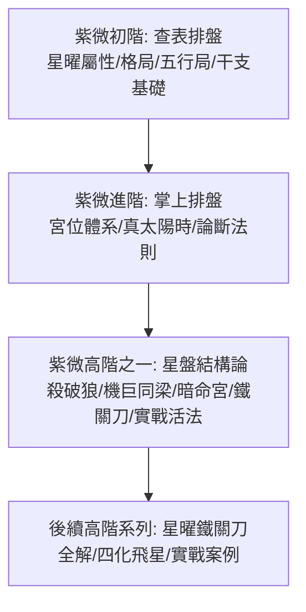

## 書寫宗旨與定位

### 核心動機
- **生命認同感的追尋**：作者指出現代人「熱愛生存，但欠缺對生命的認同感」，在衝突矛盾的世界中迷失，命理學能在窮、病、否、困時提供生命訊息的感應點。
- **去除矛盾、擁抱生命**：以紫微斗數為工具，幫助人們「不再迷失，不再與生命疏離」，期望更多人加入研究行列，達到「多態統一」的人生美感。
- **填補台灣命學研究缺口**：嘆觀日本、香港學者對中國命學典籍研究深入，台灣學界卻鮮見發表，故著書奉獻後學。

### 命理體系定位
- **五術歸類**：山、醫、命、相、卜五術中，紫微斗數屬「命」術範疇，以生辰資料推論命之窮通、運之吉凶，不看面相、不抽靈籤、不卜卦。
- **兩大派系並立**：與子平術（四柱八字）並列為當今命理學二大主流，近年斗數盛行、高手輩出，開創新紀元。
- **占星學源流**：源自中國古代天文學（七政四余），宋朝陳希夷仿制而成另一派占星學，精確度高、曾為「帝王之學」。

### 學習路徑設計
- **「初階」與「進階」雙軌**：先完成《紫微進階》（含掌上排盤、論斷法則），再補寫《紫微初階》使零基礎者可自修，兩書合併出版。
- **分層教學策略**：初階詳盡解說起源、查表排盤、古訣羅列、當前可用星曜；進階演化為掌上排盤、涵蓋所有論斷法則、指出研究方向。

## 系列書目脈絡與完整學習路徑

> **核心理念**：勸學齋主蔡學勤老師以「不留一手」為寫作原則，構建**三階梯次**的紫微斗數完整教學體系，由淺入深，環環相扣。

| 階梯 | 書名 | 核心定位 | 關鍵突破 | 適合對象 |
|------|------|----------|----------|----------|
| **第一階** | **《紫微階梯① 紫微初階》** | **入門基石・查表排盤** | 詳盡起源、速查表排盤、古訣羅列、當前可用星曜體系、格局分類、五行局闡微、干支基礎 | 零基礎自學者、需建立完整排盤骨架者 |
| **第二階** | **《紫微進階》** | **實務深化・掌上排盤** | 演化為掌上排盤（無需查表）、涵蓋所有論斷法則、指出研究方向、宮位體系深度解析、真太陽時校正 | 完成初階者、欲精通排盤技術與論斷邏輯者 |
| **第三階** | **《紫微高階之一》** | **結構論・實戰活法** | **星盤/宮盤雙盤論**、**殺破狼/機巨同梁**兩大星盤結構、**暗命宮**理論、**十二宮星座對照**、**得運失運檢查表**、**星曜鐵關刀五步分析法**（星盤結構→星性剖析→星曜直斷→趨避活法→四化啟示） | 掌握排盤論斷者、尋求結構化理解與實戰轉化者 |

### 三階承接關係圖解

- **知識遞補機制**：《初階》奠基「術」（排盤步驟、星曜名稱）；《進階》傳授「法」（掌算口訣、宮位動態）；《高階》揭示「道」（星盤結構陰陽、本體與用的互補、趨避活法）。
- **學習建議**：初學者必須先完成《初階》排盤流程與《進階》掌算速度，方能進入《高階》的結構思維與實戰應用；否則如書中所言：「如無法理解本章者，請由《紫微初階》《紫微進階》入門，循序漸進。」

## 陳希夷傳承脈絡

### 歷史人物小傳
- **身份**：唐末五代人，字圖南、號扶搖子，宋太宗賜號「希夷先生」，民間稱「陳搏老祖」，道家推為神仙祖師。
- **生平軌跡**：生於亂世，看透玄機隱居華山修道，以「睡功」聞名（每睡百餘日不起，側臥右肘當枕），宋太祖陳橋兵變後說「天下自此定矣」，曾任欽天監掌天文曆法。
- **代表作**：《無根樹》（內丹詩偈）、上述名詩《十年蹤跡走紅塵》。

### 易圖淵源系統
```
伏羲氏（河圖）→ 文王氏（洛書/八卦）→ 孔子（十翼）→ 漢儒（易傳）
→ 周敦頤（太極圖說/通書）→ 邵康節（皇極經世/梅花易數）
→ 陳希夷（睡仙/紫微斗數/無根樹）→ 劉牧（易數）→ 白玉蟾（增補紫微）
→ 羅洪先（嘉靖進士，收撰成四卷今本紫微斗數全書）
```

### 易圖傳授系統
- **呂純陽（洞賓）首創** → 傳陳希夷 → 幾經改易 → 白玉蟾增補 → 傳至十八代孫陳道（道號了然） → 明嘉靖年間羅洪先進士收撰成四卷流傳至今。

## 排盤完整步驟與星曜安置體系（初階查表法 ➜ 進階掌算法 ➜ 高階新法）

### 排盤前準備（四大要素）
1. **命盤繪製**：白紙繪十二格填十二地支（子丑寅卯辰巳午未申酉戌亥），中空填姓名、出生資料、陰陽男女、五行局、命主、身主。
2. **生年干支**：查百年干支對照表（以農曆年為準），如民國48年＝己亥。
3. **生時支**：對照十二時辰表（23:00-01:00子時，以此類推），爭議點：子時歸屬次日（作者主張23時起算翌晨）。
4. **陰陽男女**：以生年天干定陰陽（甲丙戊庚壬為陽，乙丁己辛癸為陰），再合性別定「陽男/陽女/陰男/陰女」。

### 核心排盤十九步驟（初階查表版 ➜ 進階掌算版 ➜ 高階新法補充）

| 步驟 | 內容 | 初階/進階關鍵表/口訣 | **高階新法補充（紫微高階之一）** |
|------|------|----------------------|----------------------------------|
| 1 | **定宮干** | 五虎遁月法：甲己年起丙寅…順布十二宮。 | **宮干冠蓋兩招新法**：<br>① 生年干序數×2+1=寅宮干序數（個位數定天干）。<br>② **生年干命盤定位圖**：甲年甲干在戌、乙在酉、丙在申、丁在未、戊在午、己在巳、庚在辰、辛在卯、壬在寅、癸在亥（甲己/乙庚/丙辛/丁壬/戊癸通用）。兼作「年干求月干圖」與「日干求時干圖」。 |
| 2 | **定命身宮** | 命身宮速查表：生月×生時交叉。口訣：「寅正順數生月逢…」 | **手指捷法**：左手五指位對應宮支（食指根子丑午未、食指尖寅卯申酉、中指尖辰巳戌亥），以命宮支起甲乙順數至命宮干定五行局。 |
| 3 | **安十二宮名** | 以命宮為起點逆時針：命兄夫子財疾遷友官田福父。身宮必與六正宮之一同宮。 | **六線對沖**：命遷線、兄友線、夫官線、子田線、財福線、父疾線。 |
| 4 | **定五行局** | 五行局速查表：命宮干支交叉得金四/木三/水二/火六/土五局。 | **手指捷法定局**：同步驟2手指位，1金2水3火4土5木，數至命宮干即得局數（水二/木三/金四/土五/火六）。 |
| 5 | **推算紫微星** | 紫微星速查表：五行局×生日得宮位。各局口訣（水二局初一丑順行…）。 | **除法捷法**：生日÷局數。整除取商；不盡除加<局數的數使整除，奇數商減之、偶數商加之；商>12減12；商≤0對應丑子亥酉。 |
| 6 | **安紫微星系** | 逆行：天機(隔一)→太陽(隔一)→武曲→天同→空二→廉貞→空三回紫微。 | **道生一一生二二生三三生萬物**：紫微(道/太極/一)→天機/太陽(二)→武曲/天同(三)→廉貞(萬物/三隔)。紫微己土陰土陽順陰逆。 |
| 7 | **安天府星** | 天府速查表：紫微宮位對照（巳亥對稱、寅申同宮）。 | **天府戊土陽土順行**。與紫微分道揚鑣：紫微順一宮天府逆一宮，紫微逆四宮天府順四宮（寅申同宮為分岔點）。 |
| 8 | **安天府星系** | 順行：太陰→貪狼→巨門→天相→天梁→七殺→空三→破軍回天府。 | **隱合三三歸一**：七殺破軍隔三、破軍天府隔一。天府星系八星順布無空宮。 |
| 9 | **安時系星** | 時系星速查表：生年支四組×生時支得文昌文曲火鈴地空地劫台輔封誥。 | **文曲文昌捷法**：子時文曲在左邊辰、文昌在右邊戌，順/逆數至出生時。午時對調，卯酉同宮丑未，分道揚鑣。 |
| 10 | **安月系星** | 月系星速查表：生月查左輔右弼天刑天姚天馬解神天巫天月陰煞。 | **左輔右弼捷法**：正月左輔在左邊辰、右弼在右邊戌，順/逆數至生月。七月對調，四十月同宮丑未。 |
| 11 | **安日系星** | 日系星表：三台(左輔起順至生日)、八座(右弼起逆至生日)、恩光(文昌起順至生日退一)、天貴(文曲起順至生日退一)。 | — |
| 12 | **安年干系星** | 年干系星速查表：生年天干查祿存擎羊陀羅天魁天鉞四化天福天官等。 | **祿存新法**：十天干臨官位對號入座（甲乙木寅卯、丙丁火巳午、庚辛金申酉、壬癸水亥子、戊己土寄巳午）。**羊陀**：祿前羊、祿後陀。<br>**天魁天鉞新法**：魁陽貴未起順（跳戌）、鉞陰貴丑起逆（跳戌），甲戊庚丑未對宮、乙己申子三方、丙丁夾戌、壬癸夾辰。 |
| 13 | **安年支系星** | 年支系星速查表：生年地支對照天壽天才破碎飛廉鳳閣龍池鹹池寡宿孤辰天喜紅鸞天哭天虛華蓋命馬等15星。 | — |
| 14 | **安截路空亡** | 截路空亡速查表：生年干定（甲己申酉…），正截空/傍截空為陰陽關係。 | — |
| 15 | **安旬空星** | 旬空星速查表：生年干支交叉定。 | — |
| 16 | **定命主星** | 命主星速查表：命宮地支定（子貪狼丑巨門寅祿存…），不入盤註記空白處。 | — |
| 17 | **定身主星** | 身主星速查表：生年支定（子午火星丑未天相寅申天梁…），不入盤註記。 | — |
| 18 | **安天傷/天使** | 天傷固定奴僕宮，天使固定疾厄宮。 | — |
| 19 | **起大限/小限** | 大限速查表：命宮、陰陽男女、五行局三維交叉得年齡區間。小限順逆輪轉。 | **大限順逆**：陽男陰女順、陰男陽女逆。局數定起運歲數（木三局命宮3-12歲）。 |

### 流年星排法（六大類）
1. **流年斗君**：以流年干支定斗君位置。
2. **流年干系流星**：流年天干定化祿/權/科/忌等。
3. **流年支系流星**：流年地支定歲驛、歲建等。
4. **流年歲前星**：十二歲前星（將軍、文昌等）。
5. **流年將前星**：十二將前星（歲驛、將軍等）。
6. **其他流年星**：流年祿存、流年祿馬等。

---

## 《紫微高階之一》核心創見體系（第三階重點）

> 本節補充《紫微高階之一》（星曜鐵關刀）獨有的理論突破與實戰框架，為本知識頁核心增值內容。

### 一、 星盤與宮盤：雙盤解碼命盤密碼
- **命盤二元論**：命盤 = **宮盤**（十二宮位、本命/大限/流年/流月/流日/流時） + **星盤**（紫微系/天府系統軌跡）。
- **星盤規律性**：紫微系六星管六線（命遷/兄友/夫官/子田/財福/父疾），間隔固定；天府系八星順布滿十二宮，至七殺破軍隱合三一。
- **實戰價值**：結合飛宮（宮盤）與飛星（星盤），同步運用，視野不再片面。
  - *例*：太陰代表女命，福德宮為巨門（主口） → 修飾言辭即改善女命；丁干使太陰化祿卻巨門化忌 → 欺負女人的天干是丁（地/坤卦）；庚干使太陽化祿卻天同化忌 → 欺負男人的天干是庚（人/乾卦）。
- **星盤命宮**：紫微無論落哪宮，永為星盤命宮，不失其帝星本質。

### 二、 星盤兩大結構：陰陽互補、本體與用
| 結構名 | 簡稱 | 構成星曜 | 屬性 | 格局特質 | 核心隱喻 |
|--------|------|----------|------|----------|----------|
| **殺破狼星盤結構** | 殺破狼 | 紫微、武曲、廉貞、天府、貪狼、天相、七殺、破軍（8星） | **陽、動、武** | 變動格局、行事求快、抄近路、目標導向、不拘過程 | **主帥** |
| **機巨同梁星盤結構** | 機巨同梁 | 天機、太陽、天同、太陰、巨門、天梁（6星） | **陰、靜、文** | 幕僚格局、按部就班、點線面思維、過程導向、周詳考慮 | **師爺** |

#### 判別法：看命宮、遷移宮有無殺/破/狼（屬殺破狼），或機/巨/同/梁/太陽/太陰（屬機巨同梁）。

#### 人生影響與趨避活法
1. **行運陰陽不合之不適感**：
   - 殺破狼命格行機巨同梁大限：覺得沉悶、缺乏生氣、錢財順也覺不習慣。
   - 機巨同梁命格行殺破狼大限：覺得事物動太快、無章法、好生不適。
   - *規律*：大限必陰陽交替（一陰一陽/一陽一陰更迭），不適感與運氣好壞無關，純屬陰陽頻率差異。
2. **兩大族群思維差異**：
   - 殺破狼：點狀突破、結果導向、覺得機巨同梁囉唆。
   - 機巨同梁：線面推演、過程導向、覺得殺破狼無章法。
3. **趨避活法（核心：自剋修行、互須互補）**：
   - **殺破狼者**：欣賞機巨同梁周到，委以步步為營之事，學習其點線面。
   - **機巨同梁者**：欣賞殺破狼突破，交以期限任務，學習其活潑變化。
   - **一六共宗**：命宮(一/陽/用/顯)與疾厄宮(六/陰/體/密)關係 → **殺破狼者體為機巨同梁，機巨同梁者體為殺破狼**。本體退化則用無力。積極強化本體（開發另一結構本能），才是改運根本（關掉業障機器開關，而非只清除厄運產品）。
4. **各主星坐命之本體對照表**（詳見書中第三章，如紫微命體天同/機巨同梁，武曲命體太陽/機巨同梁，七殺命體太陰/機巨同梁等）。

### 三、 宮盤兩種命宮：暗命宮理論
- **顯命宮**：地盤本命命宮（及大限/流年/流月/流日/流時命宮）。
- **暗命宮（兩個）**：
  1. **生年干所在宮位**（宮干冠蓋定位）。
  2. **生年支所在宮位**（生肖宮位）。*辛壬年出生者雙重暗命宮（如壬寅年：壬寅重、壬子輕）。*
- **暗命宮影響**：
  - **屬性摻合**：命宮屬殺破狼，暗命宮屬機巨同梁 → 摻雜特性（如血型AO、上升星座交疊）。
  - **生年忌應驗**：生年忌在生肖宮 → 出生首年流年逢忌，身體不健或多囉唆；生年忌在生年干宮 → **源頭不淨**（祿權科皆由此化出，一生行好運藏禍心，環境阻礙難脫）。

### 四、 宮盤與十二星座對照（四庫全書星學分野）
| 宮位 | 星座 | 核心關鍵詞 | 宮位 | 星座 | 核心關鍵詞 |
|------|------|------------|------|------|------------|
| 子 | 寶瓶座 | 人道主義、知性、自由、博愛 | 午 | 獅子座 | 自信權力、王者孤獨、快樂光輝 |
| 丑 | 摩羯座 | 追求成功、自我行動、嚴格現實 | 未 | 巨蟹座 | 專制保護、家庭平民、記憶懷古 |
| 寅 | 射手座 | 追求自由、半人半馬、讀書行路 | 申 | 雙子座 | 意識二元、雙重人格、人際溝通 |
| 卯 | 天蠍座 | 動機隱密、蜕變三階段、怀抱感恩 | 酉 | 金牛座 | 信心佔有、享受品味、內向任性 |
| 辰 | 天秤座 | 公平正義、平衡和諧、現實取向 | 戌 | 牡羊座 | 主動進取、自我肯定、特殊才能 |
| 巳 | 處女座 | 周到詳盡、快樂服務、神經緊張 | 亥 | 雙魚座 | 內心世界、潛意識強、沉迷嗜好 |

> **實戰用法**：以命宮星座全解釋命宮，兄弟宮星座解兄弟關係及兄弟本身…六親皆同。財帛看該宮星座財帛段，官祿看該宮星座官祿段。

### 五、 各宮得運失運檢查表（即時轉運工具）
| 宮位 | 得運表征（良藥） | 失運表征（預兆） | 對應部位 | 應用示例 |
|------|------------------|------------------|----------|----------|
| 子 | 熱誠順從 | 腦神經痛、小腿骨折、冷酷叛逆 | 腦部、小腿 | 命坐申、流命坐巳感冒 → 申為流命田宅 → 家裡溝通出問題 |
| 丑 | 壓力化大為小、樂觀 | 膝關節痛、牙痛、悲觀逃避 | 膝蓋、牙齒 | 羊年加強家庭和樂、懂權變增財運 |
| 寅 | 動靜兩顧面對 | 過度自信、逃避急躁、不兼顧讀書旅遊 | 筋骨皮、脊椎 | 馬年自信快樂、旅遊讀書兼顾激發財能 |
| 卯 | 蜕變、認定放下 | 得失心重、鑽牛角尖、嫉妒 | 肝、生殖、內分泌 | — |
| 辰 | 內外和諧擇是為之 | 腰腎病痛、夫妻朋友不和、優柔寡斷 | 腰、腎 | 辛巳年政治人物批鬥挑剔 → 巳流命 → 社會運氣下滑 |
| 巳 | 身心放松 | 腸胃病、緊張愛批評唠叨 | 腸子 | — |
| 午 | 自信不自大、快樂往前 | 心臟性能力背部問題、不快樂自大 | 心臟、背部 | — |
| 未 | 家庭和樂 | 胃病痛、家庭不和敏感焦慮 | 胃部 | — |
| 申 | 加強活動力、學習、溝通 | 手部骨折、肺部感冒、討厭人膚淺 | 手部、肺部 | 覺得周遭人討厭 → 申反應 → 加強活動溝通即可轉運 |
| 酉 | 講究生活品味 | 頭部酸緊、喉嚨痛、貪求物慾 | 頭部、喉部 | — |
| 戌 | 發展特殊才能 | 頭部病痛、工作平凡、急躁自私 | 頭部 | — |
| 亥 | 降低同情心 | 腳部病痛、濫情軟弱 | 腳部 | — |

### 六、 星曜鐵關刀：五步分析法（論命標準化流程）
對每一顆主星（十四正曜及重要輔星）統一施以五步剖析：

| 步驟 | 名稱 | 內涵 | 功能 |
|------|------|------|------|
| **1** | **星盤結構** | 該星在紫微/天府系統中的運行軌跡、自然環境、彼此關係（如紫微以天機為护衛/兄弟手段，太陽為子女/子田態度…） | 建立星曜「生態位」，非孤立符號 |
| **2** | **星性剖析** | 依星盤結構、五行生剋、主化權責，深度剖析星性本質（如紫微「帝星、不接受別人比他強」、武曲「財帛主、獨立自主」） | 透過結構看本質，避免斷語生硬 |
| **3** | **星曜直斷** | 依星性直接論斷在十二宮位之吉凶效應；運用化忌直指弊端（如廉貞化忌在夫妻宮主離異、武曲化忌主財來財去） | 實戰斷驗，針對性強 |
| **4** | **趨避活法** | 依星性提供趨吉避凶的**活潑方法**（非死板規則），了解三昧可變化運用（如武曲坐命宜「獨立經營」、太陰坐命宜「修飾言辭」） | **核心價值**：化知識為智慧，造命改運 |
| **5** | **四化啟示** | 祿因忌果、權為過程，四化揭示人生啟示（如祿存「給予即擁有」、化忌「欠債須還」） | 昇華命理為生命教育 |

> **作者語錄**：「不把星性弄懂，要懂斗數是痴人說梦；不把星曜帶入，迷於四化是緣木求魚。」「星曜鐵關刀就是要引領大家透視星曜，發前人之所未發，言前人之所未言。」

---

## 星曜分級與廟旺體系

### 星曜四級分類（參考體系）
| 等級 | 代表星曜 | 備註 |
|------|----------|------|
| 甲級 | 紫微系6星、天府系8星、祿存、擎羊、陀羅、天魁、天鉞、左輔、右弼、文昌、文曲、火星、鈴星、地空、地劫、天馬、四化星 | 核心論命星曜 |
| 乙級 | 天刑、天姚、天廚、天巫、天月、陰煞、台輔、封誥、龍池、鳳閣、紅鸞、天喜、三台、八座、恩光、天貴、天官、天福、天才、天壽、天空、孤辰、寡宿、飛廉、破碎、天哭、天虛 | 輔助星曜 |
| 丙級 | 生年博士十二星、截路空亡、長生十二神、天傷、天使 | 補助星曜 |
| 丁/戊級 | 流年歲前十二星、流年將前十二星 | 流年專用 |

> **作者觀點**：星不分大小，得勢則大行，失勢則無用；分吉凶僅供初學者建立概念，實務以座宮五行生剋制化定星力。

### 廟旺失陷簡表（十二宮五行屬性）
| 宮位 | 五行 | 宮位 | 五行 | 宮位 | 五行 | 宮位 | 五行 |
|------|------|------|------|------|------|------|------|
| 子 | 水 | 卯 | 木 | 午 | 火 | 酉 | 金 |
| 丑 | 土 | 辰 | 土 | 未 | 土 | 戌 | 土 |
| 寅 | 木 | 巳 | 火 | 申 | 金 | 亥 | 水 |

星曜在旺相宮（同五行）為廟旺，在剋洩宮為失陷，詳細對照見書中「諸星廟旺失陷表」。

---

## 十二宮基本認識與論命框架

### 宮位核心意涵
| 宮位 | 核心主掌 | 宮位 | 核心主掌 |
|------|----------|------|----------|
| 命宮 | 本人一生總體、性格、外貌 | 遷移宮 | 外出發展、人緣、晚年 |
| 兄弟宮 | 手足緣、同輩關係、合夥 | 奴僕/交友宮 | 部屬、朋友、社交 |
| 夫妻宮 | 配偶、婚姻、合夥關係 | 官祿/事業宮 | 職業、仕途、事業成就 |
| 子女宮 | 子女緣、創作、投資 | 田宅宮 | 不動產、居住環境、晚年安穩 |
| 財帛宮 | 正財、理財能力、資源 | 福德宮 | 精神享受、福報、心靈狀態 |
| 疾厄宮 | 疾病、災厄、身體弱點 | 父母宮 | 長輩緣、庇蔭、靈性根基 |

### 三方四正結構
- **三方**：命宮對宮（夫妻）、命宮前一宮（遷移）、命宮後一宮（疾厄）構成「三方」，為命宮最直接影響力量來源。
- **四正**：命、遷、夫、疾四宮為「四正」，主一生大體框架。

### 命宮三大類型
1. **命宮陰陽與生年陰陽同/異**：影響性格內外向表裡。
2. **男亥女寅**：特殊命盤結構（男命命宮在亥、女命命宮在寅）有特定斷驗。
3. **男女命異同**：同盤男女論命重點不同（如夫妻宮、子女宮主掌差異）。

---

## 格局體系（好格局38類、壞格局18類）

### 代表性好格局（吉格）
| 格局名 | 核心組合 | 主旨 |
|--------|----------|------|
| 極向離明格 | 太陽在午/巳/未、三方四正會吉星 | 文明顯達、光明正大 |
| 輔弼拱主格 | 左輔右弼夾命/身/財/官 | 貴人扶助、事半功倍 |
| 紫府同宮格 | 紫微天府同宮（寅/申） | 權威與倉庫合一、大富大貴 |
| 機月同梁格 | 天機太陰天梁同宮/三方 | 智慧與慈悲並濟、學術專才 |
| 日月並明格（丹墀桂墀） | 太陽太陰在卯酉夾命/身 | 陰陽調和、夫妻和睦、才華橫溢 |
| 文曲拱命格 / 昌曲夾命格 | 文昌文曲夾命/身/官/福 | 文才出眾、考試順利 |
| 祿馬交馳格 / 祿馬配印格 | 祿存天馬同宮或加會印綬星 | 富貴雙全、動靜相宜 |
| 化星返貴格 | 四化星飛入得地宮位 | 化忌化解、轉禍為福 |

### 代表性壞格局（凶格）
| 格局名 | 核心組合 | 主旨 |
|--------|----------|------|
| 極居卯酉格 | 紫微/天府在卯酉獨坐無吉拱 | 權威受剋、進退維谷 |
| 日月反背格 | 太陽在酉、太陰在卯（落陷） | 陰陽失調、夫妻不和、漂泊 |
| 殺拱廉貞格 / 貞殺同宮格 | 七殺廉貞同宮或三方會照 | 性格剛烈、刑克六親、災厄重 |
| 巨逢四煞格 | 巨門會擎羊陀羅火鈴 | 口舌是非、訴訟、謀劃失敗 |
| 命無正曜格 | 命宮無十四主星坐守 | 主觀能動性弱、依賴他人 |
| 空劫夾命格 | 地空地劫夾命/身 | 虛耗、空歡喜、難以積累 |
| 羊陀夾忌格 | 擎羊陀羅夾化忌 | 災禍突發、手術、意外傷害 |

> **格局活用原則**：格局非絕對吉凶，須看星曜廟旺、四化飛星、大限流年觸發情況，活用於「避凶趨吉、造命」之實踐。

---

## 五行局闡微（五大局、三十納音）

### 五行局由來與總論
- **源頭**：《六十花甲子納音歌》→ 命宮納音定五行局數（金四、木三、水二、火六、土五）。
- **局數與行運**：決定大限起宮順逆、流年流轉規則。
- **局數與年歲**：對應人生階段性主題（如火六局主中年發展、土五局主晚年安穩）。
- **五行局與個性/聲音**：金局聲音清脆決斷、木局聲音悠揚仁厚、水局聲音低沉智慧、火局聲音高亢禮節、土局聲音敦厚誠信。
- **局與宮關係**：五行局為「體」，十二宮為「用」，局宮五行生剋制化定吉凶層次。

### 五行局分論（六納音×五局＝三十類）
| 局別 | 六納音 | 代表特質 |
|------|--------|----------|
| **金四局** | 海中金、金箔金、白蠟金、砂中金、劍鋒金、釵鈿金 | 堅毅、決斷、財帛、金屬機械、法律 |
| **木三局** | 桑柘木、松柏木、大林木、楊柳木、石榴木、平地木 | 仁慈、成長、教育、醫藥、木材植物 |
| **水二局** | 潤下水、大溪水、長流水、天河水、大海水、井泉水 | 智慧、流通、貿易、航運、謀略 |
| **火六局** | 霹靂火、爐中火、覆燈火、天上火、山下火、山頭火 | 禮儀、光榮、能源、電器、演藝 |
| **土五局** | 壁上土、城頭土、砂中土、路旁土、大驛土、屋上土 | 信實、承載、房地產、農牧、中介 |

> 每納音再細分命宮十二宮位落陷、星曜組合、大限流年應驗，書中均有詳盡案例闡釋。

---

## 五行干支命理基礎（第六章核心知識庫）

### 天干十神與五行屬性
| 天干 | 五行 | 陰陽 | 十神意象 | 人體對應 |
|------|------|------|----------|----------|
| 甲 | 木 | 陽 | 正印/偏印 | 膽、頭、頸 |
| 乙 | 木 | 陰 | 比肩/劫財 | 肝、頸、脊椎 |
| 丙 | 火 | 陽 | 正官/七殺 | 小腸、心、肩 |
| 丁 | 火 | 陰 | 偏財/正財 | 心、血、脈 |
| 戊 | 土 | 陽 | 正印/偏印 | 胃、鼻、皮膚 |
| 己 | 土 | 陰 | 比肩/劫財 | 脾、腹、肌肉 |
| 庚 | 金 | 陽 | 正官/七殺 | 大腸、肺、骨 |
| 辛 | 金 | 陰 | 偏財/正財 | 肺、氣、皮毛 |
| 壬 | 水 | 陽 | 正印/偏印 | 膀胱、腎、耳 |
| 癸 | 水 | 陰 | 比肩/劫財 | 腎、精、髮 |

### 地支藏干與十二長生
| 地支 | 藏干 | 五行 | 方位 | 十二長生（以日主論） | 沖/合/刑/害 |
|------|------|------|------|------------------------|--------------|
| 子 | 癸 | 水 | 北 | 長生/沐浴/冠帶/臨官/帝旺/衰/病/死/墓/絕/胎/養 | 午沖、丑合、卯刑、未害 |
| 丑 | 己癸辛 | 土 | 東北 | …… | 未沖、子合、戌刑、午害 |
| 寅 | 甲丙戊 | 木 | 東北 | …… | 申沖、亥合、巳刑、丑害 |
| 卯 | 乙 | 木 | 東 | …… | 酉沖、戌合、子刑、辰害 |
| 辰 | 戊乙癸 | 土 | 東南 | …… | 戌沖、酉合、丑刑、卯害 |
| 巳 | 丙戊庚 | 火 | 東南 | …… | 亥沖、申合、寅刑、戌害 |
| 午 | 丁己 | 火 | 南 | …… | 子沖、未合、卯刑、巳害 |
| 未 | 己丁乙 | 土 | 西南 | …… | 丑沖、午合、子刑、午害 |
| 申 | 庚壬戊 | 金 | 西南 | …… | 寅沖、巳合、亥刑、卯害 |
| 酉 | 辛 | 金 | 西 | …… | 卯沖、辰合、戌刑、戌害 |
| 戌 | 戊辛丁 | 土 | 西北 | …… | 辰沖、卯合、未刑、酉害 |
| 亥 | 壬甲 | 水 | 西北 | …… | 巳沖、寅合、申刑、申害 |

### 五行生剋制化與命理應用
- **相生**：木→火→土→金→水→木（母養子）
- **相剋**：木剋土、土剋水、水剋火、火剋金、金剋木（父管子）
- **制化**：有制無偏、有化無滯，需結合局數、宮位、星曜綜合判斷。
- **實務原則**：以命宮五行為主體，觀各宮星曜五行生剋，再參大限流年五行流轉，定人生各階段榮枯得失。

---

## 交叉引用與延伸閱讀

### 本庫相關頁面
- [[ziwei-doushu-xiang-xing-lilun]] — 紫微斗數相性理論、共性與特性、方法論批判
- [[ziwei-qinzi-shiwulian]] — 張盛舒《紫微的教養智慧》親子教養、食物鏈、大限應用
- [[zhongzhou-pai-ziywei-doushu-shenzhao-jiangyi]] — 王亭之中州派深造講義、星曜論、六十星系、宮垣論
- [[chu-xue-ziwei-doushu]] — 鄭景峰《初學紫微斗數》入門教材、排盤星曜十二宮格局
- [[ziwei-doushu-an-xing-fa]] — 中州派安星法、五行局、大限、十四正曜安置口訣
- [[yiting-ziwei-jiangke-jilu]] — 依婷講課記錄、真太陽時、三方四正、日月格局案例
- [[ziwei-gao-jie-zhi-yi]] — **勸學齋主《紫微高階之一》書目總覽**，涵蓋宮干冠蓋速算新法、星盤/宮盤雙盤論、殺破狼與機巨同梁兩大星盤結構、明暗命宮理論、十二宮與星座對照、得運失運檢查表，以及星曜鐵關刀五步分析法的完整體系
- [[ziwei-xingpan-liangda-jiegou]] — **深度解析勸學齋主紫微體系核心創見：星盤兩大結構——殺破狼（陽/動/武/變動格局）與機巨同梁（陰/靜/文/幕僚格局）的定義、判別法、陰陽互補關係、對人生與人際關係的影響，以及針對不同結構行運不適的趨避活法與自剋修行路徑**

### 關鍵術語索引
- **排盤核心**：命宮、身宮、五行局、紫微星、天府星、三方四正、四化星
- **星系體系**：紫微六星系、天府八星系、時系星、月系星、日系星、年干系星、年支系星
- **輔助星曜**：祿存擎羊陀羅、天魁天鉞、左輔右弼、文昌文曲、火鈴地空地劫、台輔封誥、四化飛星
- **限運體系**：大限（十年一宮）、小限（一年一宮）、流年斗君、流年四化、流年歲前將前
- **格局判斷**：吉格38類、凶格18類、格局活用、避凶趨吉
- **五行局系**：金木水火土五局、三十納音、局宮生剋、局數行運關係
- **高階獨有**：宮干冠蓋新法、星盤/宮盤雙盤論、殺破狼/機巨同梁結構、暗命宮（生年干宮/生肖宮）、源頭不淨、十二宮星座對照、得運失運檢查表、星曜鐵關刀五步法

---

## 版本資訊與編修說明
- **作者**：勸學齋主（蔡學勤）
- **出版**：勸學齋發行，己巳年（2001）雨水日序（初階）；壬午仲夏序（高階之一）
- **結構**：
  - 《初階》：六大章（認知、排盤、論命、格局、五行局、干支基礎），含大量速查表、口訣、解析、案例
  - 《進階》：掌上排盤、宮位體系深造、真太陽時校正、論斷法則
  - 《高階之一》：高階排盤新法、星盤宮盤雙盤論、星曜鐵關刀（十四主星及重要輔星五步深度剖析）、大限流年論法、勸學齋覺察語/自勉語/斗數藥言
- **特色**：兼採各家論說、羅列古訣、標示當前可用星曜、分層教學（初階查表→進階掌算→高階結構）、誠摯期盼後學賜教續寫
- **數位知識庫整合**：本頁面依《紫微階梯① 紫微初階》全書目錄與正文節選整理，並**重度補充《紫微高階之一》核心理論**（星盤結構、暗命宮、星座對照、得運失運表、鐵關刀五步法），保留原書排盤步驟編號、速查表結構、口訣原文，建立三階梯次完整學習路徑與交叉引用網絡，供數位知識庫檢索與研習參考。

> **編修者附記**：紫微斗數學習乃「術→法→道」三層遞進。《初階》立術（排盤骨架），《進階》傳法（掌算心法），《高階》悟道（結構本體、陰陽互補、自剋修行）。學者宜按部就班，切勿貪多嚥不完；掌握「星盤結構判別」與「暗命宮屬性摻合」兩大高階鑰匙，即能解開《高階之一》實戰活法之核心密碼。

## 来源

- [劝学斋紫微高阶之一](../sources/劝学斋紫微高阶之一.md)
