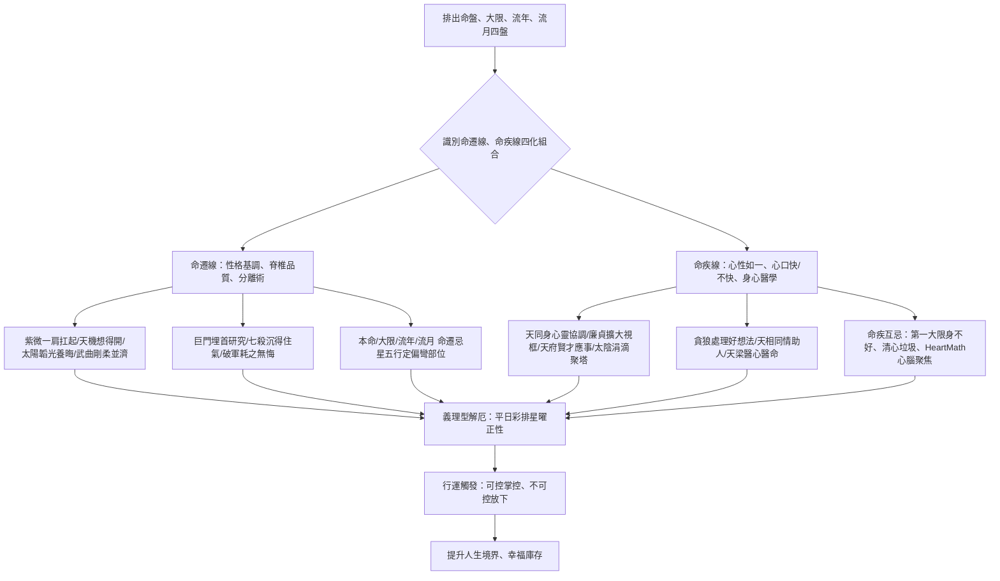

## 概述

本頁依據勸學齋主《紫微高階之四·飛星機關網》中各主星「以命理理命」章節，萃取其核心心理哲學與身心轉化法則。書中提出**「命理是用來理命的」**，強調透過飛星四化（祿權科忌）觀察星性發揮，並以「義理型解厄」——即平日熟練星曜正性，於行運觸發忌星前已完成「彩排」——實現趨吉避凶。

十四主星對應十四種人生課題與心法，構成完整的**四化星性心理轉化對照表**，為命理諮商、自我成長、身心靈整合提供結構化工具。

> 相關知識庫頁面：[[ziwei-gao-jie-zhi-san]]、[[ziwei-gao-jie-zhi-yi]]、[[ziwei-doushu-xiang-xing-lilun]]、[[ziwei-huopan-tiyong-he-luo]]、[[ni-buzhidao-de-doushu]]、[[ziwei-jie-ti-chu-jie]]

---

## 核心理念：以命理理命・義理型解厄

| 維度 | 內涵 |
|------|------|
| **宗旨** | 研究命理最崇高目的：作好人生管理，提升人生境界。企業管理只管官祿；人生管理以命宮為體，十二宮全面臻完善。 |
| **方法** | **義理型解厄**：熟悉星性，徹底發揮星曜正性，以正面意義為用，讓負面意義無空間展現。平日隨時演練（彩排），非等化忌臨頭才解救。 |
| **原則** | 好的條件注意碰會受傷；壞的組合研究如何改善並執行。人生繞著命盤跑，想辦法過得好。 |
| **關鍵** | **制機之先、治未病之病、防未患之患**。 |

---

## 十四主星心理與身心轉化對照總表

| 主星 | 五行屬性 | 核心心法（以命理理命） | 心理轉化關鍵詞 | 身心對應焦點 | 正性發揮策略 | 負性化解策略 |
|------|----------|------------------------|----------------|--------------|--------------|--------------|
| **紫微** | 陰土（脾土） | **一肩扛起，領導自我** | 責任擔當、不居功諉過、自領導 | 統帥中樞、自尊心、貴人緣 | 集思廣益、無懼無畏主宰、明君自處、廣納建言 | 化忌入命/遷：分離術——可控掌控（面容/情緒），不可控放下（錢/緣/大限） |
| **天機** | 陰木（肝木） | **想得開，化解鑽牛角尖** | 立體思考、懷疑念力管理、智慧勝聰明 | 腦神經、手足神經、肝膽、魂魄 | 不怕想多，怕想窄；把可能性想透，最壞不過如此；善體人生冷暖 | 化忌入命/遷：拜神契、奉獻眾生、主動償還、轉「鑽牛角尖」為「擴及線面體」 |
| **太陽** | 陽火（小腸火） | **韜光養晦，平衡光芒** | 傲骨不傲氣、該上上該下下、不關心中太陽 | 左眼、心臟、血壓、男性/父/子/夫宮 | 光明磊落、博愛好施、外交排場、韜光養晦（不愛出風頭） | 化忌/失輝：注意心血管、眼疾；修「傲骨不傲氣」，避免愛現、愛出風頭 |
| **武曲** | 陽金（大腸金） | **剛柔並濟，處理財慾** | 起而行錢財來、剛柔並濟、節制與堅忍 | 肺腸、骨骼、財帛庫、正財 | 起而行、順境節制、逆境堅忍、剛柔並濟（過剛折、過柔弱） | 化忌坐命：不堅強時堅強成倔強；化權忌沖財：嚴守AB帳號、管制調度 |
| **天同** | 陰水（腎水） | **身心靈協調，化解疾厄** | 協調即協調不容破裂、身心靈整體健康、鬆中有緊 | 免疫系統、內分泌、福德庫、享受力 | 自我協調、身心靈整體協調（上下左右前後）、輕鬆樂逍遙 | 化忌入疾/命：協調破裂→疾厄；守「協調本意」，避免過度犧牲或放縱 |
| **廉貞** | 陰火（心火/囚） | **擴大視框，破除自我設限** | 不自我設限、接受他人設限、大事大太極小事小太極 | 心臟、血液、行政流程、次桃花 | 賢才應事、擴大視框/思框/行框、流程化管理、鬆中有緊 | 化忌入命/遷：囚結難解→擴大框架、接受限制、流程正規化、勿製造爭端 |
| **天府** | 陽土（胃土/庫） | **賢才應事，避免強爭** | 賢才創造解決問題、不自以為是、不贏起跑點輸終點 | 消化系統、儲蓄庫、田宅庫、貴人 | 雄才大略、掌權當老闆、擴增財田、讓眾皆曰是 | 化忌入命/遷：強爭損貴氣；修「賢才應事」，避免製造問題、引發爭端 |
| **太陰** | 陰水（腎水/富） | **涓滴聚塔，經營福德** | 柔中有剛、涓滴得失聚沙成塔、男陽中有陰女陰中有陽 | 腎臟、生殖、婦科、清明度、財田小庫 | 溫柔四象、涓滴之得聚塔、涓滴之失轉眼空、靜心不墜陰沈 | 化忌入命/財/田：陰沈漸衰、財田漸損；權忌並存需權衡、靜心養陰 |
| **貪狼** | 陰水（癸水/慾） | **處理好想法，昇華慾望** | 理想=處理好想法、滿足非障礙、無欲則剛、圓己美夢不如成就眾望 | 生殖、壽命、桃花、靈感美感、解厄 | 處理好想法、理想美感、桃花化解厄、神仙之宿靈感 | 化忌入疾/命：慾望失控、想法雜亂；守「理想定義」、昇華慾望為創造 |
| **巨門** | 陽水（壬水/口） | **埋首研究，轉化口舌** | 敏感善分析、埋首研究創造價值、沉潛學問不理是非 | 口腔、咽喉、聲帶、腸道、是非口舌 | 埋首研究、創造價值、有觀念做火車頭、韜光養晦 | 化忌/化暗：口舌是非、憂疑病符；轉「說是非」為「說好話、吃健康」 |
| **天相** | 陽木（膽木/印） | **同情助人，守護貴氣** | 吉人自有天相、同情助人兼顧上進、言行舉止不失貴氣 | 肝膽、外貌儀表、衣食祿、貴人扶持 | 話說吉人自有天相、穿著不必高貴言行貴氣、同情助人 | 化忌入命/遷：貴氣喪失、印信不靈；注重穿著儀態、同情助人不縱容 |
| **天梁** | 陽木（膽木/蔭） | **醫心醫命，對應脊椎身心** | 未醫病先醫心、醫命先醫心、天良良醫、上醫醫國中醫醫人下醫醫病 | 脊椎、骨骼、壽命、蔭庇、醫藥、遷移腳 | 化氣曰陰、蔭庇眾生、醫星藥星、上醫中醫下醫分明 | 化忌入疾/命：心病身病並發；修「天梁即天良」、醫心為本、脊椎調理 |
| **七殺** | 陽金（肺金/厲） | **沉得住氣，突破困境** | 真勇氣沉得住氣、可任隨變萬變不離其宗、衝破困境打造心境 | 肺、呼吸、大腸、變動力、開刀手術 | 寧為墊腳石不為絆腳石、沉得住氣、衝破困境、打造心境 | 化忌/權沖命疾：游手好閒、暴起暴落、開刀；修「真勇氣」、沉氣定性 |
| **破軍** | 陰水（癸水/耗） | **耗之無悔，建設性破壞** | 人生必有破耗只求耗無悔、回憶助益則強否則忘、為建設而破壞 | 重組、重生、雜亂清理、桃花主、夫妻子僕 | 耗之無悔、回憶取捨、破壞為建設、耗己肥人是本事 | 化忌入命/田：雜亂耗散、耗人肥己是醜事；修「耗無悔」、建設性破壞 |

---

## 逐星深度解析與實踐指引

### 紫微星：一肩扛起——領導自我的人生總帥

> **星性**：紫微己土，陰土、脾土。化氣曰尊，貴星之最。一國之君、群眾之王、一家之長、一事之主、一身之首。官祿主，具領導風格。

#### 以命理理命・核心心法
1.  **集思廣益，無懼無畏地主宰一切，一肩扛起。**
2.  **不要居功諉過，要一肩扛起。** 應裁判自己的是非，不裁判別人的是非。把自己當皇帝思考：明君下詔罪己，昏君愚弄百姓。
3.  **領導好自己，才能領導好別人。** 領導自己優於領導別人。領導自己成功者，廣采眾智、多藉諸方，選擇決定皆我，錯誤失敗一肩扛起。
4.  **每個人都是領導者。** 培養「具備領導他人能力」與「擁有被領導度量」。領導時廣納建言，被領導時衷心服從。管理上司亦是管理之一環（大鐘擺效應）。

#### 飛星四化心理映射
| 四化組合 | 心理狀態 | 轉化建議 |
|----------|----------|----------|
| **化祿/權/科入命官** | 擁有領導才華/才幹/撇步 | 先天或後天行運顯現，善用調度能力 |
| **化忌入命/遷** | 孤克錯失貴人、固執積重難返、自尊自卑交織 | **分離術**：可控（面容/情緒/環境）掌控；不可控（錢/感情/大限）放下。廣播名嘴「關門瞬間恢復笑臉」案例。 |
| **化忌入六親** | 孤克六親、眾生中抬不起頭 | 練習「有被領導度量，領導人能力」，自行調整成專家。 |
| **化忌入財/福/疾** | 調度金錢損顏面、心靈孤寂矛盾、創業無力指揮無力 | AB帳號管制金錢；唸誦經文化解心結；降伏其心（修行課題）。 |

#### 身心對應
- **命遷線 = 脊椎、中氣、衝脈、呼吸道、食道**。命宮主頭面，遷移主腳行動力。
- **脊椎側彎品質**：本命命遷見生年忌/自化忌/射忌 → 品質差。五行定偏彎部位：水(命門腰椎)、金(胸椎上/肺)、土(胸中/脾胃)、火(胸中上/心)、木(胸下/肝膽)。
- **三盤呼應驗流年**：本命、大限、流年、流月命遷宮干化忌疊加 → 該年月脊椎彎曲發病。

> 參考：[[ziwei-huopan-tiyong-he-luo]]（河洛體用、一六共宗體用）、[[wang-wei-gong-mai-bo-lun]]（脈波論十二經絡）、[[yi-fei-wei-zong]]（以肺為宗、命門腰椎）

---

### 天機星：想得開——化解鑽牛角尖的智慧引擎

> **星性**：天機乙木，陰木、肝木。成品木、思想智慧。主腦筋、腦神經、手足神經、肝、魂。化氣曰善，布施星。兄弟主，主床位陽宅、樓梯階梯。

#### 以命理理命・核心心法
1.  **不怕想太多，只怕想得不夠寬、不夠廣。** 想多不錯，怕在單一點小範圍想多 → 鑽牛角尖。層面夠廣深，想多很美。
2.  **想得開的方法**：把可能性一一想過，最壞不過如此，毋須再煩。思考解決方法選一個做，心煩別列選項。聖人不多，不想當聖人最快樂。
3.  **懷疑的念力純度百分之百。** 懷疑配偶外遇會催生桃花。思想胡亂則鬼愚賤，圓融則神智貴。
4.  **聰明人尋煩惱，智慧人無煩惱。** 聰明少求、智慧多要。針對不是之處想出解決之道。思考擴及線面體、立體思考（八方挪一步皆海闊天空）。

#### 飛星四化心理映射
| 四化組合 | 心理狀態 | 轉化建議 |
|----------|----------|----------|
| **化祿/權/科入命遷兄友** | 施捨氣度、交際手腕、智商高 | 先天或行運/往來眾生啟動 |
| **化忌入命** | 不開朗、鑽牛角尖、小聰明多、自身矛盾、易精神官能症 | 拜神契、奉獻眾生、主動償還；把「想」擴大為立體思考 |
| **化忌入遷/六親** | 人事傷腦筋、手足問題、肝魂不安 | 拙於經營人際 → 造就自己讓人來經營你（忌中尋科） |
| **化忌入財/官/田/福/疾** | 金錢/事業/家務/心靈/身體傷腦筋 | AB帳號管錢；陽宅床位亮紅佈置；掌控心思雜亂（病由心生） |

#### 身心對應
- **腦神經、手足神經、肝膽、魂魄**。床位與肝木寧靜、魂魄安寧極密切。
- **天機生年忌坐命/遷**：發射台在遷移 → 對外人際極傷腦筋。建議：拙於經營人際，不如造就自己讓人經營你。

> 參考：[[neijing-huxi-yangsheng-fa]]（肝主魂、呼吸養生）、[[EFT情绪释放技巧]]（敲拍釋放鑽牛角尖念頭）、[[guan-xi-liao-yu-gottman-qing-xu-yao-qing]]（情緒邀請、接納不可控）

---

### 太陽星：韜光養晦——平衡光芒的外交官

> **星性**：太陽丙火，陽火、小腸火。能源馬達、光明功名、教育文化。化氣曰貴。主左眼、男性/父/夫/子。太陽化明、巨門化暗。亮位熱情排場、暗位失輝。

#### 以命理理命・核心心法
1.  **要像陽光燦爛，也要韜光養晦。**
2.  **要有傲骨，不要有傲氣；鋒頭很健，不如堅定行。**
3.  **該上台就上台，絕不要羞澀；該下台就下台，只須一鞠躬。**
4.  **不要關掉心中的太陽！**

#### 飛星四化心理映射
| 四化組合 | 心理狀態 | 轉化建議 |
|----------|----------|----------|
| **化祿/科入命遷官** | 光明磊落、博愛好施、領導才華 | 亮位自然顯現；暗位需努力展現 |
| **化權入命遷官** | 有領導才幹、外交排場 | 亮位雍容；暗位勉強撐場面 |
| **化忌入命/遷/疾/六親** | 愛出風頭/愛現、自尊心受損、心血管/眼疾隱憂 | 修「韜光養晦」，傲骨不傲氣；注意左眼、心臟、血壓 |
| **失輝太陽** | 照亮別人不照亮自己、圖眾利遠過圖己利 | 接納「溫溫來」的節奏，守住心中太陽不滅 |

#### 身心對應
- **心臟、小腸、左眼、血壓、男性生殖**。
- **太陽為官祿主（尤男命）**，事業外交排場全賴太陽光芒。

> 參考：[[yi-fei-wei-zong]]（心肺互動、二氧化碳排出）、[[wang-wei-gong-mai-bo-lun]]（心跳諧波對應經絡）

---

### 武曲星：剛柔並濟——處理財慾的財帛統帥

> **星性**：武曲庚金，陽金、大腸金。化氣曰寡，冷漠心神。財帛主，正財盈虧。南斗六星屬人馬座。

#### 以命理理命・核心心法
1.  **起而行，錢財跟著來。**
2.  **剛因過剛而折，柔因過柔而弱。**
3.  **順境中的美德——節制；逆境中的美德——堅忍。**
4.  **不須堅強時堅強，堅強化身為倔強。**

#### 飛星四化心理映射
| 四化組合 | 心理狀態 | 轉化建議 |
|----------|----------|----------|
| **化祿/權/科入命官財田** | 對錢財指揮/調度/研究能力、開創才幹 | 我宮與生俱來；他宮透過六親/行限獲得 |
| **化忌入命/遷/六親/官/田/財/疾** | 孤寡冷漠、調度進來管制不住損財、借貸反弓忌、自尊受損 | **嚴守AB帳號**；不展現調度才幹（菩薩畏因）；權忌並存細心分辨（權為小忌） |
| **生年忌坐命** | 先天孤寡、冷漠心神 | 修「剛柔並濟」，避免過剛折、過柔弱 |

#### 身心對應
- **肺、大腸、骨骼、皮膚毛髮、財帛庫**。
- **武貪主大**：戊己中央土化祿，壬癸末端化忌。武曲在戊己化祿/權 → 主大，須安穩中央成就好處。

> 參考：[[yi-fei-wei-zong]]（肺為宗氣之源、大腸傳導）、[[wang-wei-gong-mai-bo-lun]]（肺主氣朝百脈）

---

### 天同星：身心靈協調——化解疾厄的福德星

> **星性**：天同甲水，陰水、腎水。化氣曰福，天下大同。主協調和事佬。福德主。

#### 以命理理命・核心心法
1.  **自我協調很重要，一生輕鬆樂逍遙。**
2.  **協調的本意就是協調，絕對不容破裂。**
3.  **身體的協調是要上下、左右、前後都協調。**
4.  **身心靈整體健康，須基於身心靈整體協調！**

#### 飛星四化心理映射
| 四化組合 | 心理狀態 | 轉化建議 |
|----------|----------|----------|
| **化祿/科入命財官田/六親/疾福** | 善於協調、教化子女美化田宅、關心家務/心靈 | 我宮與生俱來；他宮透過六親獲得 |
| **化權入命財官田/六親/遷疾福** | 給予自主權、拓展領域、用腦於心/身 | 權入疾：用腦於心成智慧、用腦於身恐不安 |
| **化忌入命遷兄友夫子田財福父疾** | 協調破裂、操心過度、身心失調 | 守「協調不容破裂」；疾厄論心：心垃圾未清→生病前必有不高興/厭煩/低落 |

#### 身心對應
- **腎、膀胱、生殖、免疫、內分泌、福德享受力**。
- **命疾互忌**：天同在疾厄化忌入命，或命化忌入疾 → 心性如一、心口如一（快/不快），第一大限身體不好，陽宅直沖煞洩氣。

> 參考：[[neijing-huxi-yangsheng-fa]]（腎藏精、腎水上濟心火）、[[ziwei-sihua-xinli-shenxin]]（命疾線心性如一）

---

### 廉貞星：擴大視框——破除自我設限的行政官

> **星性**：廉貞丁火，陰火、心火/囚。化氣曰囚，規範心結。官祿主（行政作業流程）、次桃花主。

#### 以命理理命・核心心法
1.  **人不要自我設限，但要接受別人設限。**
2.  **冀求他人或環境對我不設限，就是自我設限。**
3.  **加大視框、思框、行框，無須去除框框。**
4.  **大事大太極，小事小太極，無論大小事，都有其流程。**
5.  **美好的人生是鬆中有緊，緊中有鬆。**

#### 飛星四化心理映射
| 四化組合 | 心理狀態 | 轉化建議 |
|----------|----------|----------|
| **化祿/科入命遷疾官/財田/六親/福** | 善於作業流程、程序認定、流程管理 | 廉貞特質：對領導程序、認定有特殊才華 |
| **化權入命財官田/六親/遷疾福** | 掌權行政、擴增財田、六親有雄才 | 權為小忌，需權衡對象事項 |
| **化忌入命遷/兄友/夫妻/官/子田/財/福/父/疾** | 囚結難解、孤克、思想不合疑心隔閡、行政疏失、心直語直傷人 | **擴大視框/思框/行框**；接受限制；流程正規化；勿製造爭端 |

#### 身心對應
- **心、小腸、血管、行政流程、桃花情緒**。
- **廉貞化忌入父母**：文書不擅、對長覺損自尊。唸誦經文可化解（案例：母罵半年不罵了）。

> 參考：[[yi-fei-wei-zong]]（心主血脈、肺為宗氣）、[[EFT情伤疗愈]]（釋怨父母創傷）

---

### 天府星：賢才應事——避免強爭的庫財星

> **星性**：天府戊土，陽土、胃土。化氣曰賢，自信與自是。主財田庫財得失、一星兩用（財田同宮）。

#### 以命理理命・核心心法
1.  **賢才應事，切莫強爭。**
2.  **賢才用來創造事物或解決問題，絕非用來製造問題或引發爭端。**
3.  **切莫自以為是，且讓眾皆曰是。**
4.  **不要贏在起跑點，卻一路輸到終點。**

#### 飛星四化心理映射
| 四化組合 | 心理狀態 | 轉化建議 |
|----------|----------|----------|
| **化祿/科入命遷官/財田/六親** | 雄才大略、祿庫穩健、六親有雄才 | 我宮與生俱來；他宮透過六親/行限 |
| **化權入命官/財田/六親/遷疾福** | 掌權當老闆、擴增財田、六親雄才、遷疾福權衡 | 權衡對象事項，避免強爭 |
| **化忌入命遷/兄友/夫妻/官/子田/財/福/父/疾** | 心力交瘁、損自尊、劫財、行政疏失、因果業障 | **賢才應事不強爭**；田宅化忌入財→抓錢買屋、分享父母；陽宅擇吉搬家 |

#### 身心對應
- **脾胃、消化、儲蓄庫、田宅不動產、貴人**。
- **陽干紫微系化忌、陰干天府系化忌**：陰陽並存、各執其理。

> 參考：[[yi-fei-wei-zong]]（脾胃為後天之本）、[[wang-wei-gong-mai-bo-lun]]（脾主運化、肌肉四肢）

---

### 太陰星：涓滴聚塔——經營福德的柔性智慧

> **星性**：太陰乙水/癸水，陰水、腎水。化氣曰富，涓滴得失。主財田庫財、女人清明。太陽為鏡子、被動、受而後施。

#### 以命理理命・核心心法
1.  **溫柔四象，妳是哪一項？**
2.  **男為陽，陽中要有陰；女為陰，陰中要有陽。**
3.  **柔弱生之徒，老氏諠剛強。**
4.  **涓滴之得，聚沙成塔；涓滴之失，轉眼成空。**
5.  **靜心要讓心靜，切莫墜入陰沈。**

#### 飛星四化心理映射
| 四化組合 | 心理狀態 | 轉化建議 |
|----------|----------|----------|
| **化祿/科入命遷/財田/福疾/六親** | 個性柔順、小祿庫、心靈/身體安寧 | 我宮與生俱來；他宮透過六親女性長輩 |
| **化權入命/財田/六親/疾** | 剛柔並濟、行運漸進、財田得失、女性六親掌權 | 權為小忌，權衡剛柔；疾厄權忌並存需慎 |
| **化忌入命/財田/六親/疾** | 陰沈漸衰、財田漸損、孤克女性六親、心靈哭泣 | 靜心不墜陰沈；涓滴聚塔；權忌並存細心分辨 |

#### 身心對應
- **腎、膀胱、生殖、婦科、淋巴、體液、清明度**。
- **太陰權忌至疾厄**：權入疾主心靈掌控力，忌入疾主腎/婦科隱憂。

> 參考：[[neijing-huxi-yangsheng-fa]]（腎主水、納氣）、[[ren-shen-shu-an-quan-neng-liang-suo]]（仁神術安全能量鎖腎經）

---

### 貪狼星：處理好想法——昇華慾望的桃花主

> **星性**：貪狼癸水/甲木，陰水/木。神仙之宿、靈感如神。主慾望理想美感、桃花、壽命解厄。

#### 以命理理命・核心心法
1.  **「理想」的定義：處「理」好「想」法。**
2.  **滿足是進步的障礙，抑或知足常樂？**
3.  **雖說無欲則剛，但剛又能如何？**
4.  **圓一己之美夢，不如一舉成就眾望。**

#### 飛星四化心理映射
| 四化組合 | 心理狀態 | 轉化建議 |
|----------|----------|----------|
| **化祿/權/科入命官遷/六親/財田/疾** | 靈感創造、理想美感、桃花解厄、壽命延長 | 我宮與生俱來；他宮透過六親/行限 |
| **化忌入命官遷/六親/財田/疾** | 慾望失控、想法雜亂、桃花禍福、解厄失效 | 守「理想=處理好想法」；昇華慾望為創造；飛星論貪狼解厄 |

#### 身心對應
- **生殖、腎、壽命、桃花、靈感、美感、酒色財氣**。
- **武貪主大**：貪狼在戊己化祿/權 → 主大；壬癸化忌 → 癸破軍祿不敵貪忌。

> 參考：[[shakti-gawain-chuang-zao-xing-xiang-ti-xi]]（創造性想像、肯定陳述）、[[EFT情绪释放技巧]]（處理慾望執著）

---

### 巨門星：埋首研究——轉化口舌的口才星

> **星性**：巨門壬水，陽水。主口才口舌是非憂疑。三效應：口福、口才、口舌。化暗。

#### 以命理理命・核心心法
1.  **人人有「口」，要用來吃出「健康」、說出「好話」。**
2.  **敏感的好處是善於分析，壞處是事事憂疑。**
3.  **埋首研究，創造價值；沉潛學問，不理是非。**
4.  **有觀念的人是火車頭，沒觀念的人是車廂。**

#### 飛星四化心理映射
| 四化組合 | 心理狀態 | 轉化建議 |
|----------|----------|----------|
| **化祿/權/科入命遷官/六親/財田/疾** | 口才創值、研究學問、說好話吃健康 | 埋首研究、沉潛學問、不理是非 |
| **化忌/化暗入命遷/六親/官/疾** | 口舌是非、憂疑病符、隔角煞、敏感多疑 | 轉「說是非」為「說好話、吃健康」；有觀念做火車頭 |

#### 身心對應
- **口腔、咽喉、聲帶、食道、腸道、泌尿、是非訟獄**。
- **巨門化暗**：太陽化明、巨門化暗。失輝太陽配巨門暗 → 研究深邃。

> 參考：[[EFT情绪释放技巧]]（敲拍釋放憂疑）、[[guan-xi-liao-yu-gottman-qing-xu-yao-qing]]（不理是非、五步建立連結）

---

### 天相星：同情助人——守護貴氣的印綬星

> **星性**：天相甲木/乙木，陽木/陰木。化氣曰印，用印吉凶。貴氣衣食星。

#### 以命理理命・核心心法
1.  **話說「吉人自有天相」。**
2.  **同情而助人，要兼顧有無讓他上進。**
3.  **要傲骨，不要傲氣；要爭氣，不要生氣。**
4.  **穿著不必高貴，言行舉止要不失貴氣。**

#### 飛星四化心理映射
| 四化組合 | 心理狀態 | 轉化建議 |
|----------|----------|----------|
| **化祿/權/科入命遷官/六親/財田/疾** | 印信靈驗、貴氣顯現、同情助人、衣食無憂 | 用印吉：助人上進；印信掌管得宜 |
| **化忌入命遷/六親/官/疾** | 貴氣喪失、印信不靈、同情助人反招怨 | 注重穿著儀態、言行貴氣；同情助人兼顧上進 |

#### 身心對應
- **肝膽、外貌儀表、衣食祿、貴人扶持、印章合約**。
- **天相要注重穿著，以免損貴氣。**

> 參考：[[wang-wei-gong-mai-bo-lun]]（肝主謀、膽主決）、[[chakra-clearing-doreen-virtue]]（心輪貴氣、喉輪言行）

---

### 天梁星：醫心醫命——對應脊椎身心的壽星

> **星性**：天梁甲木/乙木，陽木/陰木。化氣曰陰。主壽、主蔭。醫星藥星。上醫醫國、中醫醫人、下醫醫病。

#### 以命理理命・核心心法
1.  **「天梁」與「天良」：** 未醫病，必先醫心；要醫命，也先醫心。
2.  **天梁的蔭法：** 庇蔭眾生、醫藥並重。
3.  **天梁飛星論病：** 脊椎、骨骼、壽命、遷移腳。

#### 飛星四化心理映射
| 四化組合 | 心理狀態 | 轉化建議 |
|----------|----------|----------|
| **化祿/權/科入命遷官/六親/財田/疾** | 蔭庇有力、醫藥靈驗、壽命延長、貴人解厄 | 上醫醫心、中醫醫人、下醫醫病 |
| **化忌入命遷/六親/官/疾** | 心病身病並發、脊椎側彎、腳患、蔭庇失效 | 修「天梁即天良」；醫心為本；脊椎調理；遷移腳部護理 |

#### 身心對應
- **脊椎、骨骼、壽命、蔭庇、醫藥、遷移腳、哮喘肺疾**。
- **天梁化忌入疾厄/命宮**：脊椎中氣品質差、大限流年流月三盤呼應驗發病。

> 參考：[[ziwei-huopan-tiyong-he-luo]]（一八推一氣生死位交友宮）、[[wang-wei-gong-mai-bo-lun]]（脈波論脊椎經絡）、[[yi-fei-wei-zong]]（以頸為鑰、脊椎中氣）

---

### 七殺星：沉得住氣——突破困境的闖將

> **星性**：七殺庚金/辛金，陽金/陰金。化氣曰厲。主暴起暴落、游手好閒與開刀。寧為墊腳石，不為絆腳石。

#### 以命理理命・核心心法
1.  **人要有勇氣，更要沉得住氣。**
2.  **真勇氣，沉得住氣；假勇氣，沉不住氣。**
3.  **可任隨改變，但萬變不離其宗。**
4.  **衝！衝！衝！衝破眼前困境；打！打！打造日後心境。**

#### 飛星四化心理映射
| 四化組合 | 心理狀態 | 轉化建議 |
|----------|----------|----------|
| **化祿/權/科入命官/財田** | 暴發富貴、開創事業、暴起暴落掌控 | 順境節制、逆境堅忍、沉得住氣 |
| **化忌/權沖命疾/財田/六親** | 游手好閒、暴敗、開刀手術、衝動魯莽 | 真勇氣沉氣定性；萬變不離其宗；衝破困境打造心境 |

#### 身心對應
- **肺、大腸、呼吸、皮膚、變動力、開刀手術、意外傷害**。
- **七殺生年化忌主暴敗**：權忌沖命疾主游手好閒/開刀。

> 參考：[[yi-fei-wei-zong]]（肺主氣、悲哀傷肺）、[[EFT情绪释放技巧]]（釋放衝動恐懼）、[[ren-shen-shu-san-yi-neng-liang-liu]]（三一能量流衝脈）

---

### 破軍星：耗之無悔——建設性破壞的重組者

> **星性**：破軍癸水/壬水，陰水。化氣曰耗。主夫妻子僕、舶來品與垃圾、雜亂對心性影響。

#### 以命理理命・核心心法
1.  **人生必有破耗，只求耗之無悔。**
2.  **回憶若對眼前有助益，請加強回憶；回憶若只能帶來嘆息，請立即忘記。**
3.  **為了建設再行破壞，不要破壞隨即停手。**
4.  **耗了自己而肥了別人，就是本事；耗了別人而肥了自己，只是醜事。**

#### 飛星四化心理映射
| 四化組合 | 心理狀態 | 轉化建議 |
|----------|----------|----------|
| **化祿/權/科入命夫子僕/官財** | 破舊立新、重組創新、耗散中見建設 | 為建設而破壞；耗己肥人是本事 |
| **化忌入命夫子僕/官財/田** | 雜亂耗散、耗人肥己醜事、心性動盪 | 修「耗之無悔」；回憶取捨；建設性破壞 |

#### 身心對應
- **重組、重生、雜亂清理、桃花、夫妻子女僕役、變動環境**。
- **破軍在夫妻子僕化忌**：耗散家庭資源、情感糾葛。

> 參考：[[shakti-gawain-chuang-zao-xing-xiang-ti-xi]]（粉紅泡泡顯化）、[[EFT情绪释放技巧]]（清理雜亂情緒）、[[qi-gong]]（氣功斷捨離）

---

## 實戰應用：四化星性心理轉化決策樹

---

## 跨頁面交叉引用索引

| 主題 | 關聯頁面 | 核心連接點 |
|------|----------|------------|
| **紫微高階體系** | [[ziwei-gao-jie-zhi-san]]、[[ziwei-gao-jie-zhi-yi]]、[[ziwei-jie-ti-chu-jie]] | 四化泄天機/星曜鐵關刀/階梯入門 |
| **活盤河洛理數** | [[ziwei-huopan-tiyong-he-luo]]、[[ziwei-doushu-jin-jie-zhi-san]] | 一六體用/一九氣數/一十庫/一八生死 |
| **相性共性方法論** | [[ziwei-doushu-xiang-xing-lilun]]、[[ni-buzhidao-de-doushu]] | 相性特性/命運分離/批判反思 |
| **心臟與身心醫學** | [[yi-fei-wei-zong]]、[[wang-wei-gong-mai-bo-lun]]、[[neijing-huxi-yangsheng-fa]] | 以肺為宗/脈波論/內經呼吸/心臟為心之所在 |
| **分離術心理應用** | [[guan-xi-liao-yu-gottman-qing-xu-yao-qing]]、[[EFT情绪释放技巧]]、[[EFT情伤疗愈实作]] | 情緒邀請/敲拍釋放/可控不可控辨析 |
| **脊椎與中氣** | [[wang-wei-gong-mai-bo-lun]]、[[yi-fei-wei-zong]]、[[ren-shen-shu-an-quan-neng-liang-suo]] | 脈波十二經絡/以頸為鑰/仁神術安全能量鎖 |
| **流年斷驗實戰** | [[liuyao-sanda-jifa]]、[[liuyao-yuce-wu-zhong-wu]]、[[qinglan-jianglan-liuyao-zhuanji]] | 六爻三大技法/誤中悟/青岚實戰傳承 |

---

## 關鍵金句與行動清單

> **「研究命理最崇高的目的——作好人生管理，並提升人生境界。」**  
> **「企業管理只管官祿宮；人生管理以命宮為體，十二宮全面臻完善。」**  
> **「三十六宮，宮宮皆是春——一宮宮回春，別只盯著命財官。」**  
> **「解厄第一原則：還原。還原後發現貴人多、小人少。」**  
> **「命理改個性才能改運：剛者柔之、柔者剛之，成剛柔並濟。」**  
> **「分離術：可控制的掌控（面容/情緒/環境），不可控制的放下（錢/感情/大限）。」**  
> **「心臟有獨立神經系統（心腦），真正影響行為的是心臟發出的訊息。」**  
> **「命疾互忌：心性如一、心口如一（快/不快），第一大限身不好，若不清心垃圾則洩氣。」**  
> **「脊椎品質以命遷忌星五行定偏彎處；大限流年流月三盤呼應，精準到年月。」**

### 行動清單
- [ ] **自查命盤**：命遷、命疾四化組合 → 定性格基調與行運轉化策略。
- [ ] **練習分離術**：近期一件「不可控」事件（錢/人/運），書面列出可控層面並執行。
- [ ] **每日心臟聚焦**：早晚各 10 秒，眼觀鼻→鼻觀心→呼吸入心區，清理心垃圾。
- [ ] **脊椎風險排查**：本命命遷有忌 → 記錄五行部位；查大限/流年/流月三盤忌星呼應表，預排矯正/鍛鍊/搬家。
- [ ] **建立幸福庫存**：金錢安全存量、才能備選庫、興趣多元庫 → 應對景氣突變與人生無趣。

---

> 本頁為知識庫結構化沉澱，持續更新交叉引用與實戰案例。  
> 主編：數字知識庫策展人 | 來源：《勸學齋紫微高階之四·飛星機關網》全書文本

## 来源

- [劝学斋紫微高阶之四](../sources/劝学斋紫微高阶之四.md)
