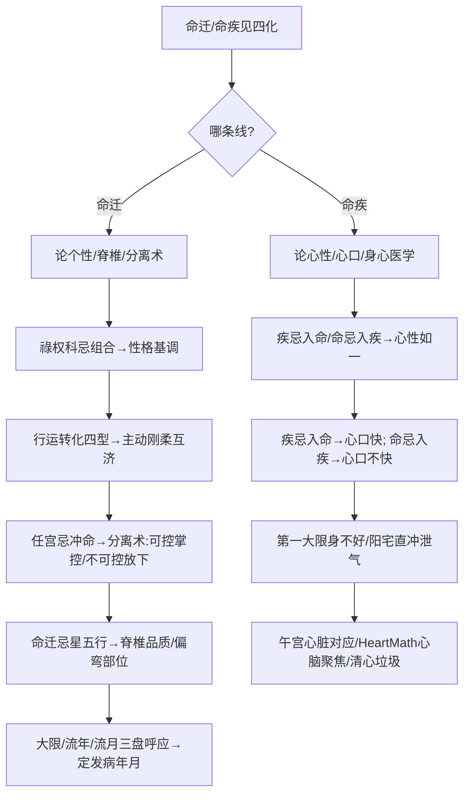

## 概述

本页系统沉淀勸學齋主《紫微高階之三·四化洩天機》核心体系：以**人生管理**、**幸福庫存**为宗旨，阐述**命迁线**、**命疾线**四化论性向、**分离术**、体用河洛理数与**脊椎身心对应**的实战框架。重点覆盖：
- 祿權科忌在命遷、命疾的性格成因与行运转化四型（剛性烈化/柔化、柔性剛化/軟化）
- **分离術**：任何一宮化忌沖命，须辨「可控制的掌控、不可控制的放下」
- **心脏为『心』之所在**：引证中医、心能智力、神经科学确立心脏主管知觉、直觉、情感整合
- **命疾互忌**：心性如一、心口如一（快/不快），揭示身心同构与病由心生的机制
- **脊椎中气品质**：以命迁忌星五行定偏弯部位，结合大限、流年、流月三层呼应实战断验

> 相关知识库页面：[[ziwei-gao-jie-zhi-san]]、[[ziwei-doushu-xiang-xing-lilun]]、[[ziwei-huopan-tiyong-he-luo]]、[[neijing-huxi-yangsheng-fa]]、[[yi-fei-wei-zong]]、[[wang-wei-gong-mai-bo-lun]]

---

## 一、活盘原理：宫序、河洛理数与体用

### 十二宫宫序与阴阳逆顺
- **支序（顺行/阳）**：子1丑2寅3卯4辰5巳6午7未8申9酉10戌11亥12
- **宫序（逆行/阴）**：命1兄2夫3子4财5疾6迁7友8官9田10福11父12
- 一阴一阳之谓道：紫微（阴土/逆行）统紫微系，天府（阳土/顺行）统天府系；天魁阳贵顺行、天钺阴贵逆行；左辅阳顺、右弼阴逆。

### 先天河图一六共宗 → 体用关系
| 宫位 | 序数 | 性质 | 角色 |
|------|------|------|------|
| 命宫 | 1（奇/阳） | 后天/用 | 显意识、个性、面貌 |
| 疾厄宫 | 6（偶/阴） | 先天/体 | **心**、身心医学之本 |

> **核心公式**：疾厄为命之体（先天），命为疾厄之用（后天）。  
> **推演**：以任一宫为太极（1），其第六宫即为该宫之体/先天。

### 后天洛书一九合十 → 气数位
- 一九合十（子午线/坎离代乾坤），第九宫为官禄宫 → **气数位**（后天行为表现宫）。
- **任一宫第九宫 = 该宫气数位**  
  例：夫妻宫气数位在福德（福德为夫妻官禄），子女宫气数位在父母，财帛宫气数位在命宫。

### 一十推库位、一八推一气生死位
| 推算 | 结果 | 含义 |
|------|------|------|
| 一十（命→田宅） | 田宅为财库 | 阴静不动，财帛进出归库 |
| 一八（命→交友） | 交友为一气生死位 | 父母精血寄胎、灵魂入驻之关口 |

> **活盘铁律**：本命盘原宫位名称永不消失，活盘论体用须保留原意。  
> 例：兄弟宫为财帛田宅（小财库），因兄友属众生线，钱仍在进出未真入库。

### 静态格局与动态格局四象分析
- **静态格局**：无宫干四化之星曜组合（阴/初始）
- **动态格局**：宫干四化激发之吉凶（阳/进行）
- **四象**：静好动好、静好动坏、静坏动好、静坏动坏  
  → 不分阴阳、不明体用，非命理也。

---

## 二、命迁线：性格、分离术、脊椎中气

### 命迁论个性：四化性向与行运转化

| 四化组合 | 性格关键词 | 行运转化典型 |
|----------|------------|--------------|
| **祿** | 乐观、实质/表现乐观 | 柔星化祿过柔；刚星化祿刚柔并济 |
| **權** | 刚强奋斗 | 遇刚星→刚强；遇柔星→刚柔并济 |
| **科** | 温和斯文、不计较 | 表现科者（忌在命/命自化科/科在迁）讲话错置成语 |
| **忌** | 固執惜情 | **择事固执**可造就自我；前半程输、后半程赢 |
| **祿忌** | 时开朗时不开朗 | 射祿/祿在迁→外显乐观内独承受；射忌/忌在迁→外显不快内藏开朗 |
| **權忌** | 霸气/霸道 | 刚星→霸道；柔星→霸气。权在迁/自化权→可被接受；忌在迁/自化忌→令人畏惧 |
| **科忌** | 囉唆打绕 | 表现科→错置成语；表现忌→鸡毛蒜皮碎念、重复发问 |
| **雙忌** | 固执二次方 | 「九怪」（台语）级固执 |
| **祿權忌/祿科忌/權科忌/祿權科忌** | 复合性向 | 依序叠加：先祿科、后科忌、最后权忌 |

#### 行运转化四型实战表
| 原本性向 | 大限/流年四化触发 | 转化结果 | 对策 |
|----------|-------------------|----------|------|
| **刚性烈化** | 坐刚星无祿科，逢大限化权/忌入本命迁 | 刚硬更烈，伤人伤己 | **主动柔化**，刚柔并济 |
| **刚性柔化** | 命迁有祿科，或大限化祿科到本命迁 | 自动调整为刚柔并济 | 迁移化来者须常外出/活动多 |
| **柔性刚化** | 坐柔星，命迁有权忌，或大限化权忌到本命迁 | 刚柔并济佳；自化忌/射忌观感差 | 须注意忌星伤害性 |
| **柔性软化** | 坐柔星，命迁有祿科，或大限化祿科到本命迁 | 过度散漫乐观 | **柔者刚之**，主动刚化 |

> **理想命理观**：以最理想原则改造自己——**刚者柔之、柔者刚之，成刚柔并济**。  
> 案例：巨门坐命（天蝍一阶段蝎子躲洞→二阶段老鹰腾空→三阶段凤凰助人），作者自述从悲观转实质乐观。

### 命宫四化飞十二宫：性向外放映射
| 飞入宫位 | 祿 | 權 | 科 | 忌 |
|------------|----|----|----|----|
| **兄友** | 有情谊付出 | 授权展友谊 | 平辈教化、讲道理 | 交友层次广、三教九流；损财/床位 |
| **夫官** | 禄入夫→对配偶好；入官→关心事业照夫 | 禄妻高自主/分派工作 | 谈学问/谈经验 | 忌夫→管束配偶疏事业；忌官→操心事业疏感情 |
| **子田** | 待子好/关心家务 | 给子女高自主/拓田宅 | 教化子女/美化田宅 | 操心子女/操心家务 |
| **财福** | 财心态轻松/喜心灵学问 | 开创钱财/开创心灵领域 | 研究钱财/研究心灵 | 掌控预算（量未入为出）/主观意识强烈 |
| **父疾** | 关心父母善文书情绪/善抚身心 | 给父母作主/权入病位不善用权 | 同禄小论 | **忌父→担心约束父母、心直语直伤人**；**忌疾→心性如一、心口不快** |

### 分离术：可控与不可控的实操法则
> **核心原则**：「凡事能掌控的去掌控；不能掌控的放下。」

#### 实战步骤
1. **识别触发点**：任一宫化忌冲命 → 该宫事务与我无缘（钱被倒、感情变坏、田宅自冲）。
2. **分离层面**：
   - **不可控**：钱追不回、感情已变、大限必走 → **放下**，不再耗心力。
   - **可控**：面容表情、情绪反应、田宅环境（搬家/占卜择吉）、床位调整 → **掌控**，立即行动。
3. **训练案例**：
   - 广播名嘴林某：播音室吵架两分钟→出门→关门瞬间恢复笑脸主持。「听众不需接受我的情绪。」
   - 双胞胎姊妹：姊婚姻破裂面容枯槁，妹未婚容颜如初。劝姊「已失老公，勿再失美貌」，以笑容训练重塑面相。
   - 学员六大限连忌冲命迁，仍笑脸迎人 → 「人生值得鼓掌」，内苦外爽朗，分离术极致体现。

### 命迁论头脚、脊椎、中气、呼吸食道
- **命宫 = 头（含面貌）**，**迁移宫 = 脚（对外行动力）** → 命迁线 = **脊椎、中气、冲脉、呼吸道、食道**。
- **任何宫化忌冲命**，除事务无缘外，**必冲到头/脸/个性** → 分离术介入。

### 脊椎侧弯品质定夺与流年实战法则

#### 品质判定（本命盘）
| 条件 | 结论 |
|------|------|
| 本命命迁有**生年忌、自化忌、射出忌** | **脊椎品质不好**（易坏），生年忌最重 |
| 无上述条件 | 品质正常，待大限/流年触发 |

#### 大限确立（呼应）
| 情况 | 判定 |
|------|------|
| 大限命迁宫干化忌入本命命迁、或大限命迁自化忌/射忌 | **该大限脊椎弯掉** |
| 本命无忌，但大限命化忌入本命迁/大限迁，大迁又化忌入本命迁/大命迁 | **该大限脊椎弯了** |

#### 流年/流月触发（三盤呼应）
| 层级 | 触发干 | 条件 | 结果 |
|------|--------|------|------|
| **流年** | 太岁干/流年迁干 | 化忌入本命命迁、大限命迁、流年命迁 | **该年脊椎弯了**，弯久→腰酸背痛 |
| **流月** | 流月命/流月迁干 | 化忌入大限命迁、流年命迁、流月命迁 | **该月脊椎弯了** |

#### 偏弯部位五行定位法
| 首个忌星五行 | 偏弯部位 | 对应脏腑/结构 |
|----------------|----------|-----------------|
| **水** | 命门处（腰椎） | 肾/命门 |
| **金** | 接近肺部脊椎（胸椎上段） | 肺 |
| **土** | 接近脾胃脊椎（胸椎中段/腰椎上） | 脾/胃 |
| **火** | 接近心脏脊椎（胸椎中上段） | 心/心包 |
| **木** | 接近肝胆脊椎（胸椎下段/腰椎） | 肝/胆 |

> **实战案例一**：文曲忌在迁（水）→先弯命门；大限廉贞忌入迁（火）→再弯心脏处；巨门自化忌（金）→命门更甚；流年丙子化忌入本迁、流迁庚午化天同忌入大迁 → **该年病痛大发**，七杀庚化权忌冲大疾 → **开刀在所难免**。
> **实战案例二**：文曲忌在迁（水）→ 命门一大凹（肚脐对后）；二限文曲忌再入本迁持续恶化；四限文昌忌入本命 → 更弯，**条件始终一水，未如案一多重五行叠加，故未开刀**。

#### 临床建议
- 幼年骨骼酸痛勿忽视「成长痛」，早期干预（矫正/锻炼/床位/搬家）。
- 懂命盘者**积极处理**：田宅宫不好 → 用《勸學齋梅花心易斗數盤》占卜择吉搬家，借钱搬亦可赚回。

---

## 三、命疾线：心脏为「心」之所在、心性如一、身心医学

### 「心」究竟在哪？跨学科证据汇聚
| 来源 | 核心观点 |
|------|----------|
| **中医《灵枢·本神》** | 心为「五脏六腑之大主」，任物、意、志、思、虑、智皆属心 |
| **《心能量开发法》（杜克）** | 心比脑聪明 |
| **HeartMath（齐德瑞/霍华·马丁）** | 心具独立神经系统（约4万神经元），称「心脑」；心脏传送情感直觉讯号，管理体内系统协作，与大脑双向沟通 |
| **莱歇夫妇心理学** | 心脏不机械服从大脑指令，依任务本质做认可反应；心脏讯息回传大脑，大脑完全服从 → **真正影响行为的是心脏发出的讯息** |
| **直觉/认知差异** | 脑=线性逻辑、分类预设、知道；心=直接本能知识、了解、关怀/直觉/谅解/安心/感激 |
| **古文化共识** | 美索不达米亚、埃及、巴比伦、希腊、犹太、中医均视心为情绪/道德/决策/能量中心 |

> **斗数定论**：疾厄宫论「心」，展现在命宫为「性」。  
> **心性如一** = 命化忌入疾 或 疾化忌入命（忌有黏住义）。

### 命疾互忌：心口如一的快与不快
| 组合 | 心性 | 心口 | 速度 | 典型行为 | 易被误解为 |
|------|------|------|------|----------|------------|
| **疾厄化忌入命** | 如一 | 如一 | **快** | 心直口快 | 坦率/冲动 |
| **命化忌入疾厄** | 如一 | 如一 | **不快** | 累积二三次再讲，找适当时机 | **有城府/奸诈** |

#### 结构性差异与人际冲突
- **杀破狼（阳/动/武/变动格局）**：有事就讲、吵完和好。
- **机巨同梁（阴/静/文/幕僚格局）**：累积观察、择机表达 → 被杀破狼误读为城府深。
- **作者主张**：「不能言而能不言」（《世说新语》）方为高德。尖酸言语如刀留伤痕，杀破狼亦会留伤。

### 命疾互忌的身心代价
- **第一大限身体不好**（原则上本命疾厄不佳）。
- **阳宅喻**：心性如一、心口如一 = 直冲煞/穿堂煞 → 通风但泄气。
- **病由心生机制**：
  1. 有形体（肉身/器官） → 必有毁坏一日（物理学量子聚合→物体→有时限毁坏；佛家「有形必坏」）。
  2. 疾厄宫**体看心、用看病**；心垃圾未清 → 生病前必有不高兴/厌烦/低落。
  3. **清理心垃圾 = 核心养生**；春山茂雄《脑内革命》医学论证同构。

### 心脏对应宫位与养心实操
| 宫位 | 对应 | 养心要诀 |
|------|------|----------|
| **午宫（狮子座）** | **心脏、性能力、背部** | 自信不自大、快乐昂首向前行；两眼无神/骄奢/不快乐/缺乏自信 = 失运 |
| **疾厄宫** | 心（中枢） | 保持清朗心境，注意力集中心脏（眼观鼻、鼻观心、鼻室生白 = HeartMath 腹式呼吸聚焦心区） |
| **命宫** | 性（心之显现） | 善用忌星：固执用于事（钻研学问）、不用于人 |

---

## 四、十干四化深层奥义与人类文明隐喻

### 天地人三才管辖十干四化
| 干组 | 归类 | 管辖卦 | 核心隐喻 |
|------|------|--------|----------|
| 甲乙丙 | 天（乾） | **艮卦管辖（人合天）** | 甲干廉贞化祿（钻木取火/穴居）开启文明 |
| 丁戊己 | 地（坤） | **坤卦管辖（地是地）** | 丁干太阴化祿（坤卦首卦/归藏易） |
| 庚辛壬 | 人（艮） | **乾卦管辖（天合人）** | 庚干太阳化祿（乾卦首卦/周易） |
| 癸 | 暴变 | — | 汰旧换新（亥年/中元运末/次贷危机） |

### 化祿化忌交叉揭示「不经寒彻骨，怎得梅花扑鼻香」
- 甲祿廉贞（艮/人）却在丙忌；庚祿太阳（乾/天）却在甲忌；丁祿太阴（坤/地）却在乙忌。
- **现代解读**：男（太阳）女（太阴）皆须受「忌」洗礼，终得「祿」拥抱。

### 武贪主大：戊己中央土化祿，壬癸末端化忌
- 武曲、贪狼在戊己化祿/权 → **主大，须安稳中央成就好处**。
- 壬癸化武曲忌/贪狼忌 → **壬梁祿不敌武忌，癸破军祿不敌贪忌**。

### 天机乙丙丁连祿权科 = 「三奇嘉会」
- 《道枢》：天三奇（日月星）、地三奇（乙丙丁）、人三奇（精气神）。
- 奇门遁甲三奇：乙开、丙休、丁生。
- **天机星**在乙祿、丙权、丁科 → 生年祿权科在命财官称「三奇嘉会」格。

### 阳干紫微系化忌、阴干天府系化忌
- 阳干（甲丙戊庚壬）忌星全属**紫微系（阴土/逆行）**。
- 阴干（乙丁己辛癸）忌星全属**天府系（阳土/顺行）**。
- **阴阳并存、各执其理**：斗数随处可见阴归阴/阳归阳或阴配阳。

---

## 五、实战速查表：命迁命疾四化决策树

---

## 六、跨页面交叉引用索引

| 主题 | 关联页面 | 核心连接点 |
|------|----------|------------|
| **紫微高阶体系** | [[ziwei-gao-jie-zhi-san]]、[[ziwei-gao-jie-zhi-yi]]、[[ziwei-jie-ti-chu-jie]] | 四化泄天机/星曜铁关刀/阶梯入门 |
| **活盘河洛理数** | [[ziwei-huopan-tiyong-he-luo]]、[[ziwei-doushu-jin-jie-zhi-san]] | 一六体用/一九气数/一十库/一八生死 |
| **相性共性方法论** | [[ziwei-doushu-xiang-xing-lilun]]、[[ni-buzhidao-de-doushu]] | 相性特性/命运分离/批判反思 |
| **心脏与身心医学** | [[yi-fei-wei-zong]]、[[wang-wei-gong-mai-bo-lun]]、[[neijing-huxi-yangsheng-fa]] | 以肺为宗/脉波论/内经呼吸/心脏为心之所在 |
| **分离术心理应用** | [[guan-xi-liao-yu-gottman-qing-xu-yao-qing]]、[[EFT情绪释放技巧]]、[[EFT情伤疗愈实作]] | 情绪邀请/敲拍释放/可控不可控辨析 |
| **脊椎与中气** | [[wang-wei-gong-mai-bo-lun]]、[[yi-fei-wei-zong]]、[[ren-shen-shu-an-quan-neng-liang-suo]] | 脉波十二经络/以颈为钥/仁神术安全能量锁 |
| **流年断验实战** | [[liuyao-sanda-jifa]]、[[liuyao-yuce-wu-zhong-wu]]、[[qinglan-jianglan-liuyao-zhuanji]] | 六爻三大技法/误中悟/青岚实战传承 |

---

## 七、关键金句与行动清单

> **「研究命理最崇高的目的——作好人生管理，并提升人生境界。」**  
> **「企业管理只管官禄宫；人生管理以命宫为体，十二宫全面臻完善。」**  
> **「三十六宫，宫宫皆是春——一宫宫回春，别只盯着命财官。」**  
> **「解厄第一原则：还原。还原后发现贵人多、小人少。」**  
> **「命理改个性才能改运：刚者柔之、柔者刚之，成刚柔并济。」**  
> **「分离术：可控制的掌控（面容/情绪/环境），不可控制的放下（钱/感情/大限）。」**  
> **「心脏有独立神经系统（心脑），真正影响行为的是心脏发出的讯息。」**  
> **「命疾互忌：心性如一、心口如一（快/不快），第一大限身不好，若不清心垃圾则泄气。」**  
> **「脊椎品质以命迁忌星五行定偏弯处；大限流年流月三盘呼应，精准到年月。」**

### 行动清单
- [ ] **自查命盘**：命迁、命疾四化组合 → 定性格基调与行运转化策略。
- [ ] **练习分离术**：近期一件「不可控」事件（钱/人/运），书面列出可控层面并执行。
- [ ] **每日心脏聚焦**：早晚各 10 秒，眼观鼻→鼻观心→呼吸入心区，清理心垃圾。
- [ ] **脊椎风险排查**：本命命迁有忌 → 记录五行部位；查大限/流年/流月三盘忌星呼应表，预排矫正/锻炼/搬家。
- [ ] **建立幸福库存**：金钱安全存量、才能备选库、兴趣多元库 → 应对景气突变与人生无趣。

---

> 本页为知识库结构化沉淀，持续更新交叉引用与实战案例。  
> 主编：数字知识库策展人 | 来源：《勸學齋紫微高階之三·四化洩天機》全书文本

## 来源

- [劝学斋紫微高阶之三](../sources/劝学斋紫微高阶之三.md)
