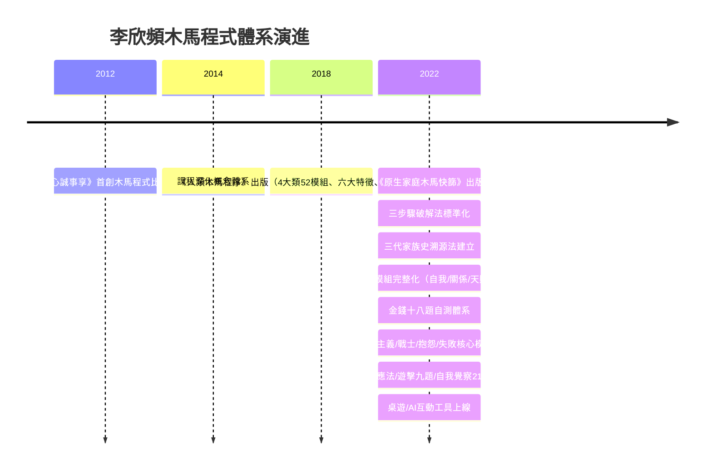

## 书籍定位与版本脉络

《人类木马程序》为李欣频 49 岁期中报告，自序题为《49 岁给自己与这个世界的期中报告》。作者将 21 岁广告文案、35 岁心灵修行、42 岁北大博士的关注轨迹，总结为广告文案→心灵修行→人类大数据库的蜕变，并以本书开启 60 岁耳顺无木马程序的状态。

2012 年《心诚事享》中首次以木马程序比喻身陷困境难以自拔的状态，2014 年课程深化概念，2018 年完成初稿、定稿出版《人类木马程序》。2022 年出版深化实操版《原生家庭木马快筛：三步驟解鎖並拋棄繼承家族負向印記》，补全三步驟破解法、三代家族史溯源法、五大生命課題模組、金錢十八題自測等完整体系。书中声称 4 大类 52 个模组的木马程序中 80% 作者皆中过，案例均为真人改写。

本书与李欣频的量子天命系列在天命、木马程式概念上形成互文，可参考 [[天命辨识与天命木马清理]] 与 [[量子天命与AI时代新天赋]]。

## 核心定义：人类木马程序

木马源自特洛伊木马屠城记。计算机木马程序为远程控制软件黑客工具，在用户不知情或未经同意下入侵系统，启动时破坏、修改数据或夺取私密数据，进而控制整台计算机。

以此比喻人类木马程序具**隐蔽性**与**非授权性**两大特点：人类头脑中埋藏此类程序，被篡改潜意识、控制自主性与行为，在相同情绪情境中一再受困制造无意识的鬼打墙。

人类木马程序的常用定义为：
- **植入**：原生家庭自小不断灌输限制性信念，当事人不自觉打开潜意识心脑大门迎入
- **受其控制、无自由意志、信以为真**：借《盗梦空间》inception 概念说明信念植入后，之后所有决定皆以此模组相应频率反应
- **无法正常运作**：除非当事人发现，否则持续死机直至自毁崩盘

## 六大特征识别体系

### 误以为是真的，以为是不可改变的真理真相
表面正向信念常包裹木马，如「吃得苦中苦方为人上人」。作者提出**不自信之择苦模组**与**怕落后模组**，说明人们无意识选择困难路径、将苦等同于光明，并制造竞争评比标准。

### 不注意视盲耳聋
中木马者只选择看到听到与该木马相符的概念，不符合者既看不到也听不到。典型的「爱与不被爱验证循环」，以及导演不自信怀疑女服务员反馈的案例显示矛盾与强制印证。

### 竞争评比标准带来的能量萎缩
木马常伴随「更好更美更优秀」的比较欲望，产生压力、能量萎缩、不开心、扭曲本貌、自责不够好。以「成为更好的自己」为例，前提是觉得自己不够好，频率落在**霍金斯意识能量层级表** 200 以下恐惧区。

> 霍金斯表在书中作为筛检工具：200 为正负能量分界，200 以上为爱信任勇气，200 以下为恐惧怀疑愤怒。

### 目标与内在木马冲突的矛盾性
想要达到的目标与内在潜藏木马程序冲突却不自知，就像一支箭无法同时射向两个靶心，导致梦想永远不会聚焦成真。作者提出**愿望卡住的强力问句**：「若愿望成真，你最害怕什么」。

### 无意识自动化反应与关系网络联动
木马内建成功后，当事人会无意识不经思考直接反应说话动作行为，且越来越偏离真正想要。并导致家庭关系、伴侣关系、人际关系、工作事业、财富资源、身体健康全方位联动出问题。

认知神经学引用迈克尔·加扎尼加《谁说了算？自由意志的心理学解读》指出信念胜过自主生理程序，错误的解释器会捏造符合木马的合理答案。

### 追逐虚幻不实目标直至崩盘
让人启动无穷无尽追逐虚幻不实目标的过程，直到崩盘或精疲力竭，浪费大量生命时间。书中以马追胡萝卜、西西弗斯推石上山为喻。

## 四大类木马程序分类架构

作者将人类木马程序分为四大种类，分类依据为霍金斯能量层级正负频率带，爱与恐惧无法并存：

| 类别 | 核心领域 | 对应生命议题 |
|------|----------|--------------|
| **第一类** | 自我与人际关系的木马程序 | 核心根源：感到自己不重要、没有安全感 |
| **第二类** | 感情的木马程序 | 亲密关系、依恋模式、背叛与夺爱循环 |
| **第三类** | 关于天赋、梦想、金钱的木马程序 | 天赋蓝图、职业选择、金钱财富流通 |
| **第四类** | 导致身心疾病的木马程序 | 心身症状、癌症关联、免疫系统失调 |

---

## 核心实操体系一：三步驟破解法（升维看问题）

爱因斯坦语录：「我们不能在制造问题的同一个层次上解决问题。」借用高斯求和 1+2+...+100 的升维思维（头尾相连、对称视角），将原生家庭负向木马印記三步驟破解法标准化：

### 步驟一：头尾相连
把**目前当下发生的问题**，与**最初在原生家庭发生的同类型初始事件**相比对。

### 步驟二：头尾第二数相连
把**目前当下之前发生过的同类型问题**，与**在原生家庭发生初始事件之后的同类事件**相比对。

### 步驟三：找到共同点
找到共同一致的**情绪频率/模组/惯性反应/行为**，写出内建的程式设定，并找出「抓著这个木马程式不放」的好处是什么。

#### 实战示范：学员 A 的职场夹层困境
- **当下问题**：工作上主管与属下同事不合，A 经常夹在中间协调纷争
- **原生家庭初始事件**：身为长女，小时经常夹在父母与弟妹之间担任协调冲突角色
- **当下之前类似事件**：婚姻中夹在老公与孩子/公婆冲突间成缓颊者；求学时期任班长在师生间布达维持秩序
- **共同点**：身为上下关系之间的协调者
- **抓著木马的好处**：能同时被两边重视与需要，透过协调得到「被需要」的感觉与价值感
- **逆轉反應法**：强迫自己放手，让双方自己面对面处理，绝不介入、不干预、不传话、不给意见、不去协调，即使被骂也坚持。每次堅定選擇與過去不一樣的反應，以新反應覆蓋原劇情模組。

> **逆轉反應法通则**：老是习惯性拒绝机会的人→改说「Yes」；老是答应每一個人所求的人→改说「No」。連續實驗七天。

---

## 核心实操体系二：三代家族史溯源法（精密扫描）

若「三步驟破解法」是 X 光片，「三代家族史破解源頭木馬法」即超音波/核磁共振，能精密掃讀潛藏深處極小病灶。根據量子糾纏概念，就算搬到火星仍會與原生家庭產生精神糾纏態，必須在精神層面充分理解印記形成機制。

### 步驟一：設定角色，完成三代家族史撰寫
將自己設定成**記者、傳記作者、紀錄片導演或偵探**，盡可能搜尋家族簡史並寫述完整。
- **搜訪對象**：爸爸、媽媽、爺爺、奶奶、外公、外婆、姑伯姨舅、表堂兄弟姊妹
- **必記特殊事件**：領養、墮胎、難產、自殺、意外、疾病、分居離婚、財務重大事件（賭博、負債、破產、上市）
- **自身成長史**：出生至今每一件重要大事，特別是引發極大情緒的部分；回溯出生前父母感情、墮胎念頭、主養育者、兄弟姊妹偏愛情況

> **影視觀察練習**：
> - 《羅塞里尼家族絮語》：名人後代「羅塞里尼症候群」——在家族盛名陰影下尋找定位
> - 《Gucci：豪門謀殺案》：派翠西亞「金錢至上、嫁入豪門」vs 莫里吉奧「反叛權威找存在」雙木馬對撞
> - 《魷魚遊戲》金句：「人不是因為別人值得相信才相信，是因為如果不相信，自己就會無依無靠」
> - 《7 Up》系列：跨越三代時間軸觀察原生家庭印記如何影響人生軌跡

### 步驟二：跳出家族角色，升維成「靈魂程式維修工程師」
從人造衛星角度俯瞰，拿起紅筆以自己為主角軸心，往上下旁圈勾三代共同點（行為模式、信念、情緒頻率、疾病、意外、重大事件），像基因剪輯一樣剪掉不想重複的負向模組。

#### 案例 B：月光族的玩偶報復
- **現象**：父母財務良好、會理財，B 卻入不敷出、衝動買玩偶刷爆信用卡
- **溯源**：小時想買玩偶被父母拒絕（覺得無助學業），教育補習卻捨得花錢
- **木馬方程式**：「錢是有限的，自己想要的都得到不到」+「愛＝玩偶」
- **機制**：長大經濟自主後，潛意識「報復式」消費填補童年缺憾，花光錢後驗證「想要的都得到不到」
- **延伸現象**：「愛＝物」木馬→買公仔/潮鞋給孩孫刷存在感→過勞愧疚→低價值感循環

#### 案例：權威型父母的「朕沒給的你不能要」
- 以金錢物質控制孩子符合期望，《滿城盡帶黃金甲》皇帝台詞具象化
- 孩子長大後以為錢可為所欲為、有指使他人權力，因為自己就是這樣被指使長大的

### 步驟三：根據圈勾關鍵字歸納出一組方程式
方程式寫出來即能準確預測「模組不變情況下」可能發生的事，助及早趨吉避凶。

#### 好友 A 夫妻雙癌案例
- **主要問題**：先生淋巴癌、A 牙痛左臉腫、神經衰弱、焦慮
- **雙方原生家庭**：女強男弱（個性強勢非經濟），兩代二合一木馬模組
  - 女：強勢→神經衰弱
  - 男：隱忍→癌症（公公直腸癌、父親攝護腺癌、先生淋巴癌）
- **A 的運作**：小時被糾正→長大轉為「糾正」別人拿回權力，以老師「揪錯」模組管老公
- **破解**：中止揪錯模組，化抱怨為感恩珍惜，看著眼睛帶愛的頻率交流，真心道歉建立新溝通協定
- **延伸木馬**：「揪錯/糾正」→「正義魔人」（堅信自己百分百對、不容質疑、消除異己）vs 真正伸張正義者（理性溝通、達成平衡）
- **逆轉抱怨木馬**：「得理不饒人」模組創造讓人道歉的事件獲存在感，常與「負罪自責」配對

---

## 核心实操体系三：五大生命課題木馬模組破解示範

人生面對五大課題：面對自我、面對關係、天賦藍圖、金錢財富、身心健康——涵蓋 99% 人生課題。找到貫穿命運的負向核心木馬，相當於關掉投射問題的發球機。

### 模組一：面對自我——自信、存在意義與價值
**典徵**：不自信、覺得不夠好/美/優/努、在意他人評價、怕被忽視、陷入比較競爭、怕拒絕怕輸

#### 父母烙印機制
父母想打造「完美」孩子彌補自己「不完美」，孩子一路優秀光明聽話善解人意無法喘息，陰暗面深埋變地雷。參考網文〈我花了12年時間，終於親手毀掉了自己的孩子〉（筆名堅果），母親反應造成孩子自責、不愛自己、不自信、寡語、膽怯、孤僻、憂鬱、自毀傾向。

| 事件 | 母親反應 | 可能負向印記 | 建議回應 |
|------|----------|--------------|----------|
| 孩子賴著玩具不放 | 「再不聽話我就走了！」 | 不敢說真實需求，以權威期望為主，變工具人 | 深談了解需求，將物欲轉創作欲（積木/繪畫/黏土） |
| 鄰居搶玩具 | 教訓「要分享」 | 習慣犧牲自己成全他人，直到被掏空失去自我 | 秉公處理，教孩子愛自己、勇敢表達、拒絕不合理 |
| 比較鄰居孩子 | 「你看看你不如他」 | 把競技場思維裝進腦袋，以贏過別人為成功標竿 | 不拿孩子比較，協助探索屬於自己的興趣天賦 |
| 孩子被霸凌 | 「是不是你惹人家？你不會躲？」 | 吸引施暴者，隱忍不說直到出大事 | 成孩子最信任朋友，聯合學校關心霸凌者原生家庭 |

#### 核心延伸木馬模組

**① 救世者木馬模組**
- **辨識**：「幫助別人」是出於真心（對方不知感謝、辱罵也無所謂）？還是等對方感謝回報的交易？
- **陷阱**：潛意識期待關注尊敬崇拜讚美→耗乾後無人給予→自我存在感受打擊；以幫助逃避自己課題、上癮成就感→遇「盡力幫不了」「恩將仇報」棒喝
- **破解**：「願意相信別人自己也能做好」，從不信任控制轉信任放手；檢查承諾習慣（半年爽約≥3 次須調整），誠實檢查不敢拒絕的木馬
- **關鍵語**：「尊重是自己給自己的，不是別人給的」；無相布施為高境界

**② 不自信之完美主義木馬模組**
- **來源**：母親說「做什麼事都要準備到完美才能去做」
- **本質**：「完美」基於「看不到自己哪裡好、永遠覺得不完美」的焦慮（未來），實為「否定當下自己」的負向頻率；父母怕你出錯的恐懼頻率繼承成裹足不前重石
- **破解**：訂書預定上市日→倒推月/週/日計畫→照時間執行，以行動取代恐懼拖延；關鍵語：「不必想太多，現在就去做，先求有再求好，邊做邊修正」
- **曼德拉語錄**：「希望你的選擇，反映你的夢想，而非你的恐懼」

> **自我課題實操原則**：若 90% 力量來自外在，只剩 10% 內在不受影響；若 90% 來自內在，只剩 10% 外在影響。檢查父母曾說過什麼話讓你印象深刻，從這句話找出負向頻率。不必鞭策出更好的自己，只有本初貌真的自己。

### 模組二：人際關係、家庭關係、情感關係
**核心機制**：將自己不願面對的黑暗陰影投射到對方，世界是內心戲的投影。四分之三個案因未察覺父母影響，把負面模組投射到自己關係中。

#### 典型投射模式
- 父母不睦/離婚→對感情不信任木馬→高逃避低焦慮（疏離型依戀）或高逃避高焦慮（恐懼型依戀）
- 父母一方外遇→潛意識懷疑另一半→疑心病搞煩對方→分手或成真外遇
- 父母法庭/媒體互揭瘡疤→孩子烙印「感情麻煩充滿謊言背叛」+「自責/自我貶低」→自我價值低落→金錢破口（花錢填補）
- **關鍵干預**：朱政坤法官離婚判決書留千字文給八歲孩子：「在爸媽吵架裡你沒做錯任何事……他們都很愛你……請相信愛你的爸媽是最棒的」

#### 三步驟破解實戰案例

**個案一：被背叛奪愛循環**
- **自述**：好朋友背叛、搶男生、潑髒水；結婚零朋友請；總覺得得倒追最終被甩
- **方程式**：自己不夠好，所以總被親密的人背叛奪愛
- **溯源**：妹妹把秘密告訴爸媽→被罵→爸媽討厭看不順眼→感覺妹妹奪走爸媽愛
- **破解**：置入妹妹視角重新體驗（妹妹覺得爸媽比較愛姊姊想奪愛）→理解原諒→不再用受害方程式創造事故
- **反例**：同模組女性→成為第三者透過競爭奪愛證明自己值得被愛；兩女性愛上同一男人（被媽媽/奶奶爭寵溺愛）→男人選擇躲起來讓女人雙方競鬥
- **破解鑰**：找到源頭「愛需要爭取」錯誤程式（小時常被問比較愛誰、常被拿來比較）→解除「重新設定自己夠好不必與人奪愛」

**個案二：不斷逃獄的情感依賴獄**
- **現象**：老是陷在兩個以上女人之間；名人/豪門/運動員婚變新聞、《Gucci》、《米爾麗很美麗》主角原生家庭印記極似
- **方程式**：夾在兩者之間，透過雙方爭奪自己來增加自我價值感
- **運作模組**：
  1. 童年被嚴格管控/責難（名門豪門）→找父母反對女生→逃離父母速戀婚
  2. 發現女生變管控嚴厲「爸媽」→覺得又被掌控→找看似自由女生出軌→放不下錢（自由資本）→希望兩邊都不失去（白玫瑰紅玫瑰都要）
  3. 兩女水火不容逼選邊→不是逼原配離婚就是原配自立自強離婚
  4. 放棄原配/錢/孩子與新女友同居→重拚事業→若木馬未改再次循環：事業興盛又想逃→外遇；或拚不成一起慘→繼續逃
  5. 永遠以「逃」躲避問題、不回應/謊言掩飾、不勇敢面對解決、不找生命重心
  6. 每遇新對象（解救者）再劈腿（逃）→像感情「抓交替」、囚犯逃獄期望新獄卒救出→出獄不知做什麼（茫然）→再犯罪回監獄→加上逃獄罪關更久
  7. 有時放進兩獄間三角關係讓雙方爭奪愛建立存在感、或一方成戰友對抗另一方
  8. 戀愛零空窗期、重疊關係、不停換伴侶逃避面對自己
  9. 童年被管控責罵→有「被抓到等著被罵」負罪感上癮→哪方罵越兇越有逃的理由動力
- **破解**：以「面對」取代「逃避」，空出更長獨處空窗期面對孤單，不再找新對象填補空洞，不再做「明知會被罵」的事增強負罪感，直到完全自處愉悅才是恢復正常第一步

**個案三：建築師的多重伴侶循環**
- 35 歲、換無數女友、多次婚離、對方懷孕才被迫結婚、劈腿被發現才結束
- **溯源**：幼年父母離異各有新對象→交給奶媽帶、奶媽換好幾任、奶奶外婆姑姑阿姨輪流帶、很晚斷奶
- **運作**：「習慣性」要有兩個以上女友、壓力時吸吮手指緩解
- **破解**：同個案二，學會獨處獨立面對自己，以面對取代逃避

> **關係課題實操原則**：原生家庭負向印記若未自覺清除，會像投影蓋章複製再複製直到醒來清理修改設定。衝突常因「覺得對方不尊重我」或踩到底線，信任水位不對等→雙木馬對應：一方學「尊重界線」、另一方學「強化自尊自信地基」。若常覺得被瞧不起，檢查自己是否也瞧不起自己。努力方向易被對方誤導離初衷越來越遠。防衛之心待人久了身邊人跑逃。批評對方大不了我、讚美對方小不了我、人人獨一無二。自尊自信地基夠深穩→不計較攀比、省下討好等待療傷精力、心胸寬闊真心欣賞激勵他人→互為貴人最高維度共好版本。

### 模組三：個人天賦藍圖
**核心觀**：天賦非他人眼中了不起成就，而是以創造創作點燃熱情活著的火花（參考《靈魂急轉彎 Soul》、《魔法滿屋 Encanto》）。詳細模型見《量子天命》——「天命→天職→多元天賦→天能→量子天命」多維雙錐雙向金字塔投影動能模型、十四組動力結構、擴展多元天賦十大模型。

#### 三步驟破解案例：會計師的半途而廢
- **提問**：正職會計，興趣畫畫/跳舞/寫作/花藝/茶道等，每樣都學半途而廢，該辭職專心做喜歡的事？
- **方程式**：自己喜歡的事都會被中斷
- **溯源**：小時玩積木被媽媽打斷要先做功課→內建「得聽我的否則剝奪玩權利」反應模組
- **深層程式**：
  ```
  總是必須先選「別人」覺得該做的事
  或必須先做自己不喜歡的事
  然後才能選自己喜歡的事
  但又不知道怎麼選
  因為沒有一件喜歡的事能完整做完
  總是中途被粗暴打斷
  ```
- **長大後運作**：先選父母期望科系、下意識選家人認為有錢途工作、自動忽略喜好→內心想做喜歡事利用瑣碎時間學這學那→「中途被打斷」模組仍在→自己成為打斷自己的人（投射到主管/同事/先生/孩子）→半途而廢耗費青春熱情十幾二十年
- **延伸**：中斷→再換慣犯（換學習主題/學校/工作）
- **破解**：
  1. 列出真正想做的事，靜下問：若明天不在地球了，沒做哪件事最遺憾（以「不遺憾清單」取代「夢想清單」）
  2. 將此事列最優先，每天盡可能最多時間專心完成，**未徹底做完前先不做其他事**
  3. 一旦決定無論如何堅持完成，絕不半途而廢
  4. 只承諾做得到的，承諾/約定盡量不輕易更動反悔拖延取消，改約爽約越少能量越穩定
  5. 例：畫繪本為最大遺憾→排第一位、找空檔零碎時間逐頁完成，**不需辭職**（否則掉進半途而廢模組+生存焦慮木馬未清→更心慌）
  6. 中途冒出想做別事念頭→寫進「完成繪本後」待辦清單，**必須堅持把最重要的事做完，千萬別再打斷自己**

> **天賦課題實操原則**：徹底清除原生家庭「因害怕造成的限制性信念」，化恐懼為穿越洞見勇氣，恢復清明原廠設定，天賦之光從原礦毫無阻礙散發，機會資源自動聚流，心誠事享即此原理。

### 模組四：金錢與財務
**核心機制**：計較掠奪索求是貧窮開始。對自己的信心決定財庫容量。有才華懂變現但覺得「不配得」→潛意識以離奇方式擋掉推掉錢（莫名花掉/被詐騙/被借不還/賭博投資失利）。想「炫富」贏羨慕崇拜→負向動機觸發花更多錢破財。自我認同/情感關係木馬破洞→變金錢破口（無信心買保養名牌/焦慮健康買保健保險）。**優先找出金錢木馬破口修補**，人生時間不再浪費在賺錢漏財惡性循環。

#### 金錢木馬十八題自測（深度搜出潛意識/無意識程式）
> 第 1-3 題直指原生家庭印記，第 4-18 題深度搜出已烙印程式

1. 爸爸媽媽發生過什麼跟錢有關的事印象最深？灌輸你的金錢觀是什麼？
2. 回想整理家人對你的金錢觀造成哪些正向負向影響？
3. 還記得爺爺奶奶外公外婆或其他親戚跟錢有關的事印象深刻嗎？
4. 講到錢，你第一個聯想到的是什麼？
5. 瞬間有幾十/幾百億，覺得可能產生什麼問題？最害怕發生什麼不好的事？
6. 瞬間有很多錢卻發生緊急事讓錢瞬間消失，覺得可能是什麼事？
7. 瞬間沒錢，最害怕什麼情況發生？
8. 瞬間負債，最害怕什麼？覺得可能因什麼事導致？
9. 沒錢會向誰求助或借款？
10. 沒錢甚至負債，覺得自己是怎樣的人？
11. 最大最奢華的夢想是什麼？
12. 打算怎麼完成？預估花多少錢？順利完成可能透過什麼方式？沒完成可能什麼原因？
13. 瞬間變超級首富，覺得自己會是怎樣的人？
14. 瞬間變超級首富，最想讓誰知道？
15. 有花不完的錢，想拿來做什麼買什麼？最常買/囤積什麼？最常被哪三類廣告吸引？
16. 從超級首富變回原樣，感覺如何？覺得會變成怎樣的人？
17. 從超級富豪變「負」豪，覺得自己怎樣？覺得別人會認為你怎樣？
18. 從超級富豪變「負」豪，想要盡快回到超級有錢狀態嗎？

#### 關鍵題目解析與破解示範

**第 1 題：父母財務事件+金錢觀**
- 案例：朋友夫妻嚴重債務→父親擔保人跑了瞬間負債、母親借錢給親戚不還→拋棄繼承債務但**沒拋棄金錢負向印記頻率**
- 破解：十分鐘寫出「被父母影響木馬方程式」→一步精準破解
- 學生案：父賭博欠債、母手工辛苦養大→她不問自己喜歡什麼只找賺最多錢/最穩定工作→潛意識設障礙板擋住「喜歡的事會有錢」可能+痛恨父賭博不安全感→高度管控先生財務→夫妻常為錢吵架→母向她借錢投資失敗→**只要有金錢木馬破口，錢會從意想不到/無法拒絕的人事物漏出**
- 《魷魚遊戲》賭博角色：潛意識覺得已是輸家、又信下次翻盤暴贏→搞成地獄無家可歸覺得「該死」
- 父賭博→孩子要么極端省錢、要么繼承「錢來得快去得快」印記→繼承負債（賭博/亂花/亂借/高風險投資）

**第 4 題：錢＝？聯想詞**
- 負向詞（如「麻煩」）→倒裝：「我怕麻煩→潛意識不讓自己太有錢免得找麻煩」→查找擋水板
- 正向詞（如「萬能」）→寫相反句：「錢不能買感情/健康/生命時間/起死回生」→這些將來可能成金錢破口
- 企業家生案：答「錢＝萬能」→花最多錢在保健品醫藥費→**這就是金錢破口**→潛意識聚焦「生病」輕忽健康、沒想過「不生病很健康」可能性、更別說用心維持健康飲食習慣

**第 5 題：瞬間有大筆錢的恐懼**
- 「怕被借錢」→為何不敢拒絕？怕失去親友/怕被說小氣→兩句都有「怕」=核心木馬→有這木馬身邊人發現弱點就借錢不還
- 「怕被綁架」→「太有錢＝危險」→潛意識抗拒金錢能量→表面努力賺錢存錢但莫名「被漏財」符合「錢不要太多否則危險」

---

## 核心木馬模組辨識圖譜

### 救世者木馬模組
- **核心信念**：「我必須幫助別人才有價值/被愛」
- **運作特徵**：不敢拒絕/怕被拒絕、答應過多導致過勞耗盡、以「幫」字為中心建立高低之別、療程結束對方不感謝會失落
- **醫護/諮商師常見**：覺得收錢才被尊重→資淺者收費高即不平衡→導出「不被尊重」木馬結論
- **破解鑰**：尊重是自己給自己的；來找協助的人是成就我們的老師；無相布施；腦袋裡連「幫」字都不存在、憑直覺做該做的事、做完不宣揚、幫不了也不愧疚

### 完美主義木馬模組
- **核心信念**：「準備到完美才能行動」「不完美就不值得被愛」
- **運作特徵**：寧缺勿濫（完美控制）、盯著不完美處無限放大、偏執圓滿缺口、挖東牆補西牆、無限焦慮奔忙
- **本質**：父母怕你出錯的恐懼頻率繼承；給自己「可以不必馬上行動」藉口；帶著「不信任自己不信任周圍」頻率
- **破解鑰**：「不必想太多，現在就去做，先求有再求好，邊做邊修正」；訂截止日倒推計畫照時間執行；曼德拉語錄

### 戰士木馬模組
- **核心前提**：「這個世界充滿危險，處處會遇到欺負我們的人」→隨時處「警備」狀態→好人善人想幫忙也被當入侵者推開→人生往危險被欺負方向創生更多劇情
- **兩大亞型**：
  - **將帥型**：愛開疆闢土，負向印記不解除會以詭異理由毀成功事業→才有新復仇戰鬥力「東山再起收復失土重建江山逆轉勝」→鬼循環。紀錄片《殺青啦！唐吉訶德》泰瑞·吉蘭屢敗屢戰；《1917》好戰不想停戰將軍
  - **忠臣型**：有好戰長官下指令時是超強戰士；指揮官離開→茫然無首慌亂→找續戰理由恐嚇威脅哀求不讓離開→投射假想敵甚至更大戰場重新啟動動能→第一個投射敵人往往是剛離去的指揮官/貴人
- **破解鑰**：早點清醒看破為誰而戰為何而戰假相，放掉戰鬥殺氣，放下屠刀立地成佛，戰場變道場

### 抱怨木馬模組
- **核心機制**：四處挑刺挑毛病找麻煩，潛意識創造讓人「得跟他道歉」事件，藉「對方低頭賠不是」得高人一等存在感＝「得理不饒人」模組
- **特徵**：不會快樂（四下無人只能找自己麻煩）、常與「負罪自責」配對共演顛倒夢想

### 失敗模組
- **觸發點**：經常被批評不如別人→失敗模組（因）→逼自己選賺快錢非喜歡工作（果1：自我/工作面）、選大家覺得成功非喜歡伴侶（果2：感情面）、與上司同事伴侶處不好（果3：符合最早失敗模組）、亞健康焦慮胃痛經期紊亂失眠（果4：健康面）

---

## 互動工具與延伸資源

### 人類木馬程式桌遊
- **購買連結**：https://p.ecpay.com.tw/291A56F
- **用途**：假日在家約家人朋友共同玩桌遊殺消木馬，而非彼此強化木馬

### 人類木馬程式 AI 互動系統
- **網址**：skywalker.course.voiss.cc
- **功能**：AI 協助快篩、辨識、破解木馬程式

### 遊擊漏網次要木馬補強問題單（九題）
完成三代家族史破解後延伸補漏：
1. 寫出出生至今每一個重要轉折點/抉擇點
2. 設想當初做不同選擇會有什麼不一樣路徑版本結果
3. 列出此生最遺憾懊悔的事，若當初哪環節改變現在會如何不同
4. 重新經驗前半生大事記，會在哪些環節做怎樣改變
5. 穿越回過去，想在哪些關鍵時間點給自己什麼建議
6. 若五年後的自己穿越來，覺得他/她會給什麼建議
7. 寫出目前最想完成的十個願望 → **檢查未來是否仍投射未清理木馬**（如買跑車豪宅證明成功→想讓原生家庭誰知道？期待什麼反應？仍需肯定讚許？要花多少時間符合期待？＝目前仍牽制的負向印記）
8. 一句話總結前半生 + 經常掛嘴邊/寫社群的一句話 → **極可能是潛意識預設**（如「人生充滿奇蹟」前提是「充滿災難困難挑戰危機」；「一定有辦法」預設「眼前必有困難→未來必有方法」→人生變闖關遊戲）
9. 置身每位家族成員角色重新經驗重大事件，會在哪些環節做怎樣改變 → 以高維角度幫三代修改反應模組

> **自我覺察系統**：每個念頭先辨認是否帶負向原生家庭木馬印記，或已清除過濾後純淨自由無礙。最少堅持 21 天，3 個月以上更好，才能徹底拋棄繼承負向印記。

---

## 關鍵概念交叉引用索引

| 概念 | 關聯頁面 | 備註 |
|------|----------|------|
| 霍金斯意識能量層級表 | 本頁內文 | 200 分界線：愛信任勇氣 vs 恐懼怀疑愤怒 |
| 量子天命體系 | [[量子天命与AI时代新天赋]]、[[天命辨识与天命木马清理]] | 天命、木馬程式概念互文 |
| 吸引力法則/顯化 | [[专注意念的惊人力量]]、[[创造金钱]] | 逆轉反應法與顯化頻率共振 |
| 原生家庭創傷療癒 | [[依恋原生家庭执迷心理学三册套装]] | 蘇珊·福沃德控制型親密關係/煤氣燈術框架 |
| 內在小孩工作 | [[尤尼希皮里与内在小孩]]、[[框架与向往的清理]] | 荷歐波諾波諾清理記憶框架 |
| 靈魂課題/出生前計畫 | [[灵魂的出生前计划]]、[[从未知中解脱]] | 羅伯特·舒華茲轉世目的/反面學習 |
| 九型人格防衛機制 | [[九型人格三中心]] | 本能密碼/資訊扭曲/人際應對模式 |
| 占星相位/木馬模組對照 | [[sue-tompkins-aspect-theory]]、[[han-lianglu-synastry-law-of-attraction]] | 行星落宮/相位與木馬程式共振 |

---

## 版本演進與實踐路徑總覽



> **核心洞見**：「只有醒來的人才知道自己沒在夢裡」——瞬間醒來省下大把「忙著複製負向印記投射問題衍生劇本解決問題惡性循環」的時間，多出來的時間可全力發展天賦天能天命，無懼自由探索創造豐富人生。**清除後最明顯徵兆：能做自己想做的事的時間突然變多、行動力變強、情緒地雷變少、頭腦清楚清明、內心寧靜不苦。**

## 来源

- [原生家庭木马快筛](../sources/原生家庭木马快筛.md)
