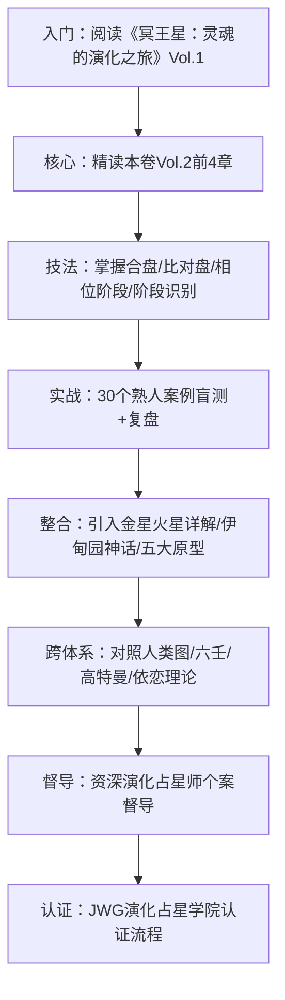

# 冥王星：灵魂在亲密关系中的演化

> **核心定位**：杰夫·格林演化占星学系列第二卷，建立「冥王星—月交点轴—合盘/比对盘」三位一体分析框架，揭示亲密关系作为灵魂演化催化剂的深层机制。

---

## 一、演化占星学核心范式

### 灵魂演化的双重欲望原型
- **分离欲望**：灵魂渴望离开源头，体验独立、独特、物质化存在
- **回归欲望**：灵魂渴望重返源头，消融分离感，实现合一
- **演化本质**：在无数轮回中逐步消耗「分离欲望」，直至仅剩「回归欲望」

### 冥王星的四重功能
| 功能层面 | 核心含义 | 关系显化 |
|----------|----------|----------|
| **演化动力** | 推动灵魂跨越关键阈值的压力源 | 关系危机、背叛、失控、强迫性吸引 |
| **业力记忆库** | 存储跨世代的未完成课题与创伤 | 无意识投射、重复性模式、德性债偿还 |
| **赋权机制** | 通过直面阴影实现自我掌控 | 权力斗争转化为共同赋权、界限重塑 |
| **时间锚点** | 标识灵魂在演化周期中的精确位置 | 合盘冥王星指示「共同演化任务」的起点 |

> **关键洞见**：冥王星非单一能量，而是「无所不在的演化培育力」——它既是灾难性突变的推手，也是一致性渐进的底流。[[neizai-de-tiankong|斯蒂芬·福里斯特《内在的天空》]]亦称进化占星学七大原则首条为「冥王星代表灵魂演化意图」。

### 月交点轴：演化的导航系统
- **南交点（龙尾）**：过去世已掌握的技能/惯性/安全区 → 合盘南交点显示「双方共同携带的旧模式」
- **北交点（龙首）**：今生必须发展的新能力/陌生领域 → 合盘北交点指引「关系必须成长的方向」
- **交点主宰行星**：落入宫位星座揭示「如何操作」该交点能量

> **交叉引用**：[[liuyao-yinyuan-yuce|王虎应《六爻姻缘预测学》]]中「用神取法」与交点主宰行星逻辑异曲同工；[[renlei-tu-ai-guanxi-yu-xing|人类图《爱、关系与性》]]亦以「策略+内在权威」对应「北交点路径+主宰行星操作」。

---

## 二、冥王星—月交点轴：业力动力学精密模型

### 四大核心相位形态

| 相位形态 | 演化状态 | 关系显化 | 破解钥匙 |
|----------|----------|----------|----------|
| **冥王星合南交点** | 业力重演/丰收/混合态 | 极强既视感、无法抗拒的吸引、重复旧剧本 | 等待第二次土星回归(~56岁)或主动激活北交点 |
| **冥王星合北交点** | 前世已启动新课题 | 关系感使命感、共同面对陌生挑战 | 持续深化北交点主宰行星所指领域 |
| **冥王星四分交点轴** | 「省略步骤」——摇摆未定 | 关系反复拉扯、分合循环、时空错乱感 | 判断冥王星行进方向→一致性发展该交点 |
| **交点主宰行星互换合相** | 过去未来同现 | 时空折叠体验、顿悟式转化 | 冥王星对应点作为「推手」促成整合 |

### 相位「状态」判读法：入相 vs 出相
- **入相位**（未达精确角度前）：首次体验该转化课题，感受陌生、抗拒大
- **出相位**（越过精确角度后）：多世熟练，驾驭自如，但易陷入惯性
- **演化门槛**：0°/45°/90°/135°/180°/225°/315° 对应八月相阶段（新月→残月）

> **实战提示**：合盘金星冥王星 90° 若为入相，情侣陷入「控制—反控」初体验；若为出相，双方已精通权力博弈，需转向「共同赋权」新课题。

---

## 三、合盘与比对盘：双镜透视关系全息图

### 根本区别
| 维度 | **合盘 Composite** | **比对盘 Synastry** |
|------|-------------------|---------------------|
| **本体论地位** | 关系作为「第三实体」的独立星盘 | 两个独立个体的相互激活图谱 |
| **核心问题** | 「我们共同的演化任务是什么？」 | 「你如何触发我的业力？我如何触发你的？」 |
| **冥王星含义** | 关系的共同核心驱力/业力核心 | A的冥王星如何渗透B的特定宫位/行星 |
| **月亮含义** | 关系的情感操作模式/共同自我 | 双方情感需求的契合/冲突细节 |
| **适用场景** | 长期承诺关系、婚姻、事业伙伴 | 所有互动关系、初期磨合、亲子、职场 |

### 合盘核心解读链
```
合盘冥王星(宫/座) → 共同核心驱力/业力主题
       ↓
合盘冥王星对应点(宫/座) → 关系演化方向/解药
       ↓
合盘南北交点(宫/座) + 主宰行星 → 旧模式操作法 / 新路径操作法
       ↓
合盘金星/火星/月亮相位网 → 情欲/行动/情感的具体互动剧本
```

### 比对盘关键锚点
- **A冥王星 → B宫位**：A的核心意志如何重塑B的生命领域
- **A冥王星 → B行星**：A对B特定心理功能的深度渗透/改造
- **双向冥王星相位**：相互渗透的「共谋场」——最具转化张力也最危险
- **交点轴相位**：跨世代契约的激活点

> **方法论传承**：格林主张「中点法」合盘（最接近中点），弃用达维森时间中点法。[[人际合盘占星全书|翁礼夫《人际合盘占星全书》]]、[[人际相位圣经|韩良露《人际相位圣经》]]均采中点法并细化相位/宫位解读体系。

---

## 四、四大演化阶段：灵魂成熟度的分级地图

> **核心原则**：**必须先判断个案所处演化阶段，再解读星盘符号**。同一金星落处女座，合群阶段表现为「挑剔伴侣」，个体化阶段为「建立健康界限」，灵性阶段为「服务型亲密」。

| 阶段 | 占比 | 核心心理特质 | 关系模式 | 关键转化任务 |
|------|------|--------------|----------|--------------|
| **演化初阶** | ~5% | 模糊自我/极度受限愤怒 | 依赖/被依赖、无界限 | 建立基础自我觉知，进入合群 |
| **合群阶段** | ~70% | 顺从主流、安全感源于归属 | 传统角色分工、条件式爱、相互依赖 | 质疑规范、萌发个体意识 |
| **个体化阶段** | ~20% | 反叛主流、文化疏离、相对主义 | 平等伙伴、心理边界清晰、投射收回 | 整合自我于社会、超越虚无感 |
| **灵性阶段** | ~5% | 超验现实、自我向灵魂转移 | 灵性伴侣、无条件服务、师徒共修 | 消除灵性自我膨胀、成为真导师 |

### 阶段识别的观察锚点
- **语言系统**：问「何时买BMW」vs「何时得启蒙」
- **危机反应**：外求权威 vs 内省重构 vs 服务当下
- **权威关系**：盲从/对抗/内在权威/传递源头

> **跨体系对照**：[[renlei-tu-wu-zhong-ren-ge-lei-xing|人类图五型人格]]中「生产者/显示者/投射者/反映者」策略差异，实质对应演化阶段的能量运作模式；[[aqal整合图谱|威尔伯AQAL层次]]中「前个人/个人/超个人」三大层级与此四阶段高度同构。

---

## 五、关系五大原型：业力契约的分类学

| 原型 | 核心驱力 | 典型相位/配置 | 演化功能 | 易陷阱区 |
|------|----------|---------------|----------|----------|
| **互相依赖** | 「你补全我」 | 合盘月亮/金星/冥王星重合、四分、对分 | 熟悉感、情感生存、重演童年依附 | 界限消融、投射收回失败、窒息感 |
| **辅导者/被辅导者** | 「我教你/我学你」 | 土星/冥王星/北交点强连接、宫位互落 | 技能传递、业力偿还、权威投射 | 权力失衡、亲子化、毕业拒绝 |
| **老师/学生** | 「我唤醒你」 | 天王星/海王星/北交点/冥王星、九宫/十二宫激活 | 意识跃迁、范式转换、灵性传承 | 导师崇拜、灵性物质化、越界 |
| **施虐/受虐** | 「痛即是爱」 | 冥王星/火星/土星/莉莉丝/南交点、八宫/十二宫重压 | 极端压力下的灵魂破壳、阴影整合 | 创伤复演、斯德哥尔摩综合征、代际传递 |
| **自我满足** | 「我完整，故我们共舞」 | 合盘太阳/北交点/木星/金星良相、一宫/七宫/十一宫强 | 完整个体的自由联合、共同创造 | 灵性自恋、回避深度亲密、功能性分离 |

### 四大特定变量（叠加于原型之上）
1. **业力伴侣**：偿还特定债务，任务完成即分离（冥王星/土星/南交点紧相位）
2. **灵魂伴侣**：多世共修，支持彼此北交点（北交点/木星/金星/海王星流通）
3. **同一灵魂伴侣**：同一灵魂分裂的两极，极强磁吸/排斥（冥王星/莉莉丝/顶点/顶点对点）
4. **孿生灵魂**：同源灵魂群，使命协作（北交点/天王星/十一宫/星群）
5. **跨阶段灵魂**：阶段差≥1级，自带「导师/学生」张力（阶段识别为首要）

---

## 六、伊甸园神话：父权制条件化的深层源码

### 三大核心投射
| 神话元素 | 心理投射 | 关系后果 | 占星对应 |
|----------|----------|----------|----------|
| **女人=诱惑/肉体/原罪** | 女性天生低等、性即罪恶、快乐需赎罪 | 受虐倾向、性羞耻、臣服男性意志 | 金星落陷/刑克冥王星/土星、莉莉丝受困 |
| **男人=灵性/优越/被诱惑** | 男性天生高等、性冲动即堕落、愤怒外投 | 施虐倾向、情感压抑、控制欲 | 火星/太阳刑克冥王星/海王星、北交点受压 |
| **灵肉对立、性圣分离** | 必须否定感官得灵性、痛苦通往神圣 | 禁欲/放纵两极摆动、亲密恐惧 | 月亮/金星/火星相冲、十二宫/八宫/五宫张力 |

### 历史演化轨迹
- **母系社会**（双鱼座末期→宝瓶座末期）：无核心家庭、共同育儿、性即神圣、男女平等、盖亚信仰
- **父权转型**（摩羯座次时代/巨蟹座时代 ~公元前6500年）：男性发现生育角色→权力感→土地/财产/血统控制→核心家庭→天神神话→伊甸园叙事确立
- **当前转型期**（冥王星射手座/海王星宝瓶座/天王星宝瓶座）：父权信仰崩解、性别重构、生态回归、神圣女性觉醒

> **集体星盘锚点**：几乎所有人**土星/冥王星/木星南交点落摩羯座、北交点落巨蟹座**——前世集体经历父权转型开端；**海王星南交点宝瓶座**——灵魂源自母系社会；**天王星南交点射手座**——游牧自然法则生活。今生共同任务：完成时代转型。

### 临床显化谱系
- **家庭/性/心理虐待曝光潮**（海王星天王星过摩羯座合本命冥王星/木星/土星南交点）
- **女权/环保/灵性复兴运动**（1960s海王星天蠍座刑本命冥王星狮子座）
- **个体层面**：压抑天王星牡羊座解放冲动→投射为控制/被控→虐待循环

> **疗愈路径**：识别神话投射→收回投射→重新神圣化身体/性/感官→建立基于平等/完整性的亲密范式。[[guan-xi-liao-yu-gottman-qing-xu-yao-qing|高特曼「情绪邀请」五步法]]可作操作性微观实践；[[lingmei-mama-xinling-jieda-shu-4|灵媒妈妈《与自己对齐》]]提供灵性层面整合框架。

---

## 七、金星—火星—冥王星：亲密关系的三角动力核

### 八大相位阶段循环
| 阶段 | 角度 | 月相对应 | 关系主题 | 核心张力 |
|------|------|----------|----------|----------|
| **新生** | 0°-45° | 新月 | 种子植入、磁吸启动 | 未知恐惧 vs 命运感 |
| **初期** | 45°-90° | 眉月 | 磨合、价值观碰撞 | 适应 vs 自我坚持 |
| **第一四分** | 90°-135° | 上弦月 | 危机突破、模式打破 | 控制 vs 投降 |
| **突显** | 135°-180° | 盈月 | 深度整合、阴影显现 | 投射 vs 觉知 |
| **圆满** | 180°-225° | 满月 | 对抗/镜像、极致极性 | 融合 vs 分离 |
| **扩展** | 225°-270° | 缺月 | 分享成果、教学传递 | 执着 vs 放下 |
| **极致** | 270°-315° | 残月 | 业力清算、准备新生 | 完结 vs 拖延 |
| **残月** | 315°-360° | 残月末期 | 休整、种子酝酿 | 空虚 vs 信任 |

> **金星—火星**：欲望/价值/行动的互动剧本；**金星—冥王星**：价值/亲密/权力的深度重塑；**火星—冥王星**：意志/行动/生死的终极博弈。

### 星座/宫位落点的阶段性解读
- **火星/金星落星座**：欲望表达风格的「原型服装」
- **火星/金星落宫位**：欲望运作的「生命舞台」
- **相位阶段**：当前所处的「剧集进度」
- **演化阶段**：演员的「演技段位」

> **跨体系整合**：[[金星星座爱情模式|金星星座四元素恋爱风格]]、[[十二星座恋爱宝典|太阳星座速配]]、[[世界最准爱情占星术|月亮/金星/火星/婚神星四轴]]均为「原型服装」层面；格林体系提供「剧集进度+演员段位」的纵向维度。

---

## 八、实操工作流：从星盘到演化咨询

### 咨询前置判断
1. **阶段识别**：观察语言/危机叙事/权威关系 → 定四阶段
2. **核心驱力锁定**：
   - 个人：本命冥王星(宫/座) + 对应点 + 南北交点 + 主宰行星
   - 关系：合盘冥王星/对应点/交点轴 + 金星火星相位网
   - 互动：比对盘双向冥王星/交点/土星/莉莉丝锚点
3. **神话投射扫描**：伊甸园/父权/母系残留/宗教条件化

### 咨询话术架构
```
"你的灵魂带着【冥王星主题】而来，在【南交点模式】中寻找安全，
这段关系的合盘冥王星落在【宫/座】，意味着你们共同的业力核心是【】。
北交点在【】指引你们必须共同发展【】新能力。
你的火星金星处于【阶段】，正在演绎【剧集主题】。
你目前处于【演化阶段】，所以这套剧本对你意味着【阶段性解读】。
伊甸园投射在你身上显化为【具体模式】，收回投射的第一步是【微行动】。"
```

### 阶段性建议差异化
| 阶段 | 核心建议方向 | 禁忌 |
|------|--------------|------|
| 合群 | 正常化体验、引入相对性视角、小步实验 | 过早推向个体化/灵性、否定归属需求 |
| 个体化 | 验证疏离感、整合投射、建立心理边界 | 强行和解、灌输灵性旁路 |
| 灵性 | 服务当下、警惕灵性自我、传递而非展示 | 接纳「导师」投射、回避人间烟火 |

---

## 九、关键概念交叉引用总表

| 本体系概念 | 对应既有页面 | 互补/延伸价值 |
|------------|--------------|---------------|
| 演化占星学框架 | [[neizai-de-tiankong]]、[[nei-xing-xing]] | 萨斯波塔斯/格林心理占星→演化占星的深化 |
| 冥王星业力核心 | [[行运行星与社会风向]]、[[黄道十二宫体系]] | 行运冥王星/本命冥王星双轨验证 |
| 月交点轴操作 | [[liuyao-yinyuan-yuce]]、[[renlei-tu-ai-guanxi-yu-xing]] | 六爻用神/人类图策略提供操作性类比 |
| 合盘/比对盘技术 | [[人际合盘占星全书]]、[[人际相位圣经]]、[[整宫制与十二宫位]] | 翁礼夫/韩良露提供细节解读库 |
| 四大演化阶段 | [[aqal整合图谱]]、[[renlei-tu-wu-zhong-ren-ge-lei-xing]] | AQAL层级/人类图五型提供跨体系校准 |
| 五大关系原型 | [[guan-xi-liao-yu-gottman-qing-xu-yao-qing]]、[[依恋原生家庭执迷心理学三册套装]] | 高特曼微观互动/依恋理论提供实证锚点 |
| 伊甸园神话解构 | [[zhongshen-de-zhiwu]]、[[zhihuan-zhiwu-leixing]]、[[Mabon丰收神话与传说]] | 神圣植物/生殖崇拜/丰收祭祀提供人类学深度 |
| 金星火星冥王星三角 | [[金星星座爱情模式]]、[[十二星座恋爱宝典]]、[[世界最准爱情占星术]] | 多维度「原型服装」库丰富个案画像 |
| 灵魂伴侣/孿生灵魂 | [[灵魂的出生前计划]]、[[从未知中解脱]]、[[出生前计划与因果疗愈]] | 出生前契约研究提供叙事深度 |

---

## 十、本体系的独特贡献与局限

### 独特贡献
1. **纵向时间维度**：将关系置于「跨世代演化周期」中，超越单世心理学
2. **冥王星—交点轴精密模型**：提供可操作的业力诊断/演化导航工具
3. **阶段性解读原则**：解决「同配置异命运」的核心难题
4. **神话—心理—社会三层贯通**：伊甸园解构连接个人/集体/历史

### 已知局限与后续发展方向
| 局限 | 互补资源 |
|------|----------|
| 缺乏量化验证数据 | [[liuren-shen-ke-jin-kou-jue-xian-dai-shi-li-jing-jie]]、[[liuyao-shizhan-da-quan]] 六壬/六爻实证案例库 |
| 相位阶段判读依赖经验 | [[liuyao-xiangfa-jinjiie]]、[[liuyao-q-and-a-quwei]] 象法/答疑提供细节锚点 |
| 灵性阶段描述易滑向灵性自恋 | [[登出键体系与莫子]]、[[零极限与荷欧波诺波诺体系]] 提供「不解释/清理」实操防护 |
| 集体转型预言需更新 | [[21世纪的21堂课]]、[[量子天命与AI时代新天赋]] 提供当代宏观语境校准 |

---

## 十一、学习路径建议



> **官方认证体系**：Jeff Green创办演化占星学院，女儿Deva Green现任校长。详见 `www.schoolofevolutionaryastrology.com`

---

> **结语**：格林体系的终极礼物，不是预测「这段关系会不会长久」，而是揭示「**这段关系邀请你长成什么样的灵魂**」。当我们不再问「对方对不对」，转而问「这个触发点在逼我觉醒什么」，冥王星的重压便化作了演化的阶梯。

## 来源

- [冥王星：灵魂在亲密关系中的演化](../sources/冥王星：灵魂在亲密关系中的演化.md)
