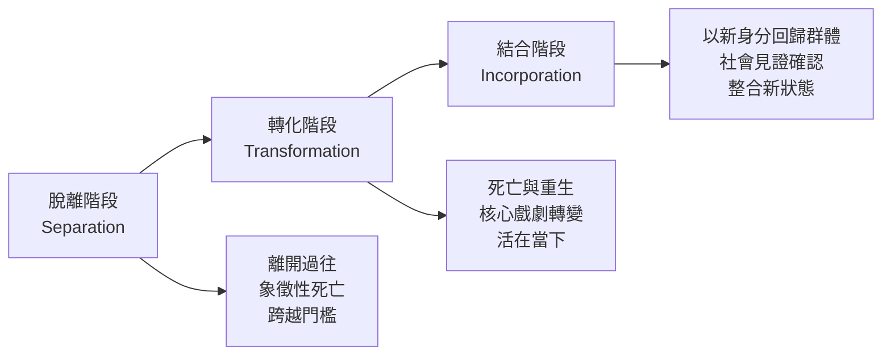
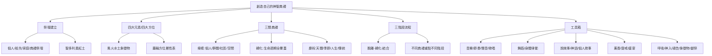

# 創造自己的神聖典禮

> **核心理念**：神聖典禮是連結物質世界與靈性世界的橋樑，透過祭壇、四大元素、四大方位等基礎架構，運用脫離-轉化-結合三階段流程，為生命重要時刻創造專屬的療癒、轉化、慶祝儀式。

---

## 書目資訊

| 項目 | 內容 |
|------|------|
| **原書名** | *Creating Your Own Sacred Ceremonies* |
| **作者** | 史蒂芬·法莫 |
| **譯者** | 丁騰 |
| **出版社** | 賀氏書屋 |
| **核心框架** | 祭壇建立 → 四元素/四方位 → 三類典禮 → 三階段流程 → 多元工具 → 具體生命情境應用 |

---

## Part 1：神聖典禮的目的、準備與進行

### 典禮與儀式的關鍵區別

| 維度 | **神聖儀式** | **神聖典禮** |
|------|--------------|--------------|
| **核心目的** | 達成特定預期結果 | 與大靈共舞、調和一致 |
| **結構** | 固定程序、不可變通 | 基本架構 + 直覺靈活引導 |
| **關鍵差異** | 期盼效果、工具導向 | 創造靈感、關係導向 |
| **風險** | 易淪為例行公事、形式大於內容 | 需平衡架構與自發性 |

> **賈德·格列哥里**：
> 「儀式是我們做些事，以便召喚造物主的力量按照我們心意行事。典禮則是我們與宇宙造物主一起共舞的靈感表達。」

### 核心哲學基石

- **永恆哲學**：神性實相滲透萬物，靈魂可與之直接連結 ([[aqal整合图谱]] 整合視野呼應)
- **薩滿傳承**：無寺廟體制、身兼醫生/祭司/神諭、連結人類與靈界 ([[MBA女巫带你开通能量]] 靈性歷程參照)
- **靈性自主**：不盲從外在權威，培養內在指引與大靈直接關係

### 創造祭壇：神聖空間的錨點

#### 祭壇類型
| 類型 | 功能 | 佈置重點 |
|------|------|----------|
| **個人祭壇** | 專屬靈性練習焦點 | 直覺布置、攜帶式設計 |
| **祖先祭壇** | 緬懷先人、敬仰根源 | 過世親友照片、三炷香、四元素象徵 |
| **家庭祭壇** | 家庭靈性活動中心 | 全家成員聖物共享、客廳顯眼位置 |
| **典禮祭壇** | 特定典儀臨時焦點 | 圓圈中央或全員可見處、參與者共同佈置 |

#### 祭壇基本架構
```
中央代表物（十字架/佛像/靈性導師照片/塞爾特十字架）
├── 火元素：蠟燭（核心配備）
├── 水元素：聖水小瓶/貝殼/鮑魚殼
├── 風元素：羽毛/銅製老鷹/動物圖騰
└── 土元素：聖地石頭/聖多利奧紅土/水晶
```

> **聖多利奧紅土傳說**：新墨西哥州聖塔菲教堂土坑紅土，百年不竭，療癒力量強大，作者女兒凱瑟琳親歷敬畯體驗。

#### 祭壇啟動典禮
1. 祈請指導靈 → 2. 點燭燃鼠尾草淨化 → 3. 點線香 → 4. 擊鼓/搖沙鈴/吟唱 → 5. 與每件聖物冥想共處 → 6. 為他人/世界祈禱 → 7. 以「願祢意願成全」結束

### 四大元素與四大方位：能量地圖

#### 四大元素對應表
| 元素 | 象徵物 | 功能 | 典禮應用 |
|------|--------|------|----------|
| **火** | 蠟燭、壁爐火 | 照亮、溫暖、燒掉負面能量 | 祭壇中心、冥想焦點、釋放儀式燃燒紙張 |
| **水** | 聖水瓶、貝殼、鮑魚殼 | 療癒、情感流動、連結記憶 | 淨化、祝福、情感釋放容器 |
| **風** | 羽毛、老鷹圖騰、香煙 | 呼吸、靈感、傳遞意圖 | 煙燻掃淨、召喚四方、呼吸練習 |
| **土** | 聖地石頭、紅土、水晶 | 穩定、接地、祖先連結 | 祭壇基礎、埋葬釋放物、療癒傳遞媒介 |

#### 四大方位屬性表（源自美洲原住民藥輪）
| 方位 | 元素 | 季節 | 動物圖騰 | 特質 | 太陽週期 | 月相 | 顏色 | 人生階段 | 創造力 | 關鍵字 |
|------|------|------|----------|------|----------|------|------|----------|--------|--------|
| **東** | 風 | 春 | 老鷹、貓頭鷹 | 心理 | 黎明 | 盈月 | 黃 | 出生 | 激發 | 靈感 |
| **南** | 水 | 夏 | 青蛙、海豚 | 情緒 | 正午 | 滿月 | 藍 | 童年 | 培養 | 直覺 |
| **西** | 火 | 秋 | 鳳凰、蛇 | 靈性 | 落日 | 虧月 | 紅 | 青年 | 試驗 | 轉化 |
| **北** | 土 | 冬 | 熊、烏龜 | 身體 | 午夜 | 新月 | 黑/白 | 老年 | 鞏固 | 內省 |

> **應用**：典禮開始時榮耀四方，祈求各方位靈性存有協助；可依典禮目的強調特定方位能量。

---

## Part 2：神聖典禮的三種基本類型

### 三類典禮核心比較

| 類型 | 核心目的 | 適用情境 | 關鍵特質 |
|------|----------|----------|----------|
| **療癒典禮** | 治療身心靈創傷、修復分離幻覺 | 個人/家庭/群體創傷、九一一事件集體療癒 | 整合性療癒、靈魂復原、薩滿靈魂找回 |
| **轉化典禮** | 標記人生進入下一階段 | 出生、成年、結婚、離婚、中年、老年、死亡 | 橋樑功能、身分轉換、社會見證 |
| **慶祝典禮** | 發揮創造力、榮耀特別日子 | 生日、週年、節日、天體週期（滿月/至點/分點） | 喜悅表達、豐富意涵、重構傳統 |

> **艾察**：
> 「我的目的是用典禮來慶祝最平凡、日常的事件，因為人生原本就是一場宏偉的典禮，你就是其中的主角。」

### 典禮三階段流程：脫離 → 轉化 → 結合



#### 階段詳細說明

| 階段 | 核心動作 | 象徵意義 | 具體範例 |
|------|----------|----------|----------|
| **脫離** | 物理/象徵移動、跨越入口線、釋放舊物 | 結束舊階段、短暫死亡、騰出空間 | 婚禮父親交棒新娘、剪斷臍帶、跨越畫在地上的線 |
| **轉化** | 核心儀式執行、盟約交換、命名/塗油/洗禮 | 實質蛻變、意識提升、大靈共舞 | 婚禮宣誓、嬰兒歡迎儀式、青春期成人禮核心考驗 |
| **結合** | 正式宣告新身分、群體歡迎、共享盛宴 | 社會確認、整合新角色、能量落地 | 「我宣布你們夫妻」、介紹史密斯夫婦、嬰兒受洗命名、成人禮群體接納 |

> **關鍵洞見**：不一定每場典禮都包含三階段；追悼會重脫離、青春期禮重轉化、受洗禮重結合。

---

## Part 3：神聖典禮的工具與步驟

### 四大基本原則

| 原則 | 核心內容 | 實踐要訣 |
|------|----------|----------|
| **清晰意圖** | 典禮主幹：療癒/轉化/慶祝？對象？階段聚焦？預期結果？ | 意圖即一切；設定後行動自明；吸引靈性指引與自發療癒 |
| **適時適地** | 曆法日期 vs 自然週期（日出/至點/滿月）；室內/外、空間大小、便利性 | 創造「非比尋常」感：火把、花瓣、移動傢俱、裝飾品 |
| **明確流程** | 明確開場（聲音/靜默/點燭/跨越入口）與結束（擊鼓/吹燭/感恩禱詞/擊掌宣告） | 事前說明流程、指派協助者、防止突發狀況、滿足好奇心 |
| **彈性架構** | 預先規劃大綱 + 允許靈性創意自由發揮 | 地圖與方向重要，但沿途可停車觀星、邀請大靈同行 |

### 典禮構成要素工具箱

| 要素 | 功能 | 實作方式 |
|------|------|----------|
| **設立祭壇** | 焦點錨點、能量聚集 | 臨時/永久、中央/可見處、參與者共同佈置 |
| **祈請與召喚** | 邀請指導靈/神靈全程參與 | 大靈/造物主/神通用稱謂；搖沙鈴/吟唱/擊鼓/木笛召喚四方天地 |
| **加入禱告** | 感謝為先、祈求為後、全然放手 | 跨文化手印/歌曲/唱誦；群體同心禱告效果增強；以「願祢意願成全」結束 |
| **有意識呼吸** | 直接經驗生命力、連結靈魂 | 夏威夷語「哈」=呼吸/生命能量/靈魂；瑜伽呼吸法；釋放恐懼：吸氣充滿恐懼→吹入石頭→埋土/放水 |
| **進入神入狀態** | 腦波減緩、進入「初始時間/無時間」 | 節奏/舞動/吟誦/說故事/禱告/靜默；拿掉手錶、團體同步達到深層意識、常引發狂喜 |
| **有意義象徵物** | 橋接個人與原型意義 | 個人意義（女兒音樂盒=內在小孩原型）+ 原型意義（母親/魔術師/國王跨文化共通） |
| **四大元素** | 生命基礎構成、全員熟悉 | 具體物品或象徵物代表風火水土 |
| **四大方位** | 榮耀方位靈性存有、引導能量 | 依藥輪屬性呼喚東南西北、天地 |
| **獻祭供品** | 迴向能量、感恩迴向 | 食物獻祭（典禮前上祭壇獲祝福→典禮後獻大地/分享）；聖物獻祭（接收團體意識力量） |

### 音樂、舞蹈、說故事：三大萬能癒合膏藥

> **安琪拉·亞立恩**：《四面之道》指出吟唱、說故事、跳舞、保持靜默為四大萬能癒合膏藥。

#### 節奏與聲音
- **節奏科學**：每秒4-7拍擊鼓 → 腦波從β波(14-20Hz)同步至θ波(4-7Hz) → 進入薩滿意識狀態/深度冥想
- **健康效益**：增強免疫力、對抗壓力、銀髮族鼓圈改善狀態
- **群體凝聚**：非洲塞內加爾村莊和平樹下鼓圈 → 個別節奏同步 → 主節奏浮現 → 同步祈禱世界和平
- **聲音療癒**：海浪聲撫平靈魂、迪吉里杜管低沉振動誘導夢境時空旅程

#### 歌唱與唱誦
- **薩滿傳統**：世代傳承療癒/慶祝/感謝歌曲
- **嗡(OM)唱誦**：神人溝通音頻；團體重複 → 多重單音融合 → 類狂喜狀態
- **多樣表達**：言語/歌唱/咕噥/呻吟/無言喜悅

#### 舞蹈與身體律動
- **跨文化共識**：美洲原住民/非洲/峇里島/印度典禮不可無舞
- **個人即興案例**：作者跳〈夜遊高加索〉求愛「內在女人」 → 療癒失愛創傷 → 吸引真實伴侶 → 結為夫妻
- **應用原則**：非表演性、意圖導向、身體成靈性表達媒介

#### 說故事
- **功能**：傳承文化價值、增添人性永恆、個人經驗鼓勵參與者、英雄旅程原型共鳴
- **素材來源**：神話傳說/個人真實經驗/虛構美化/《星際大戰》《魔戒》等現代神話
- **技巧**：無需大師，真誠分享即可；婚禮講新人趣事增添溫度

### 薰香、齋戒與盛宴

| 工具 | 目的 | 實作方式 |
|------|------|----------|
| **薰香草藥** | 淨化負面/召喚正面能量 | 白鼠尾草/煙燻杖/煙燻掃身/掃祭壇/掃空間 |
| **齋戒禁欲** | 增加典禮意義重要性、慈悲感恩 | 戒除習慣/癮頭/特定飲食；天主教四旬齋模式；將飲食習慣交付大靈 |
| **盛宴分享** | 彼此呵護滋養、社區連結 | 典禮後共食；食物先上祭壇獲祝福；療癒典禮餵食葡萄麵包象徵滋養 |

---

## Part 4：療癒典禮深度框架

### 療癒核心認知

| 概念 | 內涵 |
|------|------|
| **療癒vs治療** | 治療針對症狀；療癒整合身心靈、必然發生於靈性層面 |
| **根本創傷** | 與造物主分離的幻覺 → 所有療癒本質上修復此連結 |
| **創傷機制** | 全面壓垮經驗 → 控制與恐懼鎖住能量 → 創傷後壓力症候群 |
| **薩滿視角** | 靈魂碎片流失/被竊 → 靈魂找回 → 整合完整 |
| **道德準則** | 為他人舉行需尊重自由意志、與醫師/心理治療師合作、不替代醫療 |

### 療癒典禮層級架構

| 層級 | 範圍 | 特色 |
|------|------|------|
| **個人釋放重生** | 個人情緒/創傷/轉化 | 石頭呼吸法、火燒紙張埋土、水釋放 |
| **小群體療癒** | 家庭/夥伴/小組 | 共同意圖、相互見證、葡萄麵包餵食儀式 |
| **社區療癒** | 大群體/社會事件 | 九一一禱告夜、集體悲傷轉化團結 |
| **居家淨化祝福** | 空間能場 | 煙燻走遍房間、四角灑聖水/紅土、榮耀四方 |

---

## Part 5：轉化典禮——人生關鍵轉折點

### 生命週期轉化典禮譜系

| 人生階段 | 典禮名稱 | 核心意圖 | 關鍵元素 |
|----------|----------|----------|----------|
| **出生** | 出生禮讚 | 歡迎新靈魂、父母身分確認 | 剪臍帶、塗油/洗禮、命名、社區歡迎 |
| **青春期** | 兒童/青少年過渡儀式 | 標記成年、社會接納 | 挑戰考驗、長者指導、群體見證新身分 |
| **男性成年** | 男人入門儀式 | 進入成熟男性原型 | 長者引領、自然獨處、靈視探尋、責任承擔 |
| **女性成年** | 女人入門儀式 | 榮耀女性力量、月經/生育奧秘 | 女性長者圈、紅帳篷、月經初潮慶祝、女神原型 |
| **中年** | 步入中年轉化 | 整合陰陽、面對陰影、傳承智慧 | 生命回顧、釋放青春執著、導師角色確立 |
| **老年** | 迎接老年轉化 | 榮耀長者智慧、準備終極轉化 | 生命總結、傳承儀式、長者議會、死亡準備 |

> **核心原則**：每個轉化典禮必須包含**脫離舊身分 → 轉化核心體驗 → 結合新身分回歸群體**三階段，並由社區見證確認。

---

## Part 6：慶祝典禮——榮耀時間與自然節律

### 慶祝典禮分類體系

| 類別 | 具體典禮 | 時間錨點 | 核心意涵 |
|------|----------|----------|----------|
| **人生里程碑** | 結婚、離婚/分離、追悼/葬禮 | 個人生命關鍵點 | 愛的承諾/釋放/生死跨越 |
| **天體週期** | 滿月/新月、日蝕/月蝕、彗星出現 | 月相/行星排列 | 宇宙節律同步、顯化/釋放窗口 |
| **季節節點** | 春分/秋分、夏至/冬至、節分日/季度日 | 太陽黃道位置 | 陰陽平衡/光暗轉折/大地能量門戶 |
| **四季慶典** | 春播/夏長/秋收/冬藏 | 自然四季 | 生命循環參與、感恩豐收/靜待新生 |
| **傳統節日重構** | 聖誕/復活節/農曆新年等 | 文化曆法 | 注入個人創意、超越商業化、回歸精神本質 |

### 太陽與月亮週期詳細對照

#### 太陽週期八大節點（年輪）
| 節點 | 日期約略 | 主題 | 慶典重點 |
|------|----------|------|----------|
| **冬至** | 12/21 | 光的回歸 | 黑暗中點燭、內省、種子意圖 |
| **春分** | 3/21 | 平衡與新生 | 種植儀式、平衡冥想、蛋象徵 |
| **夏至** | 6/21 | 光輝巔峰 | 火祭、感恩豐盛、陽能極致 |
| **秋分** | 9/21 | 收穫感恩 | [[Mabon秋分与年轮]] 豐收祭壇、分享食物、平衡 |
| **節分日** | 2/2, 5/1, 8/1, 11/1 | 季節門檻 | [[Mabon仪式法术占卜与食谱]] 凱爾特傳統、火祭、預言 |

#### 月亮週期應用
| 月相 | 能量特質 | 適宜典禮 |
|------|----------|----------|
| **新月** | 開始、播種、設定意圖 | 新計畫啟動、種子禱告、黑暗冥想 |
| **上弦月** | 行動、建構、克服阻力 | 執行計畫、突破障礙、體力活動 |
| **滿月** | 顯化、圓滿、釋放、高能量 | 慶典巔峰、療癒釋放、充電水晶/水 |
| **下弦月** | 整理、內化、放手、休息 | 淨化空間、釋放舊模式、靜修 |

### 榮耀大地慶典
- **大地之母連結**：赤足行走、擁抱樹木、種植儀式、收穫感恩
- **元素榮耀**：分別為風火水土舉辦專屬慶典
- **生態責任**：典禮結合環保行動、恢復養分循環（呼應薩滿中介角色）

---

## 核心概念交叉引用網絡



### 關聯知識頁面索引

| 主題 | 相關頁面 | 連結點 |
|------|----------|--------|
| **薩滿/靈性傳承** | [[MBA女巫带你开通能量]]、[[cong-xin-jue-xing]]、[[drunvalo-melchizedek]] | 靈性歷程、心的神聖空間、生命之花 |
| **能量/脈輪/療癒** | [[chakra-clearing-doreen-virtue]]、[[neng-liang-ping-heng]]、[[ren-shen-shu]] | 脈輪淨化、能量平衡、仁神術 |
| **儀式/典禮/魔法** | [[wicca-candle-magic-introduction]]、[[wicca-magic-starter-kit]]、[[仪式魔法]]、[[亚伯拉梅林之书]] | 威卡蠟燭/水晶/草藥魔法、儀式魔法體系 |
| **元素/自然魔法** | [[史考特康宁罕元素魔法]]、[[土元素魔法体系]]、[[水系魔法体系]]、[[火元素魔法体系]]、[[风元素魔法体系]] | 四大元素實踐體系 |
| **音樂/聲音療癒** | [[yvonne-de-bruijn-shengming-zhisheng]]、[[soham-healing-sprays]]、[[guang-liao-yang-liao-hua-jing-zheng-he-liao-fa]] | 生命之聲、SoHam、光氧花精整合 |
| **生命週期/轉化** | [[Mabon秋分与年轮]]、[[Mabon丰收神话与传说]]、[[Mabon仪式法术占卜与食谱]] | 年輪八節點、秋分豐收傳說實作 |
| **顯化/意圖/信念** | [[专注意念的惊人力量]]、[[写下来奇迹就会发生]]、[[零极限与荷欧波诺波诺体系]]、[[如幻视角与信念显化]] | 吸引力法則、書寫顯化、荷歐波諾波諾 |
| **占星/時間質量** | [[shengshang-xingzuo]]、[[huangdao-shier-gong-tixi]]、[[zhanxing-shuji-mulu-yu-zhuti-daohang]] | 上升星座、身體星座對應、占星書目導航 |

---

## 實踐速查卡：設計你的專屬神聖典禮

### 步驟 1：釐清意圖（5分鐘）
- [ ] 類型：療癒 / 轉化 / 慶祝？
- [ ] 對象：個人 / 家庭 / 群體？
- [ ] 核心需求：釋放什麼？歡迎什麼？見證什麼轉變？
- [ ] 一句話意圖宣言：________________________

### 步驟 2：選擇時空（10分鐘）
- [ ] 時間：自然週期優先（至點/分點/滿月/新月/日出/日落）
- [ ] 地點：室內/外、祭壇位置、參與者便利性
- [ ] 環境營造：火把/花瓣/移動傢俱/特定裝飾

### 步驟 3：建立祭壇（15分鐘）
- [ ] 中央代表物：________________________
- [ ] 四元素：火(燭) 水(聖水/貝殼) 風(羽毛/香) 土(石頭/紅土/水晶)
- [ ] 四方位呼喚：東(靈感) 南(直覺) 西(轉化) 北(內省)
- [ ] 個人聖物：________________________

### 步驟 4：設計三階段流程（20分鐘）
| 階段 | 核心動作 | 工具選擇 | 時間 |
|------|----------|----------|------|
| **脫離** | 跨越入口/釋放舊物/象徵死亡 | 畫線/燃燒紙張/呼吸法/鼓聲 | ___分 |
| **轉化** | 核心儀式/盟約/命名/考驗 | 禱告/塗油/洗禮/舞蹈/說故事/唱誦 | ___分 |
| **結合** | 宣告新身分/群體歡迎/共食 | 正式宣告/介紹/盛宴分享/擊掌 | ___分 |

### 步驟 5：整合工具箱（彈性選擇）
- [ ] **音樂**：播放清單/現場擊鼓/沙鈴/木笛/迪吉里杜管/嗡唱誦
- [ ] **舞蹈**：自由律動/結構化圓舞/特定手勢/四方位動作
- [ ] **故事**：神話朗誦/個人經驗分享/引導式想像/英雄旅程敘事
- [ ] **薰香**：白鼠尾草煙燻全身/空間/祭壇/參與者
- [ ] **齋戒/盛宴**：典禮前禁食/特定食物獻祭/典禮後共餐分享

### 步驟 6：排練與執行
- [ ] 獨自走一遍流程、計時、調整
- [ ] 準備備案方案（天氣/參與者缺席/情緒突發）
- [ ] 設定「非比尋常」信號（特定聲音/香氣/燈光變化）
- [ ] **執行當下**：信任直覺、允許偏離計畫、記住「在神眼中一切無錯」

---

## 結語：相信你內在的神聖力量

> 「當你以誠摯的心去做，神與天使會親切地對你微笑。大多數人都不是在典禮習俗盛行的傳統下長大……儀式本身並無錯誤，問題出在參與者若缺乏真心誠意，且沒有充分顯現儀式的意義，它就會變成一種例行公事和義務。身為人類，我們正處於靈性創造力煥發的時期，我們被敦促要提升自我的靈性意識。地球正在懇求我們提供協助，敦促我們再次發現人類在生命網絡中真正的位置。神聖典禮作為生活中不可缺少的一部分，自然會促進我們對大靈的敞開。」

**從今天開始**：
1. 在家中建立一個簡單祭壇（一燭、一石、一羽、一水）
2. 設計一個「新月設定意圖」或「滿月釋放」的個人微型典禮
3. 在下一個生命轉折點（生日/畢業/搬家/分手/新工作）創造專屬轉化典禮
4. 邀請親友共同參與季節慶典，重構傳統節日意涵

**記住**：你本身就有創造神聖典禮的能力。它只需要一點奉獻、意圖與謙卑，加上傾聽靈性教導的意願。聖靈是充滿慈愛的——**在神的眼中，一切都沒有錯。**

## 来源

- [创造自己的神圣典礼](../sources/创造自己的神圣典礼.md)
