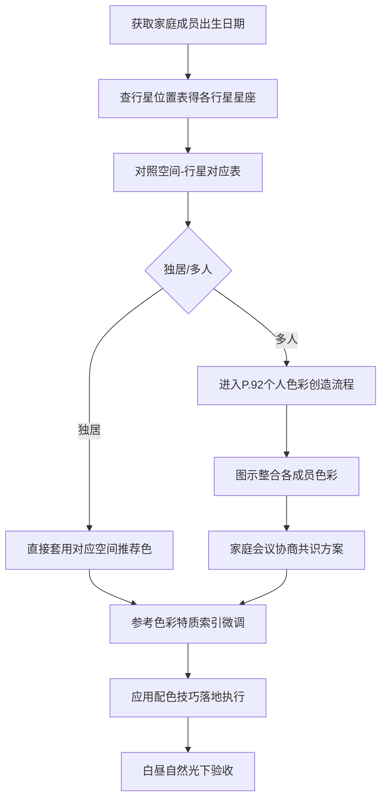

## 书籍概述

《十二星座居家配色宝典》是一本将占星学与室内色彩设计相结合的实用指南。全书核心理念：**住屋不仅是避风港，更能通过色彩影响居住者的心理、健康、人际与事业**。作者主张依据个人星盘中行星落座星座，为各功能空间挑选契合居住者性格的色彩，使居家环境成为“补给正能量”的场域。

书中建立**行星—空间—星座—色彩**四层对应体系，收录**77种色彩**的心理特质定义，提供从单人独居到多人同住的分级选色流程，并传授室内设计师常用的和谐配色技巧。

## 核心理论框架

### 行星与居家空间对应表

| 行星 | 对应空间 | 代表心理功能 | 关键活动示例 |
|------|----------|--------------|--------------|
| 太阳 | 玄关、更衣室、套房 | 社会行为、角色扮演、展示自我 | 接待客人、整理仪容、穿衣照镜 |
| 月亮 | 厨房、卧室 | 护育、呵护、情感连接 | 烹饪进食、照顾家人、睡眠做梦 |
| 水星 | 走廊、游戏室 | 沟通、学习、游戏、信息交换 | 交谈、阅读、玩耍、上网 |
| 金星 | 客厅、庭院、餐厅 | 愉悦、审美、亲密关系、享受 | 放松、品尝、做爱、装饰鲜花 |
| 火星 | 小厨房、楼梯间(次) | 行动、切割、体力劳动、欲望 | 烹饪操作、运动、打扫、性行为 |
| 木星 | 楼梯间、客房、餐厅 | 扩展、教导、社交仪式、权威 | 接待贵宾、教育子女、宴会展示 |
| 土星 | 书房、浴室(次)、厕所(次) | 结构、独处、冥想、整理、规划 | 学习工作、整理文件、冥想计算 |
| 天王星 | 书房(主) | 创新、科技、直觉、突变 | 上网、用电脑、创造性工作 |
| 海王星 | 浴室、卧室(次) | 感受、梦境、直觉、溶解边界 | 沐浴冥想、听音乐、做梦睡眠 |
| 冥王星 | 厕所、楼梯间(次)、游戏室(次) | 深度转化、潜意识、清理、掌控 | 排泄清理、深度思考、心理分析 |

> 说明：同一空间常有主次行星共管（如楼梯间主木星、次土星/冥王星），书中提供完整对照表。

### 星座色彩心理学与77种色彩特质

- **黄道十二星座**作为心理原型框架，每个星座对应一组“适合色彩”与“不建议色彩”。
- **77种色彩**经问卷实证，提炼为十大心理形容词维度（如乐观、平静、力量等），建立《色彩特质索引》。
- 色彩分类体系：原色（黄/红/蓝）→ 二次色（橘/紫罗兰/绿）→ 三次色（金黄/朱红/紫/靛/绿松/黄绿）→ 加白/黑/灰形成粉彩、深色、灰调 → 再微调混入第三原色生成细分色阶。
- 色彩名称沿用传统命名（如群青、赭石、茜草），并注明文化溯源与物质基础。

### 个人星盘色彩选取法

1. **查找行星落座**：依出生年月日（不需出生时间）查阅书末“行星位置表”，得知各行星落入何星座。
2. **对应空间选色**：按空间—行星对应表，取该行星星座的“适合色彩”名单。
3. **单人独居**：直接套用对应空间的推荐色系。
4. **多人同住**：进入“创造你的个人色彩”流程，用图示工具整合家庭成员色彩，经协商形成共识方案。
5. **进阶微调**：参考“色彩特质索引”依心理需求增减色调，或用“玩玩你的色彩”章节的设计师技巧和谐搭配。

## 空间详解与配色策略

### 室外空间——太阳/月亮/水星
- **象征**：家庭共同的“皮肤”，呈现社会形象与融入度。
- **色彩应用**：外墙、护窗板、大门、围栏、信箱、花圃等。
- **选色建议**：独居查太阳星座；多人共选，兼顾家庭整体意向。

### 玄关——太阳/木星/月亮
- **功能**：住屋的“阀门”，兼具保护、魔法净化、威慑或抚慰来客。
- **色彩应用**：地板、墙面、鞋柜、镜框、灯具、挂画。
- **选色建议**：独居以太阳星座为主；多人参考木星（社交展示）与月亮（护育欢迎）星座。

### 楼梯间——木星/土星/冥王星
- **象征**：垂直轴心，连接地窖(潜意识)与阁楼(超意识)，掌控存在感。
- **色彩应用**：扶手、踏板、踢面、墙面、灯具。
- **选色建议**：以木星星座为主导，佐以土星(结构)与冥王星(深度)色彩作点缀。

### 客房——木星/月亮/太阳
- **功能**：招待客人、增进家庭凝聚、展示待客之道。
- **色彩应用**：床品、窗帘、家具、毛巾、装饰画。
- **选色建议**：常客可个性化参考其星盘；临时客房以木星星座(待客仪式)为主。

### 餐厅——木星/金星/太阳
- **象征**：协商室、社交舞台、心意相通或拔刀相向的场域。
- **色彩应用**：餐桌椅、桌巾、餐具、吊灯、餐边柜、镜框。
- **选色建议**：木星主导仪式感，金星提升愉悦度，太阳强化展示性。

### 厨房——月亮/火星/冥王星
- **核心**：家庭隐私核心，烹饪与进食注入爱意，亲密对谈场所。
- **色彩应用**：橱柜、瓷砖、电器、窗帘、桌巾、抹布。
- **选色建议**：月亮星座奠定护育基调，火星/冥王星色彩可用于操作区点缀。

### 小厨房——火星/冥王星/月亮
- **象征**：单身/效率导向，科技与原始烹饪并存，感官麻痹劳动。
- **色彩应用**：同厨房，重耐脏、易清洁材质。
- **选色建议**：以火星星座(行动力)为主，冥王星(清理)次之。

### 客厅与庭院——金星/太阳/水星
- **象征**：理想世界投射，放松、社交、家庭共同活动的公共领域。
- **色彩应用**：沙发、抱枕、地毯、窗帘、灯具、庭院花盆、户外家具。
- **选色建议**：金星星座定基调(愉悦)，太阳/水星色彩丰富社交与沟通层面。

### 游戏室——水星/太阳/冥王星
- **功能**：被驯服的世界，成长与智力开发，压力释放安全区。
- **色彩应用**：游戏桌、收纳柜、墙面、地垫、灯光。
- **选色建议**：水星星座主导趣味与沟通，太阳增加展示性，冥王星用于深度游戏区。

### 走廊——水星/火星/冥王星
- **象征**：通往另一世界的通道，誕生/死亡隐喻，潜意识投射。
- **色彩应用**：墙面、踢脚线、壁柜门、灯具、挂画。
- **选色建议**：水星星座缓解压迫感，火星/冥王星色彩极简点缀。

### 卧室——月亮/土星/海王星
- **神圣性**：创造奇迹之所，女性偏爱、伴侣灵魂结合、至圣所意象。
- **色彩应用**：床品、窗帘、床头柜、灯具、墙面、镜框。
- **选色建议**：主卧以月亮星座(护育)为主，佐土星(独处冥想)与海王星(梦境)色彩；儿童/青少年房按各自月亮星座个性化。

### 浴室——海王星/火星/土星
- **仪式感**：沐浴如洗礼，净化重生，镜前诚实面对自我。
- **色彩应用**：瓷砖、浴帘、毛巾、洗漱用品收纳、镜框、灯具。
- **选色建议**：海王星星座定感受基调，火星(唤醒)与土星(整理)作功能区分色。

### 厕所——冥王星/土星/太阳
- **深层意义**：精神分析室，面对阴影、清理心理垃圾、象征性排泄。
- **色彩应用**：墙面、地砖、马桶盖、收纳、镜框、芳香装置。
- **选色建议**：冥王星星座主导转化色，土星辅助整理感，太阳用于梳妆镜区。

### 书房——天王星/太阳/土星
- **性质**：阳刚气息重、品德教育场、向世界敞开的探索基地。
- **色彩应用**：办公桌椅、书架、墙面、灯具、电脑周边、装饰品。
- **选色建议**：天王星星座(创新)为主，太阳(展示)与土星(结构)平衡。

### 更衣室——太阳/土星/水星
- **功能**：自我外衣、面具准备间、与他人隔离的私密确认空间。
- **色彩应用**：衣柜内壁、镜框、座椅、灯光、地毯。
- **选色建议**：太阳星座定社交面具色，土星/水星色彩辅助整理与分类。

### 洗衣间——火星/冥王星/月亮
- **本质**：劳动与转化、清理与分类、护育延伸的功能空间。
- **色彩应用**：墙面、地砖、收纳柜、洗烘机器面板、熨衣板套。
- **选色建议**：火星星座(动力)主导，冥王星(彻底清理)与月亮(呵护织物)配合。

## 色彩体系与77色详表

### 色阶构建逻辑
1. **基础色系**：原色→二次色→三次色（12色相环）
2. **明度扩展**：各色相加白→粉彩色；加黑/灰→深色/灰调
3. **彩度微调**：在“纯色”滴入第三原色生成复杂色（如带红绿、带蓝橘）
4. **非彩色系**：白/非纯白(9种)→粉彩(11种)→灰/黑(6种)
5. **最终入选**：77色（含白/灰/黑），第77号呼应元素77铱(Iridium, 彩虹之意)

### 77色心理特质速查（节选）
| 色号 | 色名 | 核心心理特质 | 对应星座示例 |
|------|------|--------------|--------------|
| 1-9 | 白/非纯白 | 纯净、犹豫、等待、空白 | 双子、处女、水瓶 |
| 10-20 | 粉彩系列 | 纯真、历尽沧桑、柔和 | 巨蟹、双鱼、天秤 |
| 21-23 | 紫色系 | 权力、行动、物质性 | 天蝎、摩羯、狮子 |
| 24-28 | 红/洋红系 | 生机、能量、男性阳刚 | 白羊、天蝎、狮子 |
| 29-33 | 粉红系 | 敏感、细腻、削减能量 | 金牛、天秤、双鱼 |
| 34-37 | 橘色系 | 乐观、生活之乐、社交 | 射手、狮子、双子 |
| 38-42 | 褐色系 | 物质、真实、沉重、扎根 | 摩羯、金牛、处女 |
| 43-48 | 黄色系 | 多变、青春、脆弱、光线 | 双子、射手、狮子 |
| 49-55 | 绿色系 | 均衡、提振抚慰并存 | 金牛、处女、摩羯 |
| 56-60 | 绿松色系 | 理想化物质、创新平衡 | 水瓶、双子、天秤 |
| 61-67 | 蓝色系 | 精神生活、绝对观念、一贯性 | 水瓶、双鱼、巨蟹 |
| 68-72 | 紫罗兰系 | 吸引力、力量、距离现实 | 双鱼、天蝎、射手 |
| 73-77 | 灰/黑系 | 谦虚悲伤/空洞沉重/界限 | 摩羯、土星强、冥王星强 |

> 完整77色定义见书末《色彩特质索引》，每色附十形容词画像。

## 室内设计配色技巧（玩玩你的色彩！）

1. **60-30-10法则**：主色60%(墙面/大件)、辅助色30%(窗帘/地毯/家具)、强调色10%(靠垫/挂画/小饰品)。
2. **色相环和谐**：
   - 单色系：同色相不同明度
   - 类似色：相邻30°-60°（如蓝→蓝绿→绿）
   - 互补色：对位180°（红/绿、蓝/橘、黄/紫）需面积克制
   - 三角配色：等分120°（红/黄/蓝），一主二从
3. **明度对比**：同色相拉开明度层次，避免“脏灰”感。
4. **材质呼应**：同色系不同材质(哑光/亮面/织物/金属)增加深度。
5. **过渡色桥接**：用非纯白、灰、木色、金属色连接强对比色块。
6. **光影测试**：白昼自然光下确认最终效果，避免灯光色温误导。
7. **心理锚定**：在关键视觉焦点(床头墙/沙发背景/餐桌上方)植入核心色彩。

## 常见问题核心解答

| 问题 | 核心观点 |
|------|----------|
| 星座色彩探讨什么？ | 依性格为各空间甚至车辆选色，无需专业知识即可专家级搭配。 |
| 住屋有何心理功能？ | 增智强记、愉悦健康、减压助眠、抗衰、支持戒瘾、深化自知与亲密、疗愈创伤、强化自尊、抗抑郁。 |
| 如何利用住屋益处？ | 必须为住屋“刻印记”(照片、偏好色彩、个人物品)，产生归属感。 |
| 为什么不用通用疗愈色？ | 千篇一律无法反映个性；唯有契合性格的色彩才能庇护重整思维。 |
| 星座能代表性格吗？ | 不比人格分类法优劣，但允许多重星座共存，吻合“独一无二又多面”的体感。 |
| 不信占星能用吗？ | 能。直接查《色彩特质索引》选色；空间介绍、配色技巧、心理分析章独立可用。 |
| 与风水冲突吗？ | 不冲突。风水调气场流向，本书调心理投射，可叠加使用。 |
| 需懂占星吗？ | 仅需出生日期查行星星座，书末附表，无需专业知识。 |
| 占星准不准？ | 若推荐色含你最爱色(或厌恶色在不建议名单)即“准”；重点非准确性，而提供决策基准与家庭互动契机。 |

## 使用流程速览

## 交叉引用与延伸阅读

- 占星基础：[[黄道十二宫体系]]、[[十二星座基本特质与经典排行]]、[[星座三原型与四正]]
- 行星心理：[[内行星]]（水金火）、[[neizai-de-tiankong]]（进化占星视角）
- 色彩应用：[[人体气场彩光学]]、[[光療氧療花精整合療法]]、[[宝石与脉轮对应关系]]
- 空间心理：[[fengshui-bao-di-mo-shi]]（风水择居）、[[zhenggongzhi-yu-shier-gongwi]]（宫位生活领域）
- 实操工具：[[ziwei-doushu-pan-wei-zheng-que]]（真太阳时校正）、[[liuyao-jichu-rumen-qinglan]]（卜筮辅助决策）

## 版本与来源说明

- 本页依据《十二星座居家配色宝典》中文版全文归档整理，保留书中核心框架、77色体系、空间行星对应表、选色流程及设计技巧。
- 书中“行星位置表”覆盖1900-2050年，使用时请确认版本年份。
- 书末附录含“色彩特质索引”、“行星位置表”、“致谢名单”，未在此逐条展开。

## 来源

- [十二星座居家配色宝典](../sources/十二星座居家配色宝典.md)
