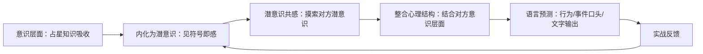

## 核心定位：专业占星学与通俗太阳星座的界分

> **序言核心主张**  
> 现代占星学推展须完成三大任务：批判继承传统术数、引进国际研究成果、推动科际整合。太阳星座流行书被专业辞典定性为「过度简化、混淆太阳、被严谨占星家轻视的低级占星学」（《占星学辞典》1980版）。专业占星家不承认太阳星座专家的领域地位，西方占星学会资格认定中，太阳星座专家常仅具「一般会员」资格，无法达「研究会员」标准。  
> —— 参考：[[zhanxing-quan-fang-wei]] 中对「五术定位」与「命理三原理」的专业界定

### 专业角色的三重标准
1. **论断因素整合度**：专业占星家以十二星座互动、相位、宫位、廟旺陷弱为整合分析对象；太阳星座仅取单一星座。  
2. **精密度诉求**：专业论断评估吉凶特质及影响生活层面，绝不无限膨胀单一因素影响力。  
3. **行星功能区分**：专业视太阳星座为「太阳功能运作下的星座」，区别于月亮、金星等行星功能语境。

## 十大核心问题：从「知其然」迈向「知其所以然」

### 星座在论断中的角色与地位
- **环境论**：星座为行星落入的环境/背景，行星只能透过落入星座发挥力量，指示「部位」「基本态度」「基本特质」。  
- **天赋特质论**：单一星座用于细微论断（如金星星座、第五宫宫头看爱情天赋）；十二星座综合比例塑造基本心理结构，决定意识/潜意识作用与行为反应模式。  
- **入门功夫**：命盘十二星座特质綜合論斷为现代占星学最基本论断方法，切入点即人格心理结构。  
> 关联：[[12星座人性攻略]]「星座成分统计、图像思考法、行星丛聚」实战框架

### 彻底理解星座的五大面向
| 面向 | 内容 | 对应实务 |
|------|------|----------|
| 分析角度 | 星座解读的切入媒介，本章重点 | 基本人格论断基础 |
| 内在机制 | 串联单一星座全特质，避免死记，发挥扩展性/联想性 | 《星座关键字解读》 |
| 相似特质差异 | 元素同质星座的细部分析 | 三方四正/阴阳二分法交叉 |
| 綜合性論斷 | 十二星座轻重比例、意识/潜意识功能划分 | 心理占星核心入门 |
| 流年應用 | 生命周期心理意识变化分析 | 推运进阶 |

### 运用自如的「意识流论断手法」
> **五步内化路径**  
> 1. **意识层面吸收** 占星知识符号说明  
> 2. **内化为潜意识** 见符号即自然描述感觉，无需思索  
> 3. **潜意识共感** 以己潜意识摸索对方潜意识  
> 4. **整合心理结构** 结合对方意识层面，掌握整体心理  
> 5. **语言预测** 以意识思维对行为/事件进行口头/文字预测  

> **五大素养**：哲学家心灵、宗教家冥想、艺术家技巧、科学家精神、政治家口才。  
> **核心原则**：符号是死的，人是活的；以无形心灵感觉引导有形文字诉说。

### 分辨太阳星座书真伪的两大原则
1. **含血型即弃读**：西方专业书从不混入血型，血型星座皆为日式抄袭低俗作。  
2. **查矛盾特质**：单一星座特质具内在一致性，绝无冲突特质并存。  
> 反例：《日月星座》白羊座同时列「激情/冷漠」「大胆冒险/敏感多虑」，且用「醒覺」等模糊词汇掩盖逻辑崩塌。

### 5-10. 学习条件、捷径、爱情/职业/运气论断边界、太阳星座流行成因
- **无特殊条件**，需持续研究+实战论断+求教真师。  
- **无速成捷径**，唯高度兴趣+不断分析命盘个性可加速内化。  
- **爱情/婚姻/职业/人际** 需评估多因素、合盘技巧，绝非单凭太阳/月亮。  
- **运气判断** 属动态运势（大运/流年/流月/流日）与静态吉凶徵兆（相位），太阳星座完全无力胜任。  
- **流行成因**：简单易懂+大众知生日+娱乐消遣属性。  
- **太阳星座价值**：仅为主要人格特质之一，决定自我意识，须剥离其他星座贡献的特质，避免误导。

## 十大谬误：太阳星座占星学的系统性缺陷

| # | 谬误核心 | 专业反驳要点 | 关联知识页 |
|---|----------|--------------|------------|
| 1 | **忽略命宫/上升星座影响力** | 命宫星座影响力常大于太阳，随年龄增强；主要人格星座通常3-4个综合判断 | [[zhenggongzhi-yu-shier-gongwei]] 命宫/宫位系统 |
| 2 | **自建太阳宫位系统预测运气** | 误差率11/12；忽略相位、本命盘配合、流年/流月/流日动态系统 | [[2022占星运势指南]] 整宫制/行运实务 |
| 3 | **幸運象徵不考慮相位** | 吉相行星/木星星座才定幸运色/宝石/方向；凶相过多反致反效果 | [[planetary-condition-traditional-astrology]] 行星状态评估 |
| 4 | **太阳/月亮单论爱情婚姻对象** | 主要人格星座多元配合；爱情重金星、婚姻男看月亮女看太阳；相位组合/合盘才是核心 | [[han-lianglu-synastry-law-of-attraction]] 合盘吸引力法则 |
| 5 | **太阳星座单论人际互动** | 合盘分析技巧为标准；工作/朋友/亲戚分别看第六/十/十一宫、第三/七/十一宫、第三/四/七/十宫 | [[synastry-planets-in-houses]] 行星落宫互动模型 |
| 6 | **太阳星座单论职业工作** | 职业看第六/十宫、太阳合相行星、特殊相位格局；太阳非六/十宫宫头影响力易被取代 | [[shi-shen-qi-shi-lu]] 十神/一柱论职业 |
| 7 | **太阳星座断财运/一生运势** | 静态看相位吉凶，动态看大运流年；太阳非必落二宫（1/12概率），仅能论钱财态度 | [[bazi-fenxi-sigeyanshi-moxing]] 动态分析框架对照 |
| 8 | **星座三段式（0-10/11-20/21-30度）混淆相邻星座** | 专业无此说；相邻星座特质截然不同，仅过宫瞬间存「朦气差」；实用「三分法（同元素影响）」或「十二等分法（2.5度/星座）」 | [[zhanxing-tianwen-jichu-yu-huangdao-tixi]] 黄道坐标/岁差 |
| 9 | **混入血型/性器/性姿势等低俗内容** | 纯日式捏造，污辱命理研究；西方专业书绝无此类内容 | [[星座与血型综合性格分析]] 休闲定位边界 |
| 10 | **缺乏宫位宫头考量（根源谬误）** | 太阳星座只呈现天赋特质，缺后天宫位生活领域表现管道；同太阳摩羯座，落二宫显钱财、落三宫显沟通，命运迥异 | [[zheng-gong-zhi-yu-shier-gong-wei]] 整宫制/宫位系统 |

## 意识流论断手法：从知识到预测的完整链路

### 关键节点解析
- **内化标准**：看见任一符号（星座/行星/相位/宫位），无需思索即能自然描述其心理感觉。  
- **共感机制**：占星师以己潜意识为「探针」，感知咨询者潜意识图景，非理性推演。  
- **结构整合**：将共感所得潜意识材料，置于咨询者显性意识/人生语境中，形成完整心理画像。  
- **预测输出**：调用意识层面逻辑/语言能力，将心理结构转化为可传达的预测建议。  
- **反馈闭环**：实战验证不断深化内化深度，形成「越用越懂」的良性循环。

> **心理占星学地位确立**：此手法印证心理占星学为现代占星主流；无法透彻研究心理占星，无法成卓越占星家；西方占星家「梦境式」心理描述即此境界外化。  
> 关联：[[nei-xing-xing]] 萨司波塔斯/格林《内行星》心理占星框架；[[arroyo-astrology-karma-transformation]] 阿若优《占星、业力与转化》高层意识导向

## 职业占星师的伦理责任

### 三大责任层级
1. **知识专业性**：拒绝「休闲式」阅读/写作态度；坚持「知其所以然」教学，不为销量输出低俗作品。  
2. **道德良心**：不昧良心介绍错误知识；不「草菅人命」式简化人生课题。  
3. **尊重生命与命运**：扫除太阳星座误导是全球占星家共同责任；推动电脑排盘普及，引导大众从「你是什么星座」转向「主要/次要人格星座、意识/潜意识星座、爱情/职业态度星座」的心理深度提问。

### 实践承诺
- **免费修正误导**：作者自述因频繁被问星座问题，决定著书澄清，视为「扫除低俗化误导」的职业义务。  
- **引进原版专业书**：争取AFA代理权，引进上千种欧美专业著作/期刊，提供正统学习管道。  
- **人才培训体系**：筹划「现代占星学校园推广小组」、教学中心、期刊，加速专业人才供给。  
- **软件工具普及**：协助占星软件改进与平价推广，夯实「星星人类」时代的技术基建。

## 星座分类体系：阴阳二分法与四正宫三重奏

### 阴阳二分法（最基础划分）
| 属性 | 星座 | 核心特质对照 |
|------|------|--------------|
| **阳性**（火/风） | 白羊、双子、狮子、天秤、射手、宝瓶 | 外向/主动/竞争/思考快/表象成就/自信/关注外在变化 |
| **阴性**（水/土） | 金牛、巨蟹、处女、天蝎、摩羯、双鱼 | 内向/被动/合作/思考细/实质成就/敏感/适应环境 |

- **量化内在比例**：每星座给阴阳分配10分（如白羊8阳2阴、双鱼1阳9阴），作观察指标非绝对标准。  
- **心理机制互补**：阳性「创造+逻辑」需阴性「感觉+秩序」落地；阴性需阳性推动行动。  
- **实战注意**：  
  1. 相对非绝对，受命盘整体冲击强弱调整。  
  2. 无优劣，唯平衡论；职业匹配看需求特质。  
  3. 行星落宫（前六/后六宫）与落星座（阴/阳）双重观察，不一致时引入三方四正厘清。  
  4. 属最粗浅分析，后续三方四正更细腻重要。

> 关联：[[12星座人性攻略]]「阴阳二分法与配比分值表」、「四正宫心理动机模型」

### 四正宫：生命历程的三大动力模式

#### 本质定义
| 四正宫 | 星座 | 核心隐喻 | 心理动机 | 人生驾驶模式 |
|--------|------|----------|----------|--------------|
| **基本宫** | 白羊/巨蟹/天秤/摩羯 | 追寻基地（中点站） | 开创/促动/带领他人 | **弯曲型**：沿途发现新目标转向 |
| **固定宫** | 金牛/狮子/天蝎/宝瓶 | 坚持焦点（立足点） | 投入/深化/抗拒入侵 | **直线型**：锁定目标一路到底 |
| **变动宫** | 双子/处女/射手/双鱼 | 融入新情境 | 调适/应变/享受过程 | **随势型**：依基本/固定力量强弱决定 |

#### 四阶段循环链接
1. **基本宫促动** → 2. **固定宫持续** → 3. **变动宫总结改变** → 回1. 选择新目标  
| 阶段 | 宫位组合 | 偏向领域 |
|------|----------|----------|
| 第一 | 戌/酉/申 | 思维知识 |
| 第二 | 未/午/巳 | 情绪亲切 |
| 第三 | 辰/卯/寅 | 再生提升 |
| 第四 | 丑/子/亥 | 服务奉献 |

#### 与三大核心因子类比
- 基本宫 ≈ **命宫**（动力源/行动指标）  
- 固定宫 ≈ **太阳**（意志表达/目标完成）  
- 变动宫 ≈ **月亮**（智力展现/环境适应）

#### 同组四正宫差异（以基本宫为例）
| 星座/宫位 | 表现范围 | 核心驱动 | 影响他人方式 |
|-----------|----------|----------|--------------|
| **白羊/戌宫** | 普遍/全领域 | 高度兴致/开创性 | 直接引领「跟我走」 |
| **巨蟹/未宫** | 家庭/情感/安全感 | 情感需求/拉拢 | 温情照顾「吸收为家人」 |
| **天秤/辰宫** | 婚姻/合伙/社交 | 观念平衡/评估 | 分析结果「成参谋者」 |
| **摩羯/丑宫** | 事业/名望/实质成就 | 实利吸引/成就感 | 掌握实权「成楷模」 |

> 固定宫/变动宫同理展开（金牛/酉宫为固定原型、双子/申宫为变动原型等），详见原书第三章细节。  
> 关联：[[sasportas-twelve-houses]] 萨司波塔斯《十二宫位研究》心理动机深度对照；[[zhanxing-shuji-mulu-yu-zhuti-daohang]] 宫位专题导航

## 交叉引用索引

| 主题 | 关联页面 | 备注 |
|------|----------|------|
| 专业占星入门体系 | [[astrology-made-simple-series]] | 叢書教學架構對照 |
| 太阳星座谬误十大批判 | [[12星座人性攻略]] | 同源雙軌教學框架 |
| 心理占星核心文本 | [[nei-xing-xing]]、[[sasportas-twelve-houses]] | 薩司波塔斯/格林/阿若優體系 |
| 合盘/关系占星 | [[han-lianglu-synastry-law-of-attraction]]、[[synastry-planets-in-houses]] | 韓良露吸引力法則/行星落宮 |
| 推运/行运实务 | [[2022占星运势指南]]、[[planetary-condition-traditional-astrology]] | 整宫制/行星状态/年度运势 |
| 宫位系统深度 | [[zheng-gong-zhi-yu-shier-gong-wei]]、[[zhenggongzhi-yu-shier-gongwei]] | 整宫制/鄭工智十二宮位 |
| 演化/业力占星 | [[arroyo-astrology-karma-transformation]]、[[ming-wang-xing-ling-hun-yan-hua-zhi-lv-juan-yi]] | 冥王星/业力/演化阶段 |
| 医学/身体占星 | [[huangdao-shier-gong-tixi]]、[[ni-de-shen-ti-jiu-shi-12-xing-zuo]] | 黄道十二宫身心对应 |
| 数字学/生命灵数交叉 | [[caibhong-shuzi-xue]]、[[conditioning-number-mangala-billson]] | 制約數字/彩虹數字學 |
| 塔罗/占卜方法论 | [[divination-fundamentals]]、[[tarot-wands-suit-analysis]] | 象征性思维/牌义体系 |
| 能量/脉轮/疗愈 | [[chakra-clearing-doreen-virtue]]、[[neng-liang-ping-heng]] | 脉轮净化/能量平衡实操 |
| 灵性成长/显化 | [[xianhua-shijian-yu-zhuanzhu-lianci]]、[[chuang-zao-jin-qian-tong-wang-feng-yu-zhi-lu]] | 显化实操/丰裕之路 |

## 结语：从「星座专家」到「占星咨询师」的跃迁

洪能平以《占星大师谈星座》划定清晰界线：  
- **入门门槛**：掌握阴阳/三方/四正三重分类、十二星座内在一致性、意识流论断五步法。  
- **职业底线**：拒绝血型混淆、宫位缺失、相位忽略、运势简化等十大谬误。  
- **伦理坐标**：以「尊重生命命运」为最高准则，推动工具普及、人才培育、原版引进三大基建。  

> 「现代占星学是一门与个人人生课题有关的知识。如果你关心自己的一生，并以谨慎关注的态度面对，你就会想知道比较深入的内容。」—— 洪能平自序

下一步学习建议：  
1. 精读《星座关键字解读》内化单一星座机制 → 2. 实操「星座成分统计/图像思考法」练习綜合論斷 → 3. 引入行星/相位/宫位模块（参考《占星学其实很简单！》入门篇） → 4. 进入合盘/推运/医学/演化等专题深造。

## 来源

- [占星大师谈星座](../sources/占星大师谈星座.md)
