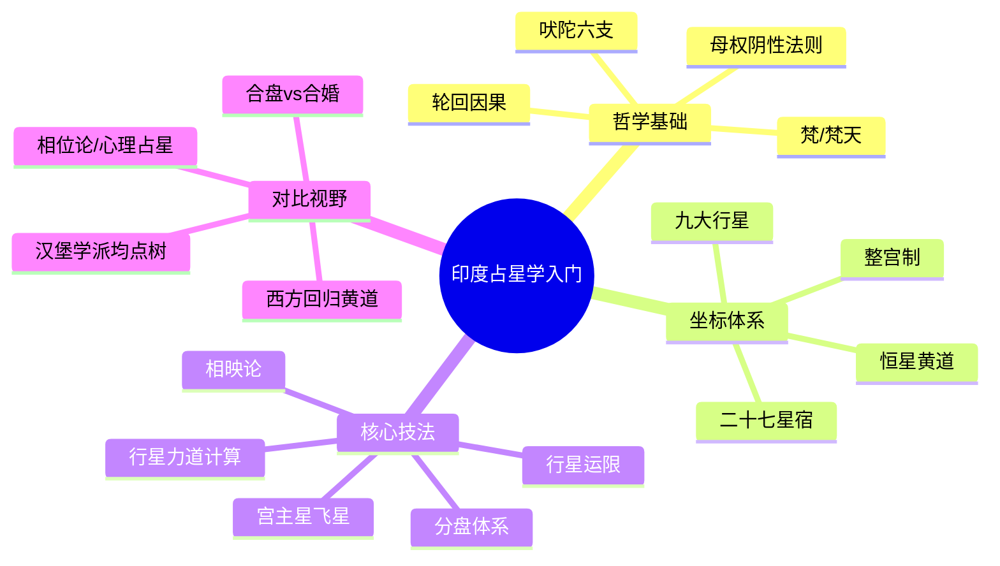

## 书籍概况

《印度占星学入门》由洪能平撰写，2001年出版。本书系统介绍印度吠陀占星学（Jyotish）的核心理论与实务操作，涵盖哲学基础、恒星黄道与整宫制、二十七星宿、分盘（Varga）体系、行星力道（Shadbala）计算、行星运限（Dasha）推运，并深度对比西方回归黄道占星与汉堡学派（Uranian Astrology）的异同。作者以「占星学是心灵的感受，而非单纯心理分析」为核心主张，强调复杂计算背后的直觉体会与精神追寻。

## 第一部分 基礎命盤

### 一、寒夜堅冰破：占星学的困境与出路

#### 星座学泛滥与专业占星的边缘化
作者指出西方占星学发展至20世纪末面临严重挑战：通俗「星座学」取代专业占星，导致大众认知偏差。心理占星学虽曾兴盛，却因过度强调「自由意志」与「人定胜天」，反而削弱占星预测功能，使占星沦为性格分析工具。

#### 印度占星的尊崇地位
对比之下，印度社会普遍尊重占星学（Jyotish），视为科学。从命名、佩戴宝石到人生关卡，皆咨询占星师。这种尊重促使印度占星保持严谨传承，未被简化为星座娱乐。

#### 相位 vs 相映：两种论命思维的分水岭
- **西方相位论**：源自开普勒，以角度容许度衡量行星互动，主导现代西方论断，易导致「单纯化」——单一相位定吉凶。
- **印度相映论**：行星作为统治者相互「瞥视」，分全见、四分之一、二分之一、四分之三见。对应宫位互动：七宫全见、三/十宫四分之一、五/九宫二分之一、四/八宫四分之三。配合行星敌友关系构建论命脉络。

#### 汉堡学派的兴起与「均点树」
Uranian Astrology（汉堡学派/宇宙生物学）舍弃星座与宫位，仅保春分点为敏感点，以「均点树」串连多因素平行整合。作者认为其内在精神与印度分盘体系异曲同工：皆透过高难度感受多层因素互动捉摸命运。

> **交叉引用**：[[zhanxing-tianwen-jichu-yu-huangdao-tixi]]（恒星黄道与回归黄道分歧）、[[sue-tompkins-aspect-theory]]（相位理论）、[[zhanxing-mofa-benjamin-dykes]]（占星魔法与择时）、[[arabic-parts-and-fixed-stars]]（阿拉伯点与均点渊源）

### 二、吠陀星声闻：哲学根基与社会文化映射

#### 吠陀六支与占星定位
印度占星属吠陀六支（Vedanga）之一「Jyotisha」（天体之光科学），喻为「吠陀之眼」。六支分别对应身体器官：计量为足、方法为手、语法为口、教导为鼻、语源为耳、占星为目。

#### 宗教演进与命运观
- **天然神话时代**（前1500-1000）：多神崇拜，万物有灵，《梨俱吠陀》为代表。
- **婆罗门教时代**（前1000-500）：确立四姓制度，《奥义书》确立「梵」为形而上原理，《薄伽梵歌》提出「梵天」三位一体。
- 占星学融合「轮回因果」与「现世趋吉避凶」双重思维，既受婆罗门教影响，又亲近数论与密教。

#### 月亮主导的母权遗存
印度占星以月亮为核心（二十七宿体系），对应内心精神生活；西方以太阳为核心（十二星座），对应外在人格。作者认为这反映印度母权社区在父权征服后仍于占星体系存续，使印度占星呈现「阴性法则」主导特质。

#### 种姓与婚姻的现实投射
九分盤（Navamsa）论配偶实为论「阶级跃升」。古典预测重男轻女、重死亡与偷腥预测，折射当时社会现实。现代印度占星逐渐修正性别偏见，但本命盘以男性为主角传统犹存。

> **交叉引用**：[[indian-astrology-jyotish-overview]]（印度占星总览）、[[nakshatra-27-lunar-mansions]]（二十七星宿详表）、[[vargas-divisional-charts]]（分盘体系）、[[zhanxing-zhongjian-yuexing-12]]（月亮星座心理动力学）

### 三、星海東西會：技术体系深度对比

#### 两大黄道系统与宫位制
| 维度 | 西方占星（回归黄道） | 印度占星（恒星黄道） | 汉堡学派 |
|------|---------------------|---------------------|----------|
| 黄道基准 | 春分点（白羊0°） | 固定星背景 | 兼用，仅保春分点为敏感点 |
| 宫位制 | 不等宫（普拉西德斯等） | **整宫制/等宫**（命度为一宫中点） | 新创宫位制，未普及 |
| 宮主星 | 逐渐没落，仅卜卦常用 | **核心论断工具**（飞星/穿梭） | 不依赖宫主星 |

#### 行星体系与吉凶评估
- **传统七曜+两交点**：印度坚持九大行星（含罗睺/计都），现代三王星（天海冥）仅作参考。依据距离地球引力大小排序，土星重力设为1，三王星均<0.04，故非主导。
- **二十七宿分配**：九大行星各管三宿，每宿四分得108宿部，对应佛教念珠数。
- **行星力道计算（Shadbala）**：加总制，含位置力、时间力、方向力、动力、自然力、相位力等。得分最高者为最旺吉星，最低者为最弱凶星，**吉星弱则反凶，凶星旺则反吉**。直接服务于行星运限排序。

#### 运势推运体系对比
| 体系 | 核心方法 | 特点 |
|------|----------|------|
| **印度** | **行星运限** + 过运 | 大方向划分，可细分至四级运限（主/次/次次/更次次） |
| **西方英美** | 次推运 + 过运 | 相位容许度严控 |
| **西方欧陆/汉堡** | 太阳弧/均点向运 + 过运 | 均点容许度≤1°，小方向精准拿捏单一事件 |

#### 合盘与合婚观差异
- **西方合盘**：心理占兴起后强调，重互动描述而非结果预测。
- **印度合婚/汉堡学派**：**以本命盘为准**。印度合婚实用导向：旺夫、生子、阶级跃升；汉堡派：本命无离婚徵则不离，有徵则按向运时间呈现。

> **交叉引用**：[[zheng-gong-zhi-yu-shier-gong-wei]]（整宫制）、[[zhanxing-yu-ce-ji-fa-ti-xi]]（预测技法体系）、[[planetary-condition-traditional-astrology]]（行星状态与三分性主星）、[[zhanxing-liu-nian-rudolf]]（鲁道夫流年体系）、[[synastry-planets-in-houses]]（合盘行星落宫）

### 四、天韻盤中藏：分盘与谐波图的奥秘

#### 分盘体系：数的神秘切割
印度占星透过星座30°进行「数」切割（除以N、乘以N同构），生成分盘（Varga）。帕拉沙拉系统列出16种常用分盘（D1-D60），各对应特定生活领域：
- D1 命盘（总体）
- D9 九分盘（配偶/命格/阶级）
- D10 十分盘（事业/地位）
- D12 十二分盘（父母/血统）等

**核心逻辑**：分盘行星位置变动，宫位重组，以该分盘升星座为新一宫，论断特定领域吉凶。

#### 西方谐波图的渊源与局限
- John Addey 受印度分盘启发创立 Harmonic Chart，Marc Edmund Jones 七命盘形式实源自印度星组（Yoga）。
- 谐波图因心理占星退潮、缺乏与本命盘紧密诠释原则、事件断验无特殊功能而衰落。
- 印度分盘因「九分盘为基础再细分」（如 Nadi System）持续演进，经得起时代考验。

#### 律动与数的波动
Addey 从音乐韵律切入，揭示「律动」为分盘底蕴。印度占星虽缺乏此理论阐发，但实务中「星组」体现相同感知：行星在分盘中形成特定几何关系，触发生命对应领域的业力显化。

> **交叉引用**：[[vargas-divisional-charts]]（分盘详表与操作逻辑）、[[nakshatra-27-lunar-mansions]]（星宿与分盘关联）、[[zhanxing-tuxing-xiangwei-quanshu]]（图形相位与星组）、[[han-lianglu-astrology-mom-handbook]]（韩良露月亮/谷神星应用对比）

## 核心知识图谱

## 学习路径建议

1. **入门概念**：阅读 [[indian-astrology-jyotish-overview]] 建立全貌认知
2. **天文基础**：掌握 [[zhanxing-tianwen-jichu-yu-huangdao-tixi]] 中恒星/回归黄道、岁差、整宫制差异
3. **星宿与分盘**：深入 [[nakshatra-27-lunar-mansions]] 与 [[vargas-divisional-charts]]，理解数切割逻辑
4. **行星状态与力道**：参考 [[planetary-condition-traditional-astrology]] 学习行星旺弱、派别、喜乐判断
5. **推运实务**：对照 [[zhanxing-yu-ce-ji-fa-ti-xi]] 与 [[zhanxing-liu-nian-rudolf]]，对比运限、推运、向运、过运四大体系
6. **案例研习**：结合本书附例及 [[han-lianglu-synastry-law-of-attraction]]、[[han-lianglu-astrology-wealth-handbook]] 等实战案例练习统合论断

## 版本与流传

- 初版：2001年5月，随意居作序
- 定位：繁体中文市场首部系统介绍印度占星的专业入门著作
- 影响：为华语圈建立「吠陀占星≠星座学」的专业认知基石，推动后续翻译与教学（如秦瑞生《实力占星系列》、韩良露系列）的开展

> **注**：本书内容多引用印度古典典籍（《Parashara Hora Shastra》、《Jataka Parijata》、《Saravali》等）与现代印籍占星家著作（B.V. Raman、K.N. Rao 等），文中注脚编号对应原书注释。

## 来源

- [印度占星学入门](../sources/印度占星学入门.md)
