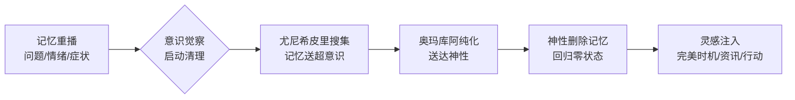

# 尤尼希皮里与内在小孩

## 核心定位：潜意识的记忆储存库与操作主体

在荷欧波诺波诺（Ho'oponopono）体系中，**尤尼希皮里**（Unihipili）是「内在小孩」的夏威夷语称呼，代表**潜意识**，是整个心灵架构中的记忆储存库与体验投射器。它不仅保存个人此生以来的记忆，更累积了宇宙诞生至今所有生命体、矿物乃至非生命形式的体验记忆。

### 记忆重播机制

- **问题本质**：我们眼前遭遇的一切「问题」（人际冲突、疾病、财务困境、情绪困扰），本质上都是尤尼希皮里将储存的记忆**重播**在意识屏幕上。
- **数据量差距**：尤尼希皮里每秒处理 **1,500 万比特** 记忆，而意识（尤哈尼）每秒仅能知觉 **15 比特**；绝大多数驱动人生的记忆运作完全在觉察之下。
- **无外在因果**：问题不在外境（他人、环境、事件），而在「看到并体验到这个现象的、自己内在的重播记忆」。朋友失去自信、自己感到格格不入，首要清理的是「在我眼里对方呈现这个样子」的认知记忆。

> **关键判准**：莫娜女士反复强调：「对，所有事情的责任都在自己。全都是在自己内在发生的。」

## 三位一体架构：尤哈尼 / 尤尼希皮里 / 奥玛库阿

| 角色 | 夏威夷语 | 对应心理层级 | 核心功能 |
|------|----------|--------------|----------|
| **母亲/意识** | **Uhane (尤哈尼)** | 顯意識/理智自我 | 发起清理、表达爱意、依灵感行动、持续清理 |
| **内在小孩/潜意识** | **Unihipili (尤尼希皮里)** | 潜意识/记忆库 | 储存并重播记忆、操控身体、搜集清理素材、传递灵感管道 |
| **父亲/超意识** | **Aumakua (奥玛库阿)** | 超意识/高我 | 接收清理请求、纯化记忆、连接神性、回传灵感 |

**合一状态**：三者融为一（One）时，即遇见「真正的自己」，零极限（Zero Limits）状态显现，灵感自由流动。

## 100% 责任原则：清理的起点与基石

> **修·蓝博士**：「假设有人在你面前跌倒，这时就应该认为这件事的责任百分之百在你自己。到底是自己内在的哪一个记忆让对方跌倒？你不知道原因，也没有了解的必要。但必定曾经发生过什么事情，现在内在小孩将当时的记忆重播出来……你能做的是清理！」

- **不查因果**：无需探究「为什么」，因真正原因唯有尤尼希皮里知晓，意识绞尽脑汁只会阻碍清理。
- **全境清理**：自己、家人、朋友、邻居、陌生人、新闻灾害……凡经由「我」体验的，皆为「我」的记忆重播，皆可清理。
- **切断阿卡索连线**：咨询/互动后主动清理与对方的共享记忆，避免残留记忆再次重播。

## 与内在小孩建立关系：对话范例与实操细节

### 日常问候与关怀

> **吉本芭娜娜**：「我为你准备了一个袋子，里面装了各种东西，以便在必要的时候取用。」
> **修·蓝博士**：「睡前或起床时问内在小孩：『明天需要什么？』凭灵感放入糖豆、银杏叶等。」

### 情绪浮现时的标准对话流程

```text
意识（我）："哇！现在我的心里出现这样的情绪。它的力量非常可怕……
好的！因为以前也有过这样的记忆。谢谢你显示给我看。
我们一起进行清理吧！我爱你。"
```

### 事前清理模板（KR女士实操）

```text
"喂，喂，跟我一起来清理吧！
我们将与XX谈话，过程中无论产生什么紧张、疼痛、痛苦，
我们都有放下它们的机会！
基本用四句话，之后再用『冰蓝』如何？"
```

### 关键态度

- **像母亲疼幼儿**：尽最大努力让内在小孩不受苦、不疲惫、不被忽视。
- **不期待结果**：期待即交易，会伤害内在小孩；「没有小孩希望获得必须经过交易才能建立的亲子关系」。
- **即时响应**：内在小孩显示记忆的当下即清理，不拖延「以后有空再做」。
- **幽默自在**：KR女士：「能对话是非常棒的，因为自问自答是充满幽默、快乐的事。」

## 聆听与道歉：清理的核心微操作

### 聆听身体——尤尼希皮里的直接语言

> **KR女士**：「内在小孩掌管了我们的身体……当彼此关系改善时，你自然就能够了解这些事情（该不该休息、吃什么、怎么运动）。」

| 身体信号 | 尤尼希皮里的讯息 | 清理动作 |
|----------|------------------|----------|
| 疲惫、不舒服、疼痛 | 记忆重播正在发生/需要清理 | 立即默念工具（四句话/冰蓝/蓝色太阳水等） |
| 想喝水、想动、想睡 | 灵感指引当下最适宜行动 | 顺从执行，不被理智干涉 |
| 按摩/穴位疼痛显现特定议题 | 家人烦恼/旧创伤以身体投射 | 边体验边清理，不压抑、不戏剧化 |

### 道歉与感谢——修复关系的四句话语法

> **修·蓝博士**：「不带感情也无妨，只须像按下计算机的删除键一样单纯默念。」

| 短句 | 深层含义 | 操作提示 |
|------|----------|----------|
| **谢谢** | 感激记忆浮现给清理机会 | 即使是痛苦记忆也说谢谢 |
| **对不起** | 承认长期忽视/虐待内在小孩 | 发自内心，非形式化 |
| **请原谅** | 请求原谅过去的独裁支配 | 包含「不知道」也需清理 |
| **我爱你** | 总括前三句，重启连接 | 可单独使用，但需配合觉察流程 |

**进阶用法**：KR女士示范——「说完一件事，接收内在小孩反应，再清理下一件」，像剥洋葱层层深入，最终获得「回乡下」等灵感指引。

## 清理工具箱：从四句话到具象意象

| 工具 | 形式 | 适用场景/特性 |
|------|------|---------------|
| **四句话** | 语言默念 | 通用基础工具，随时随地可用 |
| **蓝色太阳水** | 饮用/泼洒 | 大幅提升清理理解，对风湿、肌肉紧绷、忧郁记忆有效 |
| **冰蓝** | 意念/触摸植物 | 清理灵性/物理/经济/物质疼痛、残酷虐待记忆 |
| **金鼓** | 想象金鼓旋转/触摸 | 解放封闭/诅咒/虐待，促进意识-潜意识交流 |
| **鼓棒** | 想象敲击 | 保持神性节奏，助进化，可配合金鼓 |
| **蓝色的网** | 想象滤网 | 捕捉想法/记忆并立即转化，任何场合可用 |

> **新工具来源**：本书写作期间，修·蓝博士与KR女士持续清理，获灵感新增「金鼓、鼓棒、蓝色的网」三工具赠予读者。

## 内在小孩对身体健康的具体影响机制

1. **身体=记忆结晶**：今日身体是追溯数百世代历史、累积记忆的产物；蛋白质等物质成分只是表象，根源是记忆。
2. **症状=清理邀请**：高血压、糖尿病、癌症等，皆为尤尼希皮里为消除特定记忆而投射的体验机会。
3. **双轨并行**：
   - **物理层面**：医疗、饮食、运动（处理重播结果）
   - **灵魂层面**：与尤尼希皮里清理地球诞生以来累积的记忆源头（处理重播原因）
4. **临床佐证**：科罗拉多大学、夏威夷大学将荷欧波诺波诺纳入高血压治疗，1-2个月血压显著下降。
5. **医者自疗**：医生/治疗师必须同步清理「面对病患」的自身记忆，否则无法从根本解决。

## 内在小孩对人际关系的投射与转化机制

- **镜像法则**：你不关心内在小孩，别人也不会关心你；最不关心别人的其实是你自己。
- **关系即共享记忆**：糖尿病女士案例——清理「怨恨丈夫」记忆后，糖尿病痊愈且关系比前更好。
- **切断连线**：互动后清理共享记忆（阿卡索连线），防止旧记忆重播污染新互动。
- **零状态下的关系**：无记忆执着，因灵感而生的「美好关系」，各司其职如肝脏肾脏般和谐。

## 内在小孩作为灵感管道：从记忆到零到灵感



- **直觉≠灵感**：直觉=过去记忆重播觉得可用；灵感=零状态下神性传来的完美通知。
- **灵感特质**：不受过去束缚、完美时机、带来富足/健康/人际/创作的最优解。
- **清理即开闸**：持续清理→尤尼希皮里腾空→光（神性）进入→灵感流动。

## 零极限状态与「我的平静」：最终判准

| 状态 | 内在小孩表现 | 意识体验 | 外在投射 |
|------|--------------|----------|----------|
| **记忆满载** | 疲惫、萎缩、混乱、抗拒 | 焦虑、努力无效、情绪风暴 | 问题不断、关系紧张、疾病 |
| **清理中** | 逐渐信任、主动呈现记忆 | 恍然大悟、幽默、轻安 | 奇迹同步、压力减轻、流畅 |
| **零极限** | 与意识合一、自由快乐 | 平静、无需控制、灵感导航 | 完美呈现、各得其所、无业力 |

> **修·蓝博士**：「真正的平静不会让别人感觉不对劲，不需特别重视效率便能自然以极佳效率运作，还能帮到别人。」
> **莫娜女士桌牌**：「平静由我开始——问题不在对方，而在自己的内在。」

## 进阶议题：清理「向往」与拆除「框架」

| 隐性障碍 | 本质 | 清理策略 |
|----------|------|----------|
| **向往/羡慕** | 重播「渴望某事」的记忆，非真指南针 | 同等清理，不沉溺「心头小鹿乱撞」的虚假平静 |
| **框架/限制信念** | 父母/生活圈植入的「不可能」设定（如「我不会没计划旅行」） | 察觉即清理；微调外在（染发/剃头）可破框架，根本仍靠清理 |
| **思考习惯/业** | 爱绫称「记忆」为「思考习惯」；芭娜娜言「不做违心事即无业」 | 每日清理习惯性思维，依循灵感而非记忆行动 |

## 实践速查卡：每日与尤尼希皮里同行

| 时刻 | 动作 | 关键句/工具 |
|------|------|-------------|
| **醒来** | 问候、询问所需 | 「早安，今天需要什么？」「我爱你」 |
| **出门前** | 事前清理行程/人/地/物 | 「喂，跟我一起清理吧！」「冰蓝」 |
| **情绪起** | 即时觉察+清理 | 「哇！这情绪好强。谢谢显示。我爱你」 |
| **身体感** | 顺从/清理 | 累→休息；痛→冰蓝；想喝水→喝水 |
| **互动中** | 心中同步清理对方/关系 | 「切断阿卡索连线」「四句话」 |
| **决策点** | 请求灵感而非思考 | 「请给我灵感」「金鼓/蓝色的网」 |
| **睡前** | 回顾感谢、托付 | 「今天辛苦了，我爱你」「蓝色太阳水」 |

## 交叉引用延伸阅读

- [[零极限与荷欧波诺波诺体系]] — 四句话清理、零状态、蓝图灵感、三大核心原则的系统总览
- [[第五真言我原谅自己]] — 第五真言「我原谅自己」的语法反常含义、替代四句话的清理用法、情绪疗愈与丰盛应用
- [[框架与向往的清理]] — 对谈中「框架」「向往」作为核心清理对象的深度拆解、以乐趣为判断依据的实践法
- [[灵魂的出生前计划]] / [[从未知中解脱]] — 罗伯特·舒华兹出生前计划视角下的记忆/业力/灵魂小组机制对照
- [[EFT情绪释放技巧]] / [[EFT情伤疗愈实作]] — 敲拍穴位与肯定句处理情绪记忆的身体导向互补技法
- [[仁神術]] / [[soham-healing-system]] — 安全能量锁/三一能量流与尤尼希皮里操控身体的能量解剖对应

---

**核心一句话**：**尤尼希皮里（内在小孩）是记忆的守门人、身体的管家、灵信的管道；唯有以母亲般的爱持续清理，三位一体合一，零极限显现，人生始能活出原本的完美蓝图。**

## 来源

- [内在小孩](../sources/内在小孩.md)
