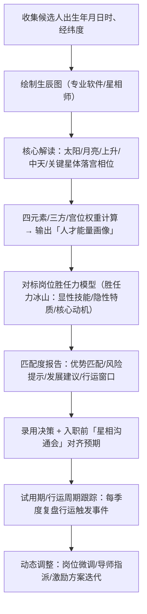

## 核心理念

- **心理星相学 ≠ 算命**  
  根据《[[十二星座成功密码]]》前言，心理星相学以「自我认识」为出发点，将生辰图视为个体独一无二的「种子潜力图」，而非宿命预言。其目的是帮助个体**理解自身动机、优势与劣势**，进而做出更符合本质的职业与人生选择。

- **「认识你自己」是成功的基石**  
  书中引用吉姆·柯林斯《从优秀到卓越》与马斯洛需求层次理论，指出**性格、思维方式、灵魂商数**等内在特质决定了能否「从优秀到卓越」。生辰图能精准回答「你在什么领域能成为世界顶尖」「什么驱动你」「什么让你持续热情」三大核心问题。

- **顺天应人、和谐共生**  
  星相学与《易经》同源，皆遵循「天人合一」的和谐原则。在商业语境下，即**依据个体先天气质安排岗位、配置团队、制定领导策略**，实现「人尽其才、地尽其利」。

> 交叉引用：[[12星座人性攻略]]、[[星座三原型与四正]]、[[占星书籍目录与主题导航]]

## 生辰图作为人才画像工具

| 维度 | 说明 | 职场应用价值 |
|------|------|--------------|
| **十大星体**（太阳、月亮、水星、金星、火星、木星、土星、天王星、海王星、冥王星） | 代表不同心理能量：自我核心(太阳)、情感需求(月亮)、思维沟通(水星)、价值审美(金星)、行动动力(火星)、扩展成长(木星)、规则边界(土星)、变革创新(天王星)、共情灵性(海王星)、深度转化(冥王星) | 识别候选人核心驱动力、沟通风格、抗压模式、创新潜力 |
| **十二宫位** | 对应生活/工作领域：命宫(自我形象)、财宫(资源获取)、兄弟宫(沟通协作)、父母宫(权威关系)、子女宫(创造表达)、奴仆宫(服务执行)、夫妻宫(合作伙伴)、疾厄宫(风险应对)、迁移宫(外拓发展)、官禄宫(事业成就)、福德宫(团队文化)、相貌宫(外部形象) | 精准映射岗位关键胜任力区域（如官禄宫落火星者适合高压销售/创业） |
| **相位**（合相、六分相、四分相、三分相、对冲） | 星体间能量互动：和谐(六分/三分)表示天赋易施展；张力(四分/对冲)提示成长课题与潜在冲突 | 预判团队协作化学反应、领导与下属磨合点、跨部门沟通隐患 |

> 《[[十二星座成功密码]]》强调：「生辰图是一个人独有的如同指纹一样的记载……即使两个星座相同的人，由于出生地点和时间不同，他们除了太阳坐落在同一星座上之外，其他星座、行宫等等都会不同。」

## 星座特质与岗位匹配

### 四元素 × 三方框架
| 元素 | 三方 | 典型星座 | 核心职场优势 | 适配岗位示例 |
|------|------|----------|--------------|--------------|
| **火** | 基本/固定/变动 | 白羊、狮子、射手 | 主动开拓、愿景感召、快速行动 | 创业者、项目发起人、危机公关、高强度销售 |
| **土** | 基本/固定/变动 | 金牛、处女、摩羯 | 执行落地、资源管控、风险把控 | 财务、运营、供应链、质量管理、长周期研发 |
| **风** | 基本/固定/变动 | 双子、天秤、水瓶 | 信息连接、方案设计、跨界协同 | 战略咨询、产品经理、公关传播、组织发展 |
| **水** | 基本/固定/变动 | 巨蟹、天蝎、双鱼 | 情感洞察、深度信任、文化塑造 | HRBP、客户成功、品牌故事、心理辅导、创意策划 |

### 单星座关键画像（节选自《[[十二星座成功密码]]》）
- **白羊座**：先锋、果断、高能量、短平快 → 适合「开拓期业务、应急小组、外科医生、军警」  
- **金牛座**：稳健、持久、物质敏感、审美驱动 → 适合「银行、会计、室内设计、美食研发、园艺」  
- **双子座**：信息枢纽、多线程、沟通润滑 → 适合「媒体、培训、售前工程师、社群运营」  
- **巨蟹座**：共情护佑、内部凝聚、风险预警 → 适合「员工关怀、客户服务、家庭办公室管理」  
- **狮子座**：舞台魅力、授权激励、品牌代言 → 适合「市场总监、品牌大使、演艺经纪、高层发言人」  
- **处女座**：流程优化、质量把关、细节控制 → 适合「QA、合规、数据分析、精益生产」  
- **天秤座**：利益平衡、谈判美学、外部联盟 → 适合「BD、法务、外交事务、高端销售」  
- **天蝎座**：深度洞察、危机重组、核心机密 → 适合「风控、并购整合、情报分析、转型项目」  
- **射手座**：战略视野、跨文化、信仰驱动 → 适合「海外拓展、高教培训、思想领袖、风投」  
- **摩羯座**：架构搭建、长期主义、权威建立 → 适合「CEO/COO、政府事务、基建、家族办公室」  
- **水瓶座**：制度创新、网络效应、去中心化 → 适合「技术架构、开源社区、未来实验室、ESG」  
- **双鱼座**：想象共情、服务奉献、边界模糊 → 适合「公益、艺术治疗、用户体验设计、灵性导师」

> 交叉引用：[[十二星座基本特质与经典排行]]、[[星座三原型与四正]]、[[人际关系占星全书]]

## 老板/员工互动模式

| 角色 | 典型领导风格（太阳/上升/中天星座为主） | 激励触点 | 易发冲突场景 | 应对策略 |
|------|------------------------------------------|----------|--------------|----------|
| **白羊座老板** | 雷厉风行、短平快、英雄主义 | 给自主权、设挑战性KPI、即时反馈 | 缺乏耐心听汇报、忽视细节、情绪爆发 | 「结论先行、细节附后」；设专人跟进执行落地 |
| **金牛座老板** | 稳扎稳打、数据导向、重承诺 | 长期激励(股权/年金)、可量化指标、物质奖赏 | 抗拒变革、决策慢、授权不足 | 用「试点+数据」推动变革；建立标准化汇报模板 |
| **双子座老板** | 思维发散、多线并行、喜新厌旧 | 多样化项目轮换、知识分享会、灵活工时 | 方向频繁切换、交付碎片化 | 设「首席执行官助理」聚焦落地；周会锁定核心三件事 |
| **巨蟹座老板** | 家文化、护短忠诚、情绪敏锐 | 归属感仪式、关怀福利、内部晋升 | 决策受情绪波动、难以开除低绩效 | 引入客观绩效仪表盘；HR 伙伴协助艰难对话 |
| **狮子座老板** | 聚光灯下授权、愿景感召、面子至上 | 公开表彰、品牌共建、舞台机会 | 过度中心化、忽视幕后执行 | 设「副将」分管执行；定期复盘「愿景-落地」差距 |
| **处女座老板** | 标准化、吹毛求疵、服务导向 | 完美主义认可、技能认证、流程改进奖 | 微管理、批评多赞美少 | 建立「红绿灯」汇报机制；只汇报异常与风险 |
| **天秤座老板** | 平衡协调、外联内稳、犹豫决策 | 公平薪酬、跨部门联动、美学环境 | 两头讨好、关键节点拖延 | 设「决策截止日」；引入第三方裁决机制 |
| **天蝎座老板** | 深度授权、危机掌控、核心圈层 | 绝对信任、利润分享、保密特权 | 猜疑、报复性人事、信息黑箱 | 透明化关键指标；建立「阳光人事档案」 |
| **射手座老板** | 宏大叙事、宽容试错、抗细节 | 愿景共创、海外轮岗、思想自由 | 战略落地断层、合规盲区 | 配「落地型 COO」；合规红线前置 |
| **摩羯座老板** | 制度架构、长周期考核、权威清晰 | 晋升通道、养老保障、荣誉体系 | 僵化、不容异议、压榨边际效用 | 引入「创新沙箱」；设「反脆弱预算」 |
| **水瓶座老板** | 去中心化、规则实验、社群共治 | 自治预算、开源贡献、声誉积分 | 执行力松散、责任主体模糊 | 关键节点设「单一问责人」；OKR 对齐 |
| **双鱼座老板** | 灵性文化、共情服务、边界模糊 | 使命感召、艺术空间、心理支持 | 缺乏刚性考核、资源分配随性 | 引入「财务管控合伙人」；设最低绩效底线 |

> 《[[十二星座成功密码]]》逐星座列出「老板领导风格」「职员心态」「激励环境」「重用时机」「离职信号」，可直接映射为管理手册章节。

## 规避“错位”风险的决策依据

1. **错位定义**  
   「一个不合适的人被放在错误的位置上，带来了最糟糕的结果」（《[[十二星座成功密码]]》）。典型表现：高离职、低绩效、团队内耗、客户投诉。

2. **生辰图+胜任力模型双轨验证**  
   - **硬指标**：学历、技能证书、过往业绩（传统 JD 匹配）  
   - **软内核**：太阳/月亮/上升星座落宫、核心相位、行运触发期  
   - **交叉比对**：如岗位需「高抗压+细节把控」（土象基本宫），候选人太阳落白羊(火象基本宫)且土星相冲月亮，需安排「压力测试+导师带教」或调岗。

3. **行运窗口期决策**  
   - **木星回归/相合**：扩张期，适合晋升、跨岗挑战  
   - **土星回归/刑冲**：结构化考核期，适合岗位沉淀、制度建设  
   - **天王星相冲**：变革期，适合轮岗创新、裁撤冗余  
   - **冥王星相合**：深度转型期，适合核心人才保留、股权激励

4. **实证案例**  
   - **保险业车祸统计**（瑞士）：天蝎、狮子座出险率显著低于均值，承保定价可引入星座风险因子。  
   - **CIA/以色列情报机构**：关键人选前需星相学家评估「忠诚度、抗压、保密」相关宫位配置。  
   - **法国高管招聘**：结合笔迹学与生辰图双重筛选，降低「面试高分、入职失配」比例。

## 实战应用流程（SOP）

## 交叉引用索引

- 核心理论来源：[[十二星座成功密码]]、[[12星座人性攻略]]、[[星座三原型与四正]]、[[十二星座基本特质与经典排行]]
- 关系合盘与团队化学反应：[[人际关系占星全书]]、[[人际合盘占星全书]]、[[人际相位圣经]]、[[人际缘分全占星]]
- 进阶宫位/行运实务：[[占星书籍目录与主题导航]]、[[整宫制与十二宫位]]、[[行运行星与社会风向]]
- 跨学科印证：[[九型人格]]、[[迈尔斯-布里格斯人格类型]]、[[大脑可塑性与五大迷思]]、[[幸运实验室]]

---

> **使用提示**  
> 本框架为**决策辅助工具**，不可替代结构化面试、背调、实战考核。请遵循「星相洞察+实证验证」双轨原则，尊重候选人隐私与劳动法合规。

## 来源

- [十二星座成功密码](../sources/十二星座成功密码.md)
