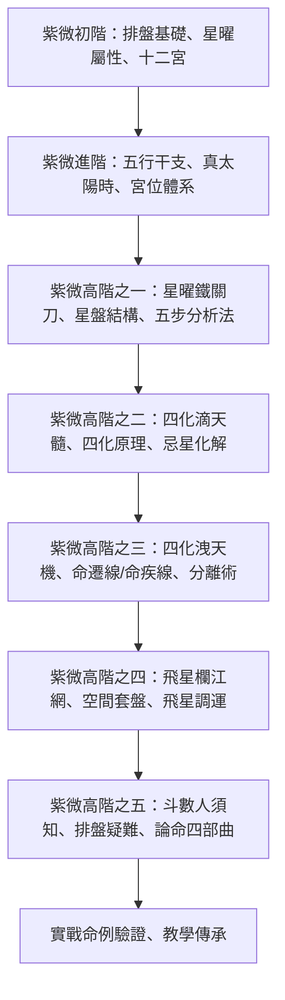

## 書目概覽

《紫微高階之五·斗數人須知》為勸學齋主蔡增宏（壬寅年序於高雄）紫微高階系列第五冊。書名藉取明朝徐善繼《地理人子須知》之意，旨在輯錄作者一生斗數研究中所認定的重點與疑點、斗數秉持原理、論命目的價值及論命路徑。全書分為四大章節：紫微斗數來源、排盤重點與疑點、論命重點與造命價值、論命進行曲（實戰四部曲）。

## 第一章 紫微斗數的來源

### 明澄派與透派
- **明澄派**第十三代張耀文《五術占卜全旨》記載：明朝奇女子梅香開創「透派」，明澄即明朝澄派，澄與透詞意相關。
- **南北派差別**：北派論節氣以月令排盤；南派只論月份不論節氣。例如十月初生，北派屬九月令命宮在卯，南派命宮在辰。
- **傳播脈絡**：張耀文全家移民日本（改姓川島），大弟子阿部泰山在日本執業。早期台灣斗數書多譯自日文版（張耀文徒子徒孫著作），激發南派老師出現。

### 陳希夷祖師
- **道藏經載**：唐代呂純陽創紫微斗數，以八卦太極為中心分十二宮，代入農曆年月日時推研造化。
- **傳承說法**：呂洞賓傳麻衣道者 → 陳摶（希夷）；或麻衣道者再傳陳搏。陳希夷集睡功大成，仙家分五派，南北派皆有往來。
- **改良說**：七政四餘為帝王之學不傳民間，陳希夷據此改編成紫微斗數；或改良《果老星宗》而成。無正史記載。
- **可考著作**：《人倫大統賦》、《河洛理數》、《神相金編》、《河洛真數》。

### 紫微斗數古籍
- **嘉靖版《紫微斗數全書》**（1550年）：明進士羅洪先（王陽明弟子）序推薦，稱陳希夷十八代孫出示。台灣竹林書局版保留木刻原貌；進源書局版重排加標點；大陸中州古籍出版社版為簡體字。
- **其他古籍**：
  - 1935年觀雲主人王裁珊《紫微斗數宣微》（北派）
  - 王亭之八卷樓鈔本（民間流傳增刪改易）
  - 《遊藝錄》（武陵出版社出版，僅排盤資料無論斷）
  - 《紫微斗數全集》《紫微斗數捷覽》（1581年）
  - 清道光進士俞樾《群經平議》《諸子平議》《古書疑舉例》
- **北派現存**：香港樹勤出版社林真秘藏《北派道家紫微斗數》與台灣陳岳鈴《北派紫微斗數》內容相同，排盤星曜與現代南派完全不同。

### 南派與北派分類
| 派別 | 代表 |
|------|------|
| **北派** | 真藏本、陳英華紫微斗數 |
| **南派中的北派** | 明澄派、觀雲主人 |
| **南派中的南派** | 現代通行斗數（勸學齋體系屬此） |

> 作者僅依結構不同分派別，不敘述近數十年自命祖師與派別。

## 第二章 斗數排盤的重點與疑點

### 一、出生資料準確性
- **核心原則**：生辰資料不準 = 拿路人甲命盤論自己命。古代計時工具不發達，陳希夷歌訣有「不準但用三時斷，時有差誤不可憑」。
- **驗證法**：報午時生 → 排午、巳、未三盤驗證。
- **出生地影響**：地球自轉、太陽照射角度不同，陰陽五行之氣不同。必須校對**真太陽時**（Local Apparent Solar Time）。
- **時區換算**：
  - 理論時區：以格林威治為零時區，每15度一時區（1小時），每1度=4分鐘。
  - 法定時區：為政治經濟理由調整（如中國全境用北京時間UTC+8，實際東經112.5度以西屬UTC+7）。
  - **校正步驟**：法定時區 → 理論時區 → 真太陽時（東加西減，一度四分鐘）。
- **夏令時間**：各國實施夏令時間者，排盤須還原至標準時間（如美加三月第2周日啟動，十一月第1周日結束）。

### 二、子時早晚子問題
- **古代計時**：圭表、日晷（太陽鐘）、刻漏（水/沙驅動）、渾天儀。官方五更制：初更戌、二更亥、三更子、四更丑、五更寅。
- **十二時辰細分**：北宋始分「初、正」為二十四時。西洋24小時制傳入後，子時對應23:00-01:00。
- **作者主張**：**子時一律算新的一天**（23:00起屬翌日），不分早晚子。理由：將子時分屬兩天百思不得其解。
- **時辰氣質**：氣轉換如漸層，初刻雜前氣、末刻雜後氣、中刻氣最純。剖腹產擇日規定在進氣與氣純的20分鐘（如前半時辰）。

### 三、閏月排盤與論命
#### 閏字由來
- 「四合院」祭神：十二月對應十二間房，閏月多出一月無專房，只能在「門」中祭祀 → 「王在門中」即閏字。
- 閏月 = 多餘之月；「三年一閏、五年兩閏」約數，實為「十九年七閏」（梅托尼克週期）。

#### 閏月設置規則
- **陽曆閏年**：回歸年365.2422天，四年一閏日（2月29日），百年不閏、四百年再閏。
- **陰曆閏月**：以月亮望朔計月（354天），比陽曆少11天。用**二十四節氣**調整：某月無中氣（只得入節）即置閏月，稱「閏X月」。

#### 作者閏月排盤法
| 出生時間 | 排盤依據 |
|----------|----------|
| 閏月15日亥時（含）以前 | 比照該月排盤（如閏五月十五日亥時 → 五月盤） |
| 閏月16日子時（含）以後 | 比照次月排盤（如閏五月十六日子時 → 六月盤） |

> 月系星（左輔右弼天刑天姚等）隨比照月份變動，年干系星、年支系星、時系星不變。

#### 閏月論命（流年流月）
- 採**流年斗君為正月**起排流月。
- 閏月處理：**「換宮不換干」**（閏月與次月同宮位，用原流月干），次月**「換干不換宮」**（同宮位換用次月流月干）。
- 例：2020庚子年流年斗君在戌（夫妻宮），正月起順行。閏四月在寅，流月干仍為辛（換宮不換干）；五月仍在寅，流月干換為壬（換干不換宮）。

### 四、火星及鈴星排法異同
| 排法類別 | 子時起宮口訣 | 是否順數至生時 | 代表著作 |
|----------|--------------|----------------|----------|
| **甲類** | 寅午戌火丑鈴卯 / 申子辰火寅鈴戌 / 巳酉丑火卯鈴戌 / 亥卯未火酉鈴戌 | **不順數**（定年支三合即定位） | 嘉靖版《紫微斗數全書》（伊力點校）、梁湘潤《四系大辭淵》 |
| **乙類** | 同上 | **不順數**，但巳酉丑火戌鈴卯 | 謝繁治《周易與紫微斗數》 |
| **丙類** | 同上 | **順數至生時** | 觀雲主人《宣微》、陸在田《評注》、破空《易性根源》、天滴子《詳解》、天乙上人《真訣》、李達威、余雪鴻、張寶丹、顧祥弘、張耀文《五術占卜金書》、廣照禪群 |
| **丁類** | 巳酉丑火戌鈴卯（與乙類同），其餘同甲類 | **順數至生時** | 南北山人《明版今註》、阿部泰山、吳情、俞樾《遊藝錄》 |

#### 作者綜論
1. **尚無確論**，須再考究。火鈴位置牽涉火貪格、鈴貪格。
2. 作者一向採用**丙類（順數法）**，論火貪鈴貪皆驗。
3. 俞樾《遊藝錄》（清刻本）亦順數至生時，與文誠堂版（不順數、巳酉丑位置相反）矛盾，為待釐清問題。

### 五、天馬星有兩種
- **命馬（年馬）**：以**生年地支**排。代表著作：梁湘潤、觀雲主人。
- **月馬**：以**生月地支**排。代表著作：張耀文、觀雲主人、南北山人、陸在田、破空、天滴子、天乙上人、李達威、余雪鴻、張寶丹、顧祥弘、阿部泰山、陸斌兆/王亭之、廣照禪群。
- **流年馬**：以流年地支排。
- **作者結論**：兩種排法**都有作用**，決定雙重使用。為免口語混淆，將「年馬」定名為「命馬」。

### 六、空星之我見
#### 空星分類（共七顆）
1. **天空**：生肖宮位順前一宮（子年天空在丑）。屬年支系星，**不應與地劫同組合**。
2. **地空、地劫**：十天干配十二地支，每旬剩兩支為空亡（旬空/旬中空亡），必佔兩宮。
3. **截路空亡（截空）**：入陽宮甲年起申逆行；入陰宮甲年起酉逆行。亦佔兩宮。

#### 作者採用原則：**去除小空留大空**，只留**天空、地空、地劫**三顆。

#### 空星特性與運用
- **金空則鳴？** 作者未採用（見火星逢空一生未發案例）。
- **旬空速算法**：以生日干支定空亡位，用於六爻卦查當日旬空、開運名片避開生日干支空亡位。
- **命坐空宮**：可塑性極高，「近朱者赤、近墨者黑」。完整說法：**容易學好，也容易學壞**（好習慣需「養」成，壞習慣易「形」成）。
- **運用策略**：空宮如空杯/空桶，嚴選優良材料注入（持續吸收學習）。孫中山三民主義、作者七書體系皆為例。
- **空宮借對宮論**：**只論內性**。遷移宮為陰/內性/遠/久，常在外奔波或年紀大才顯現。借對宮時：大小星曜、生年四化可借，**宮干自化不可借**（自化只影響對宮星性）。

### 七、天魁與天鉞正確排法
- **一般口訣**：「甲戊庚牛羊，乙己鼠猴鄉，丙丁豬雞位，壬癸兔蛇藏，六辛逢馬虎」 → 單排兩顆星，**無法符合「蓋世文章、位至台輔」古訣**。
- **古本奇門遁甲/《古今圖書集成》載**：**天魁法先天河圖，天鉞法後天洛書**，各有口訣：
  - **陽貴人（天魁）**：庚戌逢辛甲見羊，乙猴己鼠丙雞方；丁豬癸蛇壬是兔，六辛逢虎貴為陽。
  - **陰貴人（天鉞）**：甲戊庚牛羊，乙己鼠猴鄉；丙丁豬雞位，壬癸兔蛇藏；六辛逢馬虎，此是貴人方。
- 作者據此雙口訣分別排布，始符古訣效驗。

### 八、小限之我見
- **排定原則**：四墓庫起限（寅午戌起辰/申子辰起戌/巳酉丑起未/亥卯未起丑），男順女逆。
- **設立邏輯**：火局起水庫、水局起火局（水火相剋）；金局起木庫、木局起金庫（金木相剋）。
- **作者立場**：**暫不使用小限**。理由：採太歲派論流年（宇宙流行氣數），小限採該歲干支發用較呆板，未考慮流年氣數。以流年太歲論不出之事應加強功力，勿以小限事後諸葛。中限為他人說法，無權置喙。

### 九、第一大限起例
- **嘉靖版/傳統說**：陽男陰女從命前一宮（父母宮）起順行；陰男陽女從命後一宮（兄弟宮）起逆行。
- **南北山人/觀雲主人/俞樾/顧祥弘/作者**：**一律從命宮起大限**，陽男順、陰男逆、陽女逆、陰女順。作者自始採此法，論斷準確無疑。

### 十、廟旺失陷之我見
- **現況**：諸書分級不一（三級/四級/五級/七級），同星不同宮級差異極大，**無任何書說明分級理由依據**。
- **傳統論斷**：廟旺吉則大吉凶則不凶；失陷吉則無力凶則大凶。
- **作者實驗**：**無「廟旺逢忌就不凶」之剋應**，且分級無標準不一致。
- **作者觀念**：**擱置廟旺失陷論調**，待有憑據再採用。
- **替代框架**：星曜自有**星性**，入宮遇其他星曜會合（星性第一度變化），再與宮位天干/地支/納音五行及星曜藏干產生生旺退煞作用（有根有據）。引《陰陽元經》**三命支干**說：
  - 一命：干支納音同類（環境單純，非好即壞）
  - 二命：干支納音兩類（環境雙重）
  - 三命：干支納音三類（環境複雜，好中有壞壞中有好）

### 十一、庚干四化眾說紛紜
- **見過版本**：陽武陰同、陽武同陰、陽武府同、陽武輔同、陽武輔相、陽武府相、陽武同相、陽武陰曲。
- **作者認同**：**庚干陽武陰同**。
  - 反駁「陽武同陰」派：該派稱庚干陽武陰同會導致太陰兩次化科不可信，但陽武同陰會導致太陰兩次化忌，彼未解釋。
  - 作者認為太陰主清明（清潔明亮），化科有清整之意，**太陰兩次化科合理**。
  - 庚干陽武陰曲見於俞樾《遊藝錄》。
- **實戰觀察重點**：
  1. **庚干天同一定化忌**。
  2. 觀察庚干當事人**天相化忌否？**（衣著合身否，嚴重者邋遢、衣襟掉落；在大福/本福影響財運破財）。
  3. 觀察**太陰化忌否？**（住處整理乾淨整齊否，提醒當事人注重家裡整齊）。

| 干 | 祿 | 權 | 科 | 忌 |
|----|----|----|----|----|
| 己 | 武曲 | 太陰 | 天機 | 天同 |
| **庚** | **太陽** | **武曲** | **太陰** | **天同** |
| 辛 | 巨門 | 太陽 | 文曲 | 巨門 |
| 壬 | 天梁 | 紫微 | 左輔 | 武曲 |
| 癸 | 破軍 | 巨門 | 太陰 | 貪狼 |

### 十二、談斗君
#### 斗君算法（由流命推算）
1. 從**流年太歲宮位（流年命宮）起正月**。
2. **逆數至生月**所在宮。
3. 從該宮**起子時順數至生時**，即為「流年斗君」。

> 例：庚寅年，九月辰時生。寅宮起正月 → 逆數九月在午宮 → 午宮起子時順數辰時 → **戌宮為流年斗君**。
> 意即：命盤寅宮為何宮，流年斗君永在該流年對應宮（命宮→流年命宮、兄弟宮→流年兄弟宮……）。

#### 流年斗君雙重作用
1. **流年正月命宮**：流年斗君所在宮 = 該流年正月命宮，順行十二宮排流月。
2. **斗君盤命宮**：以斗君宮為命宮，自成一盤（斗君盤），另具論斷意義。

### 十三、斗數局數來源與作用
- **納音原理**：五行局即六十甲子納音五行（干支納音）。
  - 河圖洛書 → 生剋制化 → 十干五行生旺墓 → 納音五行。
- **五行局局數**：木/火/土/金/水五局，各局數不同（如木三局、火二局、土五局、金四局、水六局）。
- **記憶法**：以納音歌訣記憶六十甲子屬性。
- **特性分析**：各五行局有特定性格傾向與人生模式（木局仁義、火局禮樂、土局信實、金局剛斷、水局智慧）。

### 十四、南半球斗數排盤與論命
- **核心問題**：南北半球季節相反，節氣、干支、排盤如何處理？
- **作者主張**：**南半球依北半球年月干支退後五年半**（或對應調整）。
- **佐證**：《易經證釋》、二十四節氣南北對調。
- **四種命運模式**：北命北運、北命南運、南命南運、南命北運。旅居異半球者需依「北命南運」等模式論命。

### 十五、雙胞胎論法
- **核心原則**：**體不分，用各尋**（同盤不同命）。
- **驗證案例**：
  - 一對龍鳳胎、一對美國學生兄弟、一對姊妹。
  - 重點剖析：一美一醜、一有婚一無婚、一為財苦一有財 → 透過**大限流年細微差異**、**宮位體用**、**四化流轉**區別。
- **第二胎流年用位**：第二胎流年命宮須另推算。

### 十六、驗盤與定盤
#### 驗盤常見問題
- 出生時間不準（最常見）
- 早晚子時、閏月、夏令時間、經緯度校正錯誤
- 火鈴、天馬、空星、天魁鉞排法差異
- 大限起例差異（命宮起 vs 父母/兄弟宮起）

#### 驗盤須知
1. 先確認出生地經緯度、夏令時間、真太陽時。
2. 以**三時驗盤法**（前一時、報稱時、後一時）找出最貼切命盤。
3. 對照**已知重大事件**（婚姻、生子、疾病、破財、升遷、喪親等）反推驗證。
4. 確定命盤後，再進行四化、大限、流年詳細論斷。

## 第三章 斗數論命重點與造命價值

### 一、命理產生背景
- **何謂命理**：研究人生定數與變數、天賦與後天努力交互作用的學問。
- **為何須命理**：人生如航海，**命盤是人生地圖**，不知險阻無法趨吉避凶。
- **命理崇高價值**：
  1. 提供人生地圖，知進退存亡。
  2. **須就命盤提出消災解厄、趨吉避凶方案**（非宿命論，非單純預測）。
- **選擇問題**：命理工具選擇（紫微/八字/六壬等）、命理論述選擇（流派/師承/體系）。

### 二、斗數三要

#### 宮性
- **十二宮**：命、財、官、遷、福、田、兄、友、夫、子、疾、父。
- **十二地支定宮位**：掌上排盤法、四生/四墓/四敗宮、四門。
- **宮位干支與五行局作用**：宮位天干五行、地支五行、納音五行與星曜藏干生旺退煞。
- **五行局特性**：
  - 木局：仁義、發展、教化
  - 火局：禮樂、光明、急速
  - 土局：信實、厚重、承載
  - 金局：剛斷、決烈、收斂
  - 水局：智慧、流通、變化
- **宮星結構原理**：
  - **四正原理**：命遷官福（四正宮）為人生核心支柱。
  - **三方原理**：三方會照（對宮、財福線、兄友線、夫官線、子田線、父疾線）。
  - **六合原理**：六合宮位（子丑、寅亥、卯戌、辰酉、巳申、午未）論個人行運、人際關係。
  - **六害（穿）原理**：六害宮位論個人行運、人際關係。
- **宮位體用論**（運用極廣）：
  - 體用定義：體為主、用為輔；體靜用動、體內用外。
  - 應用：論雙胞胎（體同用異）、論六親、論股東、論桃花、論財庫、論三方四正。

#### 星性
- **核心觀點**：「星無原罪、星無吉凶」。星曜皆有正負兩面性，視宮位、四化、會合而定吉凶。
- **十四正曜正負面剖析**：
  | 星曜 | 正面 | 負面 |
  |------|------|------|
  | 紫微、天機 | 帝王、機謀、統御 | 孤高、多慮、壓抑 |
  | 太陽 | 光明、熱情、貴人 | 曝露、虛耗、急躁 |
  | 武曲、天同、廉貞 | 武曲：果斷財帛；天同：福厚享受；廉貞：執著專業 | 武曲：孤獨勞碌；天同：懶散依賴；廉貞：固執桃花 |
  | 天府、太陰 | 天府：倉庫穩健；太陰：清明智慧 | 天府：吝嗇保守；太陰：陰鬱波動 |
  | 貪狼、巨門 | 貪狼：才藝慾望；巨門：口才辯論 | 貪狼：貪婪色慾；巨門：是非口舌 |
  | 天相 | 儀容端正、輔佐 | 形式主義、依賴 |
  | 天梁、七殺、破軍 | 天梁：化解庇蔭；七殺：開創變革；破軍：突破重組 | 天梁：拖延干涉；七殺：衝動破壞；破軍：耗散重來 |
- **輔佐雜曜性質**：
  - 祿存/羊刃/陀羅：祿為財、刃為刀、陀為禍。
  - 命馬/月馬、孤辰/寡宿、空星：動、孤、空。
  - 左輔/右弼、文昌/文曲、化祿/化權/化科：扶助、文采、吉化。
  - **化忌**：核心難點，代表業力、壓力、必須面對的課題。

#### 四化之性（核心中核心）
- **比喻**：宮＝舞台，星＝演員，四化＝劇本/燈光/音效/道具。
- **剛柔並濟**：星曜與四化須剛柔並濟（如武曲化權剛、太陰化科柔）。
- **雙祿交流 vs 明暗祿交流**：
  - 雙祿：兩宮皆有祿存/化祿星，財帛雙通。
  - 明暗祿：一宮顯祿、對宮暗祿（如命宮武曲化祿、遷移宮天府化祿）。
  - 評比：明暗祿更隱蔽持久，雙祿較顯著易見。
- **祿馬交馳**：祿存/化祿與天馬同宮/會照 → 財來得快、動中求財。
- **祿最怕忌星沖破**：化忌沖破化祿/祿存 → 財來財去、勞而無功。
- **忌星入與沖**：入（坐落）為內傷、沖（對沖）為外擊。
- **一忌抵三吉**：化忌破壞力強，三吉星（祿權科）難以完全抵銷。
- **祿/科可解忌**：化祿、化科可緩解化忌壓力（趨禄避忌、以祿科解忌）。
- **忌多反吉、福星不忌**：**不可信**（實戰驗證化忌多者災厲疊加，福星照樣化忌）。
- **五福壽星全破、祿存沖破**：極度險惡格局，真要命。

### 三、論命目的與價值
- **非宿命論**：命理是「知命」而非「認命」，目的是**趨吉避凶、消災解厄、提升生命品質**。
- **靈魂視角**：參考賽斯資料，靈魂特質「不受限制、喜好自由、喜愛經驗摸索」，人生劇本由靈魂設計，斗數忌星即「己心」，《金剛經》「降伏其心」即化解忌星。
- **造命觀**：萬般帶不走，**惟有靈隨身**。福德宮為命本源（靈），研習斗數提供靈魂最好經驗摸索，交出較好人生成績。

## 第四章 斗數論命進行曲（實戰四部曲）

### 第一部曲：先了解命造格局及個性
1. **首重我宮（命宮）格局**：
   - 命宮四化格局（祿權科忌組合）。
   - 命、財、官三宮宮干四化論**動態格局**（本命四化、大限四化、流年四化三層互動）。
2. **他宮格局也要看**：十二宮各有格局，不可只看命宮。
3. **三方四正沖三方是反弓忌**：三方會照宮位若被對沖宮化忌衝擊，形成「反弓忌」，主壓力極大。

### 第二部曲：每個大限順著看一遍（迅速看出一輩子功課）
- **核心**：**忌星在哪宮特別注意**（化忌為功課核心）。
- **六大主線忌星落宮分析**：
  | 線別 | 包含宮位 | 忌星落宮代表功課 |
  |------|----------|------------------|
  | **命遷線** | 命宮、遷移宮 | 自我定位、外在發展、搬遷變動 |
  | **兄友線** | 兄弟宮、交友宮 | 手足緣、夥伴合作、社交人脈 |
  | **夫官線** | 夫妻宮、官祿宮 | 婚姻伴侶、事業職業、公眾形象 |
  | **子田線** | 子女宮、田宅宮 | 子女緣、不動產、居住環境 |
  | **財福線** | 財帛宮、福德宮 | 財富積累、精神享受、內心安寧 |
  | **父疾線** | 父母宮、疾厄宮 | 長輩緣、健康疾病、祖業蔭庇 |

- **每宮忌星詳細斷例**：書中列出大限在十二宮各化忌沖入六大線的完整排列組合（如大限在命宮化忌沖命遷/兄友/夫官/子田/財福/父疾……大限在遷移宮化忌沖六線……共72種基本組合），為實戰提供**標準化查核框架**。

### 第三部曲：論大限（四化論大限核心技法）
1. **本生年祿權科忌在大限盤哪宮最重要**：大限命宮見本命四化，定調十年基調。
2. **運用四化論大限**：大限與本命好條件合起來看（三盤疊合：本命、大限、流年）。
3. **每個大限化忌如何追論**：
   - 依**大限命宮所在本命宮位**，推導大限四化（祿權科忌）落入本命六大線。
   - 書中提供**完整查表**：大限在十二宮 × 化忌沖六線 = 72種基本斷語，再細分祿權科落宮吉凶。
   - 例：大限在本命命宮化忌到本命夫官線 → 十年婚姻/事業壓力大，需守成不宜創業。

### 第四部曲：論流年、流月
- **前提**：**先明白如何論大限，莫急於論流年**。
- **本命、大限、流年比重**：本命＝體（50%）、大限＝用（30%）、流年＝時（20%）。
- **流年流月論法**：
  - 以**流年斗君為正月**起排流月（見第二章十二節）。
  - 閏月流月：「換宮不換干」→「換干不換宮」。
  - 流年太歲干四化 → 流年宮位吉凶。
  - 流月干四化 → 觸發具體月份事件。
- **實戰原則**：大限定調、流年觸發、流月定時、流日定日（四層疊合定應期）。

## 核心概念交叉引用索引

| 核心概念 | 相關頁面 | 備註 |
|----------|----------|------|
| [[紫微斗數]] | 基礎體系 | 本書為高階實戰總結 |
| [[紫微高階之一]] | 星曜鐵關刀 | 五步分析法、星盤結構 |
| [[紫微高階之二]] | 四化滴天髓 | 四化原理、忌星化解、流年遁數 |
| [[紫微高階之三]] | 四化洩天機 | 命遷線/命疾線、分離術、河洛理數 |
| [[紫微高階之四]] | 飛星欄江網 | 飛星調運、空間套盤 |
| [[紫微斗數安星法]] | 排盤實務 | 五行局、大限起例、星曜安置口訣 |
| [[紫微斗數排盤真太陽時校正]] | 真太陽時 | 經緯度時差、夏令時間、五虎遁/五鼠遁 |
| [[紫微斗數宮位三方四正體系]] | 宮位體系 | 三方四正、四生四墓、五行局納音 |
| [[紫微斗數進階五行干支理論]] | 理論基礎 | 河圖洛書、生剋制化、納音五行 |
| [[依婷紫微講課記錄]] | 同門異說 | 真太陽時、三方四正、格局案例 |
| [[中州派紫微斗數初級講義]] | 派系對照 | 十八飛星、七政四餘、統計實證 |
| [[中州派紫微斗數深造講義]] | 進階對照 | 星曜論、六十星系、統計征验 |
| [[紫微相性理論]] | 方法論反思 | 共性與特性、命運分離原則 |
| [[紫微星盤兩大結構]] | 結構分類 | 殺破狼 vs 機巨同梁、陰陽互補 |

## 學習路徑建議

## 版本資訊
- **作者**：勸學齋主 蔡增宏
- **出版**：壬寅年（2022）季夏 序於高雄
- **系列定位**：紫微高階系列第五冊（完結冊），兼具百科全書式疑難彙整與實戰標準化流程手冊性質。

## 来源

- [劝学斋紫微高阶之五](../sources/劝学斋紫微高阶之五.md)
