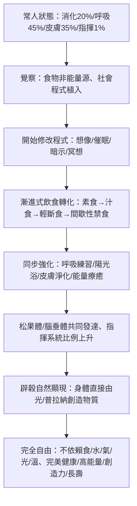

# 身體能量系統與松果體激活

> **核心觀點**：人體並非單靠食物維生，而是由四大能量系統協同運作。當指揮系統（松果體）充分發展時，身體可直接由光/普拉納創造物質，超越對食物、水、呼吸、光照與溫度的依賴。

---

## 一、四大身體能量供給系統

魏鼎在《生活可以這樣活：靈性對應性之路》中提出，從機械、能量與化學層面考量，人體由**至少四個系統同時提供能量**運轉：

| 系統 | 能量佔比 | 核心功能 | 關鍵特徵 |
|------|----------|----------|----------|
| **消化系統** | 約 20% | 將固液物質轉化為營養，提供滿足感（主要為填飽肚子後的癮症行為） | 食物實為「催化劑」而非能量源；身體耗費能量分解、中和、排泄食物；食物影響細胞資訊而非直接建構細胞 |
| **呼吸系統** | 約 45% | 透過肺供氧、排除二氧化碳，**吸收普拉納（Prana）** | 普拉納為建構物質的基本模組、光的自冷凝作用產物；瑜伽呼吸練習可增加生命能量、療癒身心 |
| **皮膚系統** | 約 35% | 人體最大器官，**呼吸、吸收普拉納、進行光合作用、合成維他命D、檢測環境、排泄毒素** | 化妝品經皮膚吸收入血毒害身體；唯可食用之物方可塗抹皮膚 |
| **指揮系統（松果體）** | 約 1% | **靈性等級在物質界的投影**，直接由光/普拉納創造身體原子與生命能量 | 松果體越活躍，身體越不需其他能量來源；完全發展時可不依賴食、水、氣、光、溫 |

> **註**：總和 101% 為估計值，個體差異極大。隨生活方式轉變（如長期靈性練習、曬太陽、哈他瑜伽），比例持續變化——指揮系統佔比可從 1% 提升至 1–100%。

---

## 二、消化系統：食物是催化劑而非燃料

### 能量守恆的悖論
- **主流迷思**：「吃得越多長得越壯」「食物提供熱量/能量」
- **實測現象**：
  - 同體重者飲食量差異極大卻同樣健康
  - 120kg 男性每日兩片麵包+兩杯咖啡體重不減
  - 大餐後反覺悶乏而非充沛
  - 強迫兒童進食導致身心結構難以挽回的傷害

### 真實機制
- 食物經消化液/酶分解為葡萄糖、胺基酸等簡單化合物
- 這些化合物進入血液抵達細胞，**攜帶「資訊/程式」影響細胞運作**
- 身體以**自身能量**合成所需物質（蛋白質、礦物質、水）
- 食物實為**催化劑**觸發特定反應，非建構原料
- 身體每日需千萬種化合物精確供給，**若不受干擾，可直接從光中合成**

### 消化系統的能量成本
- 消化與排泄耗費身體 **90–99% 生命能量**
- 辟穀者無需消化，能量釋放為常人 **9 倍以上**
- 吃得越多 → 身體負荷越重 → 衰老越快、疾病越多、壽命越短

---

## 三、呼吸系統：普拉納的主要入口

### 雙重功能
- **氣體交換**：供氧、排二氧化碳
- **普拉納吸收**：普拉納為「建構物質的基本模組，甚至實現原子的最小粒子都需要這種基本模組」

### 普拉納本質
- 原始定義與光相同
- 精微分析顯示：**普拉納是光的產物，光自冷凝作用的最初產物**
- 無處不在，透過肺（與皮膚）進入身體維持生存

### 呼吸練習效益
- 正確呼吸（如瑜伽調息法）→ 供給更多生命能量
- 具療癒身心效能
- 禁食/辟穀期間配合呼吸練習極有益處

---

## 四、皮膚系統：第二呼吸與光合作用工廠

### 多重功能整合
| 功能 | 說明 |
|------|------|
| **呼吸/氣體交換** | 與肺同樣吸收普拉納、排出氣態廢物 |
| **光合作用** | 吸收太陽光合成維他命D等物質 |
| **環境檢測儀** | 偵測溫度、濕度、黏稠度、輻射 |
| **吸收通道** | 氣態/液態物質經皮膚入血（如腸道功能） |
| **排泄器官** | 汗液、皮脂、黏液、氣體排出毒素（含重金屬、代謝廢物） |

### 皮膚吸收的毒性警示
- 化妝品（乳液、洗髮精、唇膏、蜜粉）經皮膚入血 → 循環全身毒害、增加清潔系統負擔、長年累月致病
- **判斷標準**：「能喝下去不產生不良反應」才可塗抹皮膚

---

## 五、指揮系統（松果體）：靈性等級的物理投影

### 解剖與常識的落差
| 常識觀點 | 魏鼎觀點 / 實測數據 |
|----------|---------------------|
| 出生最活躍，成人萎縮為豌豆大小，功能有限 | **成人松果體實際尺寸（未萎縮）約乒乓球大小** |
| 易患鈣化、囊腫、腫瘤 | **人體唯一不會得病的部位** |
| 僅分泌褪黑素調節晝夜節律 | **靈性等級在物質界的映射（影像）**，活躍度決定超感知覺表現 |

### 完全發展時的能力
當松果體達到乒乓球大小、高度活躍時，賦予常被視為「神蹟」的能力：
- 心靈感應、擴展感知力
- **不吃、不喝、不呼吸、不受溫度影響**
- 穿越時空、身體外形與密度變化
- 即使耳聾眼盲，所見所聞仍超越常人

### 活化機制與實測證據
- **靈性/心理練習** → 松果體變大、更活躍
- **電腦斷層掃描實測**：辟穀者松果體幾乎是常人的 **兩倍大**
- **松果體與腦垂體** 功能相輔相成，**不可人為單獨刺激松果體生長**，最好兩者共同發展

### 能量轉化模型：從「攝取」到「創造」
```
指揮系統活躍度 ↑  →  直接由光/普拉納創造身體原子與生命能量  →  對消化/呼吸/皮膚系統依賴度 ↓
```
- 松果體形狀與活躍度，**顯示個體直接用光創造物質的能力強弱**
- 當指揮系統充分發展：**不需食物、水、呼吸、光照、溫度**，身體仍能完美運轉

---

## 六、系統間的動態平衡與轉化路徑

### 生活方式對能量比例的即時影響
| 情境 | 消化 | 呼吸 | 皮膚 | 指揮/松果體 | 光/普拉納直接轉化 |
|------|------|------|------|-------------|-------------------|
| 常人（三餐飽食、少運動） | ~20% | ~45% | ~35% | ~1% | ~0% |
| 長期呼吸練習、曬太陽、仍大量進食 | ~1% | ~50% | ~45% | ~1% | ~3% |
| **辟穀者/深度靈性練習者** | **0%** | **變動** | **變動** | **1–100%** | **高比例** |

### 夏冬飲食差異的能量學解釋
- 陽光充足夏季 → 皮膚系統吸收光/普拉納增加 → 食慾自然下降
- 陰冷冬季 → 皮膚系統接收減少 → 需較多食物維持體溫與能量

### 從「程式」層面理解轉化
- **本能 = 資料 + 程式**（不思考、不創造、機械運行）
- 常人本能程式：「需定時定量進食身體才能運轉」
- **辟穀核心任務**：修改本能程式 → 「不管是否進食、時間量多寡，身體皆能正常運轉」
- 修改方法：**想像法、催眠法、暗示法**（參見 [[改變程式]]、[[催眠]]、[[潛意識重塑]]）

---

## 七、松果體激活的實修路徑與注意事項

### 自然顯現而非強迫達到
> 「辟穀並非強迫所得，而是自然顯現的，是此人所在的靈性等級提升的結果。」
> —— 魏鼎

- 辟穀是**靈性綻放的特徵**，非目標
- 真正辟穀者：**根本不需透過吃喝維持完美體型**，擁有「吃或不吃」的自由選擇權
- 區別關鍵：**是否有選擇能力**，而非是否進食

### 靈性練習自然擴大松果體
| 練習類型 | 對松果體/指揮系統的影響 | 相關頁面 |
|----------|------------------------|----------|
| **冥想/靜坐/正念** | 提升直覺連結、擴展感知、活化松果體 | [[冥想的奇跡]]、[[初学者的冥想书]]、[[佛脑]]、[[冥想正念手册]] |
| **呼吸練習/調息法** | 直接增加普拉納吸收、強化呼吸系統協同 | [[哈他瑜伽]]、[[以科学眼光看气功]]、[[斯瓦米·拉玛冥想指南]] |
| **能量療癒/靈氣/仁神術** | 平衡能量場、活化脈輪與松果體協同 | [[靈氣基础与调频]]、[[仁神術]]、[[SoHam徒手能量療癒]]、[[能量平衡]] |
| **陽光凝視/日光療法** | 皮膚與松果體同步接收光資訊、促進光合成 | [[光未来的医学]]、[[人体气场彩光学]]、[[光療氧療花精整合療法]] |
| **顯化/吸引力/意識創造** | 強化「真我即創造者」程式、直接由光創造物質 | [[显化实践与专注力训练]]、[[吸引力法则]]、[[专注意念的惊人力量]]、[[创造金钱通往丰裕之路]] |

### 禁忌與風險
- **不可人為刺激松果體生長**（如外部電磁、藥物、強制視覺化）
- 松果體與腦垂體**必須共同發展**，單獨刺激失衡
- **社會意識程式**從受孕即植入（母親飲食習慣、集體信念場），需以**獨立思考**覺察並重寫（參見 [[社會意識的影響]]、[[零极限与荷欧波诺波诺体系]]）
- 強迫禁食/辟穀 → 消瘦、甚至餓死，**違背自然程式**

### 轉化過程的常見�狀（身體清潔反應）
| 階段 | 典型症狀 | 能量學解釋 |
|------|----------|------------|
| **初期（週/月）** | 恐懼、虛弱、脫水、頭暈、噁心、體重下降、發燒、感覺寒冷、皮膚變化、關節腫脹、頭髮脫落、牙齒鬆動 | 長期毒素（重金屬、工業添加劑、代謝廢物）被動員排出，清潔系統超負荷運轉 |
| **中期** | 心態不穩、不同現實體驗、疼痛、消瘦 | 細胞層級重組、程式重寫、靈性等級提升伴隨的結構性調整 |
| **穩定期** | 完美健康、高能量、少睡眠、創造力爆發、免疫力極強 | 指揮系統主導、光/普拉納直接創造物質、毒素零累積 |

> **關鍵提醒**：症狀非「病」，而是**深度清潔與重組**；若以藥物抑制症狀 → 毒素繼續累積、清潔系統崩潰。

---

## 八、能量轉化模型的科學與哲學對照

### 量子物理視角
- **物質與能量同源**（E=mc²），可被思維影響
- 雙縫實驗/觀測者效應：**實驗結果取決於實驗者期望** → 能量/物質依賴於思維/程式
- **宇宙即程式**假說：無法證明宇宙非程式，證明宇宙是程式反而較易
- 人體 = **極精密的「程式—活力—電子—化學—機械」自我控制系統**

### 全像宇宙與大衛·波姆隱顯秩序
- 參見 [[占星學哲學基礎：波姆、混沌、榮格]]、[[量子占星學]]
- 部分包含整體 → 每個細胞含全身藍圖 → 光中含全部物質資訊
- 松果體作為「介面」從全息場調取資訊在局部顯化

### 榮格/同步性/原型視角
- 松果體對應 **「自我」原型** 的物理錨點
- 靈性等級提升 = **個體化進程** 中自我整合超越人格面具
- 參見 [[榮格心理學]]、[[同步性]]、[[個體化]]

### 顯化法則/吸引力法則/一的法則
- **真我即創造者** → 「我是意識，我創生了一切」
- 信念即程式 → 程式決定實相 → 修改程式即修改實相
- 參見 [[一的法则]]、[[吸引力法则]]、[[显化实践与专注力训练]]、[[专注意念的惊人力量]]

---

## 九、綜合應用：從「飲食奴隸」到「能量主宰」的轉化地圖



### 關鍵轉折點指標
| 指標 | 常人 | 轉化中 | 穩定辟穀/高指揮系統 |
|------|------|--------|---------------------|
| **日睡眠** | 7–9h | 4–6h | 0–3h（或不睡） |
| **飲食頻率** | 3–5餐 | 1餐/隔日/週末 | 0（或純社交/體驗） |
| **體溫調節** | 依賴環境/衣物/食物 | 耐寒/耐熱增強 | 完全不受溫度影響 |
| **免疫力** | 季節性感冒 | 少病、快癒 | 病毒/細菌不侵 |
| **創造力/直覺** | 間歇性 | 持續增強 | 瞬間洞察/共時性高頻 |
| **松果體大小** | 豌豆 | 杏仁~棗核 | 乒乓球（CT可測） |

---

## 十、相關知識頁面交叉引用索引

### 核心理論與作者
- [[辟穀與食氣主義]] — 魏鼎核心著作完整脈絡
- [[魏鼎]] — 作者生平與使命闡述
- [[真我]]、[[意識]]、[[本能]]、[[理智]]、[[直覺]]、[[靈性等級]] — 核心形而上學架構

### 能量系統與身體運作
- [[人體能量場與超感知力]]、[[光之手與人體能量場體系]] — 七層氣場、脈輪、哈拉層、核星層
- [[中脈七輪]]、[[女巫脉轮疗愈体系]]、[[脈輪淨化]] — 脈輪與松果體（頂輪/眉心輪）協同
- [[以科学眼光看气功]]、[[中脉七轮]]、[[哈他瑜伽]] — 氣功/瑜伽對能量系統的實修驗證
- [[人體氣場彩光學]]、[[光療氧療花精整合療法]]、[[光未来的医学]] — 光/色彩/氧/花精對松果體與能量場的調節
- [[全频能量花精全书]]、[[巴赫花精]] — 花精對靈性等級與程式重寫的輔助

### 程式重寫與意識轉化
- [[零极限与荷欧波诺波诺体系]]、[[第五真言我原谅自己]] — 清理記憶/程式的核心技術
- [[显化实践与专注力训练]]、[[吸引力法则]]、[[专注意念的惊人力量]]、[[创造金钱通往丰裕之路]] — 顯化法則與「真我即創造者」實踐
- [[心灵魔法显化的神经科学]]、[[显化的大脑网络与神经系统]] — 神經科學驗證顯化機制
- [[催眠]]、[[潛意識重塑]]、[[NLP]] — 程式修改的心理學工具

### 靈性進化與出生前計畫
- [[出生前计划与因果疗愈]]、[[灵魂的出生前计划]]、[[从未知中解脱]] — 靈魂層面對「辟穀/高能量狀態」的安排
- [[灵魂小组与集体出生前计划]]、[[指导灵的类型]] — 非物質指導系統對轉化的協助
- [[业力]]、[[因果法则]]、[[自由意志]] — 業力模式與飲食/能量依賴的關聯

### 科學與哲學對照
- [[占星學哲學基礎：波姆、混沌、榮格]]、[[量子占星學]] — 全像宇宙、疊加態、觀測者效應
- [[一的法则]]、[[拉資料]] — 高維視角對密度/靈性等級的定義
- [[肯·威尔伯]]、[[AQAL整合圖譜]] — 象限/層次/路線/狀態/類型整合框架定位松果體發展

### 實修方法與案例
- [[冥想的奇跡]]、[[初学者的冥想书]]、[[佛脑]]、[[斯瓦米·拉玛冥想指南]] — 系統化冥想入門
- [[SoHam徒手能量療癒]]、[[SoHam療癒氣場噴霧]]、[[SoHam技法與經絡]] — 直接作用於能量體與松果體
- [[仁神術]]、[[安全能量鎖]]、[[三一能量流]] — 日本古老能量療癒系統
- [[靈魂出體]]、[[出體信念轉化與心理氣候]]、[[靈魂出體經驗研究與生死觀]] — 意識脫離物質身體的實證
- [[三波志愿者与新地球]]、[[朵洛絲·坎農]] — 催眠回溯中高維存有對「不吃不喝」的說明

---

## 十一、結語：選擇權永遠在你

> 「我是意識，我創生了一切。」
> 「當您知道了您是什麼的時候，就可以看到並感覺到『真我在有意識地創造生命』，那麼您也就不需要什麼了。」
> —— 魏鼎

**四大能量系統**揭示了人體運作的真實機制：**消化系統只是輔助，指揮系統（松果體）才是主宰**。松果體的萎縮非生理必然，乃是**社會意識程式**與**低靈性等級**共同造成的結果。

透過**靈性練習、程式重寫、能量療癒、光/普拉納直接吸收**，松果體可恢復乒乓球大小的完整功能，使身體進入**「光維生/普拉納維生」的自由狀態**——不再被食物、水、空氣、溫度綁架，真正活出「我是意識，我創生一切」的主權人生。

**這不是理論，而是等待每個人親身驗證的可能性。**

## 来源

- [原来我还可以这样活](../sources/原来我还可以这样活.md)
